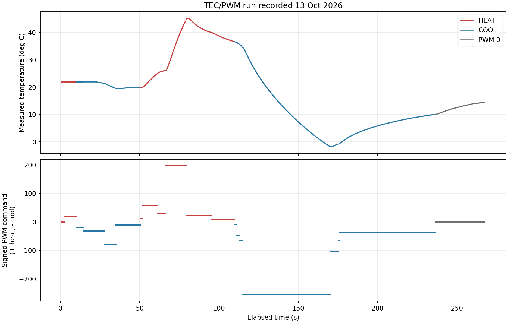
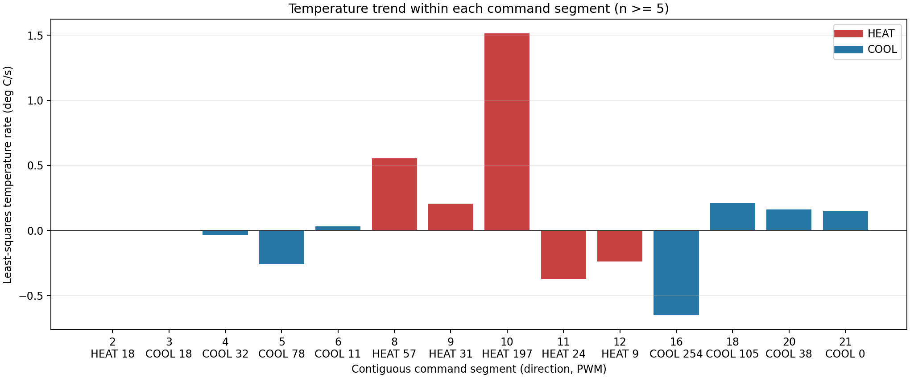

# Sammy Cohen: TEC/PWM Run Analysis, 13 October 2026

Supplemental analysis of the real-mode TEC run recorded today. This is a new report, raw-data snapshot, and pair of figures; it does not replace the existing Module 4 or Module 5 reports or source data.

## Source and Scope

The source is the dated snapshot [`tec_run_2026-10-13_sammy_snapshot.csv`](tec_run_2026-10-13_sammy_snapshot.csv), copied byte-for-byte from the GUI's live [`tec_run.csv`](tec_run.csv). It contains 524 measurements from 0.88 s to 267.10 s, a duration of 266.22 s. The median interval between measurements is 0.510 s. The temperature range is -1.87 to 45.26 deg C; the first and last readings are 21.92 and 14.37 deg C. PWM ranges from 0 to 255, and both HEAT and COOL commands occur.

The separate demo file is not used. The GUI log contains temperature, time, PWM, and direction, but not measured current, voltage, or ambient temperature.

## Graphs





In the time-series figure, positive signed PWM means HEAT and negative signed PWM means COOL. The grey segment is PWM 0.

## Method: Averages and Rates

The run has 21 contiguous command segments, defined by a change in PWM or direction. Fourteen segments have at least five readings; those are included in the rate table. For each included segment:

```text
average temperature = sum of segment temperatures / number of readings
endpoint rate = (last temperature - first temperature) / (last time - first time)
```

The plotted trend rate is the least-squares line slope through all readings in the segment:

```text
m = sum[(t_i - mean(t)) * (T_i - mean(T))] / sum[(t_i - mean(t))^2]
```

The least-squares slope uses every sample and is less sensitive than a two-point endpoint rate to the first and last readings. These segments are short transients, not confirmed steady states; their averages and slopes describe this run only.

## Segment Results

| Segment | Time (s) | Command | N | Sum T (deg C) | Mean T (deg C) | Endpoint delta T (deg C) | Fitted rate (deg C/s) |
|---:|---:|---|---:|---:|---:|---:|---:|
| 2 | 2.92-9.54 | HEAT, PWM 18 | 14 | 306.8800 | 21.92000 | 0.00 | 0.00000 |
| 3 | 10.05-14.11 | COOL, PWM 18 | 9 | 197.2800 | 21.92000 | 0.00 | 0.00000 |
| 4 | 14.62-27.34 | COOL, PWM 32 | 26 | 567.3000 | 21.81923 | -0.52 | -0.03450 |
| 5 | 27.89-34.50 | COOL, PWM 78 | 14 | 286.9200 | 20.49429 | -1.67 | -0.25894 |
| 6 | 35.01-49.76 | COOL, PWM 11 | 30 | 591.1800 | 19.70600 | +0.35 | +0.03236 |
| 8 | 51.83-60.99 | HEAT, PWM 57 | 19 | 426.7800 | 22.46211 | +4.90 | +0.55539 |
| 9 | 61.50-65.57 | HEAT, PWM 31 | 9 | 230.9700 | 25.66333 | +0.88 | +0.20560 |
| 10 | 66.08-78.80 | HEAT, PWM 197 | 26 | 910.9900 | 35.03808 | +18.06 | +1.51463 |
| 11 | 79.31-94.57 | HEAT, PWM 24 | 31 | 1317.0900 | 42.48677 | -4.63 | -0.37260 |
| 12 | 95.08-109.33 | HEAT, PWM 9 | 29 | 1109.6500 | 38.26379 | -3.33 | -0.23772 |
| 16 | 114.97-167.37 | COOL, PWM 254 | 104 | 1433.1100 | 13.77990 | -35.46 | -0.65263 |
| 18 | 169.92-175.01 | COOL, PWM 105 | 11 | -15.9000 | -1.44545 | +0.93 | +0.21195 |
| 20 | 176.03-236.06 | COOL, PWM 38 | 119 | 734.0100 | 6.16815 | +10.61 | +0.16205 |
| 21 | 236.57-267.10 | COOL, PWM 0 | 61 | 769.8300 | 12.62016 | +4.29 | +0.14645 |

Segments 1, 7, 13-15, 17, and 19 have fewer than five readings. They remain in the raw snapshot and time-series plot but are left out of the segment-rate fit.

## Fully Worked Calculations

### Mean Temperature: Segment 10, HEAT at PWM 197

The 26 temperatures in this segment sum to 910.9900 deg C:

```text
mean T = sum(T_i) / N
       = 910.9900 deg C / 26
       = 35.03808 deg C
       = 35.04 deg C (rounded to 0.01 deg C)
```

The first and last readings were 26.10 and 44.16 deg C, so the endpoint change was:

```text
delta T = 44.16 - 26.10 = +18.06 deg C
delta t = 78.80 - 66.08 = 12.72 s
endpoint rate = delta T / delta t
              = 18.06 / 12.72
              = +1.41981 deg C/s
```

For the least-squares rate, the raw segment gives:

```text
sum[(t_i - mean(t)) * (T_i - mean(T))] = 573.373062 deg C*s
sum[(t_i - mean(t))^2]                 = 378.557585 s^2
m = 573.373062 / 378.557585
  = +1.51463 deg C/s
```

The two rates differ because the trace is curved during this fast transient; the fitted rate uses all 26 points rather than just its endpoints. The highest recorded temperature, 45.26 deg C, occurs in the following HEAT/PWM 24 segment, after the command had already been reduced. That is consistent with the plate continuing to respond after a command change, but this log alone does not identify the cause.

### Mean and Rate: Segment 16, COOL at PWM 254

```text
mean T = 1433.1100 deg C / 104
       = 13.77990 deg C

endpoint delta T = -0.79 - 34.67 = -35.46 deg C
endpoint delta t = 167.37 - 114.97 = 52.40 s
endpoint rate = -35.46 / 52.40 = -0.67672 deg C/s

least-squares numerator   = -15835.979207 deg C*s
least-squares denominator = 24264.991453 s^2
fitted rate = -15835.979207 / 24264.991453
            = -0.65263 deg C/s
```

## Trends and Limits

- In this run, the HEAT/PWM 197 segment had the fastest fitted rise: +1.51463 deg C/s. Its temperature continued rising briefly into the next, lower-PWM HEAT segment before falling.
- COOL/PWM 254 had a fitted fall of -0.65263 deg C/s. Later, with COOL/PWM 38 still selected, temperature rose from -0.58 to 10.03 deg C; with PWM 0 it rose from 10.08 to 14.37 deg C. Direction and PWM alone do not determine the instantaneous temperature slope: the plate's prior temperature and thermal history matter.
- Several HEAT segments also have negative fitted slopes, while some COOL segments have positive slopes. Do not combine all HEAT readings or all COOL readings into one rate; those averages would mix different temperatures, PWM levels, and thermal transients.
- This was a short manual run with changing commands, not a set of steady-state holds. The segment means and rates are descriptive. They cannot be used as steady-state temperature-versus-PWM slopes or as a calibrated susceptibility.
- PWM 0 removes commanded drive but does not instantly return the plate to ambient. The final segment shows the plate warming while unpowered.

## Files Added

- `data/module_04/tec_run_2026-10-13_sammy_snapshot.csv`: byte-for-byte source snapshot; the GUI's live CSV is ignored by Git and may be overwritten on a later launch.
- `docs/figures/module_04/sammy_cohen_tec_run_2026-10-13_timeseries.png`: temperature and signed PWM versus time.
- `docs/figures/module_04/sammy_cohen_tec_run_2026-10-13_segment_slopes.png`: fitted rate for each segment with at least five samples.