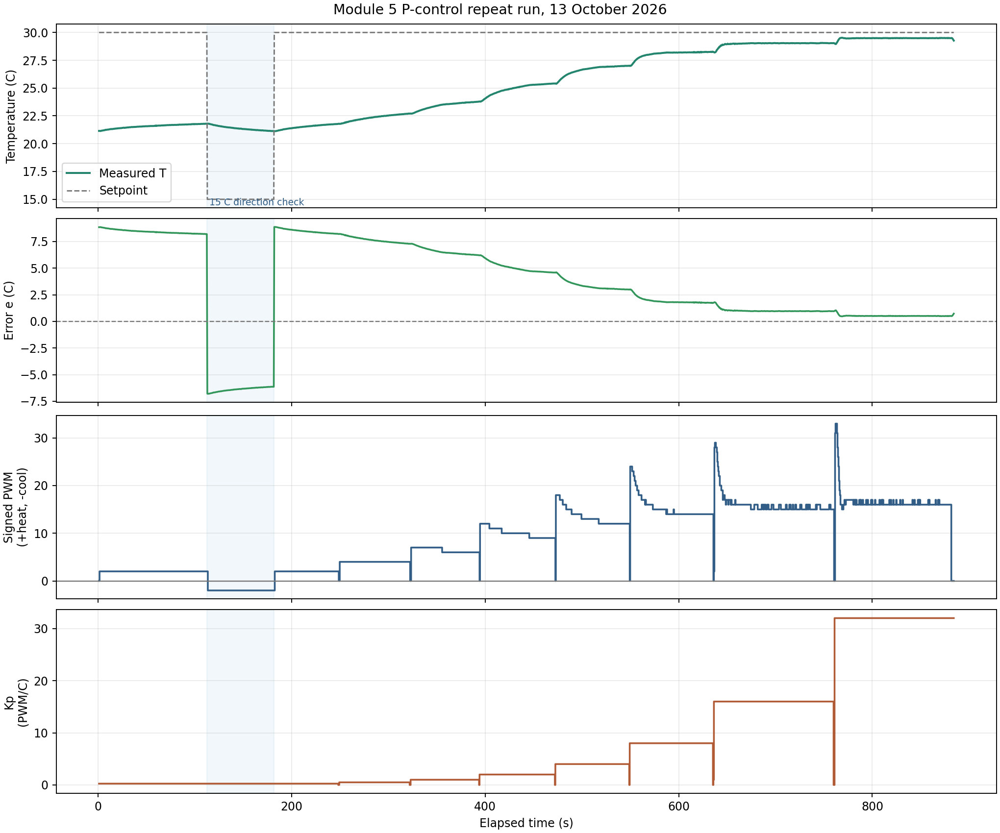
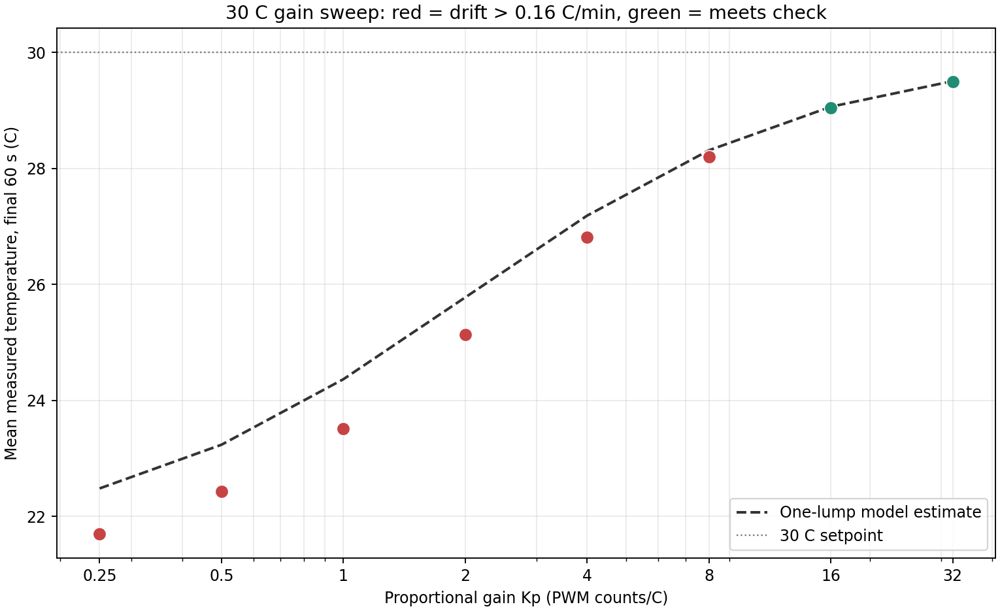

# Sammy Cohen: Module 5 P-Control Repeat Run

**Run date:** 13 October 2026

**Data:** [`p_control_run_2026-10-13_sammy_repeat_snapshot.csv`](p_control_run_2026-10-13_sammy_repeat_snapshot.csv), copied byte-for-byte from the GUI live file.

**Purpose:** preserve and analyze this run as an addition. This report does not replace the original Module 5 analysis, any Module 4 work, or either earlier data snapshot.

## Run Summary

The snapshot contains 1,737 measurements from 0.92 s to 884.24 s, spanning 883.32 s (14.72 min). The median reporting interval is about 0.51 s, giving about 118 readings in a 60-second window. Measured temperature ranged from 21.13 to 29.53 deg C. The run ended with P control off and PWM 0.

The main sweep kept the setpoint at 30 deg C and raised Kp from 0.25 through 32. A separate 15 deg C interval at Kp = 0.25 checked the cooling direction. Later, the setpoint returned to 30 deg C before the gain sweep continued. The controller logged each temperature, setpoint, error, Kp, PWM, direction, and enable state.





## How Each Quantity Is Calculated

### Controller: error to direction and PWM

The controller first subtracts measured temperature from the target:

```text
e = T_set - T
```

Here, `e` is the error in deg C. If it is positive, the plate is colder than the target and the controller requests heat. If negative, the plate is warmer than the target and it requests cooling.

Next, it multiplies error by proportional gain:

```text
u = Kp * e
```

`Kp` has units PWM counts per deg C, so `u` is a signed PWM request. The sign chooses direction; the magnitude becomes PWM, rounded to an integer and limited to 0 through 255.

**Logged heating example, setpoint 30 deg C, Kp = 0.25:**

```text
T = 21.15 deg C
e = 30.00 - 21.15 = +8.85 deg C
u = 0.25 counts/deg C * 8.85 deg C = +2.2125 counts
PWM = round(abs(2.2125)) = 2 counts
sign is positive, so direction = HEAT
```

The recorded row shows PWM 2 and HEAT. The units cancel as `(PWM counts/deg C) * deg C = PWM counts`.

**Logged cooling example, setpoint 15 deg C, Kp = 0.25:**

```text
T = 21.80 deg C
e = 15.00 - 21.80 = -6.80 deg C
u = 0.25 counts/deg C * (-6.80 deg C) = -1.70 counts
PWM = round(abs(-1.70)) = 2 counts
sign is negative, so direction = COOL
```

The recorded row shows PWM 2 and COOL. PWM itself is never negative; the sign of `u` selects which way the H-bridge drives the TEC.

### Final-minute average

For each constant setpoint/Kp interval, the last 60 seconds contain 118 samples spanning about 59.5 seconds because the Arduino reports about twice per second. The average is:

```text
mean temperature = (T_1 + T_2 + ... + T_118) / 118
```

The quick settling test uses the endpoint drift within that same final-minute window:

```text
drift = T_last - T_first
pass if abs(drift) <= 0.16 deg C
```

This compares the first and last recorded temperatures of the window. A passing result means the net drift is no larger than the lab's stated 0.16 deg C criterion; the full window's mean is still calculated from all 118 samples.

**Worked average, Kp = 16:**

```text
sum of the 118 temperatures = 3426.6700 deg C
mean = 3426.6700 / 118
     = 29.03958 deg C
     = 29.04 deg C (rounded to 0.01 deg C)

first temperature in the final-minute window = 29.04 deg C
last temperature in the final-minute window  = 29.04 deg C
drift = 29.04 - 29.04 = 0.00 deg C
```

The mean summarizes the window; the drift checks whether that window was still moving. Here the drift passes the 0.16 deg C check.

## Gain Results at a 30 deg C Setpoint

The table uses the first uninterrupted 30 deg C hold at each gain. For Kp = 0.25, that is the initial hold before the separate 15 deg C direction check. A second short Kp = 0.25 hold followed the check; its final-minute mean was 21.55 deg C with +0.55 deg C drift, so it is not substituted for the initial gain-sweep interval.

| Kp (PWM/deg C) | Hold duration (s) | Final-minute N | Sum T (deg C) | Mean T (deg C) | Final-minute drift (deg C) | Drift check | Model T estimate (deg C) |
|---:|---:|---:|---:|---:|---:|---|---:|
| 0.25 | 111.40 | 118 | 2560.2700 | 21.69720 | +0.220 | Not settled | 22.48212 |
| 0.50 | 72.24 | 118 | 2646.3400 | 22.42661 | +0.680 | Not settled | 23.23544 |
| 1.00 | 70.20 | 118 | 2774.7400 | 23.51475 | +0.760 | Not settled | 24.36477 |
| 2.00 | 77.34 | 118 | 2965.6800 | 25.13288 | +0.800 | Not settled | 25.77537 |
| 4.00 | 75.82 | 118 | 3164.1300 | 26.81466 | +0.630 | Not settled | 27.18477 |
| 8.00 | 85.48 | 118 | 3327.7100 | 28.20093 | +0.180 | Not settled; 0.02 C over criterion | 28.31143 |
| 16.00 | 123.16 | 118 | 3426.6700 | 29.03958 | 0.000 | Pass | 29.06212 |
| 32.00 | 120.13 | 118 | 3480.1400 | 29.49271 | -0.010 | Pass | 29.50354 |

The trend is clear: as Kp increases, the final-minute temperature moves closer to 30 deg C and the mean error gets smaller. But the first six means are not steady-state values: their temperatures were still moving too much in their final minute. Only Kp = 16 and 32 pass the stated drift check in this run. Do not use the red points as settled gain measurements.

The separate 15 deg C direction check lasted 68.67 s. Temperature fell from 21.79 to 21.14 deg C; 135 of 136 logged samples reported COOL, with one transitional HEAT report at the setpoint change. This supports that the controller selected cooling for a negative error. It is a direction check, not another steady-state gain measurement.

## Model Derivation, One Step at a Time

The one-lump thermal balance is:

```text
C * dT/dt = P_u * Kp * (T_set - T) - H * (T - T_amb)
```

Meaning of the terms:

- `T` is plate temperature and `dT/dt` is its rate of change in deg C/s.
- `C * dT/dt` is the rate of thermal energy stored in the lump.
- `P_u * Kp * (T_set - T)` is the heating power requested by proportional control.
- `H * (T - T_amb)` is heat lost to ambient. It is subtracted because it removes heat from the lump.
- `C`, `P_u`, and `H` are model parameters; this is a simplified one-temperature model.

At steady state the temperature is no longer drifting, so `dT/dt = 0`. That makes the left-hand side zero:

```text
0 = P_u * Kp * (T_set - T) - H * (T - T_amb)
```

Move the heat-loss term to the other side. At steady state, supplied heat equals lost heat:

```text
H * (T - T_amb) = P_u * Kp * (T_set - T)
```

Divide every term by `H`. Define the heating susceptibility `chi_h = P_u/H` and the dimensionless loop gain `L = Kp * chi_h`:

```text
T - T_amb = (P_u/H) * Kp * (T_set - T)
T - T_amb = L * (T_set - T)
```

Expand the parentheses on the right. This distributes `L` across both terms:

```text
T - T_amb = L * T_set - L * T
```

Collect all terms containing `T` on the left. Add `L*T` and add `T_amb` to both sides; doing the same operation to both sides preserves equality:

```text
T + L*T = T_amb + L*T_set
T * (1 + L) = T_amb + L*T_set
```

Factor `T` from the left side, then divide by `(1+L)`:

```text
T_ss = (T_amb + L*T_set) / (1 + L)
```

The remaining setpoint error is the droop. Subtract the expression above from `T_set`:

```text
T_set - T_ss
= T_set - (T_amb + L*T_set)/(1 + L)
= [T_set*(1 + L) - T_amb - L*T_set] / (1 + L)
= (T_set - T_amb) / (1 + L)
```

The two `L*T_set` terms cancel. Divide by the initial error `e_0 = T_set - T_amb` to get the fractional droop:

```text
fraction of initial error remaining = (T_set - T_ss)/(T_set - T_amb)
                                    = 1/(1 + L)
```

### Worked model prediction for Kp = 16

This model uses the previous Module 4 heating susceptibility `chi_h = 0.50127 deg C/count` and the controller's configured ambient reference `T_amb = 21.54 deg C`. These are model inputs, not temperatures measured during this repeat run.

```text
L = Kp * chi_h
  = 16 PWM/deg C * 0.50127 deg C/PWM
  = 8.02032 (dimensionless)

T_ss = (T_amb + L*T_set)/(1 + L)
     = (21.54 + 8.02032*30.00)/(1 + 8.02032) deg C
     = 29.06212 deg C
     = 29.06 deg C

measured mean in the final 60 s = 29.03958 deg C
measured minus predicted        = 29.03958 - 29.06212
                                = -0.02254 deg C
```

The model predicts 29.06 deg C, and the measured final-minute mean is 29.04 deg C. This point also passes the drift check, so it is the strongest like-for-like comparison in this run. The difference is small, but it should not be called proof of the model: ambient temperature for this run was not logged independently.

## Time Constant and What It Means

For the one-lump P-control model, increasing feedback gain speeds the exponential approach. Its predicted closed-loop time constant is:

```text
tau_cl = tau / (1 + L)
```

Using the previous fitted open-loop `tau = 62.9 s`:

```text
Kp = 16: tau_cl = 62.9 / (1 + 8.02032) = 6.97 s
Kp = 32: tau_cl = 62.9 / (1 + 16.04064) = 3.69 s
```

One time constant describes how quickly an ideal first-order response covers about 63 percent of the distance to its final value; it is not the full settling time. The actual data show that only the final-minute windows at Kp = 16 and 32 meet the 0.16 deg C drift check. The first-order time-constant formula does not guarantee settling in real hardware.

## Conclusions and Limitations

- The sign check behaved as expected: a 30 deg C target below the plate's initial temperature difference requested HEAT; the 15 deg C check requested COOL.
- The temperature increased toward 30 deg C as gain rose. The measured `Kp = 16` and `32` windows meet the final-minute drift criterion; `Kp = 8` misses it slightly, and lower gains are still drifting.
- `Kp = 16` and `32` are the only valid steady-state comparisons in this run. To obtain settled means at lower gains, hold each one longer and wait for a stable final minute before changing gain.
- A gain sweep whose low-gain stages have not settled cannot establish the full steady-state droop curve. The graph displays those points for transparency but marks them as unsettled.
- The model uses `T_amb = 21.54 deg C` from prior work; today’s ambient was not separately measured. Differences between model and measurements include that uncertainty.

## Preserved Files

- [`p_control_run_2026-10-13_sammy_repeat_snapshot.csv`](p_control_run_2026-10-13_sammy_repeat_snapshot.csv): immutable source snapshot for this report.
- [`p_control_run_2026-10-13_sammy_repeat_timeline.png`](../../docs/figures/module_05/p_control_run_2026-10-13_sammy_repeat_timeline.png): temperature, error, signed PWM, and Kp over time.
- [`p_control_run_2026-10-13_sammy_repeat_gain_comparison.png`](../../docs/figures/module_05/p_control_run_2026-10-13_sammy_repeat_gain_comparison.png): final-minute means, drift-check result, and model estimate.
- [`module_05_p_control.md`](../../docs/module_notes/module_05_p_control.md): existing Module 5 project note, unchanged.