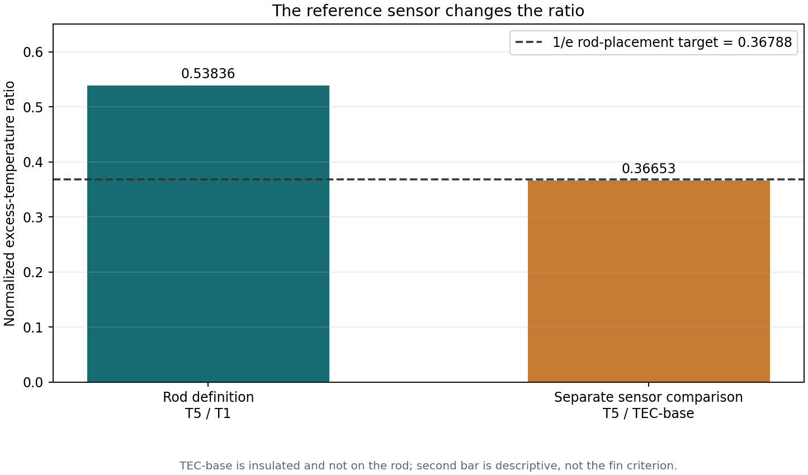

# TEC Reference versus Rod T1: Ratio Addendum

Supplement to [`sammy_stationary_fin_analysis_20261028.md`](sammy_stationary_fin_analysis_20261028.md). The raw CSV and original rod fit are unchanged.

## The distinction

The official rod coordinate starts at T1, the first rod hole: **x = 0 and theta0 = T1 - T_room**. The insulated TEC-base thermistor is about 25.4 mm (one inch) away, but it measures the TEC assembly, not a point on the aluminum rod. It is not an extra point in the one-dimensional fin profile and must not replace T1 in the official rod placement test.

It is still useful to calculate a separate descriptive ratio from the TEC sensor to T5. This includes the TEC/rod interface and insulation, so it describes the whole actuator-to-sensor path rather than just decay along the rod.

## Data window and worked arithmetic

Use the same final 10-minute control-on window as the rod analysis. Estimate room temperature as the mean of the five rod channels in the first 30 seconds: **T_room = 22.08123 deg C**. The final-window means are:

```text
T_TEC = 44.99768 deg C
T1    = 37.68316 deg C
T5    = 30.48073 deg C

theta_TEC = T_TEC - T_room = 44.99768 - 22.08123 = 22.91645 deg C
theta_T1  = T1 - T_room    = 37.68316 - 22.08123 = 15.60193 deg C
theta_T5  = T5 - T_room    = 30.48073 - 22.08123 = 8.39950 deg C
```

**Official rod ratio**

```text
theta_T5 / theta_T1 = 8.39950 / 15.60193 = 0.53836
1/e = 0.36788
relative difference = 100 * (ratio / (1/e) - 1) = +46.34%
```

This does **not** meet the rod criterion: T5 retains 0.538 of T1's excess temperature, versus a target no greater than 0.368.

**Separate TEC-to-T5 comparison**

```text
theta_T5 / theta_TEC = 8.39950 / 22.91645 = 0.36653
1/e = 0.36788
relative difference = -0.368%
```

This number is remarkably close to 1/e, but it does **not** show that the rod placement meets the target. Its denominator is a sensor in the insulated TEC assembly, not the rod-base boundary at T1. The two ratios answer different physical questions.

## Effect on the fitted model

No additional fin fit is made with TEC as a sixth point. That would violate the model's domain: the finite/semi-infinite formulas describe points along a uniform rod with T1 as the x=0 boundary. The TEC sensor is separated by an interface, is insulated, and can have a distinct contact lag. Including it as a fictitious x = -25.4 mm rod point would bias the fitted decay coefficient rather than improve it.

The rod-only finite fit remains **m = 4.716 1/m** from the prior analysis, provisional because actual measured positions, rod diameter, resistor values, and a controlled common-bath check are not yet in the sensor map. This addendum changes the interpretation only; it does not change the original rod fit.



Source: [`sammy_rod_run_20261028_114042.csv`](sammy_rod_run_20261028_114042.csv).
