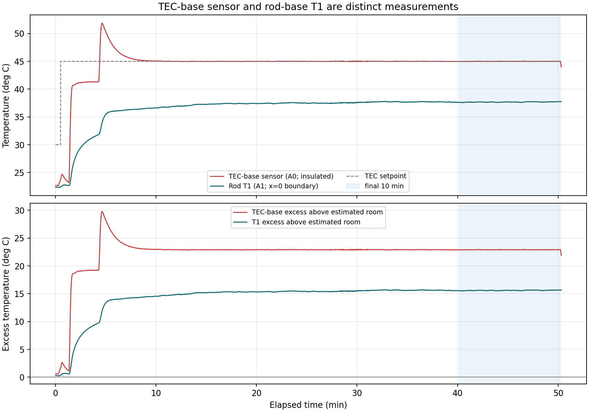

# TEC-Base Thermistor Addendum — Module 7 Run, 28 October 2026

This is a new addendum to the rod analysis. It does not change the raw CSV, sensor map, or rod-only fit.

## Important model distinction

The TEC-base thermistor is fully insulated inside/on the TEC assembly and, as reported, is about 1 inch from rod T1. It measures the actuator assembly, not a point on the aluminum rod. The course defines the rod-analysis origin at T1 (the first rod hole, x=0); T1 supplies the rod boundary condition. Therefore the TEC-base channel must not be relabeled as rod theta0 or added to the finite/semi-infinite rod fit at x=-25.4 mm. Its insulation and separate thermal contact can also give it a response different from the rod.

Approximate physical separation from TEC sensor to T1 supplied by the user: about 25.4 mm. This is not a measured rod coordinate.

## Room reference and final windows

For this analysis, room reference is estimated from the mean of the five rod channels during the first 30 s: T_room = 22.08123 deg C. This is a startup baseline, not a controlled common-bath calibration.

| Window | TEC mean (deg C) | TEC SD | T1 mean (deg C) | T1 SD | TEC − T1 (deg C) | TEC excess over room (deg C) | T1 excess over room (deg C) |
|---|---:|---:|---:|---:|---:|---:|---:|
| last40 (4304 points) | 44.9977 | 0.0160 | 37.5201 | 0.2393 | 7.4775 | 22.9164 | 15.4389 |
| last10 (1073 points) | 44.9977 | 0.0096 | 37.6831 | 0.0388 | 7.3145 | 22.9164 | 15.6019 |
| last5 (537 points) | 45.0004 | 0.0088 | 37.7022 | 0.0364 | 7.2983 | 22.9192 | 15.6209 |

## Fully worked final-10-minute calculation

The logger reports 537 points in the final 300 s and 1,073 points in the final 600 s. Use the final 10-minute averages here.

```text
T_TEC,mean = 44.99765 deg C
T_T1,mean  = 37.68310 deg C
T_room,estimated from initial rod baseline = 22.08123 deg C

theta_TEC = T_TEC,mean − T_room = 44.99765 − 22.08123 = 22.91642 deg C
theta_T1  = T_T1,mean − T_room  = 37.68310 − 22.08123 = 15.60187 deg C
T_TEC,mean − T_T1,mean = 44.99765 − 37.68310 = 7.31455 deg C
```

So the insulated TEC sensor reads about 7.31 deg C warmer than rod T1 during this final window. That difference is useful actuator/boundary context, but it does not mean the rod profile starts at the TEC sensor. In the rod fit, theta0 means theta(x=0)=T1−T_room.



## Interpretation and caveats

- The TEC-base sensor follows the controlled actuator temperature; T1 measures the first rod hole. Heat must conduct from the TEC/base into the rod, so they can differ substantially.
- The insulated TEC probe is not part of the one-dimensional rod and is not an extra spatial sample. Do not fit it as if it were a rod point one inch before T1.
- T1 remains the base boundary condition for the rod model. The initial room reference is from rod channels; the initial six-channel spread was about 0.96 C, so the common-bath calibration check is not established by this run.
- Tape mounting and insulation can add thermal lag. Preserve the raw trace; do not filter the logged measurements to conceal it.

Source: [`sammy_rod_run_20261028_114042.csv`](sammy_rod_run_20261028_114042.csv).
