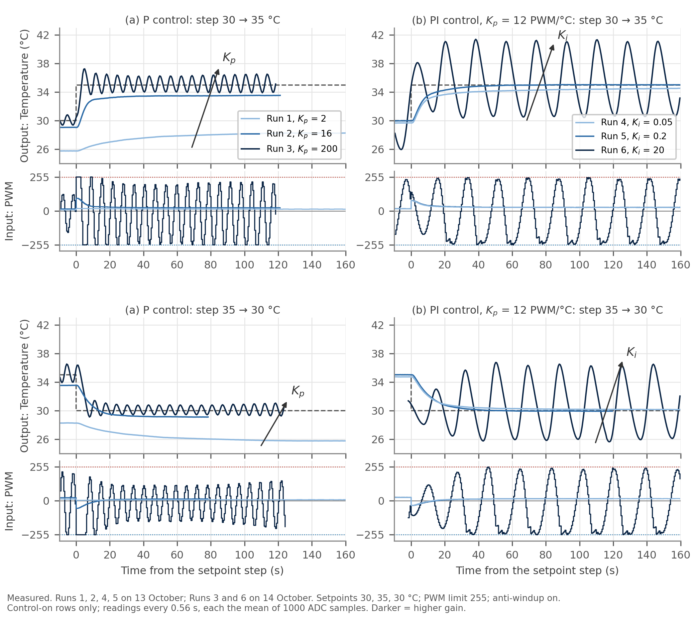
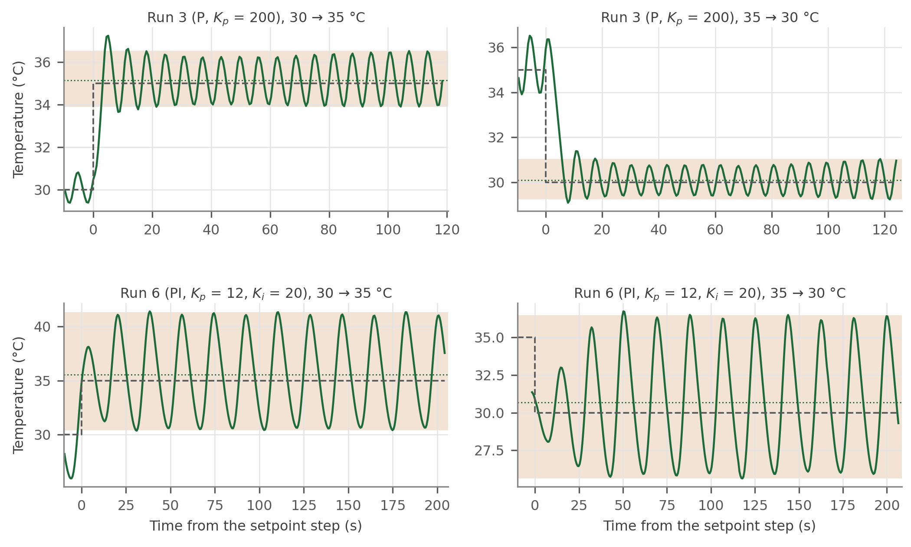
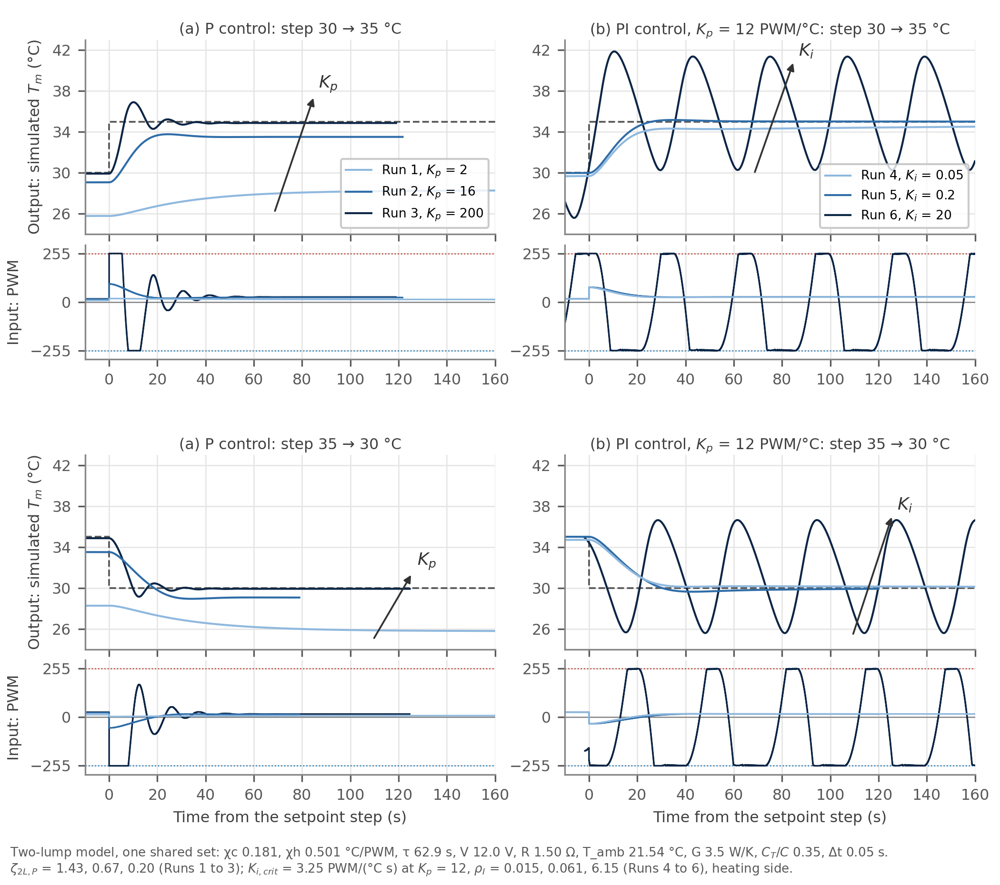
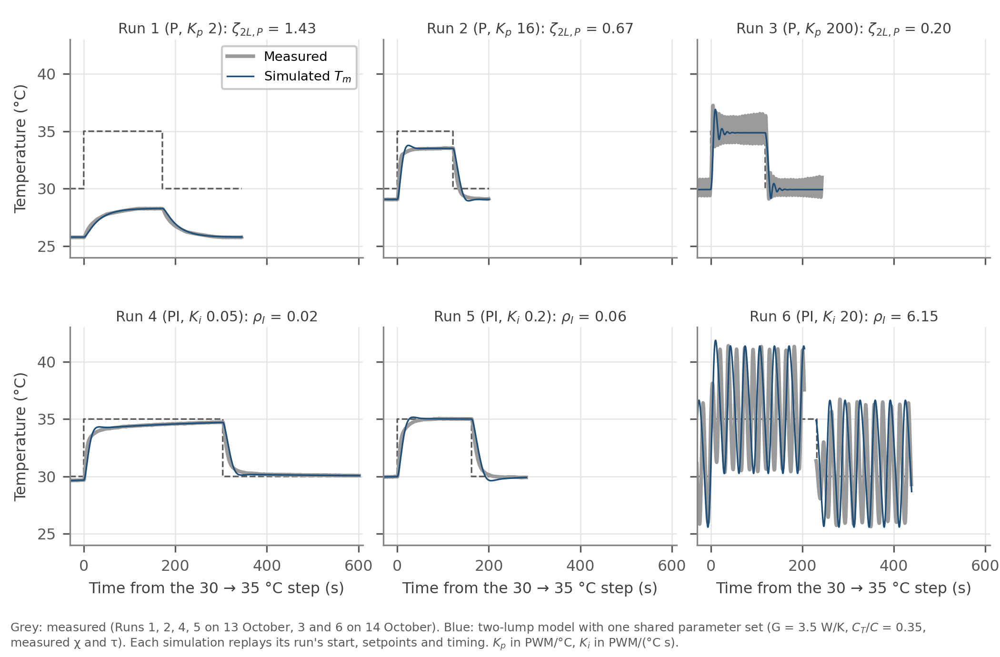

# A3: Feedback Data and Lumped-Model Memo

Assessment code: A3  
Team members: Kapil Naidu and Samuel Cohen  
Date: October 2026 (measurements 13 and 14 October)  
Repository: https://github.com/kapilnaidu1/phys39-naidu-cohen, branch main

## 1. One-lump model and P-control predictions

**Energy balance.** Treating the TEC face, plate and thermistor as one lump at temperature T,

```
C dT/dt = P_u u − H (T − T_amb)
```

C (J/K) is the heat capacity, P<sub>u</sub> (W per PWM count) the TEC heat per count, u the signed command (+ heats, − cools) and H (W/K) the conductance to the room. Every term is in watts. With the command held fixed, dT/dt = 0 gives T − T<sub>amb</sub> = (P<sub>u</sub>/H) u, so the open-loop susceptibility is **χ = P<sub>u</sub>/H** (K per count). Dividing the balance by H gives τ dT/dt = T<sub>amb</sub> + χu − T, so **τ = C/H** (s). A stronger actuator raises χ and better insulation (smaller H) raises it; C does not appear in χ and sets only how fast the plate gets there.

**Measured values.** χ<sub>h</sub> = 0.501 °C/count heating and |χ<sub>c</sub>| = 0.181 °C/count cooling (Module 4), so P<sub>u</sub> differs by direction (r = 2.77, Peltier and Joule heat add when heating and oppose when cooling). τ = 62.9 ± 5.0 s from exponential fits to eight open-loop steps (Module 6 note, section 3; 500-sample data, kept on the instructor's instruction). T<sub>amb</sub> = 21.54 °C. The model in measured form is

```
τ dT/dt = T_amb + χ u − T
```

**P control.** With u = K<sub>p</sub>e and e = T<sub>set</sub> − T, setting dT/dt = 0 gives P<sub>u</sub>K<sub>p</sub>(T<sub>set</sub> − T) = H(T − T<sub>amb</sub>), which rearranges to

```
T_set − T_ss = (T_set − T_amb) / (1 + χ K_p)
```

The lump cannot rest at the setpoint: there e = 0, so the TEC delivers nothing while H(T<sub>set</sub> − T<sub>amb</sub>) still leaks heat, and the plate drifts back until the error is large enough to pay for the leak. For the transient, write θ = T − T<sub>ss</sub>; the balance becomes C dθ/dt = −(H + P<sub>u</sub>K<sub>p</sub>)θ, so θ decays with

```
τ_cl = C / (H + P_u K_p) = τ / (1 + χ K_p)
```

The **dimensionless loop gain is L = χK<sub>p</sub>**. Raising K<sub>p</sub> raises L, and the same factor 1 + L both shrinks the droop and shortens the time constant: a stronger correction per degree of error needs less error to hold the plate and pulls it back faster. Whether a gain is small depends on L, not on K<sub>p</sub> alone; in Module 5 only K<sub>p</sub> = 0.25 and 0.5 had L < 0.3, and K<sub>p</sub> = 2 gives L = 1.00 when heating but 0.36 when cooling.

**Prediction against measurement.** Nothing below is fitted.

| Run 1 (13 Oct), P, K<sub>p</sub> = 2, L = 1.003 | Predicted | Measured |
|---|---|---|
| Settled temperature at 30 °C | 25.78 °C | 25.76 °C |
| Settled temperature at 35 °C | 28.28 °C | 28.25 °C |
| 10-90 % rise, ln 9 × τ<sub>cl</sub> with τ<sub>cl</sub> = 31.4 s | 69 ± 5 s | 74 s up, 77 s down |

Across the eight Module 5 gains (K<sub>p</sub> = 0.25 to 32) measured/predicted droop was 0.980 ± 0.039.

## 2. Experimental Goldilocks plots and step-response metrics

**Protocol.** One apparatus and sketch (`arduino/module_06/tec_pi_safety`, each temperature the mean of 1000 readings, one every 0.56 s), PWM limit 255, anti-windup on, integral zeroed before each run. Every run holds 30 °C, steps to 35 °C, then back to 30 °C, so heating and cooling steps are both measured; each step starts from the settled previous stage, or for Runs 3 and 6 from a sustained oscillation. PI runs use K<sub>p</sub> = 12, slightly below Run 2's 16. Runs 1, 2, 4, 5 were taken on 13 October; at the instructor's request Runs 3 and 6 were repeated on 14 October at much higher gain to reach saturation (the 13 October K<sub>p</sub> = 64 and K<sub>i</sub> = 1.0 runs are kept as 3a and 6a).



**Figure 1.** Measured temperature (output) and signed PWM (input) for the three P gains (left) and three PI gains (right), the step up on top and the step down below, darker for higher gain. Each run's own figure is in `docs/figures/module_06/goldilocks/`.

| Run | Controller | K<sub>p</sub> | K<sub>i</sub> | End of stage, 30 / 35 / 30 °C | Behaviour |
|---|---|---|---|---|---|
| 1 | P | 2 | 0 | 25.76 / 28.25 / 25.76 | slow, large droop, no overshoot |
| 2 | P | 16 | 0 | 29.05 / 33.52 / 29.12 | fast, droop 0.9 to 1.5 °C, no overshoot |
| 3 | P | 200 | 0 | cycles about 30.1 / 35.1 / 30.1 | sustained oscillation, command to ±255 |
| 4 | PI | 12 | 0.05 | 29.66 / 34.71 / 30.08 | droop removed slowly, still creeping |
| 5 | PI | 12 | 0.2 | 29.97 / 35.02 / 29.93 | no droop, no measurable overshoot |
| 6 | PI | 12 | 20 | cycles about 30.6 / 35.5 / 30.8 | 11 °C oscillation bounded by ±255 |

**Metrics, largest-gain P and PI runs.** Thresholds: rise is 10 % to 90 % of the change; the final value is the mean of the last 30 s of the stage, or of whole cycles in its last 90 s if it is still oscillating; settling is the last time T leaves the final value ± 2 % of the step (about ± 0.1 °C); period is the mean spacing of upward crossings of the cycle mean (0.3 °C hysteresis). Data: `data/module_06/goldilocks_metrics.csv`.

| Run, step | Rise | Overshoot | Settling | Steady-state error | Oscillation |
|---|---|---|---|---|---|
| 3 (P, K<sub>p</sub> 200), 30 → 35 | 2.8 s | 2.10 °C, 41 % (first peak) | none | −0.15 °C (cycle mean) | 33.9 to 36.5 °C, period 6.4 s |
| 3, 35 → 30 | 3.2 s | 1.00 °C, 20 % (first dip) | none | −0.10 °C | 29.3 to 31.0 °C, period 6.2 s |
| 6 (PI, K<sub>i</sub> 20), 30 → 35 | n/a | n/a | none | −0.53 °C | 30.4 to 41.3 °C, period 18.0 s |
| 6, 35 → 30 | n/a | n/a | none | −0.69 °C | 25.6 to 36.5 °C, period 18.8 s |

Run 6's steps begin in the middle of a 10 °C swing, larger than the 5 °C step, so rise and overshoot are not defined. In Run 3 the command reached ±255 on 16 % of readings in the up stage and 5 % in the down stage. In Run 6, over the last 90 s of each stage, the applied command reached 233 to 255 counts every half cycle, and the requested command would have gone past ±255 on 15 to 17 % of readings, where anti-windup refused the integral step.



**Figure 2.** The four steps quantified above. Tan band: range of the sustained oscillation in the last 90 s; dotted line: cycle mean.

For comparison, the highest gains that still settled (13 October) were:

| Run, step | Rise | Overshoot | Settling | Steady-state error | Period |
|---|---|---|---|---|---|
| 3a (P, K<sub>p</sub> 64), 30 → 35 | 2.1 s | 1.69 °C, 35 % | 21 s | +0.41 °C | 9 s |
| 3a, 35 → 30 | 4.0 s | 0.07 °C, 1 % | 15 s | +0.24 °C | n/a |
| 6a (PI, K<sub>i</sub> 1.0), 30 → 35 | 8.2 s | 0.71 °C, 14 % | 56 s | 0.00 °C | n/a |
| 6a, 35 → 30 | 12.5 s | 1.30 °C, 26 % | 68 s | 0.00 °C | n/a |

Raising K<sub>p</sub> speeds the response and shrinks the droop, then overshoot appears (3a) and finally the loop oscillates without settling (3). At fixed K<sub>p</sub>, raising K<sub>i</sub> removes the droop faster (rise 58, 24 s for Runs 4, 5), then overshoots (6a) and finally oscillates, held only by the actuator limit (6). In 6a the cooling step overshot more than the heating step, consistent with the smaller cooling χ lowering the damping (one-lump ζ 0.47 cooling against 0.62 heating).

## 3. Simulation Goldilocks plots and experiment-theory comparison

**Model and shared parameters.** Two lumps: the TEC side at T and the measured block at T<sub>m</sub>,

```
C_T dT/dt   = P_u(u) u − G (T − T_m)
C_m dT_m/dt = G (T − T_m) − H (T_m − T_amb)
```

Every simulation uses χ<sub>c</sub> = 0.181 and χ<sub>h</sub> = 0.501 °C/count, τ = 62.9 s, V<sub>TEC</sub> = 12.0 V (the instructor's value; the bench meter gave no reading), R<sub>M</sub> = 1.50 Ω and T<sub>amb</sub> = 21.54 °C, from which the course simulator derives C = 74.0 J/K, H = 1.18 W/K, P<sub>u,c</sub> = 0.213 W/count and r = 2.77, together with G = 3.5 W/K and C<sub>T</sub>/C = 0.35, a 255 PWM limit and anti-windup on; only the controller mode, K<sub>p</sub> and K<sub>i</sub> change. G and C<sub>T</sub>/C were chosen once, before the 14 October runs, by raising G from 2 W/K until the K<sub>p</sub> = 64 step overshot by 35 % as Run 3a did, then locked. Each simulation replays its run's start temperature, integral state, setpoints and timing. The plots are made by stepping the course simulator's own `advance_model()` (`python/simulate_goldilocks_two_lump.py`), because its GUI rounds K<sub>i</sub> to steps of 0.02 and cannot be set to 0.05.



**Figure 3.** Simulated T<sub>m</sub> and command for the six runs, in the same layout and axes as Figure 1.

**Stability measures.** For this parameter set

```
ζ_2L,P = [C_T(G+H) + C_m G] / [2 √(C_T C_m G (H + P_u K_p))]
K_p,crit = (1/P_u) [ (C_T(G+H) + C_m G)² / (4 C_T C_m G) − H ] = 6.2 PWM/°C
K_i,crit = [C_T(G+H) + C_m G](H + P_u K_p) / (C_T C_m P_u) = 3.25 PWM/(°C s) at K_p = 12
```

(heating side, as the simulator displays them).

| Run | Gains | Stability | Model classification | Measured | Model permits it? |
|---|---|---|---|---|---|
| 1 | K<sub>p</sub> 2 | ζ<sub>2L,P</sub> 1.43, below K<sub>p,crit</sub> | stable, non-oscillatory | non-oscillatory | yes |
| 2 | K<sub>p</sub> 16 | ζ<sub>2L,P</sub> 0.67, above | stable, underdamped (6 % overshoot) | non-oscillatory | yes, but overshoot not seen |
| 3 | K<sub>p</sub> 200 | ζ<sub>2L,P</sub> 0.20, far above | stable, underdamped, decays | sustained oscillation | **no** |
| 4 | K<sub>i</sub> 0.05 | ρ<sub>I</sub> 0.015 | stable, non-oscillatory | non-oscillatory | yes |
| 5 | K<sub>i</sub> 0.2 | ρ<sub>I</sub> 0.061 | stable, slight overshoot (3 to 5 %) | non-oscillatory | yes, but overshoot not seen |
| 6 | K<sub>i</sub> 20 | ρ<sub>I</sub> 6.15 | unstable, bounded by ±255 | unstable, bounded by ±255 | yes |



**Figure 4.** Each measured run (grey) with its simulation (blue). Data: `data/module_06/goldilocks_sim_metrics.csv`.

**Agreement.** With nothing changed between runs, the model reproduces every steady state to within 0.06 °C, the droop at both P gains that settle, Run 4's slow integral creep, Run 3's first overshoot (41 % against 41 %) and Run 6's bounded oscillation (30.3 to 41.4 °C against 30.4 to 41.3 °C).

**Disagreement.** The model's oscillations are too slow (Run 6 period 32 s against 18 s; Run 3a 23 s against 9 s), it predicts small overshoots in Runs 2 and 5 that were not measured, and it cannot produce Run 3's sustained oscillation: its second-order P loop decays at any gain, and settles here within 32 s.

## 4. PI steady state, assumptions and windup

**Ideal PI at T<sub>set</sub> = 55 °C.** With u = u<sub>P</sub> + u<sub>I</sub> = K<sub>p</sub>e + K<sub>i</sub>q and dq/dt = e, a steady state needs dq/dt = 0, so e = 0 and **T<sub>ss</sub> = 55 °C exactly**. Then u<sub>P</sub> = 0 and the integral alone holds the command the plate needs, (55 − 21.54)/0.501 = 66.8 counts, at q = 66.8/K<sub>i</sub>. P alone at K<sub>p</sub> = 12 would stop 4.77 °C short. Integral action removes droop because any error that persists keeps changing q, and so u<sub>I</sub>, until the error is gone; the integral remembers the command the proportional term could only supply by keeping an error.

**Conditions for reaching it.**

- *Closed-loop stability.* The loop must settle. In the two-lump model that needs ρ<sub>I</sub> < 1; Run 6 (ρ<sub>I</sub> = 6.15) never settled and its cycle mean sat 0.5 to 0.7 °C off the setpoint.
- *PWM range.* The 66.8 counts needed must be available, and are (limit 255).
- *Actuator saturation.* From room temperature u<sub>P</sub> alone asks for 12 × 33.5 = 402 counts, so the command saturates during the approach; while it does, the loop is open and the integral must not grow.
- *Continued integral action.* K<sub>i</sub> > 0 and q not reset or held once the plate is near the setpoint.
- *Temperature measurement.* The loop drives the thermistor reading to 55 °C. A calibration offset or lag between thermistor and plate goes straight into the true temperature, and 55 °C is only 5 °C below the 60 °C software limit: in the model, Run 6's gains overshoot past 60 °C within 29 s and would trip the Arduino shutdown (`python/pi_55c_check.py`).

**Windup.** The requested command u<sub>req</sub> = K<sub>p</sub>e + K<sub>i</sub>q is clamped to ±255, but q = ∫e dt keeps growing while the plate is still short. The extra integral does nothing while the actuator is pinned; when the plate reaches the setpoint, u<sub>I</sub> is still large, so the command stays high, the plate overshoots, and the stored integral has to be unwound by error of the opposite sign. In the two-lump model, 55 °C from room temperature at K<sub>p</sub> = 12, K<sub>i</sub> = 0.2 overshoots to 57.36 °C without anti-windup and not at all with it.

**Our anti-windup rule** (conditional integration, `pi_step()` in `python/tec_pi_control_gui.py`). Each reading, with Δt the measured time since the previous one:

```
q_trial = q + e Δt
u_trial = K_p e + K_i q_trial
if anti-windup and ((u_trial > 255 and e > 0) or (u_trial < −255 and e < 0)):
    keep q                      (refuse the step)
else:
    q = q_trial
u_applied = clamp(K_p e + K_i q, −255, +255)
```

An error that would bring the command out of saturation is always integrated, so q can unwind. The rule makes the same decision as the course simulator's `controller_command()` in 200,000 random test cases. On the bench it refused the integral step on 15 to 17 % of Run 6's readings. The clamp protects the actuator, anti-windup controls the integral during saturation, and the Arduino's 60 °C latch remains an independent shutdown.

**Resetting the integral at steady state.** At steady state u<sub>P</sub> ≈ 0 and u<sub>I</sub> supplies the whole command. Setting q = 0 removes that command at once, so the plate starts to fall toward room temperature until a new error builds q back up. In the model at 30 °C (K<sub>p</sub> = 12, K<sub>i</sub> = 0.2) the command drops from 16.9 counts to 0.02, the plate falls to 28.89 °C after 24 s and is back within 0.02 °C after 263 s. Run 6 showed the opposite case: control ran 15 s with K<sub>i</sub> = 0 before 20 was entered, the integral had reached 38 °C·s, u<sub>I</sub> jumped to 760 counts, and the first cycle peaked at 42.5 °C.

## 5. Model limits and gain selection

**Why one-lump P control cannot overshoot.** It has one state. The deviation obeys C dθ/dt = −(H + P<sub>u</sub>K<sub>p</sub>)θ, whose only solution is θ(0)e<sup>−(1+L)t/τ</sup>: one real, negative eigenvalue for any K<sub>p</sub> > 0, so θ shrinks without changing sign and T cannot cross T<sub>ss</sub>. Higher gain makes the approach faster, never oscillatory.

**What the apparatus did instead.** Module 5 found the first sign at K<sub>p</sub> = 32: +0.04 °C then −0.05 °C around the settled value. At K<sub>p</sub> = 64 (Run 3a) the overshoot was 35 % with ringing, and at K<sub>p</sub> = 200 (Run 3) the oscillation never decayed. Sampling at 0.56 s does not explain this: in the one-lump model it gives at most 0.03 °C of overshoot at K<sub>p</sub> = 64 (`python/sampling_delay_check.py`).

**How internal lag produces it.** In the two-lump model the TEC heats C<sub>T</sub>, and heat reaches the thermistor block only through G(T − T<sub>m</sub>). The controller sees T<sub>m</sub>, which lags. When T<sub>m</sub> reaches the setpoint, T is already past it and the heat stored in C<sub>T</sub> keeps flowing in after the command has dropped, so T<sub>m</sub> overshoots and the controller over-corrects. Eliminating T gives one second-order equation for T<sub>m</sub> with damping ζ<sub>2L,P</sub>; above K<sub>p,crit</sub> = 6.2 PWM/°C, ζ<sub>2L,P</sub> < 1 and overshoot is allowed, which Runs 3a and 3 show. With PI the loop is third order, and the Routh-Hurwitz condition gives K<sub>i,crit</sub>; Run 6 at ρ<sub>I</sub> = 6.15 grew until the actuator limit held it, as the model predicts.

**Final gains.** For P, K<sub>p</sub> = 16 (ζ<sub>2L,P</sub> = 0.67): 13 s rise and no measurable overshoot, but 0.9 to 1.5 °C of droop. **For PI, K<sub>p</sub> = 12 and K<sub>i</sub> = 0.2** (ρ<sub>I</sub> = 0.061): no steady-state error, 24 s rise, overshoot within the 0.02 °C noise, settled in 47 to 52 s. K<sub>i</sub> = 0.05 is too slow (0.29 °C short after 300 s); K<sub>i</sub> = 1.0 (ρ<sub>I</sub> = 0.31) overshoots 14 to 26 %; K<sub>i</sub> = 20 is unstable. Keeping ρ<sub>I</sub> far below 1 also leaves margin for a model whose oscillation period is wrong by a factor of 2.

**A physical effect a better model should include.** A third, small and fast lag between the TEC face and the reading: the thermistor's own heat capacity and its thermal contact with the plate. A loop with three lags can oscillate without decay under P control at high enough gain, which the two-lump model cannot, and a small fast lag would ring faster than the large, slow second lump this model needs to match the overshoot.

## Code and data

| Item | Path |
|---|---|
| PI controller, with `pi_step()` | `python/tec_pi_control_gui.py` |
| Arduino sketch, 1000-sample averaging, 60 °C latch | `arduino/module_06/tec_pi_safety/tec_pi_safety.ino` |
| Raw runs | `data/module_06/pi_run_20261013_094149.csv`, `data/module_06/pi_run_20261014_111720.csv` |
| Bench logs | `data/module_06/bench_log_2026-10-13.md`, `data/module_06/bench_log_2026-10-14.md` |
| Experimental figures and metrics | `python/plot_goldilocks_experiment.py`, `docs/figures/module_06/goldilocks/` |
| Simulations, course simulator code | `python/simulate_goldilocks_two_lump.py`, `python/Lab_6_7_modeling_tec.py` |
| Sampling, 55 °C and reset checks | `python/sampling_delay_check.py`, `python/pi_55c_check.py` |
| A3 figures and this PDF | `python/plot_a3_figures.py`, `python/build_a3_pdf.py` |
| Working notes | `docs/module_notes/module_06_pi_modeling.md`, `docs/module_notes/module_06_part2_two_lump.md` |

Reproduce from the repository root: `python3 python/plot_goldilocks_experiment.py`, `python3 python/simulate_goldilocks_two_lump.py`, `python3 python/plot_a3_figures.py`, `python3 python/build_a3_pdf.py`.
