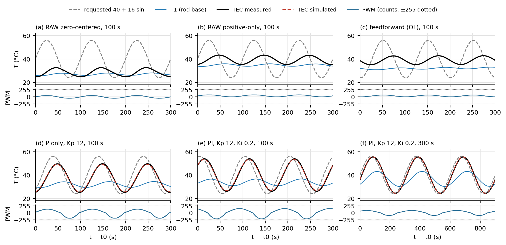
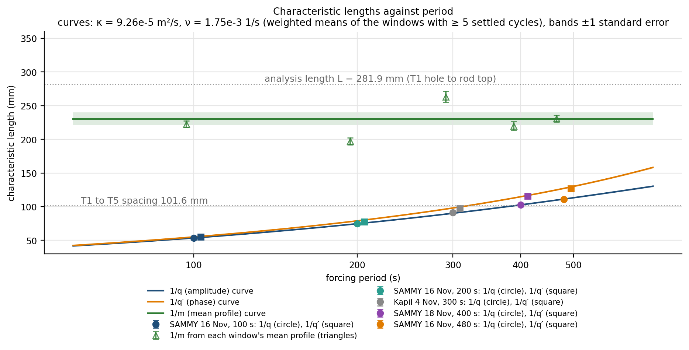
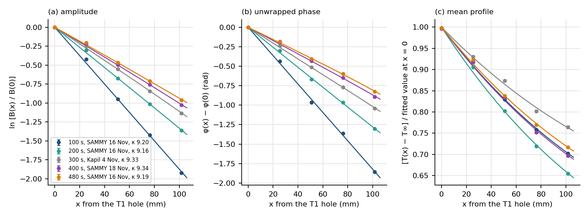
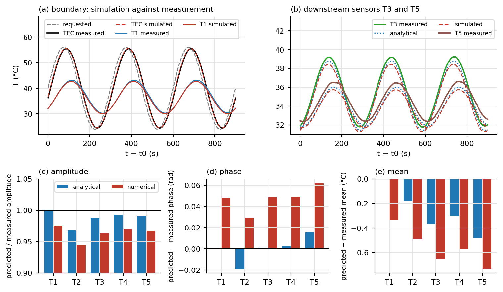

# A5: S18 Evidence, Boundary-Control Analysis and Angstrom Theory

Assessment code: A5 (individual)  
Student: Samuel Cohen (lab partner Kapil Naidu; the measurements are our team's)  
Date: 18 November 2026 (runs through 18 November)  
Repository: https://github.com/kapilnaidu1/phys39-naidu-cohen, branch main

## 1. Evidence that the S18 procedure was followed

- **S18 record.** The team's S18 evidence table (one row per step S18.1 to S18.10: result, evidence, departures) is `docs/module_notes/module_08_s18_evidence_table.md`.
  Departures that matter here: the 2 Nov feedforward inverted the measured steady-state curve instead of using the S18.5 straight line, which gives nearly the same command (3 to 67 counts against 2.9 to 66.8);
  the PI pair (Kp 12, Ki 0.2) came from the Module 6 plate model and ran at every period, and the S18.7 tuning log is the two single-gain trials of 18 Nov (Kp 20, then Ki 0.5, at 100 s; Table 1),
  neither of which met all four criteria, so I did not retune further; the 400 s window has seven settled cycles by the strict test (3 % in amplitude, 0.05 rad) only after masking one burst on T3 in cycle 4
  (four without the mask; Question 3); 480 s stands in for 500 s.
- **Data and code.** Raw runs, each with `_events.txt`, `_notes.csv` and `_meta.json`: Kapil's `angstrom_live_20261102_094506` (feedforward, P, PI 100 s) and `angstrom_live_20261104_110306` (PI 300 s, the matched run) in `data/module_08/`;
  mine in `data/module_08_sammy/`, all `sammy_angstrom_live_` + `20261111_122227` (raw zero-centered), `20261116_090538` (PI 100 and 480 s), `20261116_111935` (phases: PI 200 s, raw positive-only), `20261117_162612` and `20261118_104629`
  (PI 400 s; the latter with its `_mask.csv`) and `20261118_122006` (the two gain trials, as phase slices). Each figure caption names its run and interval (also in `a5_control_table.csv` and `a5_windows.csv`). Code (in `python/`):
  `sammy_module8_a5_write.py` regenerates every number, table and figure below with `sammy_module8_a5.py`, `sammy_module8_a5_figs.py`, `sammy_module8_angstrom_analysis.py`, `sammy_module8_finite_rod.py`,
  `sammy_module8_runs_summary.py` and the model `sammy_module8_tec_rod_sim.py`; `build_a5_cohen_pdf.py` makes this PDF. The commit named on this page contains all of them.

## 2. Measured boundary-control comparison

### Question 1: what made the measured TEC temperature track the setpoint, and why?

The target is Tset = 40 + 16 sin(2πt/τ) °C (24 to 56 °C). A trial succeeds if, over three whole settled cycles (amplitudes within 2 % of each other), the mean error is at most
1 °C, the amplitude ratio BTEC/16 is 0.90 to 1.10, the lag behind the setpoint is at most 0.30 rad and the rms tracking error is at most 3.2 °C
(20 % of the amplitude). The criteria are mine: they ask for the requested sinusoid, not just a sinusoid.

**Raw PWM and feedforward give a sinusoid, not the requested one** (Table 1, rows 1 to 3). With u = 50 sin ωt the heating half is stronger than the cooling half (χh 0.50 and χc 0.18 °C per count from Module 4;
the one-lump fit to this run gives 0.42 and 0.15, τ = 64 s), so the mean sits 4.1 °C above the baseline and the second harmonic is 0.10 of the fundamental.
Staying on the heating branch (U0 38, U 36) removes the distortion (A2/A1 0.002) and puts the mean within 0.7 °C of 40 °C, but the amplitude is only 4.0 °C
(ratio 0.25) and the TEC lags the PWM by 1.42 rad (22.6 s); the 2 Nov feedforward gives the same waveform (ratio 0.23, lag 1.42 rad).
A static calibration fixes the mean only: the plate is a first-order lag with τ ≈ 64 s, so at 100 s (ωτ = 4.0) the amplitude falls to 1/√(1 + (ωτ)²) = 0.24
and the lag approaches 90°.

**Integral action changes the mean and the amplitude, not the delay** (rows 4 and 5). P only with Kp 12 has a standing error: the mean is 2.6 °C low, as the loop gain χhKp = 6 predicts
((40 − 22.5)/(1 + 6) = 2.5 °C), with ratio 0.76 and lag 0.55 rad. PI with the same Kp takes the mean error to −0.06 °C, because the integral supplies the steady
heating command that P can supply only through an error, and raises the ratio to 0.87; the lag stays at 0.62 rad. The simulation of Question 4 (my own numerical TEC and rod model, not the course simulator) reproduces both runs (Table 1: mean errors −2.6
and 0.0 °C, ratios 0.74 and 0.83, lags 0.51 and 0.58 rad), which supports this explanation: integral action removes the droop and adds some
amplitude, and at Kp 12 neither term removes the lag.

**PI meets the criteria only at the longer periods.** With Kp 12 and Ki 0.2 at every period (a pair chosen with the Module 6 one-lump plate model and kept after the trials below, so the initial and selected PI settings are the same) the ratio is 0.87, 0.94 and 0.97 at 100, 200 and 300 s, the lag 0.62, 0.37 and 0.25 rad
and the rms error 6.6, 4.1 and 2.8 °C: all four criteria are met only at 300 s (the 16 Nov repeat of 100 s agrees). The lag in seconds is nearly constant (9.9, 11.7, 12.0,
12.8 and 12.7 s at 100, 200, 300, 400 and 480 s), so with this gain pair the phase error grows as ω: a delay in the plate and thermistor path that the gain does not remove. At 100 s the PWM already reaches −221 of −255 counts
(cooling needs 2.77 times the heating count). The two single-gain trials of 18 Nov (S18.7; Table 1, rows 9 and 10; a 300 s hold and seven 100 s cycles each, Kp 20 first) changed one gain of that baseline. Kp 20 cut the lag from 0.62 and 0.65 rad to 0.43 rad (6.9 s)
and the rms error from 6.6 and 6.9 to 4.8 °C (ratio 0.93) but clips the PWM at −255 for 1.3 % of the samples; Ki 0.5 brought the ratio to 1.03 and left the lag at 0.68 rad
(rms 7.8 °C, mean +0.95 °C, 1.6 % clipped). Each meets only the mean and ratio criteria, so no gain pair meets all four at 100 s; I did not try higher gains because the cooling branch already clips at Kp 20.
The simulation of Question 4, not adjusted to the trials, gives ratio and lag 0.89 and 0.37 rad (Kp 20) and 0.99 and 0.58 rad (Ki 0.5) against 0.93, 0.43 and 1.03, 0.68 measured:
the right direction and size, the lag 15 % (Kp 20) and 15 % (Ki 0.5) low, and the clipping at Kp 20 missed.

**The rod boundary is T1.** The TEC thermistor reads the plate; the rod base sees the plate through a contact conductance. T1 has only 0.27, 0.35 and 0.44 of the TEC amplitude at 100, 200 and 400 s (16 and 17 Nov) and lags it by
0.78, 0.64 and 0.51 rad, which a contact conductance of 0.265 W/K in series with the rod reproduces to 0.4 % and 0.03 rad (Question 4); on 18 Nov T1 had 0.22 and 0.40 of the TEC amplitude at 100 and 400 s
and the same model needs 0.210 W/K (cause unknown; the leads and sensors were handled before that run). The solution of Question 2 needs only the temperature at x = 0, and T1 is the sensor nearest to it; referring the rod to the TEC or the setpoint
would put the contact path, which is not a property of the rod, into q and q′.

**Figure 1.** TEC (black) against the requested 40 + 16 sin (grey dashed), T1 (blue) and the PWM, over three settled cycles. Intervals: (a) SAMMY 11 Nov, 461.7 to 761.7 s; (b) SAMMY 16 Nov, 2249 to 2549 s; (c) Kapil 2 Nov, 779 to 1079 s; (d) Kapil 2 Nov, 1291 to 1591 s; (e) Kapil 2 Nov, 2326 to 2626 s;
(f) Kapil 4 Nov, 1787 to 2687 s. Red dashed: the numerical TEC and rod model, run on the recorded setpoint from the start of each recorded segment.

**Table 1.** Boundary control over three settled cycles (rows 1 to 3: S18.3, S18.4, S18.6; rows 9 and 10: the S18.7 gain trials of 18 Nov; τ: forcing period; Kp in PWM counts per °C, Ki in counts per (°C s); "At ±255": share of samples at the PWM limit). Mean error: measured mean minus 40 °C;
amplitude ratio: BTEC/16 °C; lag: behind the requested setpoint (behind the PWM sine for RAW); controller step 0.54 s. Criteria: mean ≤ 1 °C, ratio 0.90 to 1.10, lag ≤ 0.30 rad, rms ≤ 3.2 °C. Simulated rows: the numerical model of Question 4.

| Run | Gains or drive | τ (s) | Mean error (°C) | Amplitude ratio | Lag, rad (s) | RMS error (°C) | PWM range (counts) | At ±255 (%) | Criteria met |
|---|---|---|---|---|---|---|---|---|---|
| RAW zero-centered | u = 50 sin ωt | 100 | −11.42 | 0.24 | 1.44 (22.9) | 16.1 | −50 to 50 | 0.0 | none |
| RAW positive-only | U0 38, U 36 | 100 | −0.66 | 0.25 | 1.42 (22.6) | 11.3 | 2 to 74 | 0.0 | mean |
| Feedforward (OL) | 3 to 67 counts | 100 | −0.98 | 0.23 | 1.42 (22.6) | 11.3 | 3 to 67 | 0.0 | mean |
| P only | Kp 12 | 100 | −2.63 | 0.76 | 0.55 (8.8) | 6.6 | −195 to 134 | 0.0 | none |
| PI, 2 Nov | Kp 12, Ki 0.2 | 100 | −0.06 | 0.87 | 0.62 (9.9) | 6.6 | −216 to 156 | 0.0 | mean |
| PI, 16 Nov | Kp 12, Ki 0.2 | 100 | −0.06 | 0.85 | 0.65 (10.4) | 6.9 | −221 to 164 | 0.0 | mean |
| PI, 16 Nov | Kp 12, Ki 0.2 | 200 | −0.06 | 0.94 | 0.37 (11.7) | 4.1 | −106 to 119 | 0.0 | mean, ratio |
| PI, 4 Nov | Kp 12, Ki 0.2 | 300 | −0.06 | 0.97 | 0.25 (12.0) | 2.8 | −95 to 88 | 0.0 | all four |
| PI, 18 Nov | Kp 20, Ki 0.2 | 100 | +0.08 | 0.93 | 0.43 (6.9) | 4.8 | −255 to 179 | 1.3 | mean, ratio |
| PI, 18 Nov | Kp 12, Ki 0.5 | 100 | +0.95 | 1.03 | 0.68 (10.9) | 7.8 | −255 to 200 | 1.6 | mean, ratio |
| P only, simulated | Kp 12, Ki 0 | 100 | −2.63 | 0.74 | 0.51 (8.2) | 6.3 | −183 to 129 | 0.0 | none |
| PI, simulated | Kp 12, Ki 0.2 | 100 | 0.00 | 0.83 | 0.58 (9.3) | 6.2 | −202 to 147 | 0.0 | mean |
| PI, simulated | Kp 12, Ki 0.5 | 100 | +0.18 | 1.00 | 0.58 (9.2) | 6.5 | −255 to 171 | 0.7 | mean, ratio |
| PI, simulated | Kp 20, Ki 0.2 | 100 | 0.00 | 0.89 | 0.37 (5.9) | 4.1 | −225 to 156 | 0.0 | mean |

## 3. Experiment, simulation and theory

### Question 2: what do the characteristic lengths mean in T(x,t)?

**The expression.** With θ = T − T∞ the rod obeys ∂θ/∂t = κ ∂²θ/∂x² − νθ for 0 < x < L, with the measured T1 as the base temperature T(0,t) = Ta + Tb cos ωt and an
insulated tip, ∂T/∂x = 0 at x = L = 281.9 mm. The settled-periodic solution is T(x,t) = T∞ + (Ta − T∞) cosh[m(L − x)]/cosh(mL) + Tb A(x) cos[ωt − φ(x)], with
A(x)e−iφ(x) = cosh[s(L − x)]/cosh(sL), s = q + iq′ = √((ν + iω)/κ) and m = √(ν/κ). I used this finite form for the mean profile and for the oscillation fits; the semi-infinite form
Tb e−qx cos(ωt − q′x) is its limit when q(L − x) ≫ 1 (Question 3 gives the size of the difference). The derivation and its checks are in `docs/module_notes/module_08_part1_complete.md`.

**The lengths.** ℓmean = 1/m is the distance over which the mean excess temperature falls by e; ℓamp = 1/q is the e-folding length of the oscillation amplitude; ℓphase = 1/q′ is the distance that adds one radian of lag. They are tied by
m² = ν/κ = q² − q′² and 2qq′ = ω/κ, so q/m = √((1 + √(1 + Ω²))/2) and q′/m = √((√(1 + Ω²) − 1)/2) with Ω = ω/ν. ℓmean does not depend on the period:
√(κ/ν) = 230 mm for the κ and ν of Question 3. For ω ≫ ν both q and q′ tend to √(ω/2κ), so ℓamp ≈ ℓphase ≈ √(κτ/π) grow as √τ: 53 mm at 100 s and 111 mm at 480 s
(Figure 2). The fitted points follow the curves although each period was fitted on its own, apart from the mean-profile points at 200 s (Question 3) and 300 s (Question 4).

**What this means for the experiment.** The 101.6 mm T1 to T5 array spans 1.9 ℓamp at 100 s and 0.9 at 480 s: the T5 amplitude is 0.15 of T1's at 100 s (0.54 ± 0.003 °C)
and 0.38 at 480 s, with a lag across the array of 1.86 and 0.82 rad. Every sensor keeps a measurable amplitude and phase at every period, and the course targets (Bfar ≈ B1/e, a lag of 0.5 to 2 rad) are met at 480 s;
at 100 s the lag is in range but the amplitude is a factor 2.5 below B1/e. Since ℓmean = 230 mm is comparable to L = 282 mm (mL = 1.2), the mean excess temperature stays measurable along the whole rod and the
insulated tip matters for it, whereas the oscillation is confined to the first one or two ℓamp (Figure 4, 300 s: T5 has 0.32 of the T1 amplitude and lags T1 by 1.04 rad (50 s), while the mean falls from 36.7 to 34.4 °C).

**Figure 2.** Characteristic lengths against period. Curves: 1/q, 1/q′ and 1/m for the shared κ = 9.26 ± 0.06 × 10⁻⁵ m²/s and ν = 1.75 ± 0.13 × 10⁻³ s⁻¹ (bands: ±1 standard error). Points: finite-rod fits of the
five production windows of Table 2 (circles 1/q, squares 1/q′, with errors) and 1/m from the finite mean-profile fit of each window (triangles; the 200 s window had no pre-hold, so its mean was still rising).

### Question 3: how do the measurements determine diffusivity and heat loss?

**Method.** For each period I fitted every sensor over whole settled cycles with Ti = ai + Bi cos(ωt + φi) (the cycle-to-cycle scatter is the error), then ln Bi and the unwrapped φi jointly
against x with one complex s (finite insulated-tip form, 1 mm position errors on T2 to T5, errors scaled by √(χ²/dof) when that exceeds 1). Then κ = ω/(2qq′) and ν = κ(q² − q′²): the product of the two decay rates carries the diffusion, the
difference of their squares the side loss (Table 2, Figure 3).

**Result.** The five periods give κ = 9.16 to 9.34 × 10⁻⁵ m²/s with errors of 1.6 to 2.5 %, and ν = 1.1 to 1.9 × 10⁻³ s⁻¹ with errors
of 15 to 60 %, because q² − q′² is a small difference of large numbers. The windows with five settled cycles (11 windows: 5 of mine and 6 of Kapil's) give the weighted mean κ = 9.26 ± 0.06 × 10⁻⁵ m²/s
(χ² 7.5 for 10 degrees of freedom) and ν = 1.75 ± 0.13 × 10⁻³ s⁻¹; with the handbook ρ and c, k = ρcκ = 224 W/(m K) and h = ρc(D/4)ν = 14 W/(m² K). The period that departs most from this pair is 200 s
(κ = 9.16 ± 0.15 × 10⁻⁵ m²/s, −0.7σ): within its uncertainty, so I draw no trend from it.

**Checks.** (i) Residuals: after the fit the amplitudes at T3 to T5 are within 1.9 % and all phases within 0.038 rad; the exception is T2, whose amplitude sits 2.6 to 5.3 % above the fit at every period
and raises χ²/dof to 2.0 to 2.9 (the errors in Table 2 are scaled up accordingly). (ii) Finite length: the finite and semi-infinite amplitudes differ at T5 by 0.1 % (100 s) to 4.1 % (480 s), so I use the finite-rod fit;
a semi-infinite fit would give κ 2.7 % (400 s) and 4.6 % (480 s) too low. (iii) Mean profile: the finite cosh fit to the mean temperatures agrees with √(q² − q′²) within errors at 100, 300, 400 and 480 s (4.50 against 4.50, 3.80 against 3.76, 4.55 against 4.46, 4.33 against 4.35 1/m), as does Module 7's full-length steady-state fit of the same rod,
m = 4.12 ± 0.07 1/m (`docs/module_notes/module_08_stationary_fin.md`); at 200 s the run started from room temperature without a hold, the mean was still rising and m is too large.
(iv) The transverse Biot number Bi = (D/4)²(q² − q′²) = 1.2 × 10⁻⁴ to 2.1 × 10⁻⁴ ≪ 0.1: one temperature per cross-section.
(v) The 400 s window (18 Nov): without a mask the strict test rejects cycle 4 on T3 alone (amplitude +8.7 %, phase +0.08 rad; the other sensors are within 2.4 %),
because of a burst on T3 (17 points more than 0.25 °C from their running median, jumps up to 3.3 °C between 0.5 s samples; 11:27:15 to 11:27:37, no note, cause unknown). I masked those 22 s of T3 (`sammy_angstrom_live_20261118_104629_mask.csv`; the raw file is unchanged),
which leaves cycles 2 to 8 settled; without the mask only cycles 5 to 8 qualify (4, below the five required) and κ = 9.27 ± 0.25 × 10⁻⁵ m²/s against 9.34 ± 0.23 with it, so the mask does not decide the result.

**The most important limitation.** The five periods agree with each other, so the frequency-consistency test passes, but κ is 34 % above the handbook 6.9 × 10⁻⁵ m²/s of 6061-T6 at every period (k = 224 against 167 W/(m K)),
and a frequency-independent systematic cannot show up in a test across frequency. It is not the sensor spacing (the calipers read 25.4 mm; 22 mm would be needed), and not T2 (dropping it changes κ by −0.4 to −0.7 %). The alloy,
the assumed ρ and c, and the effective bead positions are untested.

**Figure 3.** (a) ln of the amplitude ratio, (b) unwrapped phase and (c) mean excess temperature against distance from the T1 hole for the five windows (SAMMY 16 Nov 100 s and 480 s, SAMMY 16 Nov 200 s, Kapil 4 Nov 300 s, SAMMY 18 Nov 400 s; cycles in Table 2),
with the finite-rod curves of the fitted q and q′ and the cosh fit of the mean.

**Table 2.** Spatial fits of the five production windows (finite insulated tip; settled cycles are numbered from the start of the step; κsh is the shared value above; the 400 s window masks a T3 burst, Checks (v)). Intervals, residuals, finite-length differences, mean-profile slopes and Biot numbers are in `a5_windows.csv`.

| τ (s) | Run and settled cycles | q (1/m) | q′ (1/m) | κ (10⁻⁵ m²/s) | ν (10⁻³ 1/s) | χ²/dof | (κ − κsh)/σ |
|---|---|---|---|---|---|---|---|
| 100 | SAMMY 16 Nov, cycles 7 to 12 | 18.76 ± 0.24 | 18.21 ± 0.23 | 9.20 ± 0.16 | 1.86 ± 1.12 | 17.3/6 | −0.4 |
| 200 | SAMMY 16 Nov, cycles 2 to 7 | 13.33 ± 0.16 | 12.87 ± 0.15 | 9.16 ± 0.15 | 1.12 ± 0.52 | 12.9/6 | −0.7 |
| 300 | Kapil 4 Nov, cycles 2 to 7 | 10.94 ± 0.12 | 10.27 ± 0.12 | 9.33 ± 0.15 | 1.32 ± 0.35 | 11.8/6 | +0.4 |
| 400 | SAMMY 18 Nov, cycles 2 to 8 | 9.73 ± 0.17 | 8.64 ± 0.16 | 9.34 ± 0.23 | 1.86 ± 0.40 | 16.5/6 | +0.3 |
| 480 | SAMMY 16 Nov, cycles 2 to 8 | 9.02 ± 0.13 | 7.90 ± 0.11 | 9.19 ± 0.18 | 1.74 ± 0.27 | 14.4/6 | −0.4 |

### Question 4: how well do theory, experiment and simulation agree?

**The matched run and its inputs.** The comparison uses Kapil's 4 Nov 300 s PI run (settled cycles 2 to 7, t = 887 to 2687 s, room 27.1 °C), the period the course suggests. *Measured:* the geometry (D = 12.757 mm, L = 281.9 mm, sensor positions), the room temperature,
the T1 and TEC histories, the plate numbers C = 74 J/K and H = 1.18 W/K (Module 6) and χh = 0.501, χc = 0.181 °C per count (Module 4). *Fitted:* κ and ν (the shared pair, which includes this window),
and a contact conductance Gc = 0.265 W/K with a 3.5 s thermistor lag, fitted to the T1/TEC amplitude ratio and phase of my 16 and 17 Nov windows at 100, 200 and 400 s, not to this run. *Assumed:* the handbook ρc (it turns Gc into a heat flow), an insulated tip and one side-loss rate.
The **analytical prediction** is the finite-rod solution of Question 2 driven by the measured T1 (its mean, amplitude and phase over these cycles) with the shared κ and ν. The **numerical simulation** is a one-lump TEC plate, the contact conductance and a finite-difference rod with the sketch's
controller (PI, Kp 12, Ki 0.2, r = 2.771, conditional integration, ±255 counts, 0.54 s step), run on the recorded setpoint from the recorded temperatures at the start of the schedule (`python/sammy_module8_tec_rod_sim.py`; it is not the course web simulator).

**Boundary first.** The simulated TEC has mean 40.00 against 39.94 °C, amplitude 15.51 against 15.52 °C and a phase 0.025 rad ahead; the simulated T1 has
0.976 of the measured amplitude and a phase 0.048 rad ahead (2.3 s), with the mean 0.33 °C low. The model reproduces the boundary waveform to 2.4 % and 0.05 rad.

**One agreement: amplitude and phase along the rod** (Table 3, Figure 4). Driven by the measured T1, the analytical amplitudes are within 1.3 % of the measurements at T3 to T5 and the phases within 0.019 rad.
The numerical amplitudes are 3 to 6 % low and its phases 0.03 to 0.06 rad ahead, but by almost the same fraction as at T1: the transfer from T1 to T5
is reproduced to 0.9 % in amplitude and 0.014 rad in phase. The difference therefore belongs to the boundary (contact conductance and plate model: control and sensor behaviour), not to heat transport in the rod. T2 stands out in both models,
3.2 % low, the T2 excess of Question 3. Because κ and ν include this window, the analytical comparison is a consistency check, not an independent test; the numerical TEC and T1 histories are partly independent, since Gc came from other runs and the plate numbers
from Modules 4 and 6, but the controller is assumed to be the sketch's.

**One meaningful discrepancy: the mean temperature.** Both models are cooler than the measured mean and the offset grows along the rod: the analytical means are −0.18 to −0.48 °C at T2 to T5, the numerical ones −0.33 to −0.73 °C at T1 to T5.
The model mean decays with m = 4.35 1/m against 3.80 ± 0.08 1/m fitted to this run's mean profile. The 300 s window's own ν (1.32 ± 0.35 × 10⁻³ s⁻¹, 1.2σ below the shared value) gives
m = 3.76 1/m and brings the analytical means to within 0.09 °C. The room was 27.1 °C on 4 Nov against about 22 °C in my runs, and a smaller excess temperature means a smaller natural-convection h, which is the direction of the difference.
The ν spread between windows (Table 2) is as large as this effect, so I cannot tell a real h(ΔT) from statistical scatter.

**Table 3.** Matched 300 s run, cycles 2 to 7. Differences are prediction minus measurement; the amplitude ratio is prediction over measurement; phases are in rad.

| Sensor | Measured: mean (°C), amplitude (°C), phase (rad) | Analytical: Δmean (°C), amplitude ratio, Δphase (rad) | Numerical: Δmean (°C), amplitude ratio, Δphase (rad) | Analytical rms residual (°C) | Numerical rms residual (°C) |
|---|---|---|---|---|---|
| T1 (0.0 mm) | 36.67, 6.458, −2.103 | 0.00, 1.000, 0.000 | −0.33, 0.976, +0.048 | 0.05 | 0.41 |
| T2 (25.4 mm) | 36.02, 5.035, −2.341 | −0.18, 0.968, −0.019 | −0.49, 0.944, +0.029 | 0.23 | 0.54 |
| T3 (50.8 mm) | 35.47, 3.720, −2.617 | −0.37, 0.987, +0.001 | −0.65, 0.963, +0.049 | 0.37 | 0.67 |
| T4 (76.2 mm) | 34.79, 2.775, −2.874 | −0.31, 0.993, +0.002 | −0.57, 0.969, +0.049 | 0.31 | 0.58 |
| T5 (101.6 mm) | 34.43, 2.076, 3.138 | −0.48, 0.991, +0.015 | −0.73, 0.967, +0.062 | 0.49 | 0.74 |
| TEC | 39.94, 15.518, −1.549 |  | +0.06, 0.999, +0.025 |  |  |

**Figure 4.** Kapil's 4 Nov 300 s run, last three of cycles 2 to 7 (t = 1787 to 2687 s). (a) setpoint, TEC and T1: measurement against the numerical simulation. (b) T3 and T5: measurement, analytical prediction (driven by the measured T1) and numerical simulation.
(c) to (e) per-sensor amplitude ratio (prediction over measurement), phase difference and mean difference (prediction minus measurement) over cycles 2 to 7.

### Conclusion

The aluminium rod behaves as a one-dimensional rod that diffuses and loses heat to the air: the amplitude and phase lengths grow as √τ, one pair of parameters describes all periods (κ = 9.26 ± 0.06 × 10⁻⁵ m²/s, ν = 1.75 ± 0.13 × 10⁻³ s⁻¹,
h ≈ 14 W/(m² K)), and a finite-rod calculation and a coupled TEC and rod simulation both reproduce the 300 s run to a few percent in amplitude and a few hundredths of a radian in phase. The TEC follows the requested sinusoid only at the longer periods (at Kp 12 a delay of 10 to 13 s
limits the phase; a higher Kp shortens it to 7 s but then clips the PWM at 100 s), so the rod is analysed from T1, not from the setpoint. The conclusion is limited by a 34 % excess of κ over the handbook value that a test across frequencies cannot reveal, and a ν good to only 15 to 60 % per window. The one measurement that would best resolve the first is an independent determination of the rod's conductivity or alloy (its density from mass and volume, or a steady-state conduction measurement with a known heater power), which would show whether the excess is in k or in the effective sensor spacing.

**AI assistance.** The analysis code, the numerical TEC and rod model and the first draft of this account were written with an AI assistant (GitHub Copilot). Every number and figure is regenerated from the raw files by the scripts named in Part 1, and I am responsible for the content.
