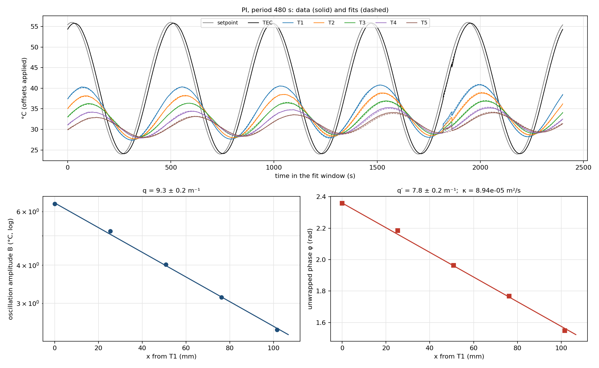

# A5: Angstrom Derivation and Model-Validity Plan

Assessment code: A5 (individual)  
Student: Kapil Naidu (lab partner Samuel Cohen; the measurements are our team's)  
Date: 2 November 2026 (data from the S18 live run the same day)  
Repository: https://github.com/kapilnaidu1/phys39-naidu-cohen, branch main

## 1. The rod equation and what κ and ν mean

Take a slice of the rod between x and x + dx, with cross-section A = πR², perimeter P = 2πR, density ρ, specific heat c, conductivity k and side heat-transfer coefficient h to a room at T∞. Heat stored = heat conducted in minus heat conducted out minus heat lost through the side:

```
ρ c A dx ∂T/∂t = kA ∂T/∂x |(x+dx) − kA ∂T/∂x |(x) − h P dx (T − T∞)
```

Divide by ρcA dx, let dx → 0 and write θ = T − T∞:

```
∂θ/∂t = κ ∂²θ/∂x² − ν θ,      κ = k/(ρc),      ν = hP/(ρcA) = 2h/(ρcR)
```

κ is the thermal diffusivity (how fast a temperature change spreads along the rod) and ν is the side-loss rate (how fast a slice relaxes toward room temperature through its surface). The assumptions are: one temperature per cross-section (small transverse Biot number, section 6.1), constant k, ρ, c and h, linear side loss, constant room temperature, and the measured temperature at the first rod hole (T1, x = 0) as the boundary condition. At steady state the same equation gives κθ″ = νθ, so the Module 7 decay constant is m² = ν/κ = hP/(kA).

## 2. Periodic solution

Drive the base as θ(0, t) = θ<sub>b</sub> cos ωt with ω = 2π/τ, and first treat the rod as semi-infinite (x ≥ 0, θ → 0 far away). Guess a complex exponential, because differentiating it returns the same function times a constant:

```
θ~(x, t) = θ_b e^(−s x) e^(i ω t)      ∂θ~/∂t = iω θ~,      ∂²θ~/∂x² = s² θ~
```

Substituting into the rod equation and cancelling θ~ turns the PDE into algebra:

```
i ω = κ s² − ν      →      s² = (ν + i ω) / κ
```

Keep the root with positive real part (the other one grows without limit) and write s = q + iq′. Then s² = q² − q′² + 2iqq′, and matching real and imaginary parts:

```
q² − q′² = ν/κ        2 q q′ = ω/κ
(q² + q′²)² = (ν² + ω²)/κ²
q  = √[ ( ν + √(ν² + ω²) ) / (2κ) ]        q′ = √[ ( −ν + √(ν² + ω²) ) / (2κ) ]
```

The physical temperature is the real part:

```
θ(x, t) = θ_b e^(−q x) cos(ω t − q′ x)
```

Every point oscillates at the drive frequency. The amplitude falls by a factor e every 1/q, and the phase lags by q′x radians (a time delay q′x/ω). Two limits check the algebra: with no side loss (ν = 0) q = q′ = √(ω/2κ); with side loss q > q′, because loss removes amplitude without adding delay. A shorter period (larger ω) raises both q and q′.

The setpoint mean is above room temperature, so the full solution also contains the stationary profile of Module 7. The equation is linear, so the two add; in the fits the mean is absorbed by a constant per sensor.

For the real rod, with an insulated top a distance L above T1, the periodic solution is

```
θ~(x, t) = θ_b e^(iωt) cosh(s(L − x)) / cosh(sL) = [semi-infinite] × (1 + e^(−2s(L−x))) / (1 + e^(−2sL))
```

The extra factor is a wave reflected from the top, of relative size about e^(−2q(L−x)). It is the finite-length check of section 6.2.

## 3. Inverse relations and dimensional checks

For two sensors Δx = x<sub>2</sub> − x<sub>1</sub> apart, q = ln(B<sub>1</sub>/B<sub>2</sub>)/Δx and q′ = Δφ/Δx. With five sensors, q and q′ are the slopes of ln B and of the unwrapped phase against x. Rearranging the two matching conditions:

```
κ = ω / (2 q q′)        ν = κ (q² − q′²)        k = ρ c κ = ρ c ω / (2 q q′)
```

The conductivity needs only the two measured slopes, the drive frequency and ρc; h never has to be measured. That is the point of the method.

| Quantity | Units | Check |
|---|---|---|
| θ, t, x | K, s, m | |
| ∂θ/∂t, κ∂²θ/∂x², νθ | K/s each | (m²/s)(K/m²) = K/s; (1/s)K = K/s |
| s², q², q′² | 1/m² | (ν + iω)/κ = (1/s)/(m²/s) |
| κ = ω/(2qq′) | m²/s | (rad/s)/(1/m²) |
| ν = κ(q² − q′²) | 1/s | (m²/s)(1/m²) |
| k = ρcκ | W/(m K) | (kg/m³)(J/(kg K))(m²/s) = J/(s m K) |
| ν = 2h/(ρcR) | 1/s | (W/(m² K)) / ((J/(m³ K)) m) |

Numerical check with the course example (ω = 0.0628 rad/s, q = 25 m⁻¹, q′ = 18 m⁻¹): κ = 0.0628/(2 × 25 × 18) = 6.98 × 10⁻⁵ m²/s and ν = 6.98 × 10⁻⁵ × (625 − 324) = 2.10 × 10⁻² s⁻¹, as on the course page.

## 4. Sign and phase conventions

- x is measured from T1's hole (the first rod hole), positive up the rod toward the top. T1 is the boundary; the TEC thermistor and the setpoint are not.
- θ = T − T∞ with T∞ = 22.53 °C, the mean of T1 to T5 (calibration offsets applied) with control off and the rod unheated, 09:47 on 2 November.
- Each sensor is fitted as T<sub>i</sub>(t) = a<sub>i</sub> + B<sub>i</sub> cos(ωt + φ<sub>i</sub>) + c<sub>i</sub>(t − t̄), with B<sub>i</sub> > 0. The drift term c<sub>i</sub> takes up the slow warming of the mean. With this convention a sensor that lags has a smaller φ<sub>i</sub>.
- Phases are unwrapped starting from T1 and going up the rod, so ln B(x) = ln B<sub>0</sub> − qx and φ(x) = φ<sub>0</sub> − q′x, both slopes negative and q, q′ > 0.
- The Arduino setpoint is T<sub>a</sub> + T<sub>b</sub> sin(phase), which is a cosine shifted by −π/2. Only phase differences between sensors enter q′, so the offset cancels.
- Calibration offsets (26 October room cross-check) are subtracted in analysis. A constant offset changes only a<sub>i</sub>, not B<sub>i</sub> or φ<sub>i</sub>.
- Errors: B<sub>i</sub> and φ<sub>i</sub> from the scatter of the same fit done cycle by cycle (standard error over 5 cycles), combined with a ±1 mm position uncertainty for T2 to T5 (T1 defines x = 0). Slope errors are scaled by √(χ²/dof) when that exceeds 1.

## 5. Acquisition plan

**Drive.** T<sub>a</sub> = 40 °C, T<sub>b</sub> = 16 °C (24 to 56 °C requested), PI on the TEC thermistor with K<sub>p</sub> = 12, K<sub>i</sub> = 0.2 and conditional-integration anti-windup, and negative commands multiplied by r = χ<sub>h</sub>/χ<sub>c</sub> = 0.501/0.181 = 2.771 (Module 4) before the ±255 clamp. In the S18 comparison at 100 s, open loop gave a TEC swing of 23 % of T<sub>b</sub>, P 76 % with a 2.6 °C droop, and PI 87 % with no droop and no saturation, so PI is the production mode. T<sub>a</sub> and T<sub>b</sub> stay fixed for every period so that only the frequency changes.

**Periods.** Planning numbers below use κ and ν from the S18 finite-rod fit at 480 s (section 6.3) and the sensors at 0 to 101.6 mm:

| Period (s) | 1/q (mm) | predicted B5/B1 | predicted lag T1 → T5 (rad) | finite-length change of B5/B1 | records per cycle |
|---|---|---|---|---|---|
| 100 | 54 | 0.152 | 1.83 | +0.1 % | 200 |
| 180 | 71 | 0.240 | 1.34 | 0.0 % | 360 |
| 240 | 82 | 0.285 | 1.14 | −0.8 % | 480 |
| 300 | 90 | 0.319 | 1.01 | −1.8 % | 600 |
| 480 | 111 | 0.386 | 0.80 | −3.4 % | 960 |

The course asks for the farthest sensor near B5 ≈ B1/e = 0.37 at the primary period, a T1 to T5 lag of 0.5 to 2 rad, and no period below 100 s. **Primary period 480 s**: measured on S18, B5/B1 = 0.385 and 0.81 rad, both on target, and the TEC follows the setpoint at 99 % amplitude. **Second period 100 s**: the course minimum, with measured B5/B1 = 0.149 and 1.79 rad; T5 still swings 0.43 °C, about 27 times its 0.016 °C fit residual. **Third period 240 s** for S20 sits between them and tests whether κ depends on frequency.

**Sampling.** One record every 0.5 s, each the mean of 1000 ADC readings (TEC) or 500 readings (each rod channel). That is 200 to 960 records per cycle, far more than a sinusoid needs; the averaging keeps the fit residuals at 0.016 to 0.03 °C at 100 s.

**Settling criterion** (fixed before looking at the fits). Fit each complete cycle on its own. A period counts as settled from the first cycle after which every sensor's B stays within 3 % and φ within 0.05 rad of the cycle before, with no steady trend over three cycles. The mean may still creep (the drift term handles it). Keep at least 5 complete settled cycles. On S18, PI at 100 s met this from its second cycle; at 480 s the first cycle after the switch had a TEC swing 3.5 % low and was excluded.

**Run lengths for S20.** About 2 cycles to settle plus 5 kept: 480 s about 56 min, 240 s about 28 min, 100 s about 12 min, roughly 1 h 40 min in one scheduled run with phase-continuous transitions kept in the record.

**Sensors.** TEC thermistor in the base; T1 to T5 taped into the first five holes at 0, 25.4, 50.8, 76.2 and 101.6 mm (±1 mm, `data/module_08/sensor_map.csv`); rod diameter 12.757 ± 0.006 mm by calipers; L = 281.9 mm from T1's hole to the top (`data/module_08/rod_geometry.csv`). No sensor moves between periods.

**Safety.** Software latch at 56 °C on T1 (the course limit for the rod base) and 65 °C on the TEC thermistor; the 70 °C thermal switch stays as the hardware backstop; setpoints are refused outside 10 to 56 °C; no period below 100 s. Highest raw readings on S18: T1 41.3 °C, TEC 55.9 °C.

**Room temperature.** Measure before heating and again after the run with everything at rest. On S18 it was measured only before, which is the main limitation on the means a<sub>i</sub> but does not affect B<sub>i</sub> or φ<sub>i</sub>.

## 6. Model-validity checks

### 6.1 Transverse Biot number

The 1-D equation needs the cross-section to be nearly isothermal, Bi<sub>⊥</sub> = hR/(2k) much less than 1. Because ν/κ = hP/(kA) = 2h/(kR), the measured slopes give it without knowing h or k: Bi<sub>⊥</sub> = (ν/κ)R²/4. With R = 6.378 mm:

| Source | ν/κ (m⁻²) | Bi<sub>⊥</sub> |
|---|---|---|
| Angstrom, 480 s finite-rod fit | 21.7 ± 3.8 | 2.2 × 10⁻⁴ |
| Angstrom, 100 s | 41.6 (ν poorly determined) | 4.2 × 10⁻⁴ |
| Module 7 steady profile, m² | 16.8 | 1.7 × 10⁻⁴ |

All are below 10⁻³, against my tolerance of 0.01, so the radial temperature variation is negligible. The 480 s value of ν/κ agrees with the independent Module 7 steady profile within 1.3 standard errors. With handbook ρc for aluminium (2.42 × 10⁶ J/(m³ K)), ν = 2.04 × 10⁻³ s⁻¹ corresponds to h ≈ νρcR/2 ≈ 16 W/(m² K), a normal value for still air.

### 6.2 Finite length

Using the measured s = q + iq′ at each period, the finite-rod factor of section 2 changes the ratios B<sub>i</sub>/B<sub>1</sub> and the lags φ<sub>1</sub> − φ<sub>i</sub> by:

| Period | | T2 | T3 | T4 | T5 |
|---|---|---|---|---|---|
| 100 s | B<sub>i</sub>/B<sub>1</sub> | 0.0 % | 0.0 % | +0.03 % | +0.13 % |
| 100 s | phase (rad) | 0.000 | 0.000 | 0.000 | 0.000 |
| 480 s | B<sub>i</sub>/B<sub>1</sub> | −0.4 % | −1.0 % | −2.0 % | −3.1 % |
| 480 s | phase (rad) | 0.002 | 0.001 | −0.003 | −0.016 |

With a 1 % tolerance, the semi-infinite form is fine for all five sensors at 100 s, but at 480 s only T1 to T3 meet it. At 480 s I therefore fit the insulated-tip finite-rod solution to all five sensors instead of dropping T4 and T5.

### 6.3 Data-based checks (S18)

- **Boundary waveform.** At T1 the second harmonic is 2.3 % (100 s) and 1.5 % (480 s) of the fundamental, the heating and cooling halves agree within 0.2 °C (100 s comparison), and the PI command never reached the clamp. T1 is a clean sinusoid.
- **Sign of ν.** q > q′ at both periods, so ν > 0, as side loss requires.
- **Spatial residuals.** The straight-line fits have χ²/dof of 3.3 and 4.7 (100 s) and 2.3 and 3.2 (480 s): the points scatter about twice their errors, so a sensor-to-sensor effect of a few percent (contact or position) is not yet in the error budget.
- **Frequency consistency**, `data/module_08/angstrom_finite_angstrom_live_20261102_094506.txt`:

| Fit | κ at 100 s (10⁻⁵ m²/s) | κ at 480 s (10⁻⁵ m²/s) | difference | χ² at 480 s (6 dof) |
|---|---|---|---|---|
| semi-infinite | 9.74 ± 0.23 | 8.93 ± 0.25 | 2.4 σ | 16.8 |
| finite rod, L = 281.9 mm | 9.74 ± 0.23 | 9.40 ± 0.24 | 1.0 σ | 11.1 |

The semi-infinite fits disagree between the two periods; the finite-rod fits agree within one standard error and fit the 480 s data better. The frequency dependence is the finite-length effect that section 6.2 predicts.



**Figure 1.** PI at 480 s, cycles 2 to 6 of the S18 run. Top: setpoint, TEC and T1 to T5 with the per-sensor fits (dashed). Bottom: amplitude on a log scale and unwrapped phase against position, with the semi-infinite lines (q = 9.34 ± 0.18 m⁻¹, q′ = 7.84 ± 0.15 m⁻¹).

- **Comparison with the literature.** The handbook values for 6061-T6 (k = 167 W/(m K), ρ = 2700 kg/m³, c = 896 J/(kg K)) give κ = 6.9 × 10⁻⁵ m²/s, about 30 % below our finite-rod values. Neither the Biot number nor the finite length explains this. Things to test in S19 to S22: the sensor positions (κ scales as Δx², so a 1 mm error in each 25.4 mm spacing moves κ by 8 %; the bead may not sit at the hole's centre line), different response lags of the taped sensors, and the alloy itself.

## 7. Conclusion: do the retained sensors support the 1-D analysis?

Yes, with one condition. Across the rod, Bi<sub>⊥</sub> ≤ 4 × 10⁻⁴, so every cross-section is at one temperature and T1 to T5 measure the 1-D field. Along the rod, the semi-infinite solution is adequate for all five sensors at 100 s (finite-length change ≤ 0.13 %), but at 480 s it is off by 2 to 3 % at T4 and T5; there I use the finite-rod solution with L = 281.9 mm, which brings κ at the two periods into agreement (9.74 ± 0.23 and 9.40 ± 0.24 × 10⁻⁵ m²/s). The remaining gap to the handbook κ and the spatial χ² of 2 to 5 are the open questions for the production run, not signs that the one-dimensional picture fails.

## 8. Files and commands

- Live run: `data/module_08/angstrom_live_20261102_094506.csv` (with `_events.txt`, `_notes.csv`, `_meta.json`); sketch `arduino/module_08/angstrom_tec/angstrom_tec.ino`; GUI `python/angstrom_gui.py`.
- Notes: `docs/module_notes/module_08_angstrom.md`.

```
RUN=data/module_08/angstrom_live_20261102_094506.csv
CAL=data/module_08/calibration_rod_run_20261026_112627.csv
python3 python/analysis/angstrom_fit.py $RUN --mode PI --period 100 --cycles 5 --offsets $CAL
python3 python/analysis/angstrom_fit.py $RUN --mode PI --period 480 --cycles 5 \
    --t-end 5507.21 --offsets $CAL
python3 python/analysis/angstrom_fit.py $RUN --compare --period 100 --cycles 3 --offsets $CAL
python3 python/analysis/angstrom_finite_fit.py \
    data/module_08/angstrom_fit_angstrom_live_20261102_094506_PI_100s.csv \
    data/module_08/angstrom_fit_angstrom_live_20261102_094506_PI_480s.csv \
    --length-mm 281.9 --dx-mm 1
```

## 9. AI use

I used an AI assistant (Claude) to help draft this write-up, the analysis scripts and the figures from our team's measurements, as the course AI policy allows. I checked the derivation step by step and checked every number against the scripts and data files listed above.
