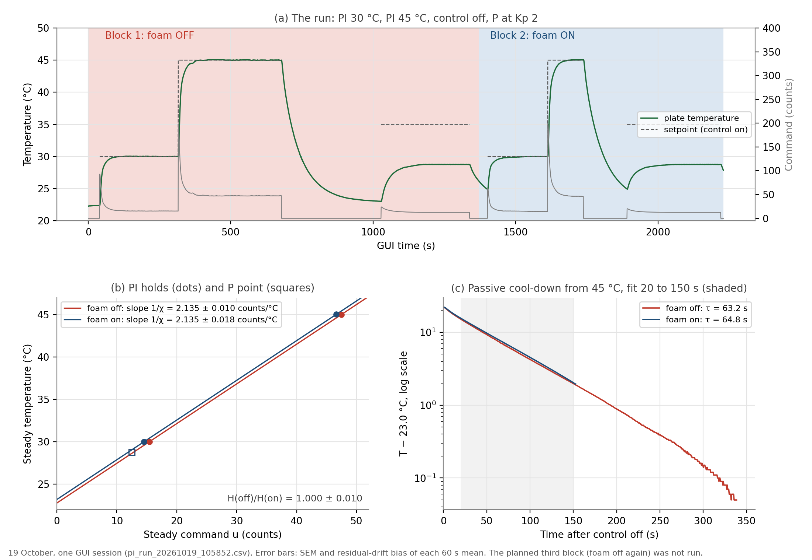

# Foam-removal experiment: does the insulating box change the heat loss H?

Naidu / Cohen. Run 19 October 2026, one session. Requested by Prof. Fraden as a
two-part design: (1) what removing the foam changes in the equations, and
(2) the most sensitive way to detect it.

**Files:** data `data/module_06/pi_run_20261019_105852.csv`; bench log
`data/module_06/bench_log_2026-10-19.md`; analysis
[`python/foam_experiment_analysis.py`](../../python/foam_experiment_analysis.py)
(output `data/module_06/foam_experiment_output.txt`); design and sensitivity
study in [`module_06_oral_review.md`](module_06_oral_review.md), section 6, with
[`python/insulation_sensitivity.py`](../../python/insulation_sensitivity.py).

---

## 1. Model and prediction

One-lump energy balance for the plate:

```
C dT/dt = P_u u − H (T − T_amb)
```

The loss term is really two paths in parallel:

```
H (T − T_eff) = H_TEC (T − T_sink) + H_air (T − T_room)
```

through the TEC into the water block, and through the air and foam to the room.
Removing the foam can only raise H<sub>air</sub>. C (same metal) and P<sub>u</sub>
(same TEC, same drive) do not change.

**Predictions if H rises by a factor f:** χ = P<sub>u</sub>/H and τ = C/H both
fall by f; the P droop (T<sub>set</sub> − T<sub>amb</sub>)/(1 + χK<sub>p</sub>)
grows; PI still reaches the setpoint but needs f times more steady command.

## 2. Design: where the foam shows up most

| Observable | Sensitivity to H | Use |
|---|---|---|
| PI steady temperature | none (the integral cancels H) | not useful |
| **PI steady command** | **full**: u<sub>ss</sub> = (H/P<sub>u</sub>)(T<sub>set</sub> − T<sub>eff</sub>) | **primary** |
| P droop | largest absolute change at L = χK<sub>p</sub> ≈ 1, i.e. K<sub>p</sub> ≈ 2 | cross-check |
| Passive cool-down τ = C/H | full, but needs the final temperature | cross-check |
| Ringing at high gain | almost none | not useful |

**Primary measurement:** hold the plate with PI at two setpoints and take the
slope Δu<sub>ss</sub>/ΔT = H/P<sub>u</sub> = 1/χ<sub>h</sub>. The slope cancels
the room temperature and any constant drift, and the foam-off to foam-on ratio
of slopes is H′/H directly, because P<sub>u</sub> cancels. On the 13 October
data (30 and 35 °C holds) this method gave χ<sub>h</sub> = 0.505 with 1.6 %
scatter per pair, against 0.501 from Module 4.

## 3. Method (as run)

`tec_pi_safety` sketch, `tec_pi_control_gui.py`, anti-windup on, PWM limit 255,
water loop on. Each block: PI (K<sub>p</sub> 12, K<sub>i</sub> 0.2) at 30 °C,
then 45 °C; control off (passive cool-down); P at K<sub>p</sub> 2, setpoint
35 °C. Steady values are the mean of the last 60 s of each hold.

| Block | Foam | PI 30 °C | PI 45 °C | Cool-down | P, K<sub>p</sub> 2 |
|---|---|---|---|---|---|
| 1 | off | 275 s | 362 s | 350 s | 310 s |
| 2 | on | 211 s | 125 s | 153 s | 329 s |

The planned third block (foam off again, to bracket drift) was not run for lack
of time.

## 4. Results



| Measurement | Foam off | Foam on |
|---|---|---|
| Steady command at 30 / 45 °C | 15.44 / 47.45 counts | 14.54 / 46.59 counts |
| **Slope H/P<sub>u,h</sub>** | **2.135 ± 0.010** counts/°C | **2.135 ± 0.018** counts/°C |
| P, K<sub>p</sub> 2: steady T (droop) | 28.753 °C (6.247) | 28.753 °C (6.247) |
| Cool-down τ, common final temperature 23.0 °C | 63.2 s | 64.8 s |
| Temperature noise sd at 30 / 45 °C | 0.007 / 0.021 °C | 0.005 / 0.021 °C |

**H(foam off)/H(foam on) = 1.000 ± 0.010** (1σ). The 2σ range is 0.98 to 1.02.

Uncertainties combine the standard error of each 60 s mean with the bias that a
leftover drift could cause. The cool-down τ depends on how the final temperature
is fitted (2 to 8 % difference), because the foam-on cool-down was short.

### Follow-up, 21 October: one setpoint at 50 °C

File `data/module_06/pi_run_20261021_113509.csv`, log
`data/module_06/bench_log_2026-10-21.md`. PI hold at 50 °C, foam off, then foam on.

| Hold | Foam | Steady command at 50 °C |
|---|---|---|
| 1 | off | 68.6 counts, still falling 0.5 counts/min (about 1 min at the setpoint) |
| 2 | on | 62.5 counts, settled |

Foam off needed about 9 % more power. With a single setpoint this cannot be
separated from a warm-up shift of the effective room temperature: a 2.8 °C
shift would explain all 6 counts. As on 19 October, the foam-off block ran
first, and on both days the first block needed more power, which fits warm-up
drift. The foam-off hold was also not settled. This run is therefore weaker
evidence than the 19 October slope, which cancels such offsets.

## 5. Conclusion

Removing the foam box changed the plate's heat-loss conductance by **less than
about 2 %**. The P droop at the most sensitive gain was identical, and the
temperature noise did not increase. The heat leaves the plate mainly by paths the
foam does not touch: conduction through the TEC into the water-cooled block, and
the mounting. A rough constant-property estimate from the Laird data sheet puts
the TEC's own passive conductance at about 0.6 W/K, against a model H of about
1.18 W/K. The data cannot say how the rest divides, only that the air path is
small, or that the box was never insulating much.

## 6. Limitations and open points

- **No second foam-off block**, so drift is not fully bracketed. The slope cancels
  a constant drift, and the identical P points argue against a large change.
- **Constant offset:** the foam-on commands were 0.9 counts lower at both
  setpoints, an effective room temperature 0.4 °C higher. That is an offset, not a
  change of H. It may be drift or warm air trapped in the box.
- **χ<sub>h</sub> over 30 to 45 °C is 0.468** in both blocks, against 0.505 over
  30 to 35 °C on 13 October. Either the plant line curves at higher temperature or
  it is a day-to-day difference. A 35 °C hold in the same session would tell.
- Heating side only. The foam may matter more when cooling below room
  temperature (condensation), with drafts, or at larger temperature differences.

## 7. Reproduce

```bash
python3 python/foam_experiment_analysis.py
python3 python/insulation_sensitivity.py
```
