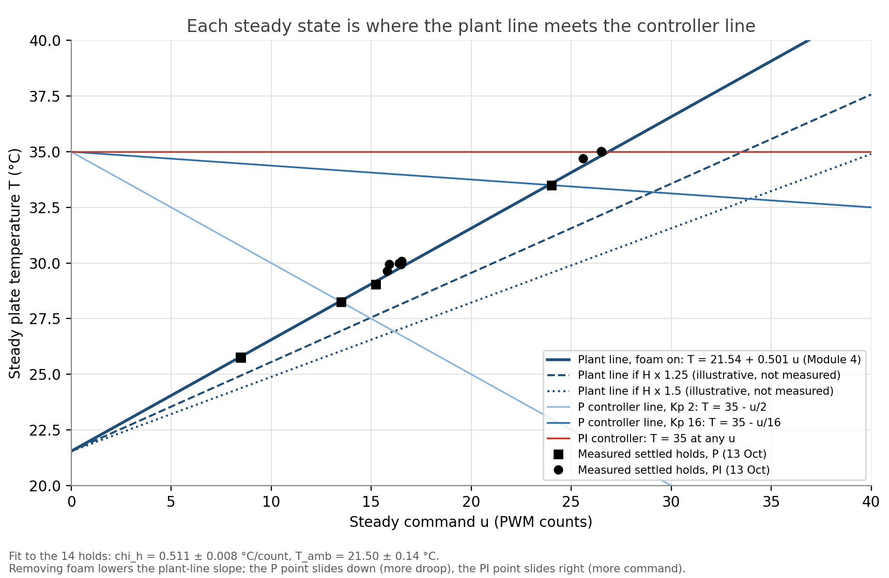
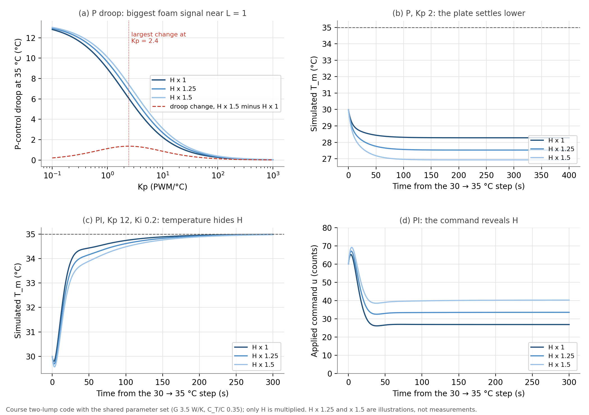

# Module 6 Part I: oral review preparation, and the foam-removal experiment

Naidu / Cohen, for the oral review on Wednesday 21 October.

Numbers come from Module 4 (χ<sub>h</sub> = 0.501, χ<sub>c</sub> = 0.181 °C/count,
τ = 62.9 s, T<sub>amb</sub> = 21.54 °C), the 13 and 14 October runs, and
[`python/insulation_sensitivity.py`](../../python/insulation_sensitivity.py)
(output in `data/module_06/insulation_sensitivity_output.txt`, settled holds in
`data/module_06/steady_operating_points.csv`, figures in
`docs/figures/module_06/oral_review/`). Anything labelled "H × 1.25" or
"H × 1.5" is an illustration, not a measurement.

---

## 1. The board derivation

```
C dT/dt = P_u u − H (T − T_amb)          plant (one lump)
u       = K_p (T_set − T)                 P controller
C dT/dt = P_u K_p (T_set − T) − H (T − T_amb)
0       = P_u K_p T_set − P_u K_p T − H T + H T_amb        (steady state)
T_ss    = (P_u K_p T_set + H T_amb) / (P_u K_p + H)
```

**How to read it.** T<sub>ss</sub> is a weighted average of the setpoint and
room temperature. The weights are two conductances in W/K: P<sub>u</sub>K<sub>p</sub>,
how hard the controller pulls toward T<sub>set</sub>, and H, how hard the room
pulls toward T<sub>amb</sub>. Whichever is larger wins.

Subtracting from T<sub>set</sub> gives the droop:

```
T_set − T_ss = H (T_set − T_amb) / (P_u K_p + H) = (T_set − T_amb) / (1 + L),   L = P_u K_p / H = χ K_p
```

The same equation written about T<sub>ss</sub> is

```
C dT/dt = −(H + P_u K_p)(T − T_ss)   ⇒   τ_cl = C / (H + P_u K_p) = τ / (1 + L)
```

**Check against the bench (13 October, 35 °C setpoint):**

| K<sub>p</sub> | L = χ<sub>h</sub>K<sub>p</sub> | T<sub>ss</sub> predicted | T<sub>ss</sub> measured | τ<sub>cl</sub> | 10 to 90 % rise, ln 9 · τ<sub>cl</sub> | measured rise |
|---|---|---|---|---|---|---|
| 2 (Run 1) | 1.00 | 28.28 °C | 28.25 °C | 31.4 s | 69 s | 74 s |
| 16 (Run 2) | 8.02 | 33.51 °C | 33.50 °C | 7.0 s | 15 s | 13 s |
| 64 (Run 3a) | 32.1 | 34.59 °C | 34.59 °C | 1.9 s | 4.2 s | 2.1 s, with 35 % overshoot |

The steady states agree to 0.03 °C; the timing agrees at low gain and fails
at high gain, where the two-lump lag takes over.

**The same thing as a picture.** Every steady state is where two lines cross:
the plant line T = T<sub>amb</sub> + χu and the controller line
u = K<sub>p</sub>(T<sub>set</sub> − T). PI has a horizontal controller "line" at
T = T<sub>set</sub>: it accepts any u, so it always lands exactly on the
setpoint.



All 14 settled holds of 13 October (P and PI, five different controllers) lie
on one plant line. Fitting them gives χ<sub>h</sub> = 0.511 ± 0.008 °C/count
and T<sub>amb</sub> = 21.50 ± 0.14 °C. Module 4 found 0.501 and 21.54 °C in
late September with no controller at all. The controller only chooses where on
the plant line the plate sits.

---

## 2. Moving from one Goldilocks graph to another

**What changes:** only the gain. The plate, TEC, water loop, foam and setpoints
were the same for all six runs, so C, H, P<sub>u</sub> and G are fixed and
every difference between the plots comes from K<sub>p</sub> or K<sub>i</sub>.

| Run | Gain | L | One-lump prediction | Two-lump measure | What the plot shows |
|---|---|---|---|---|---|
| 1 | K<sub>p</sub> 2 | 1.0 | droop 6.7 °C, τ<sub>cl</sub> 31 s | ζ<sub>2L,P</sub> 1.43 | slow, large droop |
| 2 | K<sub>p</sub> 16 | 8.0 | droop 1.5 °C, τ<sub>cl</sub> 7 s | ζ<sub>2L,P</sub> 0.67 | fast, small droop, no visible overshoot |
| 3 | K<sub>p</sub> 200 | 100 | droop 0.13 °C, τ<sub>cl</sub> 0.6 s | ζ<sub>2L,P</sub> 0.20 | sustained 2.6 °C oscillation at ±255 |
| 4 | K<sub>p</sub> 12, K<sub>i</sub> 0.05 | 6.0 | ζ<sub>PI</sub> 2.79 | ρ<sub>I</sub> 0.015 | slow integral creep, 0.29 °C short after 300 s |
| 5 | K<sub>p</sub> 12, K<sub>i</sub> 0.2 | 6.0 | ζ<sub>PI</sub> 1.40 | ρ<sub>I</sub> 0.061 | no droop, settled in about 50 s |
| 6 | K<sub>p</sub> 12, K<sub>i</sub> 20 | 6.0 | ζ<sub>PI</sub> 0.14 | ρ<sub>I</sub> 6.15 | unstable, an 11 °C swing held by ±255 |

ζ<sub>PI</sub> is the one-lump PI damping (1 + L)/(2√(τχK<sub>i</sub>)).

- **Up the P column:** raising K<sub>p</sub> raises L, so the droop shrinks as
  1/(1 + L) and the loop speeds up as τ/(1 + L). In the one-lump model this
  never oscillates. In the two-lump model ζ<sub>2L,P</sub> falls below 1 once
  K<sub>p</sub> > K<sub>p,crit</sub> = 6.2, so overshoot appears.
- **Up the PI column:** at fixed K<sub>p</sub>, raising K<sub>i</sub> makes the
  integral remove the droop faster, but lowers ζ<sub>PI</sub> and raises
  ρ<sub>I</sub> = K<sub>i</sub>/K<sub>i,crit</sub>. Past ρ<sub>I</sub> = 1 the
  two-lump loop is unstable, and only the ±255 limit bounds it.
- **The other way to move between graphs is to change the plant.** Everything
  depends on L = P<sub>u</sub>K<sub>p</sub>/H. Raising H (removing foam) at
  fixed K<sub>p</sub> moves a P run toward the "too little gain" plot, as if
  K<sub>p</sub> had been lowered. The two are not identical, though: lower
  K<sub>p</sub> makes the loop slower, while higher H makes it faster
  (τ<sub>cl</sub> = C/(H + P<sub>u</sub>K<sub>p</sub>)). Droop and speed
  together can tell them apart; droop alone cannot.

---

## 3. Taking the insulation off

Removing the foam increases H. Nothing else in the one-lump equation needs to
change: C is the same metal, and P<sub>u</sub> is the same TEC at the same drive.

| Quantity | Formula | Foam off | H × 1.25 (illustration) |
|---|---|---|---|
| Susceptibility | χ = P<sub>u</sub>/H | smaller | 0.501 → 0.401 °C/count |
| Open-loop time constant | τ = C/H | shorter | 62.9 → 50.3 s |
| P droop | (T<sub>set</sub> − T<sub>amb</sub>)/(1 + L) | **larger** | K<sub>p</sub> 2: 6.72 → 7.47 °C |
| P closed-loop time | C/(H + P<sub>u</sub>K<sub>p</sub>) | **shorter** | K<sub>p</sub> 2: 31.4 → 27.9 s |
| PI steady error | 0 | still 0 | 0 |
| PI steady command | (T<sub>set</sub> − T<sub>amb</sub>)/χ | larger | 35 °C: 26.9 → 33.6 counts |
| One-lump PI damping | (H + P<sub>u</sub>K<sub>p</sub>)/(2√(CP<sub>u</sub>K<sub>i</sub>)) | slightly larger | K<sub>i</sub> 0.2: 1.40 → 1.45 |
| One-lump PI natural frequency | √(P<sub>u</sub>K<sub>i</sub>/C) | unchanged | |
| Hottest and coldest holdable temperature | T<sub>amb</sub> + 255χ<sub>h</sub>, T<sub>amb</sub> − 255χ<sub>c</sub> | closer to room | |

So the answer to "what happens": more heat leaks out, so the P controller needs
a bigger error to supply it (more droop). Because the plate also relaxes to
room faster, it gets there sooner. PI still reaches the setpoint exactly, but
the integral has to build up a larger command, and the TEC runs harder to hold
the same temperature. Without the box, air currents also make H fluctuate,
which should show up as extra temperature noise. That effect is not in the model.

**In the two-lump model**, H sits in the measured-lump equation,
C<sub>m</sub> dT<sub>m</sub>/dt = G(T − T<sub>m</sub>) − H(T<sub>m</sub> − T<sub>amb</sub>).
With the shared parameters, H × 1.25 moves ζ<sub>2L,P</sub> at K<sub>p</sub> 16
only from 0.673 to 0.681, and K<sub>i,crit</sub> at K<sub>p</sub> 12 from 3.25
to 3.46. The ringing in the high-gain plots would look almost the same; the
foam shows up in the steady states, not in the oscillations.

---

## 4. Increasing G, the conductance between the TEC and the metal lump

G is the thermal contact between the TEC face and the plate (paste, clamping
pressure, the metal path to the thermistor).

- **Steady state: no change.** At steady state the two equations add to
  P<sub>u</sub>u = H(T<sub>m</sub> − T<sub>amb</sub>), with no G in it. Only the
  internal difference T − T<sub>m</sub> = H(T<sub>m</sub> − T<sub>amb</sub>)/G
  gets smaller.
- **Transient: less lag, more damping.** Over our range, larger G raises
  ζ<sub>2L,P</sub>, K<sub>p,crit</sub> and K<sub>i,crit</sub>, so higher gains
  can be used before ringing or instability. Our Part II numbers at
  K<sub>p</sub> = 64: G = 2, 3, 3.5, 4 W/K gives ζ<sub>2L,P</sub> 0.29, 0.33,
  0.35, 0.37 and overshoot 46, 38, 35, 32 %. In the PI demonstration set
  (K<sub>p</sub> 18), K<sub>i,crit</sub> = 0.88, 1.37, 2.34, 5.27 at
  G = 0.5, 1, 2, 5 W/K.
- **Limit:** G → ∞ forces T<sub>m</sub> = T, so the model becomes one lump, and
  P control can no longer overshoot. The course notes the trend is not
  monotonic at the extremes (tiny G disconnects the block), so "more G always
  damps" is only true over the apparatus range.

```
ζ_2L,P   = [C_T(G+H) + C_m G] / [2 √(C_T C_m G (H + P_u K_p))]
K_i,crit = [C_T(G+H) + C_m G](H + P_u K_p) / (C_T C_m P_u)
```

---

## 5. Changing the time constant, and how long things take

τ = C/H, the energy needed per degree divided by the leak per degree.

| Knob | Effect on τ | Effect on steady state |
|---|---|---|
| More mass or a higher heat capacity (C up) | longer | none: χ = P<sub>u</sub>/H has no C |
| Better insulation (H down) | longer | larger χ, so a larger open-loop rise and less P droop |
| Less insulation (H up) | shorter | smaller χ, more droop |
| Gain (closed loop) | τ<sub>cl</sub> = τ/(1 + L), shorter with K<sub>p</sub> | less droop |
| Supply voltage (P<sub>u</sub>) | open loop none; closed loop shorter via L | larger χ |

In the course simulator, doubling C kept the steady state at 33.50 °C and moved
the 63 % time from 80 to 160 s (Part I notes, section 12).

**Time taken:** the 10 to 90 % rise is ln 9 · τ = 2.2τ, and settling to 2 % is
ln 50 · τ = 3.9τ. Open loop: 2.2 × 62.9 = 138 s. At K<sub>p</sub> 2:
τ<sub>cl</sub> = 31.4 s, so the rise is 69 s (74 s measured). At K<sub>p</sub>
16: 7.0 s and 15 s (13 s measured).

---

## 6. Designing the foam-removal experiment

### Prong 1: what changes mathematically

The lumped loss term is really two paths, through the TEC to the water block
and through the air and foam to the room:

```
C dT/dt = P_u u − H_TEC (T − T_sink) − H_air (T − T_room)
        = P_u u − H (T − T_eff),    H = H_TEC + H_air,   T_eff = (H_TEC T_sink + H_air T_room) / H
```

Removing the foam raises H<sub>air</sub> only. In the one-lump equation that
changes two things: H goes up, and T<sub>eff</sub> moves toward room air. C,
P<sub>u,h</sub> and P<sub>u,c</sub> do not change. This gives testable
predictions:

1. χ<sub>h</sub>, χ<sub>c</sub> and τ all fall by the same factor, H/H′.
2. Their ratio r = χ<sub>h</sub>/χ<sub>c</sub> = P<sub>u,h</sub>/P<sub>u,c</sub>
   stays 2.77.
3. τ/χ = C/P<sub>u</sub> stays the same (125.5 count·s/°C heating).

If those fail, something besides H changed.

**How much of H can the foam affect?** A rough estimate from the Laird data
sheet, using the constant-property TEC model, gives the module's own passive
conductance as about 0.6 W/K. Our model H is 1.18 W/K. If both numbers are
right, roughly half of H is conduction through the TEC itself, which no foam
touches, so the fractional change in H may be modest. That is why the
measurement has to be sensitive. Both numbers rest on assumptions (the
data-sheet model, V = 12 V and R = 1.50 Ω behind our H), so treat this as an
order of magnitude.

**Two-lump form.** H<sub>air</sub> belongs on the measured lump (the plate the
box surrounds), which is where the course model puts all of H. Strictly,
H<sub>TEC</sub> acts on the TEC-side lump; the course model lumps both onto
C<sub>m</sub>.

### Prong 2: which measurement is most sensitive

Sensitivity S = d ln X / d ln H: the fractional change in an observable per
fractional change in H.

| Observable | S | Comment |
|---|---|---|
| χ<sub>h</sub>, χ<sub>c</sub>, τ (open-loop step) | −1 | full sensitivity, but needs T<sub>amb</sub> and a 5-minute step |
| **PI steady command u<sub>ss</sub> at fixed T<sub>set</sub>** | **+1** | full sensitivity, any gains, plate held at one temperature |
| P droop, K<sub>p</sub> 2 / 16 / 64 | +0.50 / +0.89 / +0.97 | a high S at high gain, but the droop itself is tiny there |
| P τ<sub>cl</sub>, K<sub>p</sub> 2 / 16 | −0.50 / −0.11 | gain hides H in the timing |
| PI steady temperature | 0 | the integral cancels H: temperature hides the foam |
| ζ<sub>2L,P</sub>, ringing | +0.05 (K<sub>p</sub> 16), +0.11 (K<sub>p</sub> 200) | almost blind to H |



**Design choices that follow:**

1. **Measure the PI command, not the PI temperature** (panels c and d). At
   steady state u<sub>ss</sub> = (H/P<sub>u</sub>)(T<sub>set</sub> − T<sub>eff</sub>):
   all of H, none of the gains.
2. **Use two setpoints and take the slope.** du<sub>ss</sub>/dT<sub>set</sub> =
   H/P<sub>u,h</sub> = 1/χ<sub>h</sub>, which removes T<sub>eff</sub> and room
   drift. The foam-off to foam-on ratio of slopes is H′/H directly, because
   P<sub>u</sub> cancels.
3. **This already works on our data.** Each 13 October run had a 30 °C and a
   35 °C hold. The five pairs give χ<sub>h</sub> = 0.498, 0.507, 0.515, 0.507,
   0.495, mean 0.505 with a scatter of 1.6 % per pair, against 0.501 from Module
   4. So a single pair per condition resolves a change in H of about 5 % at
   2σ (√2 × 1.6 % × 2). A wider span (30 and 45 °C) or repeated pairs should
   do better.
4. **Bracket it A-B-A** (foam on, off, on). The same five pairs imply a room
   temperature of 21.53, 21.32, 21.51, 21.58 and 21.88 °C over about 50
   minutes, a drift as large as some of the effects being looked for. Repeating "on" at the end
   shows whether drift, not the foam, made the difference.
5. **If a P run is wanted for the Goldilocks picture, use K<sub>p</sub> ≈ 2.**
   For a change from H<sub>1</sub> to H<sub>2</sub>, the absolute droop change
   is largest when P<sub>u</sub>K<sub>p</sub> = √(H<sub>1</sub>H<sub>2</sub>),
   i.e. L ≈ 1 (panel a). Run 1's K<sub>p</sub> = 2 is already there: H × 1.5
   would move its droop by 1.35 °C at a 35 °C setpoint, against a
   steady-state noise sd of 0.008 °C in Run 1.
6. **Cross-check with one open-loop step** (u = +25 from equilibrium, at least
   5 minutes). It gives χ and τ, which must change by the same factor as the PI
   slope (prediction 1).

### Protocol (about 25 minutes per condition, 75 minutes in all)

`tec_pi_safety` sketch, `tec_pi_control_gui.py`, anti-windup on, water loop
running. Write each step in the bench log with its clock time.

| Step | Setting | Duration | What it gives |
|---|---|---|---|
| 1 | control off, u = 0 | 5 min (about 5τ) | T<sub>eff</sub>, starting equilibrium |
| 2 | open loop u = +25 | 5 min | χ<sub>h</sub>, τ |
| 3 | PI, K<sub>p</sub> 12, K<sub>i</sub> 0.2, T<sub>set</sub> 30 °C | 4 min | u<sub>ss</sub>(30), mean of the last 60 s |
| 4 | same, T<sub>set</sub> 45 °C | 4 min | u<sub>ss</sub>(45) |
| 5 | P, K<sub>p</sub> 2, T<sub>set</sub> 35 °C | 5 min | droop at L ≈ 1 |

Run the table with the foam on (A), then remove the box with control off and
run it again (B), then replace the box and run it a third time (A). In the
two-lump model the 30 to 45 °C step peaks at 45.5 °C with the largest command
198 counts (207 at H × 1.5), so the PI never saturates and the plate stays well
under the 60 °C latch. The steady command at 45 °C is 47 counts with the foam
on and 70 at H × 1.5.

**Analysis.**

- From steps 3 and 4: slope = Δu<sub>ss</sub>/ΔT → H′/H = slope<sub>B</sub> /
  mean(slope<sub>A1</sub>, slope<sub>A2</sub>).
- From step 2: the ratios of χ and of τ, which should match that factor.
- From step 1 and the intercepts: the shift in T<sub>eff</sub>.
- From the last 60 s of each hold: the noise sd, to test whether it is higher
  with the foam off.

**What would falsify the one-parameter picture:** the χ ratio and the τ ratio
disagree beyond their uncertainties; r = χ<sub>h</sub>/χ<sub>c</sub> changes; or
the two A blocks disagree with each other more than with B.

---

## 7. Equation sheet

| | |
|---|---|
| Plant | C dT/dt = P<sub>u</sub>u − H(T − T<sub>amb</sub>) |
| Open loop | χ = P<sub>u</sub>/H, τ = C/H, T<sub>ss</sub> = T<sub>amb</sub> + χu |
| P | L = χK<sub>p</sub>, droop = (T<sub>set</sub> − T<sub>amb</sub>)/(1 + L), τ<sub>cl</sub> = τ/(1 + L) |
| PI | dq/dt = e, u = K<sub>p</sub>e + K<sub>i</sub>q; steady e = 0, u<sub>ss</sub> = (T<sub>set</sub> − T<sub>amb</sub>)/χ |
| One-lump PI | ω<sub>n</sub> = √(χK<sub>i</sub>/τ) = √(P<sub>u</sub>K<sub>i</sub>/C), ζ = (1 + L)/(2√(τχK<sub>i</sub>)) |
| Two lumps | C<sub>T</sub> dT/dt = P<sub>u</sub>u − G(T − T<sub>m</sub>); C<sub>m</sub> dT<sub>m</sub>/dt = G(T − T<sub>m</sub>) − H(T<sub>m</sub> − T<sub>amb</sub>) |
| Rise and settling | 10 to 90 %: ln 9 · τ; 2 %: ln 50 · τ |
| Units | C J/K, H and G W/K, P<sub>u</sub> W/count, χ K/count, K<sub>p</sub> count/K, K<sub>i</sub> count/(K s), L and ζ dimensionless |
