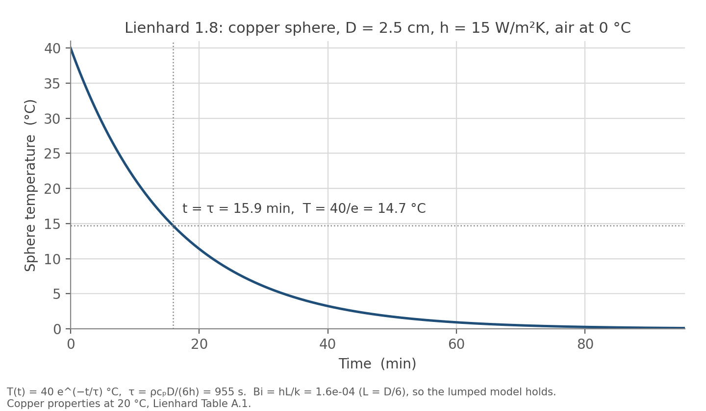
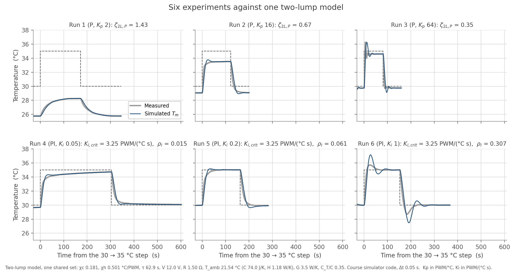

# Module 6 Part II: two-lump model and simulation

Naidu / Cohen. Class on 19 October 2026. Feeds A3 Questions 3 and 5.
Simulator: [`python/Lab_6_7_modeling_tec.py`](../../python/Lab_6_7_modeling_tec.py),
run from the repository root with `python3 python/Lab_6_7_modeling_tec.py`.

---

## Pre-class 1: Lienhard Problem 1.8 (possible board work)

**Problem.** A copper sphere, D = 2.5 cm, starts uniformly at 40 &deg;C and
hangs in a slow air stream at 0 &deg;C with h = 15 W/m&sup2;K. Radiation is
neglected. Write the energy balance, solve it, plot T from 40 to 0 &deg;C, and
confirm Bi &#8810; 1.

**Physical system.** One lump: the whole sphere at one temperature T(t). Heat
leaves only by convection from its surface to air at T<sub>&infin;</sub> = 0
&deg;C. Copper at 20 &deg;C from Lienhard Table A.1: &rho; = 8954 kg/m&sup3;,
c<sub>p</sub> = 384 J/kg K, k = 398 W/m K, all taken as constant.

**Heat balance** (Lienhard eqn 1.20). Rate of change of stored energy equals
heat lost to the air:

```
rho c_p V dT/dt = -h A (T - T_inf)
```

Units: kg/m&sup3; &middot; J/(kg K) &middot; m&sup3; &middot; K/s = W on the
left, W/(m&sup2;K) &middot; m&sup2; &middot; K = W on the right.

**Solution** (eqns 1.21 and 1.22). With T(0) = T<sub>i</sub>:

```
T - T_inf = (T_i - T_inf) exp(-t / tau),   tau = rho c_p V / (h A) = rho c_p D / (6 h)
```

since V/A = D/6 for a sphere. Numbers: V = 8.18 &times; 10<sup>&minus;6</sup>
m&sup3;, A = 1.96 &times; 10<sup>&minus;3</sup> m&sup2;, m = 73.3 g, so
C = mc<sub>p</sub> = 28.1 J/K and hA = 0.0295 W/K, giving

**&tau; = 955 s, about 16 min.** T(t) = 40 e<sup>&minus;t/955 s</sup> &deg;C.
It never reaches 0 exactly: 1 &deg;C at 59 min, 0.1 &deg;C at 95 min.



**Lumped approximation, checked.** Lienhard's Biot number is Bi = hL/k, with L
a characteristic length of the body. With L = V/A = D/6, Bi = 1.6 &times;
10<sup>&minus;4</sup>; with L = D/2, 4.7 &times; 10<sup>&minus;4</sup>. Either
way Bi &#8810; 1: the resistance to conduction inside the copper is thousands
of times smaller than the resistance of the air film, so the sphere stays
uniform and only C and hA matter.

**Link to our TEC.** Same equation with C = mc<sub>p</sub> and H = hA, so
&tau; = C/H. For the plate, &tau; = 62.9 s. The TEC adds a source term
P<sub>u</sub>u to the right-hand side, which shifts where T ends up but not
how fast it gets there. Part II asks what happens when Bi is not small enough
to treat the TEC side and the thermistor side as one lump.

Script: [`python/lienhard_problem_1_8.py`](../../python/lienhard_problem_1_8.py).

---

## Pre-class 3: the two-lump equations, labelled

```
C_T dT/dt   = P_u(u) u - G (T - T_m)
C_m dT_m/dt = G (T - T_m) - H (T_m - T_amb)
```

| Symbol | Meaning | Units |
|---|---|---|
| T | temperature of the TEC-side lump, the face the TEC pumps heat into | &deg;C |
| T<sub>m</sub> | temperature of the measured lump, the block where the thermistor sits | &deg;C |
| T<sub>amb</sub> | room temperature | &deg;C |
| C<sub>T</sub>, C<sub>m</sub> | heat capacities of the two lumps; C = C<sub>T</sub> + C<sub>m</sub> is the one-lump C | J/K |
| G | thermal conductance between the two lumps | W/K |
| H | conductance from the measured lump to the room | W/K |
| u | signed PWM command, + heats, &minus; cools | counts |
| P<sub>u</sub>(u) | TEC heat per count: P<sub>u,h</sub> when heating, P<sub>u,c</sub> when cooling | W/count |

The TEC-side lump has no direct path to the room; all loss to the room goes
through H from the measured lump.

---

## Pre-class 4: the five two-lump prompts

**1. Which term carries heat from the TEC side to the measured side?**
G(T &minus; T<sub>m</sub>). It leaves the first equation with a minus sign and
enters the second with a plus sign, so the heat the TEC side loses is exactly
what the measured side gains.

**2. Which term is the heat loss from the measured block to room air?**
H(T<sub>m</sub> &minus; T<sub>amb</sub>), in the second equation.

**3. Why can T<sub>m</sub> lag behind T?** The TEC puts heat into C<sub>T</sub>
only. T<sub>m</sub> can change only when heat flows through G, and that flow is
G(T &minus; T<sub>m</sub>), which is zero until T has already moved away from
T<sub>m</sub>. So T moves first, and T<sub>m</sub> follows at a rate set by
G/C<sub>m</sub>. With a finite G and a nonzero C<sub>m</sub>, the measured
block is always catching up.

**4. Why can a controller that uses T<sub>m</sub> react too late?** The
controller sees only T<sub>m</sub>. When T<sub>m</sub> finally reaches the
setpoint, T is already above it, and the heat stored in C<sub>T</sub> keeps
flowing into the block after the command has dropped. T<sub>m</sub> carries on
past the setpoint, then the controller over-corrects the other way. The larger
the gain, the more heat goes in before the measurement catches up, which is
why Run 3 at K<sub>p</sub> = 64 overshot by 1.69 &deg;C and rang while Run 2
at K<sub>p</sub> = 16 did not.

**5. Rate-constant form.** Dividing the measured-lump equation by
C<sub>m</sub>:

```
dT_m/dt = (G/C_m)(T - T_m) - (H/C_m)(T_m - T_amb)
        =   k21  (T - T_m) -   k_m  (T_m - T_amb)
```

so k<sub>21</sub> = G/C<sub>m</sub> and k<sub>m</sub> = H/C<sub>m</sub>. Both
are (W/K)/(J/K) = 1/s, rate constants whose inverses are time scales.

- Raising k<sub>21</sub> (more coupling, or a lighter measured block) makes
  T<sub>m</sub> follow T faster: the two lumps equilibrate in about
  1/k<sub>21</sub>, so the lag shrinks. As G grows without limit the two lumps
  move together and the model becomes the one-lump model.
- Raising k<sub>m</sub> (more loss, or a lighter block) makes the block relax
  toward room temperature faster, in about 1/k<sub>m</sub>. It also lowers how
  far a given command can hold the block from room temperature, since at
  steady state T<sub>m</sub> &minus; T<sub>amb</sub> = P<sub>u</sub>u/H.

With our measured-mode numbers (C = 74.0 J/K, H = 1.176 W/K) and the starting
split C<sub>T</sub>/C = 0.35, C<sub>m</sub> = 48.1 J/K, so k<sub>m</sub> =
0.024 s<sup>&minus;1</sup> (about 41 s). k<sub>21</sub> depends on G, which we
have not measured; the starting guess G = 2 W/K gives 0.042
s<sup>&minus;1</sup> (about 24 s). Matching Run 3 in class fixes G.

---

## Settings check (in-class step 1)

`one_lump`, `p`, `measured`, with T<sub>amb</sub> = 21.54 &deg;C,
&chi;<sub>c</sub> = 0.181, &chi;<sub>h</sub> = 0.501 &deg;C/PWM,
&tau; = 62.9 s, V<sub>TEC</sub> = 12.0 V, R<sub>M</sub> = 1.50 &Omega;,
K<sub>p</sub> = 2.

The simulator derived C = 74.0 J/K, H = 1.176 W/K, P<sub>u,c</sub> = 0.2129
W/PWM, r = 2.77 and showed &tau; = 62.9 s. It settled with an error of about
4.2 &deg;C, near 25.8 &deg;C. The droop formula gives 4.23 &deg;C (25.77
&deg;C), and Run 1 measured 25.76 &deg;C at the same gain. The check passes,
so no one-lump rerun is needed.

---

## In-class step 2: three one-lump PI comparisons

`one_lump`, `pi`, anti-windup on, start at 21.54 &deg;C, setpoint 30 &deg;C,
600 s per run. Each run was done in the GUI (screenshots checked against the
numbers below). The numbers come from the same simulator code run with the
same settings, so they are exact rather than read off a plot. ζ is the
simulator's ζ<sub>1L,PI</sub> = (H + P<sub>u</sub>K<sub>p</sub>)/(2&radic;(C
P<sub>u</sub>K<sub>i</sub>)).

| Comparison | K<sub>p</sub> | K<sub>i</sub> | C (J/K) | ζ | Peak (&deg;C) | Within 0.1 &deg;C of 30 from |
|---|---|---|---|---|---|---|
| 1. raise K<sub>i</sub> | 12 | 0.06 | 74.0 | 2.55 | none; still 0.07 short at 600 s | 503 s |
| | 12 | 0.2 | 74.0 | 1.40 | 30.02 | 43 s |
| | 12 | 1.0 | 74.0 | 0.63 | 31.60 | 82 s |
| 2. raise K<sub>p</sub> | 4 | 0.2 | 74.0 | 0.60 | 31.30 | 187 s |
| | 12 | 0.2 | 74.0 | 1.40 | 30.02 | 43 s |
| | 32 | 0.2 | 74.0 | 3.39 | none; PWM at 255 at first | 201 s |
| 3. raise C (direct constants) | 12 | 0.2 | 75 | 1.38 | 30.02 | 45 s |
| | 12 | 0.2 | 150 | 0.98 | 30.58 | 199 s |

Comparison 3 used H = 1.20 W/K, P<sub>u,c</sub> = 0.21 W/PWM and r = 2.75 for
both runs, the values the GUI rounded to on switching to direct constants, so
only C differs between them.

**What each shows.**

1. Raising K<sub>i</sub> lowers ζ (ζ &prop; 1/&radic;K<sub>i</sub>). At
   ζ = 0.63 the plate overshoots by 1.6 &deg;C; at 1.40 by only 0.02 &deg;C;
   at 2.55 the integral is so slow that the last part of the droop takes
   minutes to remove, like Run 4.
2. Raising K<sub>p</sub> raises ζ (the numerator H + P<sub>u</sub>K<sub>p</sub>
   grows). Too much damping is not better: at K<sub>p</sub> = 32 there is no
   overshoot but the final 0.15 &deg;C takes over three minutes.
3. Doubling C at fixed H doubles &tau; and lowers ζ by &radic;2, from 1.38
   to 0.98: more thermal mass gives a slower, less damped response. The
   final temperature is the same, because the steady state depends on H and
   P<sub>u</sub>, not on C.

The ζ = 0.98 run still overshoots by 0.58 &deg;C. ζ near 1 does not guarantee
no overshoot for PI, because the controller adds a zero: the integral keeps
pushing until the error changes sign.

---

## In-class step 3: the two-lump P transition

The page's common parameter set, not our apparatus: `two_lump`, `direct
constants`, `p`, T<sub>amb</sub> = T<sub>0</sub> = 29 &deg;C, T<sub>set</sub> =
30 &deg;C, C = 91 J/K, H = 1.14 W/K, P<sub>u,c</sub> = 0.26 W/PWM, r = 2.0,
K<sub>i</sub> = 0, mass temperature only. ζ is the simulator's
ζ<sub>2L,P</sub>; every displayed value matched the page's prediction.

| Run | K<sub>p</sub> | G (W/K) | C<sub>T</sub>/C | ζ<sub>2L,P</sub> | Rise 10-90 % | Overshoot of T<sub>m</sub> |
|---|---|---|---|---|---|---|
| P1 | 60 | 50 | 0.35 | 1.31 | 5.3 s | none |
| P2 | 105 | 50 | 0.35 | 1.00 | 2.7 s | none |
| P3 | 160 | 50 | 0.35 | 0.81 | 1.6 s | 0.015 &deg;C (1.5 %) |
| G1 | 105 | 35 | 0.35 | 0.84 | 2.5 s | 0.009 &deg;C (0.9 %) |
| G2 | 105 | 70 | 0.35 | 1.18 | 2.9 s | none |
| F1 | 105 | 50 | 0.20 | 1.19 | 2.9 s | none |
| F2 | 105 | 50 | 0.50 | 0.96 | 2.6 s | none visible |
| F3 | 105 | 50 | 0.80 | 1.21 | 3.0 s | none |

Rise times and overshoots are from the simulator code with these settings.

**What it shows.** Raising K<sub>p</sub> moves the two-lump P loop from
monotonic (ζ 1.31) through critical (1.00) to underdamped (0.81), and the
response gets faster each time. That is what the one-lump P model can never
do: its single real eigenvalue cannot overshoot at any gain. The overshoot here
is small, 1.5 % at ζ = 0.81, because ζ is still close to 1. Lowering G (weaker
coupling, more lag) lowers ζ; raising it brings the model back toward one
lump. ζ is smallest when both thermal masses are appreciable (C<sub>T</sub>/C
= 0.5) and rises when the capacitance sits mostly in either lump, because then
one of the two states barely matters.

---

## In-class step 4: two-lump PI stability

Same common set with G = 2 W/K, K<sub>p</sub> = 18 PWM/&deg;C, `pi`,
anti-windup on, 1 &deg;C step so the PWM never saturates (largest command 64
counts). ρ<sub>I</sub> = K<sub>i</sub>/K<sub>i,crit</sub> with K<sub>i,crit</sub>
from Routh-Hurwitz, as displayed. Rise is 10-90 %, settling is the last time
T<sub>m</sub> leaves 30 &plusmn; 0.02 &deg;C (2 % of the step), period is the
spacing of the first two peaks. Every run was done in the GUI and matched;
numbers are from the simulator code with the same settings.

| Run | K<sub>i</sub> | G | K<sub>i,crit</sub> | ρ<sub>I</sub> | Rise | First overshoot | Successive peaks above 30 (&deg;C) | Settling | Period |
|---|---|---|---|---|---|---|---|---|---|
| S1 | 0.26 | 2 | 2.34 | 0.11 | 16.4 s | 0.18 &deg;C | 0.18, 0.01 | 61 s | 72 s |
| S2 | 1.0 | 2 | 2.34 | 0.43 | 12.7 s | 0.55 &deg;C | 0.55, 0.09, 0.02 | 169 s | 84 s |
| S3 | 2.1 | 2 | 2.34 | 0.90 | 10.4 s | 0.92 &deg;C | 0.92, 0.73, 0.58, 0.47 | not within 900 s | 72 s |
| S4 | 2.5 | 2 | 2.34 | 1.07 | 9.8 s | 1.02 &deg;C | 1.02, 1.07, 1.12, 1.17 (growing) | never | 68 s |
| S5 | 1.0 | 0.5 | 0.88 | 1.14 | 19.5 s | 1.05 &deg;C | 1.05, 1.22, 1.40, 1.62 (growing) | never | 135 s |
| S6 | 1.0 | 1 | 1.37 | 0.73 | 15.5 s | 0.81 &deg;C | 0.81, 0.44, 0.25, 0.15 | 674 s | 104 s |
| S7 | 1.0 | 5 | 5.27 | 0.19 | 10.8 s | 0.30 &deg;C | 0.30, 0.00 | 54 s | 80 s |

The 0.25 on the page snaps to 0.26 in the GUI (the K<sub>i</sub> slider moves
in 0.02 steps); ρ<sub>I</sub> is 0.11 either way.

**What it shows.**

- ρ<sub>I</sub> predicts the outcome before the run: well below 1 decays fast,
  just below 1 decays slowly, above 1 grows. All seven agreed with the
  prediction made from the displayed K<sub>i,crit</sub>.
- Raising K<sub>i</sub> shortens the initial correction (rise 16.4 to 9.8 s)
  while making the final settling slower (61 s, 169 s, then never). Faster
  approach and quicker settling pull in opposite directions.
- Lowering G, at fixed gains, lowers K<sub>i,crit</sub>: more internal lag
  leaves less room for integral action. The same K<sub>i</sub> = 1.0 is well
  damped at G = 5, rings at G = 1 and is unstable at G = 0.5.
- The growing runs (S4, S5) stay inside the PWM limit for the 600 s shown, so
  their growth is the linear instability itself, not saturation.
- Moving C<sub>T</sub>/C to either extreme at G = 2, K<sub>i</sub> = 1.0
  raises K<sub>i,crit</sub> and suppresses the ringing: C<sub>T</sub>/C = 0.1
  gives ρ<sub>I</sub> = 0.19 and 0.9 gives 0.13, each with a single overshoot
  of about 0.3 &deg;C and settling in 53 s and 106 s, against 0.55 &deg;C and
  169 s at 0.35. With most of the capacitance in one lump, one of the two
  states barely matters and the loop behaves almost like one lump again.

---

## Six Goldilocks plots, steps 1 and 2: one shared parameter set

**Step 1, measured quantities.** `two_lump`, `measured`: T<sub>amb</sub> =
21.54 &deg;C, &chi;<sub>c</sub> = 0.181, &chi;<sub>h</sub> = 0.501 &deg;C/PWM,
&tau; = 62.9 s, V<sub>TEC</sub> = 12.0 V (instructor's value, not measured),
R<sub>M</sub> = 1.50 &Omega; (data sheet), PWM limit 255. The simulator derives
C = 74.0 J/K, H = 1.176 W/K, P<sub>u,c</sub> = 0.213 W/PWM, r = 2.77. Starting
estimates for the internal structure: G = 2 W/K, C<sub>T</sub>/C = 0.35.

**Step 2, fix G and C<sub>T</sub>/C on the high-gain P run.** P control,
K<sub>p</sub> = 64, step from 29.74 to a 35 &deg;C setpoint, the conditions of
Run 3. Run 3 peaked at 36.28 &deg;C and settled at 34.59 &deg;C: a 35 %
overshoot followed by several decaying swings.

| G (W/K) | ζ<sub>2L,P</sub> | Simulated peak | Overshoot | Time of peak | Ringing period |
|---|---|---|---|---|---|
| 2 | 0.29 | 36.83 &deg;C | 46 % | 16.4 s | 30 s |
| 3 | 0.33 | 36.44 &deg;C | 38 % | 13.3 s | 25 s |
| **3.5** | **0.35** | **36.29 &deg;C** | **35 %** | **12.3 s** | **23 s** |
| 4 | 0.37 | 36.15 &deg;C | 32 % | 11.5 s | 21 s |
| Run 3, measured | | 36.28 &deg;C | 35 % | about 5 s | 9 s |

Each G was run in the GUI; the numbers are from the simulator code with the
same settings. Raising G raises ζ<sub>2L,P</sub> and reduces the overshoot, so
G was moved up from 2 until the overshoot matched.

**Chosen and locked: G = 3.5 W/K, C<sub>T</sub>/C = 0.35.** C<sub>T</sub>/C was
not changed: at the G values that give a 35 % overshoot, moving it between 0.2
and 0.5 changes the period only from about 19 to 24 s.

**The disagreement.** With the overshoot matched, the model rings about 2.5
times too slowly: peak at 12 s against about 5 s, period 23 s against 9 s. No
G and C<sub>T</sub>/C in the ranges tried give both a 35 % overshoot and a 9 s
period. A period near 9 s needs G of roughly 17 W/K (from the model's natural
frequency), and at G = 20 W/K the overshoot is only 2 %. Whatever lags behind the TEC in the real apparatus is
faster than a second lump holding a third of the plate's heat capacity. A
small, fast lag, such as the thermistor and its mounting, fits that better,
but this data does not identify it.

With these values K<sub>p,crit</sub> = 6.2 PWM/&deg;C (ζ<sub>2L,P</sub> = 1 on
the heating side). Run 1 (K<sub>p</sub> = 2, ζ = 1.43) is below it, Run 2
(K<sub>p</sub> = 16, ζ = 0.67) and Run 3 (K<sub>p</sub> = 64, ζ = 0.35) are
above it. For the PI runs at K<sub>p</sub> = 12, K<sub>i,crit</sub> = 3.25, so
ρ<sub>I</sub> = 0.015, 0.06 and 0.31 for K<sub>i</sub> = 0.05, 0.2 and 1.0: all
three are predicted stable.

**Step 3, K<sub>p</sub> sweep with the locked parameters** (P, step 29.74 to
35 &deg;C). ζ<sub>2L,P</sub> = 1.43, 1.01, 0.67, 0.35 at K<sub>p</sub> = 2, 6,
16, 64: monotonic, about critical, small overshoot, large overshoot with
ringing. At K<sub>p</sub> = 2 the model settles near 28.3 &deg;C; Run 1 settled
at 28.25 &deg;C at the same gain and setpoint. At K<sub>p</sub> = 16 the model
overshoots a little (about 6 %) where Run 2 showed none (0.02 &deg;C, noise
level), a second, smaller disagreement.

---

## Steps 4 and 5: the six simulation Goldilocks plots

Script: [`python/simulate_goldilocks_two_lump.py`](../../python/simulate_goldilocks_two_lump.py).
It imports the course simulator and steps its own `advance_model()`, so the
physics, the controller and its anti-windup are the course code, unchanged.
It runs outside the GUI only because the GUI rounds K<sub>i</sub> to steps of
0.02 and cannot be set to Run 4's 0.05.

**Shared physical parameters, in one sentence** (as A3 asks): every
simulation uses the two-lump model with &chi;<sub>c</sub> = 0.181 and
&chi;<sub>h</sub> = 0.501 &deg;C/PWM, &tau; = 62.9 s, V<sub>TEC</sub> = 12.0 V,
R<sub>M</sub> = 1.50 &Omega; and T<sub>amb</sub> = 21.54 &deg;C (so C = 74.0
J/K, H = 1.18 W/K, P<sub>u,c</sub> = 0.213 W/PWM, r = 2.77), with G = 3.5 W/K
and C<sub>T</sub>/C = 0.35, a 255 PWM limit and anti-windup on; only the
controller mode, K<sub>p</sub> and K<sub>i</sub> change.

**Matched conditions.** Each simulation starts at the temperature the plate
had when control was switched on in that run and uses the same setpoints
(30, 35, 30 &deg;C) and stage lengths. The figures use the experimental axes:
&minus;30 to 610 s from the 30 &rarr; 35 step, 25 to 38 &deg;C. Two
differences remain: the model updates its command every 0.05 s without
rounding, where the bench controller updated every 0.56 s in whole counts, and
both lumps start at the same temperature.

Figures: `docs/figures/module_06/goldilocks_sim/run1_sim.png` to
`run6_sim.png`, and `sim_vs_experiment.png` with each measured run under its
simulation. All metrics, simulated and measured: 
`data/module_06/goldilocks_sim_metrics.csv`.



**Stability numbers for the shared set** (heating side, as the simulator
displays them): K<sub>p,crit</sub> = 6.2 PWM/&deg;C; K<sub>i,crit</sub> = 3.25
PWM/(&deg;C s) at K<sub>p</sub> = 12.

| Run | Gains | Stability | Simulated end values (30 / 35 / 30) | Measured | Overshoot up / down, sim | measured |
|---|---|---|---|---|---|---|
| 1 | P, K<sub>p</sub> 2 | ζ<sub>2L,P</sub> 1.43, below K<sub>p,crit</sub> | 25.77 / 28.26 / 25.79 | 25.76 / 28.25 / 25.76 | none / none | none / none |
| 2 | P, K<sub>p</sub> 16 | ζ<sub>2L,P</sub> 0.67, above | 29.06 / 33.51 / 29.06 | 29.05 / 33.52 / 29.12 | 5.8 % / 2.9 % | none / none |
| 3 | P, K<sub>p</sub> 64 | ζ<sub>2L,P</sub> 0.35, far above | 29.75 / 34.59 / 29.74 | 29.74 / 34.59 / 29.76 | 34.5 % / 12.7 % | 34.8 % / 1.4 % |
| 4 | PI, K<sub>i</sub> 0.05 | ρ<sub>I</sub> 0.015 | 29.66 / 34.69 / 30.08 | 29.66 / 34.71 / 30.08 | none / none | none / none |
| 5 | PI, K<sub>i</sub> 0.2 | ρ<sub>I</sub> 0.061 | 29.97 / 35.01 / 29.89 | 29.97 / 35.02 / 29.93 | 3.1 % / 5.1 % | none / none |
| 6 | PI, K<sub>i</sub> 1.0 | ρ<sub>I</sub> 0.307 | 30.03 / 34.98 / 30.00 | 30.00 / 35.00 / 30.00 | 43.7 % / 50.6 % | 14.2 % / 26.0 % |

In the model, as on the bench, Run 3's command sits at the &plusmn;255 limit
for about 3 s after each step; no other run reaches it. "None" means under
1 %, which for these 4 to 5 &deg;C steps is below about
0.05 &deg;C and partly reflects stages that were still creeping when they
ended.

| Run, step | Rise 10-90 %, sim / measured | Settling &plusmn;2 %, sim / measured | Period, sim / measured |
|---|---|---|---|
| 1 up | 66 / 74 s | 115 / 110 s | |
| 2 up | 12 / 13 s | 35 / 42 s | |
| 3 up | 4.5 / 2.1 s | 36 / 21 s | 24 / 9 s |
| 4 up | 22 / 58 s | 212 / 225 s | |
| 5 up | 17 / 24 s | 44 / 52 s | |
| 6 up | 10 / 8 s | 104 / 56 s | 65 s / one crossing only |

**Classification.** From the closed-loop roots with the shared parameters
(heating side): Run 1 stable non-oscillatory (two real roots); Runs 2 and 3
stable underdamped (complex pair, ζ 0.67 and 0.35); Runs 4 and 5 stable with a
well-damped complex pair (ζ 0.77) and a slow real root that dominates the
approach, so effectively non-oscillatory; Run 6 stable underdamped (ζ 0.39).
None is marginal or unstable, and none was on the bench. Measured: Runs 1, 2,
4 and 5 non-oscillatory to within the 0.01 to 0.02 &deg;C noise, Runs 3 and 6
underdamped.

### The four comparison prompts (draft for A3 Questions 3 and 5)

**1. Best reproductions.** P: Run 1, whose end values agree to 0.03 &deg;C and
whose settling time (115 against 110 s) and rise (66 against 74 s) are close.
PI: Run 4, end values within 0.02 &deg;C, no overshoot in either, settling
212 against 225 s; its simulated rise is faster (22 against 58 s) because the
model reaches the last few tenths of a degree sooner. All six end values agree
to within 0.06 &deg;C, so the steady state, including P droop and its removal
by PI, is reproduced everywhere.

**2. The three P responses.** They are ordered by falling
ζ<sub>2L,P</sub> = 1.43, 0.67, 0.35 and rising K<sub>p</sub> relative to
K<sub>p,crit</sub> = 6.2: below it the response is monotonic and slow with a
large droop (Run 1, 4.2 &deg;C at 30); above it the model predicts overshoot
that grows as ζ falls. Measured, the response gets faster at each step (rise
74, 13, 2 s) and the droop shrinks (4.24, 0.88, 0.24 &deg;C at the end of the
last stage). Run 3 overshoots and rings as predicted; Run 2, predicted to
overshoot by 6 %, did not overshoot measurably.

**3. The three PI responses.** At fixed K<sub>p</sub> = 12, ρ<sub>I</sub>
rises 0.015, 0.061, 0.307. Measured, the rise gets faster (58, 24, 8 s up) and
overshoot appears only at the largest (0.02, 0.02, then 0.71 &deg;C up and
1.30 &deg;C down). The settling time first falls, because the integral finishes
the job sooner, then rises again as overshoot takes over (225, 52, 56 s up;
110, 47, 68 s down). The model follows the same order but makes Run 6
overshoot two to three times too much (44 against 14 % up, 51 against
26 % down).

**4. Agreement, disagreement, choice.** Agreement: one parameter set, fixed
once on Run 3, reproduces all six steady states, the size of the P droop at
every gain, the slow integral creep of Run 4, and the order of every response
feature with gain. Disagreement: the model's oscillation is about 2.5 times too
slow (Run 3 period 24 against 9 s, first peak at 12 against about 5 s), and
when the loop is moderately underdamped it predicts more overshoot than was
measured (Runs 2, 5 and 6). No G and C<sub>T</sub>/C give both Run 3's 35 %
overshoot and its 9 s period, which falsifies this two-lump model in detail:
the lag in the apparatus is faster, and smaller, than a second lump holding a
third of the heat capacity. The one-lump P model is falsified outright by
Run 3, since it cannot overshoot at any gain. Gain choice: for P, K<sub>p</sub>
= 16 (Run 2) is the best compromise, 13 s rise with no measurable overshoot,
but it leaves 0.9 to 1.5 &deg;C of droop. For PI, K<sub>p</sub> = 12 with
K<sub>i</sub> = 0.2 (Run 5): no steady-state error, 24 s rise, overshoot
within the noise and settling in about 50 s. K<sub>i</sub> = 0.05 is too slow
(still 0.29 &deg;C short after 300 s) and K<sub>i</sub> = 1.0 overshoots by up
to 1.3 &deg;C.

**A physical effect a better model should include.** A small, fast lag between
the TEC face and the thermistor reading: the thermistor's own heat capacity and
its thermal contact with the plate, in effect a third, small lump. That is the
kind of lag that would give fast ringing (a 9 s period) without the large
slow second mass this model needs to produce the overshoot.
`python/sampling_delay_check.py` already showed that the 0.56 s sampling alone
cannot produce the ringing.

---

## Steps 4a and 4b: PI stability and saturation (demonstration set)

The page's demonstration set, not our apparatus: `two_lump`, `direct
constants`, `pi`, T<sub>amb</sub> = T<sub>0</sub> = 29 &deg;C, T<sub>set</sub> =
30 &deg;C, C = 100 J/K, C<sub>T</sub>/C = 0.5, G = 2 W/K, H = 1.14 W/K,
P<sub>u,c</sub> = 0.26 W/PWM, r = 2, K<sub>p</sub> = 10, anti-windup on.
K<sub>i,crit</sub> = 1.253.

| K<sub>i</sub> | ρ<sub>I</sub> | Peaks above 30 &deg;C, in order | Period | Largest command |
|---|---|---|---|---|
| 0.10 | 0.08 | 0.04 | | 10 |
| 0.60 | 0.48 | 0.58, 0.15, 0.04, 0.01 | 127 s | 14 |
| 1.10 | 0.88 | 0.88, 0.67, 0.52, 0.40, 0.31 | 107 s | 20 |
| 1.26 | 1.005 | 0.96, 0.89, 0.83, 0.77, 0.72 | 102 s | 22 |
| 1.40 | 1.12 | 1.02, 1.09, 1.17, 1.25, 1.33 (growing) | 99 s | 47 |
| 3.0 | 2.39 | 1.5, 3.8, 9.7, then 10.9 every cycle | 77 s | 255 |

(1.25 on the page snaps to 1.26 in the GUI.) Every run was done in the GUI
and matched; numbers are from the simulator code with the same settings.

**ρ<sub>I</sub> just above 1 still decayed.** At ρ<sub>I</sub> = 1.005 the
linear criterion predicts constant amplitude, but the swings shrank by about
7 % per cycle. The reason is the heating/cooling asymmetry: K<sub>i,crit</sub>
is computed with the heating coefficient, and on the half of each swing where
the command goes negative (to &minus;22 counts) the TEC cools with half that
coefficient (r = 2), so the loop is weaker there. Rerunning the same case with
r = 1 gives slowly growing swings (0.95, 0.96, 0.97, ...), as the criterion
predicts. A smaller time step (0.01 s) changes nothing, so this is not
numerical damping. Our TEC has r = 2.77, so the same effect applies to it.

**Saturation (4b, K<sub>i</sub> = 3.0).** The oscillation grows for the first
three swings (1.5, 3.8, 9.7 &deg;C above the setpoint), which is the linear
instability. The command first reaches the &plusmn;255 limit at about 300 s,
and from then on every swing peaks at 10.9 &deg;C above the setpoint, with
T<sub>m</sub> cycling between 22.4 and 40.9 &deg;C. The growth stops because
the actuator cannot deliver more, not because the loop became stable: the
bounded oscillation is set by the PWM limit, the earlier growth by
ρ<sub>I</sub> &gt; 1.

---

**Simulator quirks found.** The K<sub>i</sub> slider moves in steps of 0.02
and the program re-applies it on every redraw, so a typed 0.05 becomes 0.06.
Any field whose enabled state changes (switching measured / direct constants,
one_lump / two_lump, p / pi) is rounded to its slider step at that moment.
Set the dropdowns first, then type values, then check them.
