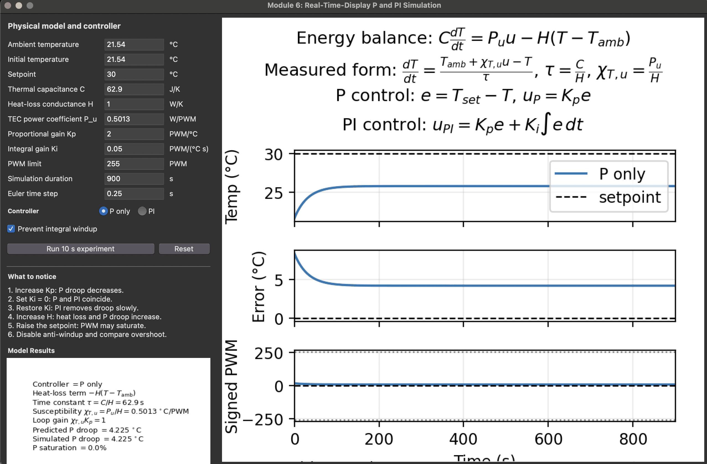
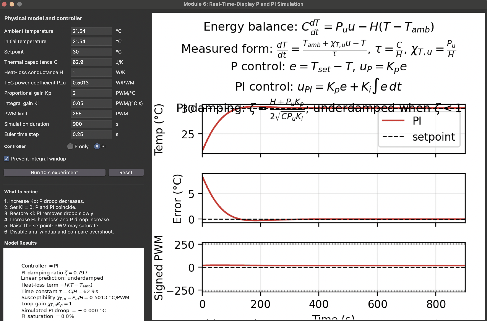
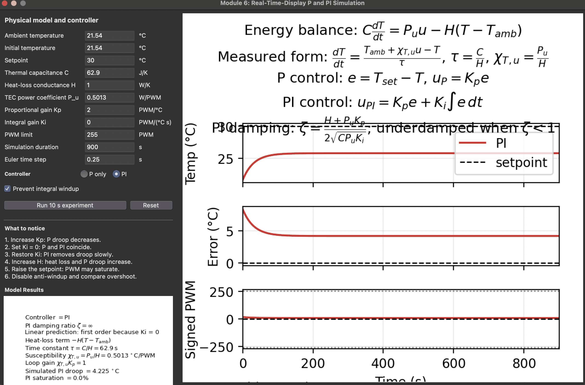
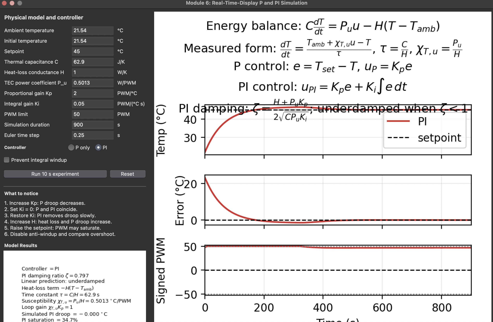
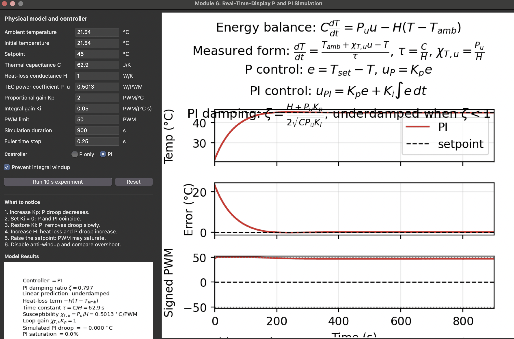
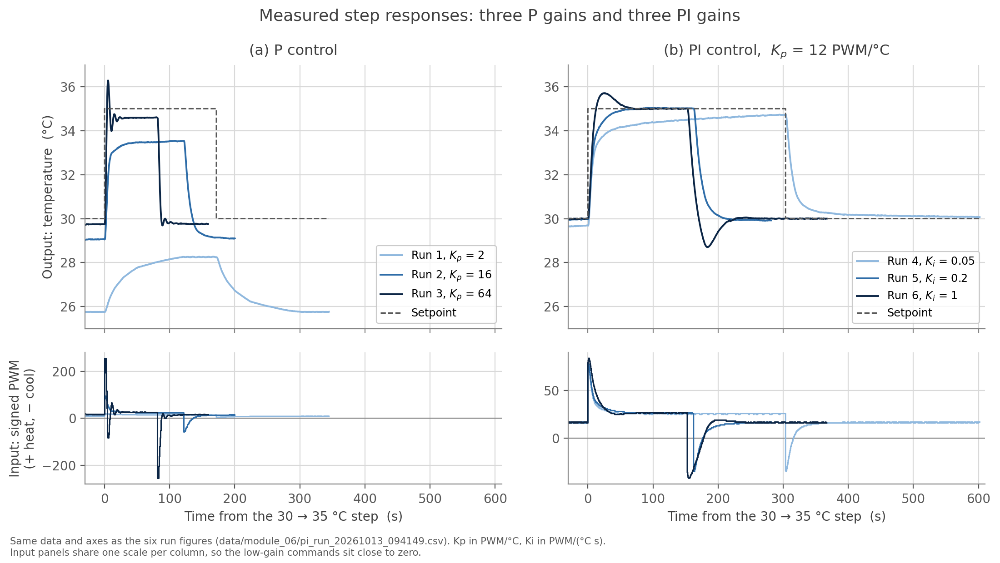
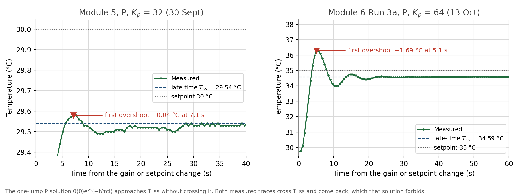

# Module 6 Part I: P/PI control and lumped modeling

Naidu / Cohen, 5 October 2026. Guided modeling work feeding A3. No separate
paper for the module itself.

**Code.** [`python/estimate_tau.py`](../../python/estimate_tau.py) (Part 3),
[`python/simulate_one_lump.py`](../../python/simulate_one_lump.py) (Parts 4, 5, 7),
[`python/Lab_6_first_order_p_pi_simulation_realtime.py`](../../python/Lab_6_first_order_p_pi_simulation_realtime.py)
(the supplied program, used only to check our own; see section 9).
Figures in `docs/figures/module_06/`, console output in
`data/module_06/simulation_output.txt`. Part 7 on the apparatus:
[`python/tec_pi_control_gui.py`](../../python/tec_pi_control_gui.py),
[`python/plot_goldilocks_experiment.py`](../../python/plot_goldilocks_experiment.py),
[`python/sampling_delay_check.py`](../../python/sampling_delay_check.py)
(section 11).

**Measured parameters, all three carried in from earlier modules:**

| Symbol | Value | Where from |
|---|---|---|
| &chi;<sub>T,u</sub> = P<sub>u</sub>/H | 0.50127 &deg;C per PWM count | Module 4 heating branch |
| &tau; = C/H | 62.9 &plusmn; 5.0 s | Part 3 below |
| T<sub>amb</sub> | 21.54 &deg;C | Module 4 zero-command steady state |

**C, H and P<sub>u</sub> were never measured separately, and never need to
be.** Everything in this module depends only on the two ratios above. That is
the single most useful thing the dimensional analysis gives us, and section 9
shows it concretely: the supplied program asks for three numbers where the
physics has two, so one of them is free.

---

## Before class

The page asks only that these existing files can be located and opened, and
explicitly says not to make new work for this section.

| File | Path |
|---|---|
| Module 4 steady-state temperature vs PWM | `data/module_04/steady_state.csv`, `data/module_04/full_run.csv` |
| Module 5 droop vs gain | `data/module_05/droop.csv` |
| Module 5 trace at a stable gain | `data/module_05/kp_0p25_run.csv` |
| Module 5 trace near oscillation | `data/module_05/session_2026-09-30_full_log.csv`, K<sub>p</sub> = 32, first 210 s; the only run showing any overshoot |
| Python environment | numpy and matplotlib only; no scipy is needed by anything here |

---

## Pre-class questions

**1. What physical part of the apparatus stores heat?** The aluminium block
and heat exchanger, mainly, plus the TEC's own ceramic faces, the thermistor
and the mounting hardware. The one-lump model treats all of it as a single
mass at one temperature with C = mc<sub>p</sub>, which is the approximation
being tested, not an assumption that happens to be true.

**2. What paths let heat leave the measured block?** Conduction through the
TEC to the reservoir face and out through the exchanger; conduction along the
mounting bolts and the thermal-switch leads; convection to room air from the
exposed plate; radiation, small at 10 to 45 &deg;C. All of them are lumped
into the single conductance H, which is why H cannot be decomposed from our
data.

**3. What evidence suggests a thermal time constant?** Every open-loop step is
an exponential approach rather than a ramp or a jump. Eight constant-command
steps in `data/module_04/full_run.csv` fit
T = T<sub>&infin;</sub> + (T<sub>0</sub>&minus;T<sub>&infin;</sub>)e<sup>&minus;t/&tau;</sup>
with R<sup>2</sup> &gt; 0.998 and &tau; between 53 and 68 s, and the temperature starts
moving within 0.5 to 2 s of every command, which is what a first-order lag
does: an immediate start that slows as it approaches.

**4. Why does the algebraic droop model not predict oscillation?** Because it
contains no time derivative. It is the dT/dt = 0 limit of the balance, so it
can only say where the plate ends up, never how it gets there. Even the full
dynamic one-lump model cannot oscillate, for the stronger reason given in
section 6: one state variable gives one real eigenvalue.

---

## 1. Algebraic droop model, and a numerical check

Substituting u = K<sub>p</sub>(T<sub>set</sub>&minus;T) into the measured
open-loop relation T = T<sub>amb</sub> + &chi;u and collecting terms:

```
T_set - T = (T_set - T_amb) / (1 + chi*Kp),     L = chi*Kp
```

**Numerical check on one Module 5 run.** K<sub>p</sub> = 2.00,
T<sub>set</sub> = 30.0 &deg;C, T<sub>amb</sub> = 21.54 &deg;C:

```
L = 0.50127 * 2.00 = 1.0025
predicted droop = 8.46 / 2.0025 = 4.225 C   ->   T_ss = 25.78 C
measured  droop = 4.25 C                    ->   T_ss = 25.75 C
```

Agreement to 0.6%, 0.03 &deg;C. **One physical reason they may differ:**
T<sub>amb</sub> is a single value measured in Module 4, before this sweep, and
room temperature was not logged during it. The droop changes by
1/(1+L) = 0.50 &deg;C per degree of ambient, so an effective ambient just 0.05
&deg;C lower than 21.54 would account for the whole difference. With
run-to-run reproducibility of 0.1 to 0.2 &deg;C (Module 5 section 4), this one
run cannot resolve a difference this small.

---

## 2. The model in measured parameters

Dividing C dT/dt = P<sub>u</sub>u &minus; H(T&minus;T<sub>amb</sub>) by H:

```
dT/dt = (T_amb + chi*u - T) / tau,    chi = Pu/H [C/count],  tau = C/H [s]
```

Units check: (W/count)/(W/K) = K/count for &chi;, and (J/K)/(W/K) = s for
&tau;. Not a different model, just the form we can run.

Predictions this makes, all three from Module 5 section 6:
P<sub>u</sub> doubles and &chi; doubles; H doubles and &chi; halves; **C
doubles and &chi; is unchanged**, because C never appears in a steady-state
ratio. Thermal capacity sets the transient and nothing else.

---

## 3. The time constant

The module suggests reading &tau; off one trace as the time to reach 63% of
the total change. That needs a final temperature, and several of our steps
were stopped before they arrived, so the 63% line would be drawn against a
guess. Instead `python/estimate_tau.py` fits each step to an exponential,
estimating T<sub>&infin;</sub> and &tau; together. At fixed &tau; the model is
linear in the two amplitudes, so only &tau; is searched over and no scipy is
needed.

| Method | Result |
|---|---|
| Eight steps, exponential fit | **&tau; = 62.9 &plusmn; 5.0 s** |
| Same steps, 63% rule against the fitted asymptote | 59.8 &plusmn; 4.7 s |
| Zero-command passive decay alone | 65.8 s |

Every fit has R<sup>2</sup> &gt; 0.998. The last row is the cleanest single
number: with the TEC off it is C/H and nothing else.

**Why eight measurements of one quantity.** A constant command moves where the
temperature ends up but not how fast it gets there: the homogeneous part is
C d&theta;/dt = &minus;H&theta; whatever u is. So &tau; should be identical at
every command, which is a prediction, and
`docs/figures/module_06/tau_estimate.png` is the test. All eight collapse onto
one exponential.

**A closed-loop cross-check is too noisy to add anything.** Fitting an
exponential to each 30 &deg;C P-control run and comparing with
&tau;/(1+L) gives a ratio of 1.03 &plusmn; 0.38 over eight runs, range 0.49
to 1.68 (`python/estimate_tau.py`). Most of those runs start within about 1
&deg;C of where they end, so each fit is poorly conditioned. The trend is the
right way, &tau;<sub>cl</sub> falling from 94 s at K<sub>p</sub> = 0.25 to
3.0 s at K<sub>p</sub> = 32, but it is not a second measurement of &tau;.

**&tau; and the Module 4 steady-state points are not independent.** Both come
from fitting T = T<sub>&infin;</sub> + (T<sub>0</sub>&minus;T<sub>&infin;</sub>)e<sup>&minus;t/&tau;</sup>
to the same steps in the same file: Module 4 kept T<sub>&infin;</sub> and this
section keeps &tau;. So the R<sup>2</sup> &gt; 0.998 reported here and the
R<sup>2</sup> of the Module 4 straight line are two views of one set of fits,
not two confirmations. What **is** independent is section 4: the simulation
takes &chi; and &tau; and predicts the whole measured trace, including its
shape, which neither fit was asked to reproduce.

**Honest caveat.** &tau; is not the same at every command. On the heating
side, including the zero-command decay, it is nearly constant: 65.0 to 65.8 s
across four steps. On the cooling side it ranges from 53.3 to 67.7 s across
four steps, a 27% spread, with the shortest at the strongest cooling command
(u = &minus;65) but the longest at a weak one (u = &minus;16), so it is not a
simple trend with command either. &tau; does correlate with step size,
r = +0.62 over the eight steps: the three smallest steps (2.8 to 4.9 &deg;C)
give the three shortest &tau;, the two largest (15 and 19 &deg;C) among the
longest. With eight points that is not firm, and the three smallest steps are
all cooling, so step size and branch cannot be separated here. A dependence on
step size is what a second, slower thermal mass would produce, which fits
section 4, but this data does not establish it. C and H are therefore not
quite constant over the operating range, and 62.9 &plusmn; 5.0 s is an average
over steps that behave differently. This supersedes the 146 s quoted in
Module 3, which was measured on 16 September, before the A0 wiring fault was
found.

---

## 4. Open-loop simulation

Euler, with the command clamped before it reaches the model:

```
T[n+1] = T[n] + (dt/tau) * (T_amb + chi*u[n] - T[n])
```

**Timestep first.** Euler is only first order, so the answer has to be shown
not to depend on dt. Over 300 s of a +25 count step, going from dt = 0.05 s to
0.01 s moves T(300 s) by 1.6e-4 &deg;C, far under the 0.02 &deg;C noise floor.
dt = 0.05 s is used throughout, dt/&tau; = 8e-4.

| Measured step | span | final measured | final simulated | rms residual |
|---|---|---|---|---|
| driven, u = +25 | 298 s | 33.99 &deg;C | 33.97 &deg;C | 0.147 &deg;C |
| passive, u = 0 | 308 s | 21.60 &deg;C | 21.58 &deg;C | 0.094 &deg;C |

Nothing is fitted to these traces. &chi;, &tau; and T<sub>amb</sub> all come
from Module 4 and section 3.

**Run configuration**, for reproducibility:

| | |
|---|---|
| Exact command | `python3 python/simulate_one_lump.py`, from the repository root |
| Initial condition | T(0) set to the first measured sample of each step, not to T<sub>amb</sub> |
| Saturation limit | &plusmn;255 counts, applied to u before it reaches the model |
| Console output | `data/module_06/simulation_output.txt` |

**The residuals are structured, not random.** Model minus measurement runs
from &minus;0.38 &deg;C at 15 s to +0.17 &deg;C at 119 s on the driven step,
and from +0.15 &deg;C at 13 s to &minus;0.15 &deg;C at 124 s on the passive
one: in both, a smooth excursion that changes sign once, against scatter of
0.02 &deg;C. In both, **the measurement moves faster than the model at first
and slower later**. A single exponential cannot do that against another single
exponential, whatever its &tau;: the difference of two would keep one sign.
So the disagreement is a second, faster time scale near the start of each
step, not measurement error. This is the same conclusion section 6 reaches from the K<sub>p</sub> =
32 overshoot, arriving independently from open-loop data.

---

## 5. P-only simulation against Module 5

Command computed from the current state and clamped before it is applied,
which is the order the real controller uses.

| K<sub>p</sub> | L | simulated droop | 1/(1+L) | measured | sim/meas | peak PWM |
|---|---|---|---|---|---|---|
| 0.25 | 0.125 | 7.518 | 7.518 | 7.66 | 0.981 | 2 |
| 0.50 | 0.251 | 6.765 | 6.765 | 6.94 | 0.975 | 4 |
| 1.00 | 0.501 | 5.635 | 5.635 | 5.50 | 1.025 | 8 |
| 2.00 | 1.003 | 4.225 | 4.225 | 4.25 | 0.994 | 17 |
| 4.00 | 2.005 | 2.815 | 2.815 | 2.81 | 1.002 | 34 |
| 8.00 | 4.010 | 1.689 | 1.689 | 1.57 | 1.076 | 68 |
| 16.00 | 8.020 | 0.938 | 0.938 | 0.90 | 1.042 | 135 |
| 32.00 | 16.041 | 0.496 | 0.496 | 0.46 | 1.079 | 255, clamps 0.3 s |

Measured values are the corrected Module 5 set, recomputed from the full
session log (Module 5 note section 3). Note the column is simulated over
measured, the inverse of the Module 5 ratio.

The simulation reproduces the algebraic 1/(1+L) exactly, as it must: both come
from the same balance, one solved and one integrated. Against measurement it
agrees to within 2.5% up to K<sub>p</sub> = 4, and **over-predicts the droop
by 4 to 8% at the three highest gains**. In degrees those misses are 0.04 to
0.12 &deg;C, inside the 0.1 to 0.2 &deg;C run-to-run reproducibility of the
session, so the data cannot say whether that is a real high-gain effect.
The simulated K<sub>p</sub> = 32 run starts from ambient and clamps briefly;
the measured one started at 29.09 &deg;C and never did. Steady-state droop does
not depend on the starting point, so the comparison stands.
Figure: `docs/figures/module_06/p_control_sim.png`.

---

## 6. Why the P-controlled one-lump model cannot oscillate

With P control the balance is

```
C dT/dt = Pu*Kp*T_set + H*T_amb - (H + Pu*Kp)*T
```

Setting dT/dt = 0 gives T<sub>ss</sub>, and the deviation
&theta; = T &minus; T<sub>ss</sub> obeys the homogeneous equation

```
C dtheta/dt = -(H + Pu*Kp) * theta
```

Trying &theta; = &theta;<sub>0</sub>e<sup>&lambda;t</sup> and cancelling
&theta;:

```
lambda = -(H + Pu*Kp)/C = -(1 + L)/tau
```

**One state variable, therefore one eigenvalue, and it is real and negative**
for any positive parameters and negative feedback. A real exponential never
changes sign, so &theta; keeps the sign it started with while shrinking:
the response cannot cross the steady state, overshoot, or oscillate. Raising
K<sub>p</sub> shortens &tau;<sub>cl</sub> = &tau;/(1+L) and shrinks the droop,
but it cannot manufacture the second state or the delay that oscillation
needs.

### What our apparatus does that this forbids

Module 5 found that at K<sub>p</sub> = 32 the trace **overshoots by 0.04
&deg;C at 7 s and then undershoots by 0.05 &deg;C at 12 s**, returning to its
settled value only by about 28 s, against a settled peak-to-peak of 0.02
&deg;C. Nothing comparable appears at K<sub>p</sub> = 16. The model says
crossing the settled value is impossible, so something is missing. **This was
observed in one run only**; it has not been repeated.

**The extension we judge most important: thermal lag between the TEC face and
the thermistor,** that is, a second lump. The overshoot fits that picture:
&tau;<sub>cl</sub> = &tau;/(1+L) is 7.0 s at K<sub>p</sub> = 16, where none
appears, and 3.7 s at K<sub>p</sub> = 32, where it does, and a fixed lag only
matters once the loop is fast enough to act on stale information. *If* lag is
the cause, it lies **between about 4 and 7 s**. That rests on one run at each
gain, so it is a consistent reading rather than a measurement of the lag. The
stronger evidence is the open-loop residuals below, which do not depend on the
overshoot at all.

The page lists seven candidates. Taking each against our data:

| Extension | Verdict for this apparatus |
|---|---|
| **Two thermal masses** | **Chosen.** The TEC junction and the block are not one object; the figure's structured residuals and the gain-threshold behaviour both point here. |
| Sensor lag | Same signature as a second mass and not separable from it with our data. How the thermistor is attached to the plate is not recorded in this repository, so its own contribution cannot be estimated. |
| Time delay | A pure transport delay would show as a flat dead time before any response. In every Module 4 step, commanded from Python, the temperature moves within 0.5 to 2.0 s of the command, so any delay is at most about 2 s. Module 3 recorded a 35 s onset delay once, but in a run whose duty was set by a trim pot its own log describes as intermittent, and it is not reproduced here. |
| Discrete controller update | Real and the strongest competitor: sampling at 1.97 Hz against &tau;<sub>cl</sub> = 3.7 s is only 7 samples per time constant. Cannot be separated from thermal lag at this logging rate. |
| Actuator lag | The bridge switches at 490 Hz and the Peltier effect is essentially instantaneous; any lag here is milliseconds against seconds. Ruled out. |
| PWM saturation | Ruled out by measurement: the command peaked at 31 of 255 counts, so the loop stayed linear. |
| Measurement noise | 0.02 &deg;C settled peak to peak, against excursions of 0.04 and 0.05 &deg;C lasting several seconds each. Unlikely to be noise, but with a single occurrence it cannot be ruled out; repeating the K<sub>p</sub> = 32 step would settle it. |

**Why a second mass rather than discrete sampling.** Both are consistent with
the overshoot alone, but the open-loop residuals in section 4 separate them:
those traces have no controller in them at all, so sampling cannot be
responsible for their structure, and they still show a systematic second time
scale. Discrete sampling may contribute to the closed-loop overshoot; it
cannot explain the open-loop residual. **Settling this properly needs a faster
log**, which is a Part II measurement rather than something to decide here.

---

## 7. Integral action, damping and windup

PI adds q, the accumulated error, with dq/dt = T<sub>set</sub> &minus; T and
u = K<sub>p</sub>e + K<sub>i</sub>q. The eigenvalues satisfy

```
lambda^2 + ((1+L)/tau)*lambda + chi*Ki/tau = 0
zeta = (1 + L) / (2*sqrt(tau*chi*Ki))
```

reached by dividing the usual (H + P<sub>u</sub>K<sub>p</sub>)/C and
P<sub>u</sub>K<sub>i</sub>/C through by H. **C, H and P<sub>u</sub> never
separate.** Underdamped when (1+L)<sup>2</sup> &lt; 4&tau;&chi;K<sub>i</sub>,
which at K<sub>p</sub> = 2 means K<sub>i</sub> &gt; 0.0318 counts/(&deg;C s).

| K<sub>i</sub> | &zeta; | damping | final droop | overshoot | settles to 0.1 &deg;C |
|---|---|---|---|---|---|
| 0.002 | 3.99 | overdamped | 2.673 &deg;C | none | never |
| 0.010 | 1.78 | overdamped | 0.359 &deg;C | none | never |
| 0.050 | 0.797 | underdamped | 0.000 &deg;C | 0.27 &deg;C | 277 s |
| 0.200 | 0.399 | underdamped | 0.000 &deg;C | 2.37 &deg;C | 271 s |

P-only at the same gain never settles to 0.1 &deg;C: its droop is 4.22 &deg;C.
**Integral action removes the droop entirely, and the overshoot appears
exactly where &zeta; crosses 1.** Figure:
`docs/figures/module_06/pi_vs_p_sim.png`.

### One overdamped and one underdamped set, in full

The module asks for C, H and P<sub>u</sub> recorded for each. Only
&chi; = P<sub>u</sub>/H and &tau; = C/H affect the answer, so H is free;
H = 1 W/K makes the other two readable directly as P<sub>u</sub> = &chi;H and
C = &tau;H. Any other H scales all three together and changes nothing.

| Case | C (J/K) | H (W/K) | P<sub>u</sub> (W/count) | K<sub>p</sub> | K<sub>i</sub> | &zeta; | Trace agrees with the prediction? |
|---|---|---|---|---|---|---|---|
| overdamped | 62.9 | 1.00 | 0.5013 | 2.0 | 0.010 | 1.783 | yes, no overshoot |
| underdamped | 62.9 | 1.00 | 0.5013 | 2.0 | 0.050 | 0.797 | yes, 0.273 &deg;C overshoot |

The prediction and the trace agree on both sides of &zeta; = 1, which is the
check the module is asking for. It holds only while the model is linear and
the command is unclamped, and both of these runs stay well inside that: peak
command 16.9 counts overdamped and 20.2 counts underdamped, of 255.

### Our apparatus cannot wind up

Holding 45 &deg;C needs (45&minus;21.54)/&chi; = **47 of the 255 available
counts**, so the bridge is nowhere near the binding constraint at any setpoint
inside the 10 to 45 &deg;C safety band. The command never stays clamped long
enough for the integral to run away. To show the effect at all, both our
simulation and the supplied program were run with the limit lowered to 50
counts, which is what Part 8 asks us to suppose.

| Limit 50 counts, K<sub>p</sub> = 2, K<sub>i</sub> = 0.05, setpoint 45 &deg;C | overshoot | time clamped |
|---|---|---|
| plain PI | +1.46 &deg;C | 313 s |
| with anti-windup | +0.26 &deg;C | 22 s |

---

## 8. Windup thought experiment

**What happens to the integral term while PWM is saturated?** It keeps
growing, because dq/dt = e and the error is still large. The command the
controller *computes* diverges from the command the actuator *delivers*: one
climbs without bound while the other sits pinned at the clamp. The extra
integral buys nothing, since the actuator is already doing all it can, but it
is stored and will have to be paid back. In our run the integral reached about
1200 &deg;C&middot;s while the command was stuck at 50 counts.

**What happens after the temperature finally approaches the setpoint?** The
error changes sign, but q is still large and positive, so u = K<sub>p</sub>e +
K<sub>i</sub>q stays saturated well past the moment the error reaches zero.
The controller only begins to back off once accumulated negative error has
cancelled what it banked on the way up, which takes roughly as long as the
saturated stretch did.

**Why might this cause overshoot?** Because full drive continues after the
error has already gone to zero. Nothing in the loop is asking for more heat at
that point; the integrator is simply still holding the memory of an error it
could not act on. The plate keeps climbing until the integral drains. Measured
at a 50-count limit: 1.46 &deg;C overshoot plain against 0.26 &deg;C with
anti-windup, a factor of 5.6 from the same gains and the same plant.

**How could software prevent or reduce it?**

- **Conditional integration.** Stop accumulating whenever the command is
  clamped *and* the error would push it further into the clamp. One line, no
  new tuning parameter. This is what `simulate_one_lump.py` implements.
- **Back-calculation.** Feed (clamped &minus; unclamped) back into the
  integrator through a gain, so it unwinds smoothly rather than freezing.
  Better behaved on a real plant, one more constant to choose.
- **Clamp the integral term itself** to the range it could ever usefully
  command. Crude but effective.
- **Reset q on a setpoint change**, which removes the commonest way a loop
  enters saturation in the first place.

---

## 9. Cross-check against the supplied program

Run after our own simulator, as the module requires, on 5 October. **H is
free:** only &chi; = P<sub>u</sub>/H and &tau; = C/H affect the answer, so H = 1
W/K makes the other two readable at a glance. The supplied interface asks for
three numbers where the physics has two.

Entered in every run: T<sub>amb</sub> = 21.54 &deg;C, initial temperature
21.54 &deg;C, C = 62.9 J/K, H = 1 W/K, P<sub>u</sub> = 0.5013 W/count,
K<sub>p</sub> = 2, Euler step 0.25 s, duration 900 s. What changed between
runs is in the table below.

| Case | Ours | Supplied program |
|---|---|---|
| &tau;, &chi; | 62.9 s, 0.5013 | 62.9 s, 0.5013 |
| P droop at K<sub>p</sub> = 2 | 4.225 &deg;C | 4.225 &deg;C predicted and simulated |
| PI droop, K<sub>i</sub> = 0.05 | 0.000 &deg;C | &minus;0.000 &deg;C |
| &zeta;, K<sub>i</sub> = 0.05 | 0.797 | 0.797, "underdamped" |
| K<sub>i</sub> = 0 | PI reduces to P | droop 4.225 &deg;C, "first order because Ki = 0" |
| Windup, limit 50: time clamped | 313 s | 34.7% of 900 s = 312 s |
| Windup, limit 50: anti-windup | clamped 22 s | clamped 0.0% |

**Why the last row differs, from the two programs' code.** Both use
conditional integration, which the supplied program states in its own
docstring. They test different things:

- The supplied program computes the command the *next* integral step would
  produce, and refuses that step if it would push the command past the limit
  (`python/Lab_6_first_order_p_pi_simulation_realtime.py`, lines 110 to 122).
  The integral is stopped before saturation, so the command never reaches the
  clamp.
- Ours holds the integral only once the command is *already* clamped
  (`python/simulate_one_lump.py`, `run_pi`), so the command enters saturation
  first and stays there 22 s before the hold takes effect.

Neither is wrong; the supplied version is the more conservative. The physical
conclusion, that anti-windup removes most of the overshoot, is the same either
way. Its saturation figure is the fraction of time steps on which the
unclamped command exceeds the limit (lines 75 and 152), so at a fixed 0.25 s
step 34.7% is 312 s of the 900 s run.

### Screenshots of the supplied program

Six runs, all with the parameters above. The program's opening run with its
own default parameters (&tau; = 80 s, &chi; = 0.12) is not included, since it
describes no part of this apparatus.

**1. P only, K<sub>p</sub> = 2, setpoint 30 &deg;C, limit 255.** Predicted and
simulated P droop both 4.225 &deg;C, saturation 0.0%: the same droop our
simulator and the algebra give.



**2. PI, K<sub>i</sub> = 0.05, setpoint 30 &deg;C, limit 255, anti-windup
on.** &zeta; = 0.797, "underdamped", PI droop &minus;0.000 &deg;C, saturation
0.0%. Integral action removes the droop, with a small overshoot.



**3. PI, K<sub>i</sub> = 0, setpoint 30 &deg;C, limit 255.** &zeta; = &infin;,
"first order because Ki = 0", PI droop 4.225 &deg;C. PI with no integral term
reproduces run 1 exactly, which is the program's own check number 2.



**4. PI, K<sub>i</sub> = 0, setpoint 45 &deg;C, limit 50, anti-windup off.**
Droop 11.715 &deg;C, saturation 0.0%. This is P control at the windup
setpoint: K<sub>p</sub>e<sub>0</sub> = 2 &times; 23.46 = 47 counts, just under
the 50-count limit, so without an integral the command never clamps. It is the
baseline for runs 5 and 6, and shows that the saturation in run 5 comes from
the integral term alone.


**5. PI, K<sub>i</sub> = 0.05, setpoint 45 &deg;C, limit 50, anti-windup
off.** Saturation 34.7%, final droop &minus;0.000 &deg;C. The command sits on
the 50-count limit for about 312 s and the error trace dips below zero before
recovering: windup overshoot.



**6. Same as 5, anti-windup on.** Saturation 0.0%, final droop &minus;0.000
&deg;C. The integral is never allowed to drive the command into the clamp. The
error comes down to zero with no dip that can be resolved on this plot's 23
&deg;C scale, against the clear dip in run 5. The program does not report an
overshoot value, so the size of any remaining overshoot is not known from
these screenshots.



---

## 10. Evidence for A3

- [x] derivation of the P-control droop equation: sections 1 and 6
- [x] the three Module 5 interpretation answers: Module 5 note section 6
- [x] estimate of &chi;<sub>T,u</sub>: 0.50127 &deg;C/count, Module 4
- [x] estimate of &tau;: 62.9 &plusmn; 5.0 s, section 3
- [x] open-loop simulation against a measured trace: section 4
- [x] P-only simulation against Module 5 droop: section 5
- [x] PI simulation against P-only: section 7
- [x] why the one-lump model does not oscillate, and what ours does: section 6
- [x] windup thought-experiment answers: section 8
- [x] supplied program run with our parameters, six screenshots:
  section 9, `docs/figures/module_06/supplied_sim/`
- [x] PI controller on the apparatus and the six experimental Goldilocks
  plots with step-response metrics (A3 Question 2): section 11
- [x] Git checkpoint cited in A3: commit 78e8c21 (pushed; the PDF itself is
  in the following commit, 3d1cd26)
- [x] Part 4 open-loop exercises in the course simulator, Part 5 marked
  overshoot, Part 6 integral questions, oral review: section 12

**Open, now answered by section 11.** The Module 5 note left open whether the
K<sub>p</sub> = 32 overshoot was real and whether discrete sampling could
cause it. At K<sub>p</sub> = 64 the overshoot is 1.69 &deg;C with clear
ringing, far above noise, and a sampled one-lump model cannot produce more
than 0.03 &deg;C of it.

**&tau; still comes from 500-sample data.** Part 3 asks for 1000-sample
averaging, and every step in section 3 used 500. On 13 October the instructor
said not to redo the Module 4 measurements, to keep the existing &tau;, and to
use 1000 samples from now on, which the Module 6 runs do.

---

## 11. Part 7: PI control on the apparatus, and the six Goldilocks runs

13 and 14 October 2026. On 14 October the instructor asked for the high-gain
P and PI runs to be pushed into saturation, so Runs 3 and 6 were repeated at
K<sub>p</sub> = 200 and K<sub>i</sub> = 20 (section 11b). The 13 October
K<sub>p</sub> = 64 and K<sub>i</sub> = 1.0 runs below are kept as "earlier
high-gain runs" (3a, 6a); the six retained runs are 1, 2, 4, 5 from 13 October
and 3, 6 from 14 October. Controller: [`python/tec_pi_control_gui.py`](../../python/tec_pi_control_gui.py),
whose `pi_step()` holds every line that computes e, q, u<sub>P</sub>,
u<sub>I</sub> and the clamped command. The instructor reviewed it on 13
October. Sketch: [`arduino/module_06/tec_pi_safety`](../../arduino/module_06/tec_pi_safety/tec_pi_safety.ino),
the Module 4 safety sketch with 1000-sample averaging.

**What the controller does each reading.** Δt is the actual time since the
previous accepted reading (0.56 to 0.61 s here), q<sub>n+1</sub> =
q<sub>n</sub> + e<sub>n</sub>Δt, u = K<sub>p</sub>e + K<sub>i</sub>q<sub>n+1</sub>,
clamped to &plusmn;255. Anti-windup is conditional integration: the new q is
refused when the command it gives is past the limit and the error pushes it
farther out. That test is the same as `controller_command()` in the course
simulator; the two agreed on 200,000 random cases. Mode, Zero integral, PWM
limit and anti-windup can only be changed with control off.

**Protocol, the same for all six.** Setpoints 30 and 35 &deg;C, PWM limit 255,
anti-windup on, integral zeroed before each run. Each run settles at 30, steps
to 35, steps back to 30. Raw data:
`data/module_06/pi_run_20261013_094149.csv`. Bench record, including the 12 V
TEC voltage and the instructor's extra K<sub>i</sub> = 2, 5, 10 tries (not
used): `data/module_06/bench_log_2026-10-13.md`.

| Run | Controller | K<sub>p</sub> | K<sub>i</sub> | End of stage at 30 / 35 / 30 (&deg;C) | Overshoot up / down (&deg;C) |
|---|---|---|---|---|---|
| 1 | P | 2 | 0 | 25.76 / 28.25 / 25.76 | 0.02 / 0.01 |
| 2 | P | 16 | 0 | 29.05 / 33.52 / 29.12 | 0.02 / 0.03 |
| 3a | P | 64 | 0 | 29.74 / 34.59 / 29.76 | **1.69 / 0.07** |
| 4 | PI | 12 | 0.05 | 29.66 / 34.71 / 30.08 | 0.02 / 0.01 |
| 5 | PI | 12 | 0.2 | 29.97 / 35.02 / 29.93 | 0.02 / 0.02 |
| 6a | PI | 12 | 1.0 | 30.00 / 35.00 / 30.00 | **0.71 / 1.30** |

Each value is the mean of the last 30 s of the stage. Overshoots of 0.03
&deg;C and below are at the noise level (0.005 to 0.02 &deg;C standard
deviation). Drift over the last 60 s of each stage is under 0.08 &deg;C/min
except Run 2's last stage, &minus;0.33 &deg;C/min, which was ended after 78 s.
Run 4 was still creeping at +0.07 &deg;C/min at both 30 and 35, as a small
K<sub>i</sub> should. (Run 3's first stage lasted only 59 s, so its 60 s
window includes the approach; over its last 30 s it is flat.)

**Figures** (`python/plot_goldilocks_experiment.py`): one per run in
`docs/figures/module_06/goldilocks/`, all on the same axes (&minus;30 to 610 s
from the 30 &rarr; 35 step, 25 to 38 &deg;C, the same axes as the Part II
simulation plots), temperature with setpoint above
and signed applied PWM below; `overlay_p_and_pi.png` puts the three P and
three PI runs on one figure each; `high_gain_steps.png` zooms on the four
steps the metrics are quoted for.



**Step-response metrics, earlier high-gain runs 3a and 6a** (the highest
gains that still settled; the A3 numbers for Runs 3 and 6 are in 11b). Rise is
10 % to 90 % of the change; settling is the last time T leaves the final value
&plusmn;2 % of the change (about &plusmn;0.1 &deg;C); period is twice the mean
spacing of crossings of the final value with 0.05 &deg;C hysteresis, given
when there are at least three crossings. All six runs are in
`data/module_06/goldilocks_metrics.csv`.

| Run, step | Rise 10-90 % | Overshoot | Settling &plusmn;2 % | ss error | Period |
|---|---|---|---|---|---|
| 3a (P, K<sub>p</sub> 64), 30 &rarr; 35 | 2.1 s | 1.69 &deg;C, 35 % | 21 s | +0.41 &deg;C | 9 s |
| 3a, 35 &rarr; 30 | 4.0 s | 0.07 &deg;C, 1 % | 15 s | +0.24 &deg;C | n/a (2 crossings) |
| 6a (PI, K<sub>i</sub> 1.0), 30 &rarr; 35 | 8.2 s | 0.71 &deg;C, 14 % | 56 s | 0.00 &deg;C | n/a (1 crossing) |
| 6a, 35 &rarr; 30 | 12.5 s | 1.30 &deg;C, 26 % | 68 s | 0.00 &deg;C | n/a (1 crossing) |

Run 3a hit the &plusmn;255 limit for 4 readings on the way up and 3 on the way
down, so its first 2 s are clipped, not linear. No other run saturated.

**What the 13 October runs show.**

- P: raising K<sub>p</sub> shrinks the droop and speeds the response, as the
  one-lump model says (Run 1 droop 4.24 &deg;C, Run 2 0.88 &deg;C, Run 3 0.24
  &deg;C on the way down, Run 3a). Run 3a then overshoots by 35 % and rings with a
  9 s period, which the one-lump P model forbids (section 6).
- PI removes the droop: Runs 5 and 6a end within 0.07 &deg;C of the setpoint,
  where P at K<sub>p</sub> = 16 (Run 2) stopped 0.88 to 1.48 &deg;C short.
  Run 4 shows the slow end of that: u<sub>I</sub> climbs for minutes and the
  plate is still 0.29 &deg;C short of 35 after 300 s.
- Raising K<sub>i</sub> at fixed K<sub>p</sub> trades speed for overshoot:
  rise 58 s, 24 s, 8 s on the way up across Runs 4, 5, 6a, overshoot 0.02, 0.02,
  0.71 &deg;C.
- Heating and cooling are not symmetric. Run 6a overshoots 0.71 &deg;C going
  up and 1.30 &deg;C coming down; the cooling branch has the smaller &chi;
  (0.18 against 0.50 &deg;C per count).

**Sampling does not explain the Run 3a ringing.**
`python/sampling_delay_check.py` runs the one-lump plant (&tau; 62.9 s,
measured &chi;) under the controller as it actually runs: read every 0.563 s,
command rounded, clipped at &plusmn;255 and held, with the delay from reading
to command anywhere from 0 to one full sample. The largest overshoot it gives
is 0.03 &deg;C, against 1.69 &deg;C measured. Something with its own lag
between the TEC and the thermistor is needed, which is what Part II's
two-lump model adds.

### 11b. High-gain repeats, 14 October: Runs 3 and 6 into saturation

Same apparatus, sketch, GUI, setpoints (30, 35, 30 &deg;C), PWM limit 255 and
anti-windup. Raw data: `data/module_06/pi_run_20261014_111720.csv`. Bench
record: `data/module_06/bench_log_2026-10-14.md`.

**Run 3, P, K<sub>p</sub> = 200.** L = &chi;K<sub>p</sub> = 100. The plate
never settles: in every stage it oscillates without decaying, and the command
swings across most of the &plusmn;255 range, reaching the limit on the 35
&deg;C stage. Over the last 90 s of each stage:

| Stage | Mean of cycle | Range | Peak to peak | Period | Readings at &plusmn;255 |
|---|---|---|---|---|---|
| 30 &deg;C | 30.09 &deg;C | 29.19 to 31.07 &deg;C | 1.88 &deg;C | 6.2 s | 0 % |
| 35 &deg;C | 35.14 &deg;C | 33.91 to 36.53 &deg;C | 2.62 &deg;C | 6.3 s | 10 % |
| back to 30 &deg;C | 30.10 &deg;C | 29.25 to 31.04 &deg;C | 1.79 &deg;C | 6.2 s | 0 % |

Step up: 10-90 % rise 2.8 s, first peak 37.25 &deg;C (2.10 &deg;C, 41 %
above the cycle mean). Step down: rise 3.2 s, first dip 1.00 &deg;C (20 %)
below the cycle mean. The cycle means sit 0.10 to 0.15 &deg;C above the
setpoint, so the average droop has gone; one-lump P predicts 0.08 &deg;C.

**Run 6, PI, K<sub>p</sub> = 12, K<sub>i</sub> = 20.** One-lump
ζ = 0.14; two-lump ρ<sub>I</sub> = 6.15, far past the stability boundary. The
oscillation grows and then holds a fixed size once the command reaches the
&plusmn;255 limit each half cycle; anti-windup refused the integral step on
about 17 % of readings in the last 90 s of each stage. Over that window:

| Stage | Mean of cycle | Range | Peak to peak | Period |
|---|---|---|---|---|
| 30 &deg;C | 30.59 &deg;C | 25.85 to 36.46 &deg;C | 10.61 &deg;C | 18.5 s |
| 35 &deg;C | 35.53 &deg;C | 30.42 to 41.32 &deg;C | 10.90 &deg;C | 18.0 s |
| back to 30 &deg;C | 30.80 &deg;C | 25.63 to 36.49 &deg;C | 10.86 &deg;C | 18.8 s |

Each step starts in the middle of a 10 &deg;C swing, larger than the 5 &deg;C
step, so rise time and overshoot are not defined. Highest temperature 42.52
&deg;C, in the first cycle. Two irregularities, both in the data: control was
on for 15 s with K<sub>i</sub> = 0 before 20 was entered, so the integral
started at 38 &deg;C s (u<sub>I</sub> = 760 at once); and control was off for
25 s at the end of the 35 &deg;C stage. The 35 &deg;C stage is taken to end
where control went off.

**Sampling still does not explain it.** `python/sampling_delay_check.py`
also runs the Part II two-lump model (shared parameter set) at K<sub>p</sub> =
200 under the sampled, rounded, clipped controller. With up to half a sample of
extra delay it settles to within 0.06 &deg;C; even with a full extra sample
it holds only 0.3 to 0.4 &deg;C peak to peak, against 1.9 &deg;C measured.

---

## 12. Remaining Part I items (completed 19 October)

### Part 4 in the course simulator

`python/open_loop_course_sim_check.py` runs the Part 4 exercises with the
course simulator's own `advance_model()` (`one_lump`, `open_loop`). Output:
`data/module_06/open_loop_course_sim_check.txt`.

**Guided exercise, simulator defaults** (T<sub>amb</sub> 22 &deg;C,
&chi;<sub>c</sub> 0.23, &chi;<sub>h</sub> 0.46 &deg;C/PWM, &tau; 80 s):

| Command | Predicted T<sub>ss</sub> = T<sub>amb</sub> + &chi;u | Simulated | &chi; from (T<sub>ss</sub> &minus; T<sub>amb</sub>)/u |
|---|---|---|---|
| u = +25 | 33.50 &deg;C | 33.50 &deg;C | 0.460 |
| u = &minus;25 | 16.25 &deg;C | 16.25 &deg;C | 0.230 |
| u = &minus;50 | 10.50 &deg;C | 10.50 &deg;C | 0.230 |

Ratio &chi;<sub>h</sub>/&chi;<sub>c</sub> = 2.00, matching the displayed
values.

1. **Why +25 and &minus;25 give unequal changes.** Peltier transport reverses
   with the current but Joule heating does not. Heating, both put heat into
   the plate; cooling, Joule heat partly cancels the Peltier pumping. So the
   TEC delivers more heat per count heating than it removes per count
   cooling: P<sub>u,h</sub> = r P<sub>u,c</sub> with r = 2 here (2.77 on our
   apparatus), and &chi; = P<sub>u</sub>/H differs by the same factor.
2. **&chi; from the displayed values** is in the table, and agrees with the
   simulator's &chi;<sub>h</sub> = 0.46 and &chi;<sub>c</sub> = 0.23.

**Thermal mass** (direct constants, u = +25, H, P<sub>u,c</sub> and r fixed):
C &times; 1 gives 33.50 &deg;C with the 63 % point at 79.9 s; C &times; 2 gives
33.50 &deg;C with the 63 % point at 160.0 s. The steady temperature is set by
the balance P<sub>u</sub>u = H(T &minus; T<sub>amb</sub>), which has no C in
it; C only sets how much energy has to go in to get there, so &tau; = C/H
doubles and nothing else changes.

**Our parameters against measured open-loop steps** (&chi;<sub>c</sub> 0.181,
&chi;<sub>h</sub> 0.501, &tau; 62.9 s, T<sub>amb</sub> 21.54 &deg;C, 12 V,
1.50 &Omega;, &Delta;t 0.05 s; Module 4 data):

| Step | Length | Final, measured | Final, simulated | rms residual | Largest miss |
|---|---|---|---|---|---|
| heating, u = +25 | 298 s | 33.99 &deg;C | 33.96 &deg;C | 0.145 &deg;C | &minus;0.38 &deg;C at 15 s |
| cooling, u = &minus;32 | 237 s | 15.95 &deg;C | 15.82 &deg;C | 0.107 &deg;C | &minus;0.15 &deg;C at 133 s |

Changing &Delta;t from 0.05 to 0.01 s moves the end by 0.0002 &deg;C or less.
The heating step agrees with section 4 (33.97 &deg;C, rms 0.147 &deg;C with our
own Euler code). The important difference from the apparatus: on both steps
the measured plate moves faster than the model for the first 60 s (model minus
measurement &minus;0.34 &deg;C heating and +0.08 &deg;C cooling, mean over 10
to 30 s) and slower after 100 s (+0.15 and &minus;0.13 &deg;C, 100 to 150 s).
A single exponential cannot do that, the same second-time-scale signature as
section 4.
Figure: `docs/figures/module_06/open_loop_course_sim.png`.

### Part 5: the high-gain trace marked



`python/plot_part5_overshoot.py`. Module 5, K<sub>p</sub> = 32: late-time
T<sub>ss</sub> = 29.54 &deg;C, first overshoot 29.58 &deg;C (+0.04 &deg;C) at
7.1 s, then down to 29.49 &deg;C at about 12 s. Run 3a, K<sub>p</sub> = 64:
T<sub>ss</sub> = 34.59 &deg;C, first overshoot 36.28 &deg;C (+1.69 &deg;C) at
5.1 s. **The contradiction:** the one-lump model predicts a monotonic
exponential approach to T<sub>ss</sub>; the apparatus crosses T<sub>ss</sub> and
comes back, an underdamped transient.

### Part 6: watching the integral contribution

From the simulator PI runs (Part II notes, in-class step 2) and Run 5 on the
bench (K<sub>p</sub> 12, K<sub>i</sub> 0.2):

1. **While e &gt; 0, why does u<sub>I</sub> keep growing?** dq/dt = e, so q
   rises as long as the error is positive, and u<sub>I</sub> = K<sub>i</sub>q
   with it. In Run 5 (first approach to 30 &deg;C), u<sub>I</sub> went 0.6,
   7.3, 9.9, 11.6, 12.7, 13.5, 14.1, 14.6 counts at 10 s intervals while e
   fell from 5.28 to 0.22 &deg;C.
2. **Why does u<sub>P</sub> go to zero at the setpoint?** u<sub>P</sub> =
   K<sub>p</sub>e and e &rarr; 0. Over the last 30 s at 30 &deg;C in Run 5,
   e = 0.03 &deg;C and u<sub>P</sub> = 0.4 counts.
3. **Why can u<sub>I</sub> stay nonzero at e = 0?** q is the accumulated
   past error. At e = 0 it stops changing but keeps its value, and
   K<sub>i</sub>q supplies the command needed to balance the heat loss. Run 5
   held 30 &deg;C on u<sub>I</sub> = 16.1 counts and 35 &deg;C on 26.7 counts
   (last 30 s of each); the one-lump model needs (30 &minus; 21.54)/0.501 =
   16.9 and (35 &minus; 21.54)/0.501 = 26.9 counts.
4. **After Zero integral at steady state, why does the temperature first move
   away?** The command was almost all u<sub>I</sub>; zeroing q removes it,
   u<sub>P</sub> &asymp; 0, so nothing balances the heat loss and the plate
   drifts toward room temperature until the new error builds q back up. In the
   model (`python/pi_55c_check.py`) the command drops from 16.9 to 0.02
   counts, the plate falls to 28.89 &deg;C after 24 s and is back within 0.02
   &deg;C after 263 s.

### Oral review answers

**Module 5, P control**

1. *Setpoint above room under P only.* At T = T<sub>set</sub>, e = 0 and the
   TEC delivers nothing, but H(T &minus; T<sub>amb</sub>) still leaks heat, so
   the plate cools until K<sub>p</sub>e pays for the leak: droop. Below
   ambient the leak runs inward, the TEC must cool, and the droop is toward
   ambient from below, set by the smaller cooling &chi;.
2. *Same TEC, different insulation.* Better insulation means smaller H, so
   larger &chi; = P<sub>u</sub>/H, larger L at the same K<sub>p</sub>, and less
   droop. Held fixed: the TEC and its drive (P<sub>u</sub>), K<sub>p</sub>,
   setpoint and T<sub>amb</sub>.
3. *Is K<sub>p</sub> = 1 small?* It has units, counts per &deg;C, so it needs
   &chi; to judge: L = &chi;K<sub>p</sub> = 0.50 heating (comparable) and 0.18
   cooling (small).
4. *Double C, nothing else changed.* &chi; and the droop are unchanged; the
   settling time doubles, since &tau;<sub>cl</sub> = C/(H +
   P<sub>u</sub>K<sub>p</sub>).

**Module 6, PI control**

1. *Integral action and windup.* dq/dt = e, so any lasting error keeps
   changing u<sub>I</sub> until e = 0; the integral then holds the command
   that P could only supply by keeping an error. Windup is q growing while
   the command is clamped; the stored integral then drives the plate past the
   setpoint. Our conditional integration refuses those integral steps.
2. *Effect of K<sub>p</sub> and K<sub>i</sub> on the apparatus* (35 &deg;C
   step, `data/module_06/goldilocks_metrics.csv`). Raising K<sub>p</sub> (2,
   16, 64, 200): rise 74, 13, 2.1, 2.8 s; droop 6.7, 1.5, 0.41 &deg;C, then a
   cycle whose mean sits 0.15 &deg;C above the setpoint; overshoot 0.02, 0.02,
   1.69, 2.10 &deg;C; settling 110, 42, 21 s, then never, a sustained 2.6
   &deg;C peak-to-peak cycle with the command at &plusmn;255 for 16 % of
   samples. Raising K<sub>i</sub> at K<sub>p</sub> 12 (0.05, 0.2, 1.0, 20):
   steady error 0.29, &minus;0.02, 0.00 &deg;C, then a cycle mean 0.53 &deg;C
   above; rise 58, 24, 8 s; overshoot 0.02, 0.03, 0.71 &deg;C (14 %, 26 % on
   the step down), then an 11 &deg;C oscillation held by saturation; settling
   225, 52, 56 s, then never. K<sub>p</sub> speeds the response and shrinks
   the droop until the lag makes it ring; K<sub>i</sub> removes the droop
   and, past about 1, adds overshoot and then instability.

**Module 6 Part II, process modeling**

1. *Which lag gives overshoot at high gain?* Heat has to flow from the TEC
   face through the plate and the thermistor contact before the thermistor
   sees it (G between C<sub>T</sub> and C<sub>m</sub>, plus the thermistor's
   own lag). The controller acts on a reading that is behind the heat already
   delivered.
2. *One parameter.* G, W/K, the conductance between the lumps. Smaller G means
   more lag: at K<sub>p</sub> = 64 the model's overshoot is 46 % at G = 2 and
   32 % at G = 4 W/K (Part II notes, step 2), and in the K<sub>p</sub> = 18,
   K<sub>i</sub> = 1.0 study the loop is well damped at G = 5, rings at G = 1
   and is unstable at G = 0.5, because K<sub>i,crit</sub> falls with G (5.27,
   1.37, 0.88).

**The two questions in the Part II model section.** If someone opens a window
and T<sub>amb</sub> drops, T<sub>m</sub> changes first: only the measured lump
exchanges heat with the room (the H term), and T follows later through G. If
the command u changes (for example after a setpoint change), T changes first:
the TEC heat goes into C<sub>T</sub>, and T<sub>m</sub> only responds once
G(T &minus; T<sub>m</sub>) has grown. The controller watches T<sub>m</sub>, so
it sees its own action late, which is the lag behind the overshoot.

