# Module 8, Part I: the whole module in one note

Naidu / Cohen. This note follows the course page
(<https://sethfraden.github.io/Phys39F26-course/labs/lab-09/>) from top to
bottom and answers every step, question and derivation with our own data. Every
number below comes from a file in this repository; the file is named next to
it. The running bench log with every detail is `module_08_angstrom.md`, the
analysis app note is `module_08_modeling_app.md`.

All runs: PI control, Ta = 40 °C, Tb = 16 °C (setpoint 24 to 56 °C), Kp 12,
Ki 0.2, cooling multiplier r = 2.771, unless stated.

---

## 0. The result in five lines

1. Five forcing periods (100, 180, 240, 300, 480 s) on four days, nine fit
   windows, all give the same thermal diffusivity:
   **κ = (9.29 ± 0.06) × 10⁻⁵ m²/s** (finite-rod fits, χ² = 6.5 for 8).
2. The heat-loss rate is ν ≈ 2 × 10⁻³ s⁻¹ (30 to 60 % error per window, because
   it is a small difference q² − q′²).
3. The mean temperature profile gives m = 4.27 m⁻¹ (run-to-run sd 0.26), which
   agrees with Module 7's 4.117 ± 0.07 m⁻¹.
4. The 1-D model is valid: finite-length effect at T5 is 0.1 % (100 s) to 4 %
   (480 s), transverse Biot number about 2 × 10⁻⁴.
5. κ is 35 % above the handbook value for 6061-T6 (6.90 × 10⁻⁵ m²/s, from
   k = 167 W/(m K), ρ = 2700 kg/m³, c = 896 J/(kg K), ASM/MatWeb 6061-T6 data
   sheet). The cause is not found yet; sensor spacing was ruled out by
   calipers.

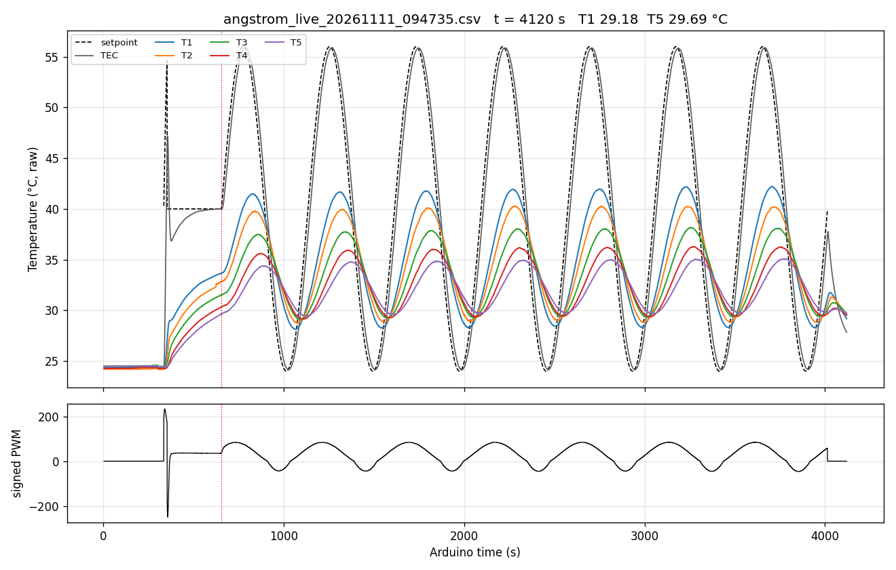

*Whole 11 Nov run: 2 min idle baseline, 19 s accidental START, 5 min hold at
40 °C, 7 cycles at 480 s. Bottom: applied PWM.*

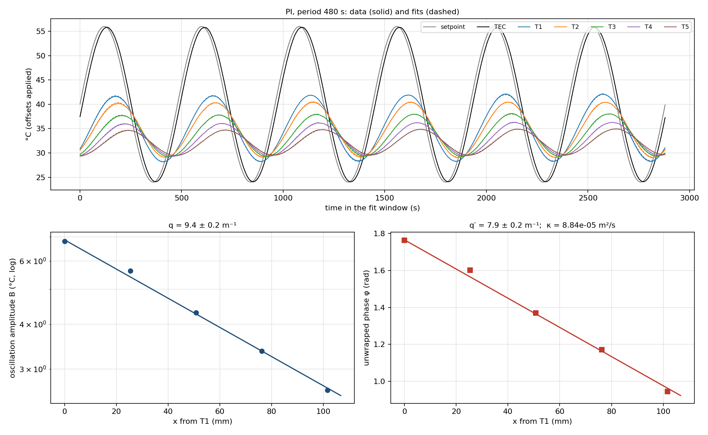

*11 Nov, 480 s, cycles 2 to 7: data (solid) and fitted sines (dashed), then
ln B and unwrapped phase against position.*

---

## 1. Purpose and the three priorities

The TEC makes a sinusoidal temperature at the rod base. Diffusion makes the
oscillation smaller and later along the rod. Measuring both lets us separate
diffusion (κ) from side heat loss (ν). Our order of priorities was the course's:
(1) a trustworthy six-channel record from the GUI with OL, P and PI compared,
(2) the Angstrom analysis, (3) comparing experiment and theory with residuals,
several frequencies and the Module 7 validity checks. All three are done below.

## 2. Schedule, what was done each session

| Session | Course plan | What we did | Files |
|---|---|---|---|
| S18, Mon 2 Nov | live run, two or more frequencies | OL, P, PI at 100 s; PI at 480 s | `angstrom_live_20261102_094506.csv` |
| S19, Wed 4 Nov | fit pilot runs, test more frequencies | schedule fast test; 240, 180 and 300 s | `angstrom_live_20261104_092527.csv`, `_110306.csv` |
| S20, Mon 9/10 Nov | production record | Sammy ran the production schedule 480, 240, 100 s (10 Nov) | `data/module_08_sammy/sammy_angstrom_live_20261110_164057.csv` |
| S21, Wed 11 Nov | spatial fits, κ and ν | 480 s repeat (Sammy's 480 s had only 3 settled cycles); all fits, mean-profile fit, app note | `angstrom_live_20261111_094735.csv` |
| S22, Mon 16 Nov | repeat or extend, P4, app check | to come | |

---

## 3. S18 in-class procedure, step by step

**Step 1. Labels, units, common bath, positions, limits.**
TEC thermistor on A0, rod T1 to T5 = R1 to R5 on A1 to A5, all in °C. T1 is in
the first (lowest) hole, nearest the TEC, and defines x = 0; T2 to T5 go up the
rod at 25.4, 50.8, 76.2, 101.6 mm (±1 mm), `data/module_08/sensor_map.csv`.
Common-bath offsets (`calibration_rod_run_20261026_112627.csv`, subtracted in the
analysis only): base +0.060, R1 +0.056, R2 −0.221, R3 +0.066, R4 −0.035,
R5 +0.134 °C. Safety latch: T1 > 56 °C, TEC > 65 °C, or 5 bad TEC readings.

**Step 2. GUI.** `python3 python/angstrom_gui.py` shows all six temperatures,
mode, setpoint and PWM, and saves every valid record to
`data/module_08/angstrom_live_YYYYMMDD_HHMMSS.csv` plus `_events.txt`,
`_notes.csv`, `_meta.json`.

**Step 3. Room temperature, r, conventions.** Room temperature = mean of T1 to
T5 (offsets applied) with the output off and the rod unheated:

| Day | Room T (°C) |
|---|---|
| 2 Nov | 22.53 |
| 4 Nov | 27.10 (300 s run used the same value; rod was still warm) |
| 10 Nov | 24.28 (Sammy's GUI showed 24.3) |
| 11 Nov | 24.37 (all channels within 0.14 °C) |

r = χ_h/χ_c = 0.50127/0.18091 = 2.771 (Module 4, °C per PWM count). Positive
PWM heats, negative cools; a negative P or PI command is multiplied by r before
the ±255 clamp.

**Step 4. Open-loop feedforward.** u_ff = f⁻¹(T_set − T_room), a piecewise-linear
inverse of the Module 4 steady-state curve (`data/module_04/steady_state.csv`).
Table in the sketch: PWM −65, −49, −32, −16, 0, 12, 25, 38, 50 for ΔT −11.79,
−8.55, −5.71, −2.64, 0, 6.03, 12.53, 19.07, 25.06 °C. The 2 Nov run asked for ΔT
from 1.5 to 33.5 °C; the curve only reaches 25.1 °C, so 36 % of OL records used
the extrapolated end segment (up to PWM 66.8).

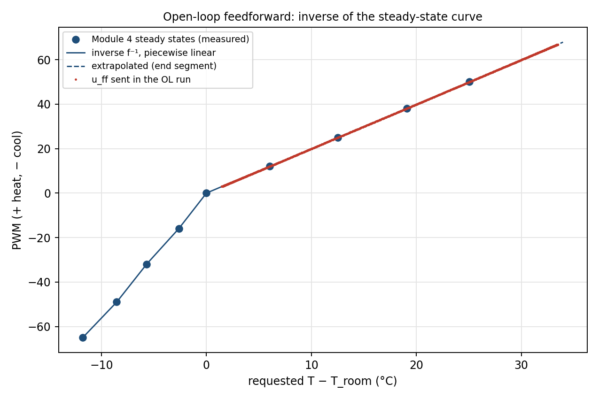

**Steps 5 to 7. OL, then P, then PI at 100 s, same drive**
(`angstrom_compare_angstrom_live_20261102_094506_100s.txt`, last 3 cycles of
each mode):

| Mode | TEC mean (°C) | TEC B/Tb | TEC lag (rad) | T1 B (°C) | T1 lag (rad) | heat / cool swing at TEC (°C) | PWM range |
|---|---|---|---|---|---|---|---|
| OL | 39.02 | 0.234 | 1.42 | 0.70 | 2.33 | 3.83 / 3.89 | 3 to 67 |
| P | 37.37 | 0.764 | 0.55 | 2.46 | 1.43 | 12.29 / 12.12 | −195 to 134 |
| PI | 39.94 | 0.868 | 0.62 | 2.88 | 1.50 | 13.93 / 13.76 | −216 to 156 |

What each term does. OL follows the steady-state curve but the plate's 63 s
time constant filters a 100 s drive: the one-lump model predicts 0.245 of the
amplitude and 1.32 rad lag, we measured 0.234 and 1.42 rad (the rod adds load
and lag). OL never cools because the whole waveform is above room. P tracks
with a 2.6 °C droop in the mean. PI removes the droop and gives the largest T1
swing. Heating and cooling halves agree within 0.2 °C; 2nd harmonic at most
1.5 % at the TEC and 2.0 % at T1. Residual rms 0.015 to 0.051 °C.

**Actuator slopes and saturation (P and PI).** Applied PWM against raw command:
heating slope 1.000, cooling 2.773 (P) and 2.771 (PI), equal to r. P hit −255
for 14 records (7 s) right after switching from OL; PI never saturated in the
fitted windows.

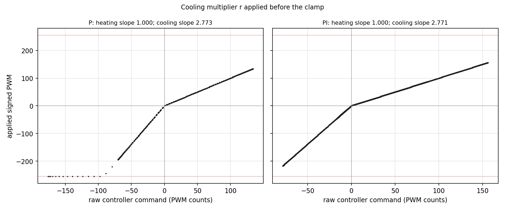

**Step 8.** Not needed: PI gave a clean sinusoidal T1 at 100 s (T1 residual
rms 0.027 °C, 2nd harmonic 2.3 %).

**Step 9. Settling, then 5 cycles at 100 s.** PI, 100 s, last 5 cycles
(2125.9 to 2625.9 s): every sensor's B within about 3 % and φ within 0.06 rad
cycle to cycle. T5 amplitude 0.43 °C, 27 times its 0.016 °C residual.

**Step 10. Second frequency.** 480 s, chosen because the predicted B5/B1 was
near 1/e. Measured B5/B1 = 0.385 and T1 to T5 lag 0.81 rad. Cycle 1 dropped,
cycles 2 to 6 kept.

**Step 11.** STOP at 5832.4 s; the file contains the OL, P and PI trials, every
mode change and the period change. Raw file unchanged.

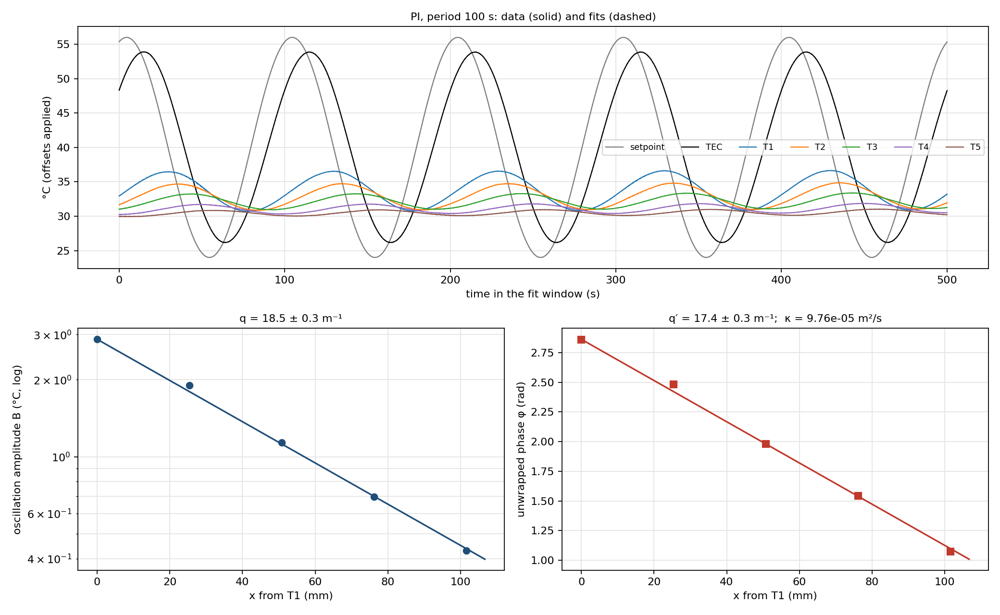
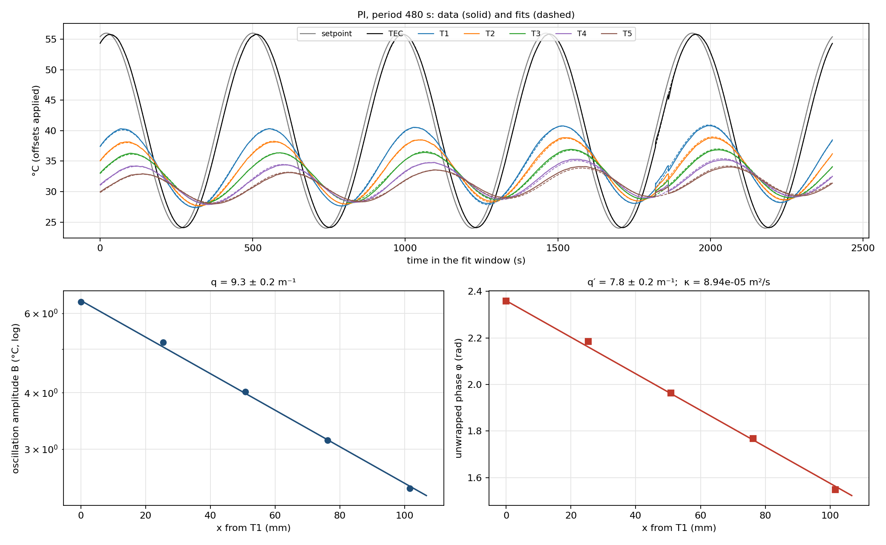

---

## 4. Choosing sensor positions

The mean decays slowly (mL ≈ 1.2 to 1.3), so it is measurable over the whole
rod, and Module 7 already measured it with a full-length layout
(`module_08_stationary_fin.md`, m = 4.117 ± 0.07 m⁻¹). We did not repeat that.

The oscillation decays fast (qL = 2.6 at 480 s to 5.2 at 100 s, measured, see
section 7), so the five sensors are bunched near the base: T1 in the first hole
(x = 0), the rest 1 in apart up to 101.6 mm. The pilot check: at 100 s T5 still
swings 0.43 °C (residual 0.016 °C), at 480 s it swings 2.45 °C, and the phase
changes 0.17 to 0.50 rad between neighbours, so the 1 in spacing works at every
period and no sensor was moved. Sammy's calipers on 10 Nov gave 25.4, 50.8,
76.2, 101.6 mm.

Geometry (`data/module_08/rod_geometry.csv`): D = 12.757 ± 0.006 mm (calipers,
3 places), L from the T1 hole to the tip = 281.9 ± 1.3 mm, overall about 305 mm.
The rod stands vertically.

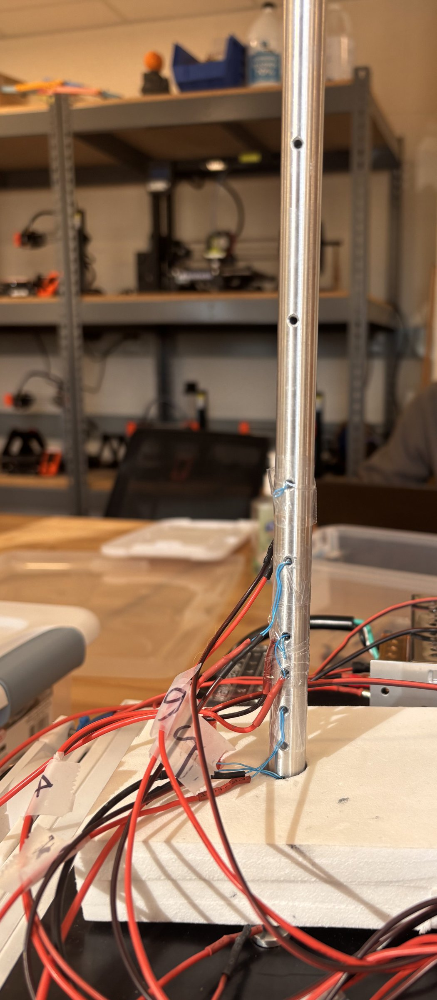
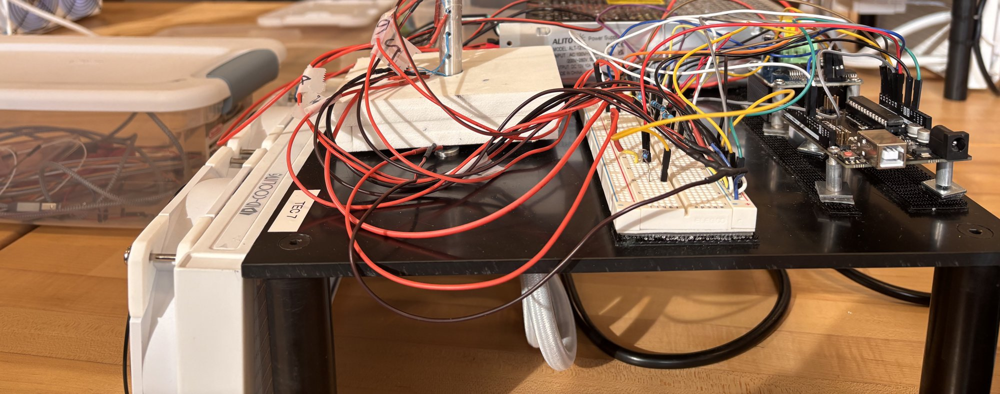

The photo still needs T1 to T5 and +x written on it (to do).

---

## 5. The prediction before the run (P3) and how it compared

**Prediction.** Every sensor oscillates at the drive period. Farther up the rod
the swing is smaller and later. The mean also falls along the rod, more slowly.
A shorter period means more attenuation and more lag per metre.

**What we saw.** All true. At 100 s the swing drops from 2.87 °C (T1) to 0.43 °C
(T5) and T5 is 1.79 rad late; at 480 s it drops from 6.37 to 2.45 °C and T5 is
0.81 rad late. The means fall (2 Nov 480 s: 34.25 °C at T1 to 31.16 °C at T5).

## 6. The simulator questions (four features)

We did not run the online simulator for this note; the answers below come
from our measured data, which is the same question asked of the real rod.

1. **Mean excess falls about exponentially.** Yes. Mean-profile fits give
   m = 3.8 to 4.6 m⁻¹ (section 11). On 2 and 4 Nov the residuals are under
   0.11 °C except one point.
2. **Amplitude falls exponentially, with a different coefficient.** Yes. ln B
   against x is a straight line (q = 9.1 to 18.7 m⁻¹ depending on period), and
   q is 2 to 4 times m.
3. **Phase lag grows steadily downstream.** Yes, at every period (e.g. 240 s,
   4 Nov: lags 0, 0.27, 0.57, 0.86, 1.15 rad).
4. **PWM phase.** Fundamental of the applied PWM against the setpoint (my quick
   fit, 2 Nov 100 s and 4 Nov 240 s):

   | Mode, period | PWM vs setpoint | TEC vs setpoint | T1 vs setpoint |
   |---|---|---|---|
   | OL, 100 s | 0.00 rad | −1.42 | −2.22 |
   | P, 100 s | +0.86 (leads) | −0.55 | −1.44 |
   | PI, 100 s | +0.79 (leads) | −0.62 | −1.50 |
   | PI, 240 s | +0.71 (leads) | −0.30 | −0.91 |

   OL PWM is exactly in phase with the setpoint (it is a function of it). P and
   PI lead the setpoint and lead every temperature. Adding the integral term
   pulls the command back by 0.07 rad, as expected (an integral lags).

Do points near the tip leave the straight line? Our sensors stop at
101.6 mm of 281.9 mm, so we only see the start of it: the finite-rod fit
changes κ by under 1 % at 100 to 300 s and by about 5 % at 480 s.

---

## 7. Derivations

### 7.1 Rod equation

θ = T − T∞. Energy balance on a slice: ∂θ/∂t = κ ∂²θ/∂x² − νθ, with
κ = k/(ρc) in m²/s and ν = hP/(ρcA) = 2h/(ρcR) = 4h/(ρcD) in 1/s. Every term is
K/s. Assumes constant properties, linear side loss, constant room temperature,
one temperature per cross-section.

### 7.2 Complex exponential

Boundary θ(0, t) = θ_b cos ωt, θ → 0 far away. Try θ̃ = θ_b e^(−sx) e^(iωt).
Then ∂θ̃/∂t = iωθ̃ and ∂²θ̃/∂x² = s²θ̃, so

iω = κs² − ν  ⇒  **s² = (ν + iω)/κ**.

Keep the root with positive real part (the other grows with x).

### 7.3 q and q′

s = q + iq′, s² = q² − q′² + 2iqq′. Matching real and imaginary parts:

**q² − q′² = ν/κ**,  **2qq′ = ω/κ**.

Since (q² + q′²)² = (q² − q′²)² + (2qq′)² = (ν² + ω²)/κ²:

q = √[(ν + √(ν² + ω²))/(2κ)],  q′ = √[(−ν + √(ν² + ω²))/(2κ)].

### 7.4 Real part

θ(x, t) = θ_b e^(−qx) cos(ωt − q′x). Amplitude falls as e^(−qx); lag q′x
radians, a time delay q′x/ω. Fitting form: B0 e^(−qx) cos(ωt − q′x + φ0).

Our fit convention is T_i = a_i + B_i cos(ωt + φ_i) (plus a slow drift term),
so a later sensor has a smaller unwrapped φ and the phase slope is −q′.

### 7.5 Mean plus oscillation

Linear equation, so add the stationary part:
T(x, t) = T∞ + (Ta − T∞) e^(−mx) + Tb e^(−qx) cos(ωt − q′x), with
m = √(ν/κ) and m² = q² − q′².

Three length scales: ℓ_mean = 1/m (mean falls by e), ℓ_amp = 1/q (swing falls
by e), ℓ_phase = 1/q′ (one radian of lag; wavelength 2π/q′). With Ω = ω/ν:
q/m = √[(1 + √(1 + Ω²))/2], q′/m = √[(−1 + √(1 + Ω²))/2].

**Check with our numbers.** Using the combined κ = 9.17 × 10⁻⁵ m²/s and
ν = 2.02 × 10⁻³ s⁻¹ (`data/module_08/part2_parameters.txt`), m = 4.69 m⁻¹ and
these formulas predict, against the measured finite-rod values:

| Period | Ω = ω/ν | predicted q, q′ (1/m) | measured q, q′ (1/m) |
|---|---|---|---|
| 100 s | 31.1 | 18.8, 18.2 | 18.60, 17.54 (2 Nov); 18.72, 18.21 (10 Nov) |
| 180 s | 17.3 | 14.2, 13.4 | 13.97, 13.52 |
| 240 s | 13.0 | 12.4, 11.5 | 12.44, 11.37 (4 Nov); 12.53, 11.58 (10 Nov) |
| 300 s | 10.4 | 11.2, 10.2 | 11.05, 10.22 |
| 480 s | 6.5 | 9.1, 7.8 | 9.09, 7.75 (2 Nov); 9.29, 7.94 (10 Nov); 9.25, 7.91 (11 Nov) |

One κ and one ν describe all five periods to about 1 to 4 %.

### 7.6 Popup: the three dimensionless lengths for our rod

The page's planning table used handbook k with h = 10 and L = 0.300 m. Ours,
from measured q and q′ (finite-rod fits) and L = 0.2819 m:

| Period | 1/q (mm) | 1/q′ (mm) | 2π/q′ (mm) | qL | q′L (rad) | q′L/2π | e^(−qL) |
|---|---|---|---|---|---|---|---|
| 100 s (2 Nov) | 53.8 | 57.0 | 358 | 5.24 | 4.94 | 0.79 | 0.0053 |
| 180 s | 71.6 | 74.0 | 465 | 3.94 | 3.81 | 0.61 | 0.020 |
| 240 s (4 Nov) | 80.4 | 88.0 | 553 | 3.51 | 3.21 | 0.51 | 0.030 |
| 300 s | 90.5 | 97.8 | 615 | 3.11 | 2.88 | 0.46 | 0.044 |
| 480 s (2 Nov) | 110.0 | 129.0 | 811 | 2.56 | 2.18 | 0.35 | 0.077 |

mL: 1.16 with Module 7's m = 4.117; 1.20 with the mean-profile 4.27; 1.33 with
√(ν/κ) = 4.70 (ℓ_mean = 243, 234, 213 mm). At every period qL > mL, so the
swing dies faster than the mean, as the page says. Our qL values are lower than
the planning table (6.47 at 100 s) because our κ is larger than the handbook
value.

### 7.7 Finite insulated tip (guided solution)

Mean part: θ̄'' − m²θ̄ = 0, θ̄(0) = Ta − T∞, θ̄'(L) = 0 gives
θ̄ = (Ta − T∞) cosh[m(L − x)]/cosh(mL).
Oscillating part: F'' − s²F = 0, F(0) = Tb, F'(L) = 0 gives
θ̃ = Tb cosh[s(L − x)]/cosh(sL) e^(iωt).
Together: T = T∞ + (Ta − T∞) cosh[m(L − x)]/cosh(mL) + Tb A(x) cos[ωt − φ(x)],
where cosh[s(L − x)]/cosh(sL) = A(x)e^(−iφ(x)).

- **Check 1 (x = 0).** Both cosh ratios are 1, so
  T = T∞ + (Ta − T∞) + Re{Tb e^(iωt)} = Ta + Tb cos ωt. ✓
- **Check 2 (x = L).** d/dx cosh[m(L − x)] = −m sinh[m(L − x)] = 0 at x = L, and
  the same with s. Zero slope at the tip. ✓
- **Check 3 (long rod).** cosh[m(L − x)]/cosh(mL) =
  e^(−mx)[1 + e^(−2m(L − x))]/[1 + e^(−2mL)] → e^(−mx) when m(L − x) ≫ 1. Same
  with s, since |e^(−2s(L − x))| = e^(−2q(L − x)). ✓
- **Check 4 (why the tip matters).** The correction is a wave reflected off
  the insulated tip, of relative size about e^(−2q(L − x)). It is largest where
  L − x is small, i.e. near the tip, and for small q, i.e. long periods. Ours
  at T5 (x = 101.6 mm), from `part2_parameters.txt`: 0.12 % (100 s), 0.68 %
  (180 s), 1.19 % (240 s), 2.00 % (300 s), 3.97 % (480 s). For the mean
  profile (m ≈ 4.7, much smaller than q) it is 9.5 %, which is why the mean is
  always fitted with the cosh form.

### 7.8 Inverse relations and the sanity check

Two sensors: q = ln(B1/B2)/Δx, q′ = Δφ/Δx. With five sensors we fit slopes.
Inverting: **κ = ω/(2qq′)**, **ν = κ(q² − q′²)**, k = ρcκ.
Units: (rad/s)/(1/m²) = m²/s; (m²/s)(1/m²) = 1/s. ✓

Page example (q = 25, q′ = 18, ω = 0.0628): κ = 6.98 × 10⁻⁵ m²/s,
ν = 2.10 × 10⁻² s⁻¹. Ours at 100 s (2 Nov): q = 18.53, q′ = 17.37 (semi-infinite)
gives κ = 9.76 × 10⁻⁵ m²/s, ν = 4.0 × 10⁻³ s⁻¹.

No side loss (ν = 0) gives q = q′ = √(ω/2κ). Side loss makes q > q′. In every
one of our windows q > q′, ν > 0, and κ does not depend on period, so none of
the page's warning signs appear.

---

## 8. Experimental notation filled in

| Symbol | Meaning | Our value |
|---|---|---|
| T∞ | room temperature | 22.53, 27.10, 24.28, 24.37 °C (2, 4, 10, 11 Nov) |
| Ta | mean setpoint | 40 °C |
| Tb | setpoint amplitude | 16 °C |
| TEC | TEC-base thermistor | swing 0.86 to 0.99 of Tb with PI, 10 to 12 s behind |
| T1 | rod base, x = 0 | swing 2.9 °C (100 s) to 6.8 °C (480 s) |
| T2 to T5 | x = 25.4, 50.8, 76.2, 101.6 mm | T5 swing 0.43 to 2.62 °C |
| a_i | fitted mean of sensor i | e.g. 4 Nov 240 s: 36.33, 35.63, 35.01, 34.28, 33.88 °C |
| B_i | fitted amplitude | e.g. 4 Nov 240 s: 5.82, 4.42, 3.15, 2.28, 1.64 °C |
| φ_i | unwrapped phase | e.g. 4 Nov 240 s: −1.335, −1.601, −1.909, −2.192, −2.488 rad |
| τ, ω | period, 2π/τ | 100 to 480 s, 0.0628 to 0.0131 rad/s |
| q | amplitude decay | 9.1 to 18.7 1/m |
| q′ | phase slope | 7.8 to 18.2 1/m |
| κ | diffusivity | (9.29 ± 0.06) × 10⁻⁵ m²/s |
| ν | side-loss rate | about 2 × 10⁻³ 1/s |
| r | χ_h/χ_c | 2.771 |

---

## 9. Stage 1: the boundary condition

- **Drive.** T_set = Ta + Tb sin(2πt/τ), Ta 40, Tb 16, computed on the Arduino.
  Measured room temperature recorded every day (section 3).
- **Heating/cooling asymmetry.** r = 2.771 from Module 4; applied before the
  clamp; fitted actuator slopes 1.000 and 2.771 confirm it.
- **Feedforward from the inverted steady-state curve,** not a sinusoidal PWM
  (section 3, step 4).
- **OL vs P vs PI** compared at the same drive (section 3). PI used for all
  later runs.
- **Tracking and sinusoidal quality** (measured-to-requested amplitude and lag
  of T1 behind the setpoint), from the fit files:

| Run | Period | B_TEC/Tb | TEC lag | B_T1/Tb | T1 lag | PWM range in window |
|---|---|---|---|---|---|---|
| 2 Nov | 100 s | 0.868 | 9.9 s | 0.180 | 24.0 s | −217 to 156 |
| 10 Nov | 100 s | 0.862 | 9.9 s | 0.187 | 23.6 s | −225 to 152 |
| 4 Nov | 180 s | 0.928 | 11.1 s | 0.317 | 30.0 s | −144 to 111 |
| 4 Nov | 240 s | 0.954 | 11.6 s | 0.364 | 34.6 s | −108 to 98 |
| 10 Nov | 240 s | 0.957 | 11.4 s | 0.301 | 36.9 s | −94 to 101 |
| 4 Nov | 300 s | 0.970 | 12.0 s | 0.404 | 38.4 s | −95 to 88 |
| 2 Nov | 480 s | 0.991 | 12.1 s | 0.398 | 52.1 s | −43 to 88 |
| 10 Nov | 480 s | 0.992 | 12.0 s | 0.394 | 52.9 s | −47 to 83 |
| 11 Nov | 480 s | 0.992 | 12.4 s | 0.426 | 51.4 s | −46 to 85 |

  No fitted window reached ±255. The TEC loses amplitude at short periods
  because the plate lags about 10 to 12 s. We always use the measured T1, not
  the setpoint, as the boundary condition.

**Optimise the waveform: targets against ours.**

| Course target | Ours |
|---|---|
| period ≥ 100 s | 100 to 480 s |
| primary period: farthest sensor near B1/e = 0.37 | 480 s: B5/B1 = 0.385 (2 Nov), 0.383 (10 Nov), 0.384 (11 Nov) |
| lag T1 to farthest sensor 0.5 to 2 rad | 0.81 rad (480 s) to 1.86 rad (100 s) |
| clean, unclipped, rod base below 56 °C | harmonics ≤ 2.5 %; T1 max 41.3 to 43.4 °C raw; TEC max 55.9 °C |
| Ta, Tb fixed when comparing periods | yes, 40 and 16 throughout |

---

## 10. Stage 2: the live GUI record, and Stage 3: the schedule

**Record** (one line about every 0.54 s; median spacing 0.543 s on 11 Nov):

```text
time_ms,run_state,control_mode,step,Ta_C,Tb_C,period_s,setpoint_C,feedforward_pwm,TEC_C,T1_C,T2_C,T3_C,T4_C,T5_C,controller_pwm,heating_to_cooling_ratio,signed_pwm
```

`nan` marks a field that does not apply (feedforward in P/PI, controller in OL,
setpoint while idle). Lines starting with `#` are the banner, settings and
events, also saved with wall-clock time in `_events.txt`.

**Run log.**

| File | What happened |
|---|---|
| `angstrom_live_20261102_094506` | OL 405.5 s, P 1079.2 s, PI 1591.4 s, 480 s period 2626.8 s, STOP 5832.4 s |
| `angstrom_live_20261104_091727`, `_092121` | contact faults on T2 to T5, wires reseated; not used |
| `angstrom_live_20261104_092527` | Stage 3 fast test, then hold, 240 s, 180 s |
| `angstrom_live_20261104_104451` | idle, rod cooling; not used |
| `angstrom_live_20261104_110306` | hold, 300 s; stopped after cycle 7 |
| `sammy_angstrom_live_20261110_164057` | Sammy's production run: hold, 480, 240, 100 s |
| `angstrom_live_20261111_094326`, `_094614` | no data / short idle; not used |
| `angstrom_live_20261111_094735` | hold, 480 s (accidental 19 s START first, absorbed by the hold) |

**Stage 3 evidence (4 Nov, `angstrom_live_20261104_092527`).** Fast test, 200 s
each at 100, 150 and 200 s periods: two automatic changes at 200.0 s
intervals, continuous setpoint (no jump at either change), an `# EVENT ...
SCHEDULE STEP k` line at each change, `step` field updated in every record,
`SCHEDULE DONE, output 0` at the end, recording continuous throughout. Schedule
syntax: one step per line `duration Ta Tb period`, up to 8 steps; periods below
100 s and setpoints outside 10 to 56 °C are refused.

---

## 11. Stage 4: pilot analysis and the experiment plan

1. **Transient removed, settling evidence.** Rule fixed in A5 before fitting:
   fit each cycle on its own; settled from the first cycle after which every
   rod sensor's B stays within 3 % and φ within 0.05 rad of the cycle before,
   with no steady trend. Cycles dropped: 2 Nov 480 s cycle 1; 4 Nov 240 and
   180 s cycles 1 and 2; 4 Nov 300 s cycle 1; 10 Nov 240 s cycle 1; 11 Nov 480 s
   cycle 1. On 11 Nov all amplitudes crept up about 0.7 % per cycle together,
   but the ratios did not (B5/B1 0.386 in cycle 2, 0.380 in cycle 7).
2. **At least five settled periods.** Yes in six windows (table below); two
   windows from 10 Nov have only 3.
3. **Data and fitted sine for every sensor:** the top panel of each fit figure.
4. **B against x on a log scale:** bottom-left panel.
5. **Unwrapped phase against x:** bottom-right panel.
6. **Production period:** 480 s is the primary period (1/e target met); 240 s
   and 100 s added, with 180 and 300 s on 4 Nov.

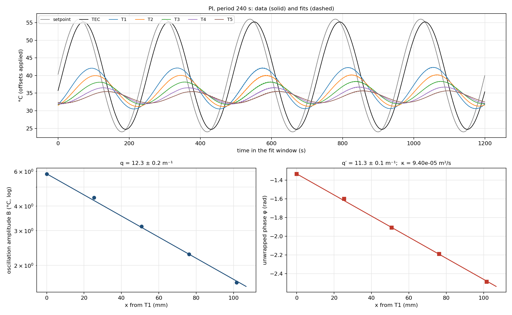
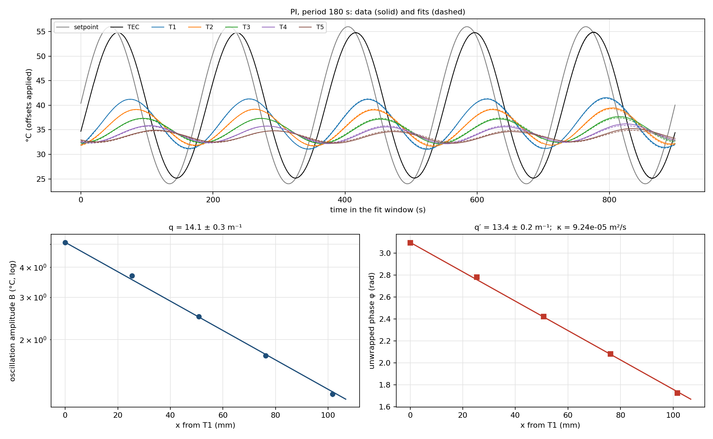
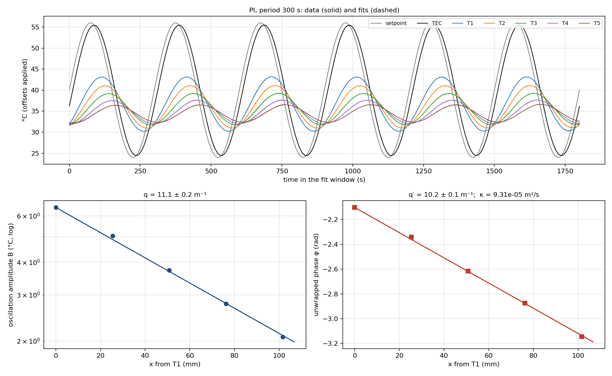

**Experiment plan (what the page asks the plan to state).**

| Field | Our plan |
|---|---|
| Periods | 480 s primary, 240 s and 100 s (production preset); 180 and 300 s extra |
| Mean, amplitude | Ta 40 °C, Tb 16 °C |
| Duration | 5 min hold at 40 °C, then 7 cycles per period (56 + 28 + 12 min, 101 min) |
| Sampling | one record about every 0.54 s (180 to 890 per cycle) |
| Safety | latch at T1 56 °C, TEC 65 °C, 5 bad TEC readings; setpoints 10 to 56 °C |
| Settling | 3 % in B, 0.05 rad in φ, cycle to cycle, no trend; keep ≥ 5 settled cycles |
| Channels | TEC (A0), T1 to T5 (A1 to A5) at 0 to 101.6 mm |
| Files | GUI CSV + `_events.txt` + `_notes.csv` + `_meta.json`; runbook `module_08_production_runbook.md` |
| Usability tests | no nan or spikes in the window; ≥ 3 sensors with measurable B and φ; no saturation; ≥ 5 settled cycles |

---

## 12. Stage 5: production data

1. **Minimum dataset:** met many times over (table below).
2. **Extra periods with the schedule:** yes, five periods; every transition is
   in the files and each period's settled window is chosen on its own.
3. **Geometry and sensor map unchanged:** same holes since 2 Nov; calipers on
   10 Nov confirm the spacing.
4. **Room temperature and drift:** recorded every day (section 3). Rod means
   drift slowly within a window (up to 0.34 °C per cycle on 2 Nov at 480 s); the
   fit's drift term absorbs it.
5. **Raw data preserved:** offsets, masks and exclusions are only in the
   analysis code (`--offsets`, `--mask`).
6. **Every restart and departure recorded:** the run log above and
   `module_08_angstrom.md` sections 7 to 9 (wire faults 4 Nov, T5 glitches, TEC
   jump, accidental START, a wrong "reseated" note on 11 Nov).

**All nine windows.** κ in 10⁻⁵ m²/s, ν in 10⁻³ s⁻¹, q and q′ semi-infinite
slopes in 1/m (`module_08_modeling_app.md`, `angstrom_finite_*.txt`).

| Run | Period | Settled cycles kept | q | q′ | B5/B1 | lag T1→T5 (rad) | κ semi-inf. | κ finite rod | ν finite rod |
|---|---|---|---|---|---|---|---|---|---|
| 2 Nov | 100 s | 5 | 18.53 | 17.37 | 0.149 | 1.79 | 9.74 ± 0.23 | 9.74 ± 0.23 | 4.1 ± 1.5 |
| 2 Nov | 480 s | 5 (2 to 6) | 9.34 | 7.84 | 0.385 | 0.81 | 8.93 ± 0.25 | 9.40 ± 0.24 | 2.0 ± 0.4 |
| 4 Nov | 180 s | 5 (3 to 7) | 14.10 | 13.39 | 0.234 | 1.37 | 9.23 ± 0.20 | 9.19 ± 0.20 | 1.7 ± 0.8 |
| 4 Nov | 240 s | 5 (3 to 7) | 12.34 | 11.29 | 0.281 | 1.15 | 9.39 ± 0.17 | 9.36 ± 0.17 | 2.1 ± 0.5 |
| 4 Nov | 300 s | 6 (2 to 7) | 11.06 | 10.17 | 0.321 | 1.04 | 9.30 ± 0.16 | 9.33 ± 0.15 | 1.3 ± 0.4 |
| 10 Nov | 480 s | 3 (5 to 7) | 9.36 | 7.95 | 0.383 | 0.82 | 8.78 ± 0.21 | 9.22 ± 0.19 | 1.9 ± 0.3 |
| 10 Nov | 240 s | 6 (2 to 7) | 12.42 | 11.52 | 0.280 | 1.18 | 9.14 ± 0.14 | 9.10 ± 0.14 | 1.7 ± 0.4 |
| 10 Nov | 100 s | 3 (5 to 7) | 18.73 | 18.06 | 0.147 | 1.86 | 9.28 ± 0.16 | 9.28 ± 0.16 | 2.4 ± 1.1 |
| 11 Nov | 480 s | 6 (2 to 7) | 9.37 | 7.90 | 0.384 | 0.82 | 8.84 ± 0.33 | 9.27 ± 0.35 | 2.0 ± 0.5 |

- **Frequency consistency:** weighted mean of the finite-rod κ = 9.29 ± 0.06,
  χ² = 6.5 for 8 degrees of freedom. Only the six windows with ≥ 5 settled
  cycles: 9.30 ± 0.07. Five periods, four days, room 22.5 to 27.1 °C, one κ.
- The Part II Monte Carlo (one common position, L and D draw for all windows)
  gives 9.17 ± 0.18; the 1.3 % difference is a choice of weighting, noted in
  `docs/assessments/final_thermal_transport_analysis.md`.
- Semi-infinite κ is about 5 % low at 480 s because of the tip reflection;
  the finite-rod fit is the one we quote.

**Problems found, and what we did about them.**

- **T5 glitches.** 4 Nov 300 s: T5 read up to 0.36 °C high for about 20 s; with
  those 30 s replaced by the same phase from cycles 4 and 6 (temporary copy)
  κ changed from 9.31 to 9.30, so it was left in. 10 Nov: T5 read 1 to 4 °C
  high at 1860 to 2618 s and 3060 to 3141 s; masked in the fit.
- **10 Nov TEC jump.** At t = 2598 s the TEC reading jumped 4.3 °C in one record
  while T1 kept falling smoothly, so it is the sensor, not the plate. PI
  answered with −176 PWM; afterwards every rod amplitude was about 10 % lower and
  the rod mean 1.3 °C lower, with the sensor ratios unchanged. Only cycles 5 to
  7 kept (3 cycles). This is why we repeated 480 s on 11 Nov.
- **T2 anomaly.** On 10 Nov T2's mean sat 1.2 °C above the cosh curve through
  the others (only while heated; normal at room temperature); on 11 Nov
  +0.35 °C, with B2/B1 = 0.827 against 0.809 to 0.813 on other days and its
  phase 0.035 rad early against the model. T2's mean was left out of the 10 Nov
  mean-profile fit; its oscillation is kept. Cause unknown; check T2's seating.

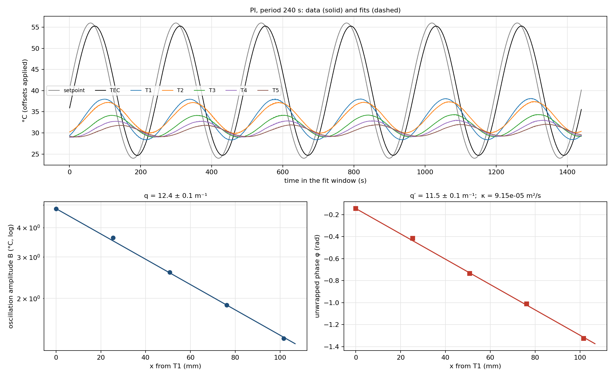
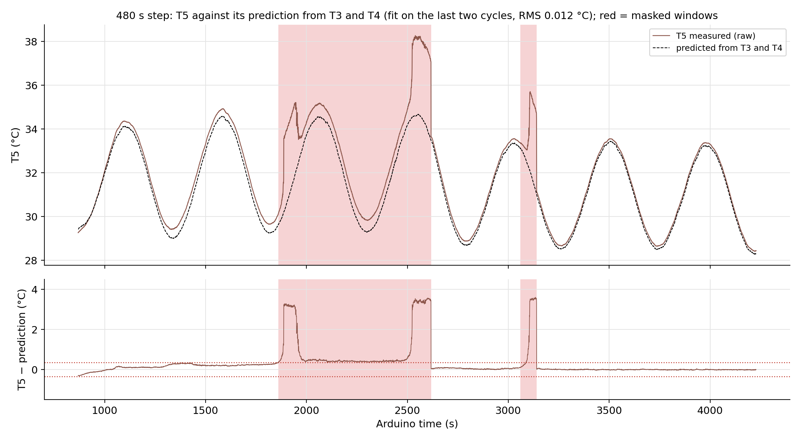

---

## 13. Stage 6: spatial fits, mean profile, model checks

**q and q′:** table above. **κ and ν:** table above.

**Mean profile** (`angstrom_mean_profile.py`): fit a_i − T∞ =
(a0 − T∞) cosh[μ(1 − ξ)]/cosh μ with ξ = x/L, μ = mL, then m = μ/L with the
errors of μ and L (±1.3 mm) combined.

| Run | Period | m (1/m) | χ²/dof | √(q² − q′²) (1/m) |
|---|---|---|---|---|
| 2 Nov | 100 s | 4.34 ± 0.16 | 34.9/3 | 6.5 ± 1.2 |
| 2 Nov | 480 s | 4.08 ± 0.21 | 0.6/3 | 5.1 ± 0.4 |
| 4 Nov | 180 s | 4.30 ± 0.11 | 2.1/3 | 4.4 ± 1.0 |
| 4 Nov | 240 s | 4.16 ± 0.09 | 5.6/3 | 5.0 ± 0.5 |
| 4 Nov | 300 s | 3.79 ± 0.08 | 10.0/3 | 4.4 ± 0.5 |
| 10 Nov, no T2 | 480 s | 4.28 ± 0.11 | 1.1/2 | 4.9 ± 0.4 |
| 10 Nov, no T2 | 240 s | 4.61 ± 0.07 | 2.5/2 | 4.6 ± 0.5 |
| 10 Nov, no T2 | 100 s | 4.57 ± 0.07 | 5.1/2 | 5.0 ± 1.2 |
| 11 Nov | 480 s | 4.36 ± 0.30 | 79.6/3 | 5.04 ± 0.56 |

- Mean-profile m: average 4.27, run-to-run sd 0.26. **Agrees with Module 7's
  full-length 4.117 ± 0.07.** The scatter is bigger than the single-fit errors,
  as the page warned (sensors bunched near the base constrain mL weakly).
- Angstrom m = √(q² − q′²): weighted 4.85 ± 0.18, about 3σ above the mean-profile
  value. Each single value is weak because q² − q′² is a small difference.
- μ = mL: 1.16 to 1.33 depending on which m (section 7.6).

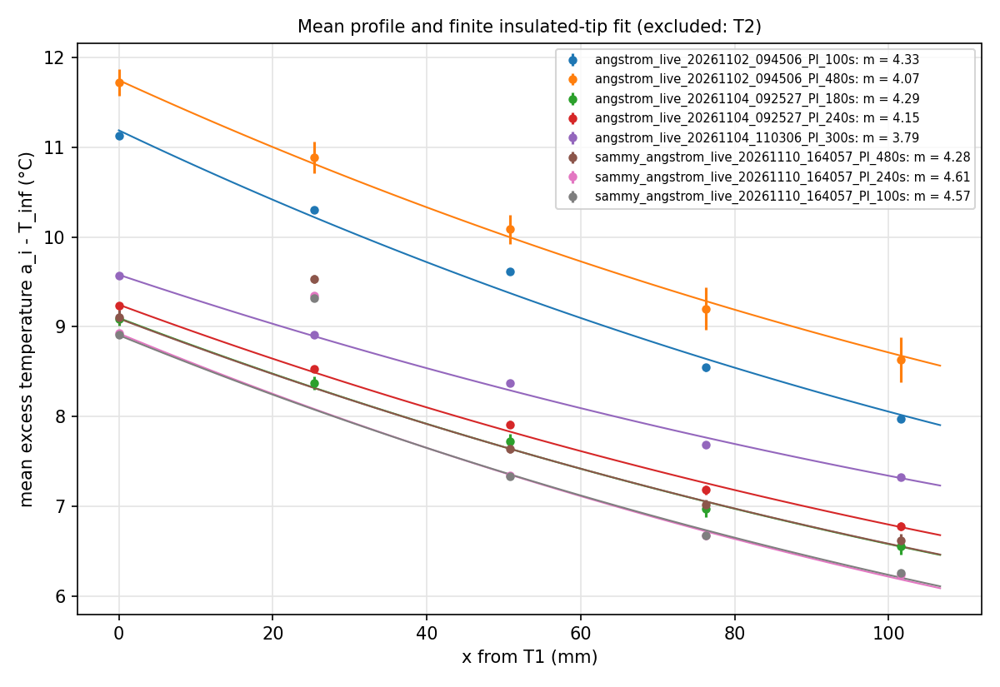
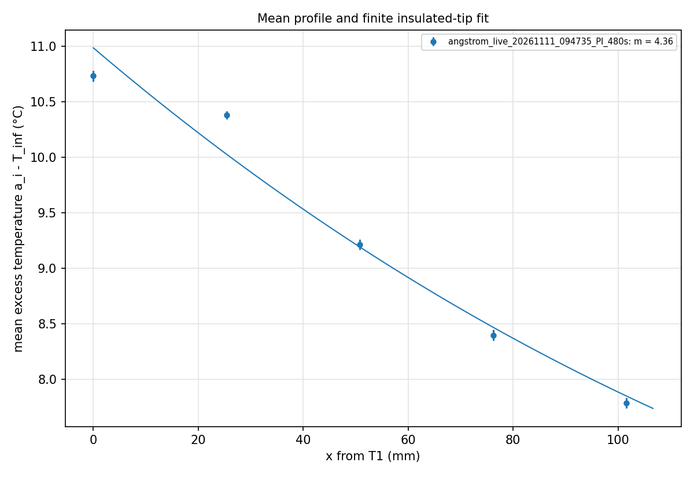

**Model against data** (`angstrom_model_compare.py`: finite-rod heat equation,
κ = 9.17 × 10⁻⁵, ν = 2.02 × 10⁻³, driven by the measured T1, nothing fitted). On
11 Nov at 480 s the modelled amplitudes match T3 to T5 within 0.4 to 1.6 % and
the phases within 0.007 rad; T2 is 4.7 % high and 0.035 rad early. The means at
T3 to T5 sit 0.38 to 0.44 °C above the model, so the model's ν is a bit too
large for the mean profile (the same tension as the two m values above).

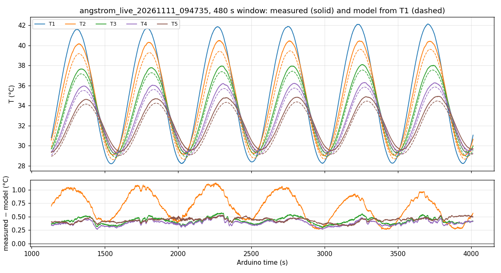

**Validity checks with the final numbers.**

- Finite length at T5: 0.12 % (100 s) to 3.97 % (480 s); finite-rod fits used.
- Transverse Biot number Bi = (ν/κ)R²/4 with R = 6.378 mm: 1.4 × 10⁻⁴ to
  4.2 × 10⁻⁴ per window (2.3 × 10⁻⁴ combined). Far below 0.1, so one temperature
  per cross-section is fine.
- Conclusion: all five retained sensors support the 1-D analysis; with the
  finite-rod form, the semi-infinite approximation is not even needed.

**App checklist** (formative check, all in `python/analysis/`):

- [x] imported raw data and fitting interval: `angstrom_fit.py` (window printed in every output file)
- [x] TEC tracking and rod-base waveform: top panel of every fit figure; tracking table above
- [x] sine fit for every retained sensor: `angstrom_fit_*.png`
- [x] a_i against x and finite-rod fit for mL and m: `angstrom_mean_profile.py`
- [x] amplitude and unwrapped phase against x: fit figures, bottom panels
- [x] q and q′ with units and errors: `angstrom_fit_*.txt`, `angstrom_finite_*.txt`
- [x] κ and ν: same files
- [x] residuals and exclusions with reasons: rms residuals in each fit file; `module_08_modeling_app.md`
- [x] finite-length and transverse Biot checks: this section and `part2_parameters.txt`
- [x] AI note: `module_08_modeling_app.md`

Optional global fit (all T_i(t) at once with shared q, q′): not done.

---

## 14. Evidence saved

Requested and measured boundary waveforms (setpoint, TEC, T1 in every CSV and
fit figure), controller settings (`_events.txt`), sensor map, raw pilot and
production data, fitting windows (first line of every output file), exclusions
(`module_08_modeling_app.md`), intermediate fit parameters (`angstrom_fit_*.csv`),
residuals, code version (git history; `_meta.json` records the commit at the
start of each run). Paths: `docs/module_notes/`, `data/module_08/`,
`docs/figures/module_08/`. Nothing raw was overwritten.

## 15. A5

`docs/assessments/a5_angstrom_derivation_plan.md` (PDF `docs/A5_Naidu.pdf`):
derivation, inverse relations, units, acquisition plan, finite-length and Biot
checks. The deadline moved (Part II page: Monday 23 Nov, 9:05). Its numbers
predate the 10 and 11 Nov runs and should be updated to the tables above
before submitting.

## 16. Learning objectives

**1. Measure all six temperature histories.** Nine settled fit windows from five
runs on four days, all recorded live by the GUI with every event and note;
records about every 0.54 s; no fitted window saturated; faults (T5, the
10 Nov TEC jump) found from the raw files and masked or excluded in code, not
by editing data.

**2. Understand the settled-periodic profile.** The three lengths for our rod:
ℓ_mean = 1/m ≈ 234 mm (mean-profile m = 4.27), ℓ_amp = 1/q = 54 to 110 mm,
ℓ_phase = 1/q′ = 57 to 129 mm, from 100 to 480 s. ℓ_amp < ℓ_mean at every period.
One κ = 9.29 × 10⁻⁵ m²/s and ν ≈ 2 × 10⁻³ s⁻¹ predict q and q′ at all five
periods through Ω = ω/ν (section 7.5).

**3. Compare experiment and theory.** Per-sensor residuals 0.01 to 0.2 °C, straight
ln B and φ lines, κ the same at five periods (χ² 6.5/8), finite-length ≤ 4 %,
Biot about 10⁻⁴, mean-profile m agrees with Module 7. What does not fit yet:
κ is 35 % above the 6061-T6 handbook value; √(q² − q′²) is about 3σ above the
mean-profile m; T2 is slightly off on several days.

---

## What to say if asked

| Question | Answer |
|---|---|
| What is the Angstrom method? | Drive the base with a sine; the swing shrinks (q) and lags (q′) along the rod; κ = ω/(2qq′), and side loss cancels out of that product. |
| How do you know the response was settled? | Each cycle fitted separately; amplitudes within 3 % and phases within 0.05 rad of the previous cycle, no trend; first unsettled cycles dropped; at least 5 kept. |
| Why trust κ? | Five periods and four days give the same value, χ² 6.5 for 8. |
| Why not the semi-infinite formulas? | At 480 s the tip reflection is 4 % at T5 and shifts κ by about 5 %, so we fit the finite insulated-tip form. |
| Is 1-D OK? | Transverse Biot number about 2 × 10⁻⁴, far below 0.1. |
| Why is κ 35 % above the handbook? | Not solved. Spacing was checked with calipers. Candidates: sensor contact or lag, where the bead sits in the hole, the actual alloy. |
| Why repeat 480 s on 11 Nov? | Sammy's 480 s had only 3 settled cycles after a TEC-sensor jump; ours has 6 and gives 9.27 ± 0.35. |
| Why PI and not OL or P? | OL only reached 23 % of the requested swing; P drooped 2.6 °C; PI had no droop and 87 % of the swing at 100 s, 99 % at 480 s. |
