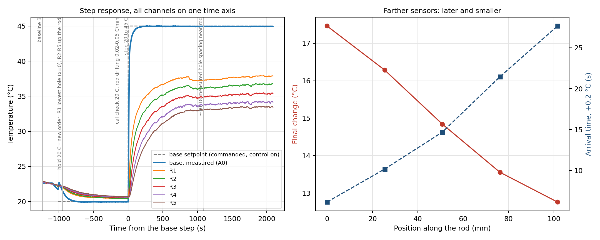

# Module 7, Part III: rod instrument and data-acquisition chain (C5)

Naidu / Cohen. Started 26 October 2026. Course naming: this note, the data
(`data/module_08/`) and the figures (`docs/figures/module_08/`) use the
`module_08` paths the course page asks for.

**C5 work in class on Wednesday 28 October. No Moodle receipt was due that
day; when the receipt is due, it must cite the pushed commit.**

Fields marked **TO MEASURE** are not known yet and must come from the bench.
Nothing in this note is a measurement until it says so.

---

## 1. The acquisition chain

| Stage | What | Where |
|---|---|---|
| Sensor | 100 kOhm NTC thermistor (TDK B57861S0104F040V24) on the rod surface, one per position | rod |
| Divider | 5V - R_fixed - pin - thermistor - GND, thermistor as the lower leg, one divider per channel | breadboard |
| ADC | Uno 10-bit ADC, 4.88 mV per count, one converter switched between pins | A0 (base), A1 to A5 (rod) |
| Averaging | base: 1000 readings per report; rod: 500 per channel; the first 4 readings after each channel switch are discarded | sketch |
| Conversion | divider voltage, then resistance, then the beta equation (B = 4540 K, R25 = 100 kOhm), on the averaged count | sketch |
| Serial | one line per report: `Temperature (C): base, Time (s): t, PWM: n, Heat/Cool: d, Rod (C): R1, R2, R3, R4, R5` | 9600 baud |
| Logging | one CSV row per line: base columns as in Module 6, then `T_R1_C` ... | `python/rod_pi_logger.py` |
| Base control | the same PI controller and anti-windup as Module 6, acting on the base thermistor | `python/tec_pi_control_gui.py` |

**Why one line per report.** Every channel in a row was read within about
0.3 s, in the same pass of `loop()`, and carries one Arduino time stamp
(`time_s`). The base temperature is the rod's boundary condition, so a delay
or an amplitude ratio between a rod channel and the base is only meaningful
if both are on the same clock. Two separate loggers, or a laptop clock, would
add an unknown offset between the streams.

**Why the discarded readings.** The Uno's ADC samples through a multiplexer
onto a small capacitor. The divider's source resistance (about 50 kOhm at
room temperature) is five times what the ATmega328P data sheet recommends
(10 kOhm or less), so the first reading after a channel switch can be pulled
toward the previous channel. The sketch throws those away.

**Raw data only.** The saved temperatures are the raw beta-equation values.
Offsets from the cross-check are applied in memory by the analysis scripts
(`--offsets`), never written back.

## 2. Hardware and wiring (TO MEASURE / TO CONFIRM on the bench)

| Item | Value | How measured |
|---|---|---|
| Rod material | aluminium alloy 6061 (as given for the course rod, 26 Oct) | label / instructor |
| Rod diameter D, radius R = D/2 | D = 0.5 in = 12.70 mm nominal, R = 6.35 mm; **confirm with calipers** at 3 places (mean ± sd) | nominal size, 26 Oct |
| Cross-section A = πR², perimeter P = 2πR | A = 126.7 mm² = 1.267e-04 m², P = 39.9 mm = 0.0399 m, A/P = R/2 = 3.175 mm (from the nominal D) | calculated |
| Rod length L | 300 mm (30 cm) overall as given; for the fit, L is **measured from R1's hole to the tip** | nominal, 26 Oct |
| Coordinate origin and direction | x = 0 at rod thermistor R1 in the first (lowest) rod hole, x increasing up the rod toward the tip (course Part 2, from 28 Oct about 09:40) | course procedure |
| Insulation around the rod | TO RECORD (bare, foam, partly covered) | |
| Each upper resistor R_fixed | TO MEASURE with the multimeter, enter in `rodRfixed[]` and `sensor_map.csv` | multimeter |

**Wiring.** Each rod thermistor gets its own divider, wired exactly like the
base: 5V to R_fixed to the analog pin, pin to thermistor, thermistor to GND.
Default pins A1 to A5 (edit `rodPins[]` if different). **Disconnect the old
trim pot from A1 first.**

**Sensor map:** [`data/module_08/sensor_map.csv`](../../data/module_08/sensor_map.csv).
One row per rod channel, in the same order as `rodPins[]`: channel name, pin,
position from the origin (mm), position uncertainty (mm), measured R_fixed,
notes. The logger names the CSV columns from this file and copies it into the
metadata of every run.

Photograph: TO ADD, `docs/figures/module_08/sensor_map_photo.jpg`, showing
the origin, the x direction and each channel label.

## 3. How to run

1. Upload `arduino/module_08/rod_tec_multichannel/rod_tec_multichannel.ino`
   (after setting `NUM_ROD`, `rodPins[]` and `rodRfixed[]`). Check in Serial
   Monitor at 9600 baud that the banner lists the rod channels and that every
   channel gives a number, then quit the Arduino IDE.
2. **Check each channel by its response:** warm one thermistor between finger
   and thumb and confirm that only its column rises. This proves the channel
   name, the pin and the physical sensor match.
3. Start the logger from the repository root:

   ```bash
   cd ~/Documents/GitHub/phys39-naidu-cohen
   python3 python/rod_pi_logger.py
   ```

   It writes `data/module_08/rod_run_<date_time>.csv`, `_meta.json` and
   `_notes.csv`. Type notes into the box during the run (Enter saves them
   with the time).

## 4. Part 1: cross-check (calibration)

With the TEC off and the rod left alone until it is at room temperature,
record at least 60 s (better 3 to 5 min). Then:

```bash
python3 python/analysis/rod_calibration.py data/module_08/rod_run_<...>.csv --t0 <start> --t1 <end>
```

It prints each channel's mean, scatter and offset from the mean of all
channels, writes `data/module_08/calibration_<run>.csv`, and plots each
channel minus the reference. **Decision rule:** apply an offset only if it is
much larger than its own standard error *and* not small compared with the
temperature differences to be measured. A trend of offset with position means
the rod was not at one temperature; wait longer and repeat.

**Multi-point check.** If an offset is large, or to show the offsets do not
change with temperature, bundle the thermistors flat on the plate next to the
base thermistor (beads touching, taped, shaded) and hold two or three plateaus:
control off at room temperature, then PI at 35 °C and 45 °C, about 5 minutes
steady at each, with a note at each. Then

```bash
python3 python/analysis/rod_calibration_multipoint.py data/module_08/rod_run_<...>.csv --windows <t0:t1> <t0:t1> <t0:t1>
```

fits reading = a + b·reference for each channel. A gain b of 1 means a
constant offset is enough; otherwise the gain is applied as well
((T − a)/b). Either output file works with `--offsets`.

**Result (26 October, run `rod_run_20261026_112627`, window 150 to 390 s,
TEC off, room temperature).** Reference = mean of the rod
channels, 22.447 °C. Files:
[`calibration_rod_run_20261026_112627.txt`](../../data/module_08/calibration_rod_run_20261026_112627.txt),
`.csv`, and `docs/figures/module_08/calibration_rod_run_20261026_112627.png`.

| Channel | Offset (°C) | SEM (°C) | Offset / SEM |
|---|---|---|---|
| base (A0) | +0.060 | 0.027 | 2.2 |
| R1 (A1) | +0.056 | 0.025 | 2.2 |
| R2 (A2) | −0.221 | 0.022 | 10.1 |
| R3 (A3) | +0.066 | 0.019 | 3.4 |
| R4 (A4) | −0.035 | 0.026 | 1.4 |
| R5 (A5) | +0.134 | 0.020 | 6.6 |

Spread 0.36 °C, inside the ±1 % (about ±0.2 °C each) tolerance of the
thermistors. **Decision: apply the offsets.** R2 and R5 are 10 and 7 times
their own SEM, and 0.2 °C is not small next to the 0.7 to 1.3 °C differences
between neighbouring sensors in the steady profile.

**Independent check, 28 October** (run `rod_run_20261028_092033`, 13 to
87 s, control off, before any heating, sensors in the rod). Raw spread of
the six channels 0.43 °C; with the 26 October offsets applied 0.09 °C, and
the five rod channels agree to sd 0.02 °C. The offsets carried over to 28 October.

## 5. Part 2: baseline and step response

Course procedure (Prof. Fraden, updated Part 2):

1. **Boundary sensor.** Rod thermistor R1 sits in the first rod hole and
   defines x = 0. Its reading T(0,t) is the rod's boundary condition. The
   TEC thermistor (A0, in the plate) is only the controlled variable.
2. **Placement pilot.** Hold the base steady at 45 °C (never above 55 °C) and
   choose holes so that θ5 ≤ θ1/e at steady state, with the sensors spread
   out on a ln θ against x plot. `stationary_fin_fit.py` prints this check.
3. Record every position (distance from R1's hole, ±1 mm) in the sensor map.
4. Set the TEC to 20 °C, let everything settle, and check the calibration
   criterion (note "cal check 20 C").
5. Apply a non-oscillatory PI step 20 → 45 °C (Kp 12, Ki 0.2, anti-windup on).
   Note "step 20 to 45 C". Hands off the rod.
6. Record until stationary (each channel changing less than about 0.05 °C
   in 5 min). This takes tens of minutes, not the 2 to 4 minutes of the
   plate-only runs.
7. Plot all channels on one time axis. The CSV already holds the commanded
   setpoint (`setpoint_C`, a command only while `control_on` = 1), the
   measured TEC temperature (`temperature_C`) and T(0,t) (`T_R1_C`).

Analyse one step at a time (a run can hold several):

```bash
python3 python/analysis/rod_step_response.py data/module_08/rod_run_<...>.csv --t-start <s> [--t-end <s>] --offsets data/module_08/calibration_rod_run_20261026_112627.csv
```

Output names carry the segment, for example `step_<run>_t1300-end.png`.

**Run 092033 (28 Oct).** One file, two set-ups:

- 0 to 600 s: first step to 40 °C with the old tape order. Use
  `--t-end 600 --sensor-map data/module_08/sensor_map_rod_run_20261028_092033.csv`.
  Not stationary when stopped (R5 still rising). Result:
  `data/module_08/step_rod_run_20261028_092033_t0-600.txt`.
- From 1319 s: re-taped (R1 lowest hole, x = 0), baseline 3, hold 20 °C,
  then the 20 → 45 °C step. Uses the current `sensor_map.csv`.

   It plots all channels, the commanded setpoint and the measured base on one
   time axis, and for each channel the arrival time (0.2 °C above its
   baseline), the half-change time and the final change, against position.

**Why farther sensors respond later and less:** heat reaches a point only by
conducting along the rod from the base, and the rod stores heat (ρcA per unit
length) as it goes, so the change spreads diffusively: the arrival time grows
roughly like x²/κ. Meanwhile the side surface keeps losing heat (hP per unit
length), so less of the base change survives the farther out a sensor is. In
the steady state the excess decays roughly like e^(−mx).

**Result: 20 → 45 °C step, run 092033 (28 October).**

```bash
python3 python/analysis/rod_step_response.py data/module_08/rod_run_20261028_092033.csv \
    --t-start 1319 --t-end 4646 --t-step 2556.11 \
    --offsets data/module_08/calibration_rod_run_20261026_112627.csv
```



- **Before the step.** PI hold at 20 °C from 1544 s; "cal check 20 C" note at
  2440 s. In that window (2440 to 2556 s, offsets applied) the base read
  19.94 °C and the rod 20.41 (R1) to 20.70 °C (R5). The rod was not at one
  temperature because the room (about 21 °C) was warmer than the base, so
  the sensors cannot be compared with each other here; the calibration
  rests on the 26 and 28 October room checks above. The rod was still
  drifting 0.02 to 0.05 °C/min (noted).
- **The step.** Setpoint 20 → 45 °C at 2556.1 s. PWM sat at 255 for 9 rows
  (about 5 s) at the start. The base reached 45 °C without oscillation:
  peak 45.07 °C at 269 s after the step, never below 44.98 °C after 300 s,
  mean 45.00 °C over the last 300 s (raw base reading, the controlled value).
- **Disturbance** at about 10:18 (885 s after the step): hands and a ruler
  near the rod while measuring the spacing; R1 dropped 0.4 °C in 30 s.
  Noted in the run.
- **End.** Control off at 4646.8 s; the last 300 s meet the stationary
  criterion (section 3 of the fin note).

| Channel | x (mm, provisional) | Change at the end (°C) | Arrival, +0.2 °C (s) | Half change (s) |
|---|---|---|---|---|
| base (A0) | plate | +25.00 | 2.2 | 10.7 |
| R1 | 0 | +17.46 | 6.1 | 55.6 |
| R2 | 25.4 | +16.28 | 10.2 | 83.5 |
| R3 | 50.8 | +14.84 | 14.7 | 117.5 |
| R4 | 76.2 | +13.56 | 21.4 | 160.5 |
| R5 | 101.6 | +12.76 | 27.7 | 197.8 |

Every rod sensor responds later and changes less the farther it is from the
plate, as expected. R1, the boundary T(0,t), rises 17.5 °C, not 25 °C,
because of the thermal resistance between the plate and the first rod hole.
That is why the course takes R1, not the TEC thermistor, as the boundary.

**Earlier segment of the same file** (0 to 600 s, old tape order, step to
40 °C, not stationary): `step_rod_run_20261028_092033_t0-600.txt`, with
`sensor_map_rod_run_20261028_092033.csv`.

**Placement check:** not met (θ5/θ1 = 0.74 against the 0.37 target); see
[`module_08_stationary_fin.md`](module_08_stationary_fin.md) section 3.

## 6. C5 checklist (Wednesday 28 October)

- [x] Thermistors cross-checked; calibration file and figure saved (26 Oct,
      checked again 28 Oct)
- [ ] Sensor coordinates, origin, direction, uncertainties and wiring
      documented. Origin and direction done (R1 = x = 0, up the rod);
      **positions only by eye so far: ruler values, calipers and a photograph
      still to do**
- [x] Synchronized multichannel logging with `rod_pi_logger.py` (28 Oct)
- [x] Baseline and initial step-response data saved and plotted (run 092033)
- [x] Every run has `_meta.json` and `_notes.csv`; for run 092033 the sensor
      maps are the two files named in the bench log, since the meta copy was
      taken before the re-tape
- [ ] Commit pushed; Moodle receipt filled in with the template below (no
      receipt was due on 28 October)
- [ ] Each of us can trace one channel end to end and name one dominant
      uncertainty

Moodle receipt template:

```text
Assignment or milestone: C5 Team Checkoff
Student name(s): Kapil Naidu, Samuel Cohen
Repository URL: https://github.com/kapilnaidu1/phys39-naidu-cohen
Branch: main
Full commit hash: <git rev-parse HEAD after the final push>
README path: README.md
Principal code path(s): arduino/module_08/rod_tec_multichannel/rod_tec_multichannel.ino, python/rod_pi_logger.py, python/analysis/
Data and figure path(s): data/module_08/, docs/figures/module_08/
Command used to reproduce the result: python3 python/analysis/rod_calibration.py ...; python3 python/analysis/rod_step_response.py ...
```

## 7. Preparing the C5 oral questions

These are prompts for our own answers, not answers to read out.

1. **Trace one sensor.** Pick a channel and follow it: physical position on
   the rod (sensor map), divider and pin (`rodPins[]`), conversion (beta
   equation in the sketch), serial field (its place after `Rod (C):`), CSV
   column (`T_<name>_C`), and its calibration offset (calibration file).
2. **Why one time reference?** Section 1: delays and amplitude ratios against
   the base are the measurement.
3. **Metadata for six months later.** Units, channel names and positions,
   origin and direction, rod geometry and insulation, room temperature, the
   setpoints and gains, the sketch and program versions (commit), the
   sampling and averaging, and timed notes of anything that happened. The
   `_meta.json` and `_notes.csv` files hold most of it; the rest is in this
   note.
4. **Largest uncertainty.** Candidates to compare once there are data:
   - sensor position: a position error δx shifts θ by about m·θ·δx, so it
     matters most where the profile is steep;
   - thermal contact: a thermistor that touches the rod poorly reads between
     the rod and the air, which looks like extra decay;
   - calibration offsets, compared with the small θ at the far sensors;
   - room-temperature drift during a long hold, which shifts every θ.
   Whichever is largest feeds straight into m, and through m (with the
   Module 8 phase data) into the conductivity.
5. to 7. **"Long and thin", the fin equation, the two profiles.** These are
   the A4 derivations. A4 is individual, so each of us prepares them from
   Lienhard Section 4.5 and the Part II page; we can check each other.
