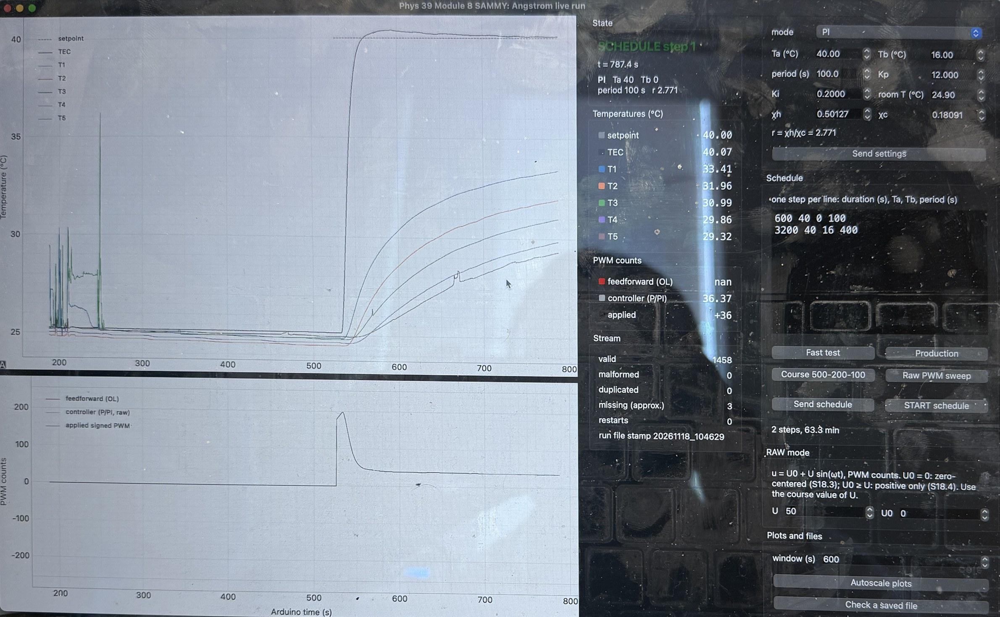
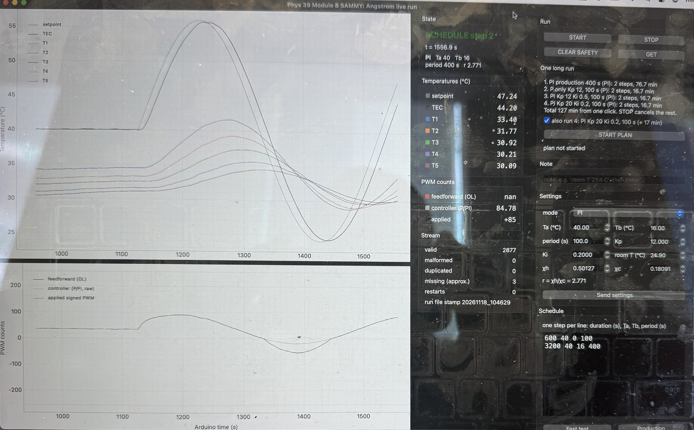
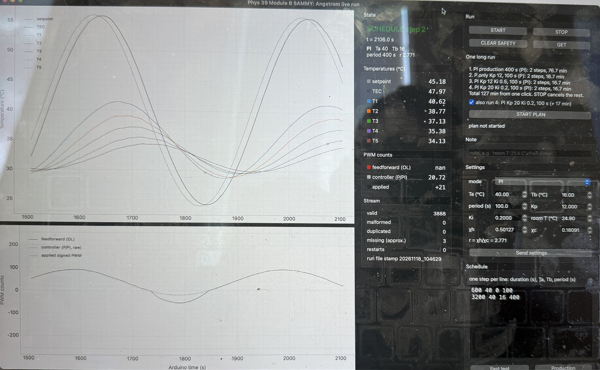
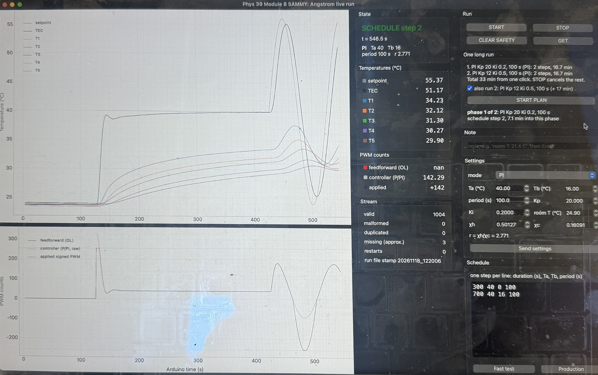
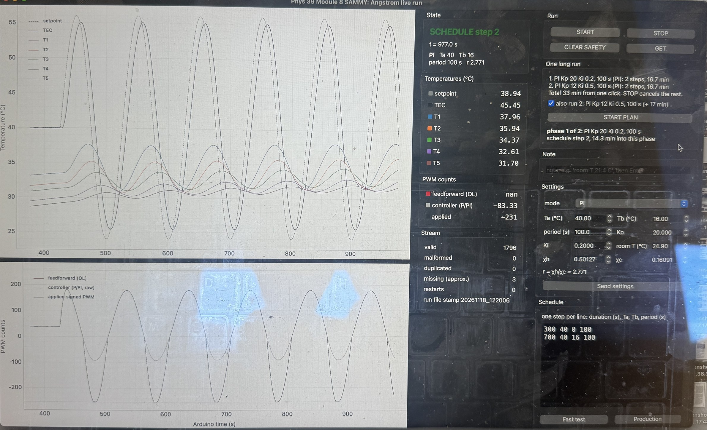
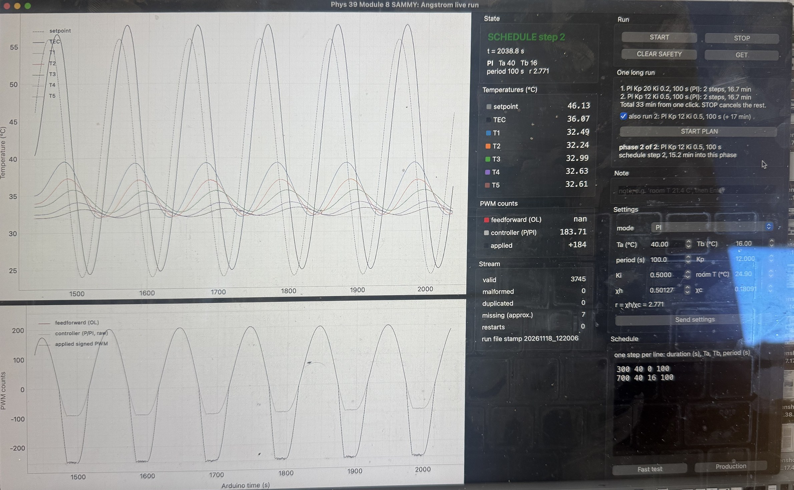

# Module 8, Part I: S18 evidence table (Naidu / Cohen)

Team table of the course page's S18.1 to S18.10, as of 18 November 2026. One row per step: the saved evidence, the principal result, and any departure from the procedure.
A5 (`docs/assessments/a5_angstrom_cohen.md`, Part 1) links here without rewriting it. Course page: <https://sethfraden.github.io/Phys39F26-course/labs/lab-09/>.
Run files are in `data/module_08/` (Naidu) and `data/module_08_sammy/` (Cohen); each run has `_events.txt`, `_notes.csv` and `_meta.json` beside the `.csv`.
The code checkpoint of a given account is the commit named on its first page.

| Step | Evidence | Principal result | Departure from the procedure |
|---|---|---|---|
| S18.1 Verify the measurement and safety limits | Sensor maps: [Naidu](../../data/module_08/sensor_map.csv), [Cohen](../../data/module_08_sammy/sensor_map.csv). Geometry: [rod_geometry.csv](../../data/module_08/rod_geometry.csv). Calibration offsets (common bath, 26 Oct): [calibration_rod_run_20261026_112627.csv](../../data/module_08/calibration_rod_run_20261026_112627.csv), [figure](../figures/module_08/calibration_rod_run_20261026_112627.png). Photos: [rod and sensors](../figures/module_08/setup_rod_sensors_20261102.jpg), [wiring](../figures/module_08/setup_bench_wiring_20261102.jpg). Limits and code: [module_08_angstrom.md](module_08_angstrom.md) section 1, [angstrom_tec.ino](../../arduino/module_08/angstrom_tec/angstrom_tec.ino). | T1 to T5 at 0, 25.4, 50.8, 76.2, 101.6 mm (±1 mm) from the first hole; D = 12.757 ± 0.006 mm; analysis length L = 281.9 ± 1.3 mm; room 22.53 °C on 2 Nov. Software latch at 56 °C on T1 and 65 °C on the TEC thermistor, setpoints limited to 10 to 56 °C, no forcing period below 100 s. | None. Positions by tape (28 Oct) and ruler or calipers (2 and 10 Nov). R2 to R5 were put back into their holes on 2 Nov after an earlier run that used other holes (note in the sensor map). No caliper reading was typed on 18 Nov; Sammy reports that the calipers gave the same 1 in spacing as on 9 and 10 Nov, entered afterwards in [calipers_check_20261118.csv](../../data/module_08_sammy/calipers_check_20261118.csv). The leads were handled before the 18 Nov 400 s run (spikes on T1 to T5 in the first four minutes of the file). |
| S18.2 Verify the live display and saved record | Sketch and GUI: [angstrom_tec.ino](../../arduino/module_08/angstrom_tec/angstrom_tec.ino), [angstrom_gui.py](../../python/angstrom_gui.py); Cohen's copies [angstrom_tec_sammy.ino](../../arduino/module_08_sammy/angstrom_tec_sammy/angstrom_tec_sammy.ino), [sammy_module8_angstrom_gui.py](../../python/sammy_module8_angstrom_gui.py). Record format and mode fields: [module_08_angstrom.md](module_08_angstrom.md) section 1. Sample record: [angstrom_live_20261102_094506.csv](../../data/module_08/angstrom_live_20261102_094506.csv) with [events](../../data/module_08/angstrom_live_20261102_094506_events.txt), [notes](../../data/module_08/angstrom_live_20261102_094506_notes.csv), [meta](../../data/module_08/angstrom_live_20261102_094506_meta.json). GUI photos of the 18 Nov session: see Photos below. | All six channels update; the GUI saves every valid 18-field record unchanged, with events and notes beside it; fields that do not apply in a mode hold `nan`. `python3 python/angstrom_gui.py --check-file <file>` verifies a saved file. | Two command bursts overflowed the Uno's 64-byte input buffer on 2 Nov; no setting took a wrong value, and the GUI now sends commands 0.3 s apart. Cohen's copy adds the RAW mode and a plan runner. |
| S18.3 Zero-centered sinusoidal PWM | Run: [sammy_angstrom_live_20261111_122227.csv](../../data/module_08_sammy/sammy_angstrom_live_20261111_122227.csv). Analysis: [s183_analysis_20261111_122227](../../data/module_08_sammy/s183_analysis_20261111_122227/s183_by_period.csv) (`s183_model_fit.csv` has the one-lump fit), [sammy_module8_s183_analysis.py](../../python/sammy_module8_s183_analysis.py). Walkthrough: [S18.3 page](../sammy_module_08_guide/Sammy_Module_8_S18_3_Raw_PWM_Walkthrough.md). Check at 300 s: [s183_300s_check.py](../../python/analysis/s183_300s_check.py), [figure](../figures/module_08/s183_300s_vs_500s.png). | u = 50 sin ωt at 100, 200, 500 s: mean 4.13, 4.31, 4.28 °C above the baseline; fundamental amplitude 3.81, 6.60, 10.88 °C; lag behind the PWM 1.44, 1.12, 0.69 rad (22.9, 35.6, 54.9 s); second harmonic / fundamental 0.10, 0.11, 0.14. One-lump fit: χh 0.417, χc 0.149 °C per count, τ 64.3 s. | Periods 100, 200, 500 s, not the 300, 200, 100 s the page now asks for (the page changed after the run); 3, 3 and 2 settled cycles. The course simulator's six-run table and 300 s overlay were not done: the one-lump model was fitted in Python, and the 300 s case is a model check, not a run. |
| S18.4 Positive-only sinusoidal PWM | Run: [sammy_angstrom_live_20261116_111935_phase2_raw100s.csv](../../data/module_08_sammy/sammy_angstrom_live_20261116_111935_phase2_raw100s.csv) (slice of `sammy_angstrom_live_20261116_111935.csv`). Analysis: [report.txt](../../data/module_08_sammy/analysis_20261116_111935_phase2_raw100s/report.txt), [sammy_module8_s184_analysis.py](../../python/sammy_module8_s184_analysis.py), figures [overview](../figures/module_08_sammy/20261116_111935_phase2_raw100s_s184_overview.png) and [shape](../figures/module_08_sammy/20261116_111935_phase2_raw100s_s184_shape.png). Prediction made before the run: [S18.4 page](../sammy_module_08_guide/Sammy_Module_8_S18_4_Positive_Only_PWM_Walkthrough.md). | U0 = 38, U = 36 counts (PWM 2 to 74, never negative), 100 s, settled cycles 2 to 9: TEC mean 39.38 °C (−0.62 from 40 °C), amplitude 3.99 °C, lag 1.420 rad (22.6 s), second harmonic / fundamental 0.002 (S18.3: 0.102); highest T1 35.97 °C. Measured minus the one-lump prediction: mean +0.46 °C, amplitude +10.5 %, lag +0.09 rad. | The paired simulation is the Python one-lump prediction made before the run, not the course simulator's table. |
| S18.5 Setpoint and feedforward | Module 4 curve: [steady_state.csv](../../data/module_04/steady_state.csv) (χh 0.50127, χc 0.18091 °C per count, r = 2.771). Command construction: [module_08_angstrom.md](module_08_angstrom.md) sections 1 and 4. Plot: [feedforward figure](../figures/module_08/angstrom_feedforward_angstrom_live_20261102_094506.png). | Ta 40 °C, Tb 16 °C, τ 100 s (24 to 56 °C requested). The command runs from 3 to 67 counts on the heating branch only; the S18.5 straight line ua = (Ta − Troom)/χh = 34.9, ub = Tb/χh = 31.9 gives 2.9 to 66.8 counts for Troom = 22.53 °C. | The sketch inverts the measured steady-state curve (piecewise linear) instead of using the straight line; the two commands agree to 0.2 count. |
| S18.6 Apply the feedforward command | Open loop from 405.8 s to 1079.2 s of [angstrom_live_20261102_094506.csv](../../data/module_08/angstrom_live_20261102_094506.csv) ([events](../../data/module_08/angstrom_live_20261102_094506_events.txt)). Analysis: [compare file](../../data/module_08/angstrom_compare_angstrom_live_20261102_094506_100s.txt), [actuator file](../../data/module_08/angstrom_actuator_angstrom_live_20261102_094506.txt). A5 Table 1, row "Feedforward". | Last three cycles (779 to 1079 s): TEC mean 39.0 °C (−1.0 °C against 40), amplitude ratio 0.23 (3.7 °C against the 16 °C requested), lag 1.42 rad (22.6 s); T1 amplitude 0.70 °C, lag 2.33 rad. | None beyond S18.5. |
| S18.7 Repeat with P and PI control | 100 s, 2 Nov, same file: P from 1079.2 s (Kp 12, Ki 0), PI from 1591.4 s (Kp 12, Ki 0.2). PI 100 s repeat: [sammy_angstrom_live_20261116_090538.csv](../../data/module_08_sammy/sammy_angstrom_live_20261116_090538.csv). PI 200 s: [sammy_angstrom_live_20261116_111935_phase1_pi200s.csv](../../data/module_08_sammy/sammy_angstrom_live_20261116_111935_phase1_pi200s.csv). PI 300 s: [angstrom_live_20261104_110306.csv](../../data/module_08/angstrom_live_20261104_110306.csv). Gains: [module_08_angstrom.md](module_08_angstrom.md) section 1 (Module 6 one-lump check). Gain trials, 18 Nov (one GUI `--trials` plan run): [sammy_angstrom_live_20261118_122006.csv](../../data/module_08_sammy/sammy_angstrom_live_20261118_122006.csv) with the slices [Kp 20, Ki 0.2](../../data/module_08_sammy/sammy_angstrom_live_20261118_122006_phase1_pi_kp_20_ki_0_2_100s.csv) and [Kp 12, Ki 0.5](../../data/module_08_sammy/sammy_angstrom_live_20261118_122006_phase2_pi_kp_12_ki_0_5_100s.csv); analyses [Kp 20](../../data/module_08_sammy/analysis_20261118_122006_phase1_pi_kp_20_ki_0_2_100s/tracking_by_period.csv), [Ki 0.5](../../data/module_08_sammy/analysis_20261118_122006_phase2_pi_kp_12_ki_0_5_100s/tracking_by_period.csv). Trial log: A5 Table 1 (rows 9 and 10), [a5_control_table.csv](../../data/module_08_sammy/a5_control_table.csv). | Kp in PWM counts per °C, Ki in counts per (°C s), controller step 0.54 s. P: mean error −2.63 °C, amplitude ratio 0.76, lag 0.55 rad, rms 6.6 °C. PI at 100 s: −0.06 °C, 0.87, 0.62 rad, 6.6 °C (16 Nov repeat 0.85, 0.65 rad, 6.9 °C); at 200 s: 0.94, 0.37 rad, 4.1 °C; at 300 s: 0.97, 0.25 rad, 2.8 °C. PWM reached −221 counts at 100 s with the baseline pair. Gain trials at 100 s (18 Nov): Kp 20, Ki 0.2: mean error +0.08 °C, ratio 0.93, lag 0.43 rad (6.9 s), rms 4.8 °C, PWM −255 to 179 (1.3 % of the samples at the limit); Kp 12, Ki 0.5: +0.95 °C, 1.03, 0.68 rad (10.9 s), 7.8 °C, −255 to 200 (1.6 %). Neither trial meets all four criteria. | Tuning log: the baseline Kp 12, Ki 0.2 (100 s on 2 and 16 Nov, 200 s, 300 s), then two single-gain trials on 18 Nov, Kp 20 first and Ki 0.5 second, one gain changed each time against the baseline. Neither met all four criteria and nothing was retuned afterwards, so the selected pair is still Kp 12, Ki 0.2. P only was not repeated (Naidu's 2 Nov run is used). The 100 s baseline runs are Naidu's (2 Nov) and Cohen's (16 Nov), 200 s is Cohen's, 300 s is Naidu's, the trials are Cohen's. |
| S18.8 Compare the measured boundary responses | A5 Part 2: Table 1 and Figure 1 in [a5_angstrom_cohen.md](../assessments/a5_angstrom_cohen.md), [a5_control_table.csv](../../data/module_08_sammy/a5_control_table.csv), [a5_fig1_control.png](../figures/module_08_sammy/a5_fig1_control.png), code [sammy_module8_a5.py](../../python/sammy_module8_a5.py) (`control_metrics`). | Waveform shape: zero-centered PWM leaves a residual amplitude of 0.44 °C and a second harmonic of 0.10, positive-only 0.10 °C and 0.002. Tracking at 100 s: feedforward, P and PI all miss at least one of the criteria (mean ≤ 1 °C, amplitude ratio 0.90 to 1.10, lag ≤ 0.30 rad, rms ≤ 3.2 °C); PI meets mean and ratio at 200 s and all four at 300 s. | The criteria are ours (the page leaves them to the team). The focused S19 simulation uses our own TEC and rod model ([sammy_module8_tec_rod_sim.py](../../python/sammy_module8_tec_rod_sim.py)), not the course six-sensor simulator. |
| S18.9 Settle, fit and improve the first pilot (100 s) | Naidu 2 Nov, PI 100 s, cycles at 2125.9 to 2625.9 s: [fit table](../../data/module_08/angstrom_fit_angstrom_live_20261102_094506_PI_100s.csv), [report](../../data/module_08/angstrom_fit_angstrom_live_20261102_094506_PI_100s.txt), [figure](../figures/module_08/angstrom_fit_angstrom_live_20261102_094506_PI_100s.png). Cohen 16 Nov, cycles 7 to 12 (1192.5 to 1792.5 s) of [sammy_angstrom_live_20261116_090538.csv](../../data/module_08_sammy/sammy_angstrom_live_20261116_090538.csv): [settled_blocks.csv](../../data/module_08_sammy/analysis_20261116_090538/settled_blocks.csv), [cycle_fits.csv](../../data/module_08_sammy/analysis_20261116_090538/cycle_fits.csv). | Passed the settling and sensor checks: every sensor's amplitude within about 3 % and phase within 0.05 to 0.06 rad of the block; five settled cycles (2 Nov) and six (16 Nov); all five rod sensors measurable, T5/T1 amplitude 0.15, lag across the array 1.79 to 1.86 rad. T1 swing 2.9 °C, TEC amplitude ratio 0.87, lag 0.62 rad. | Retuned gains for the poorly tracked 100 s waveform were tried on 18 Nov (the S18.7 trials, Kp 20 and Ki 0.5; neither met all four criteria); the other fallback, Tb 10 °C, was not tried and Tb stayed at 16 °C. |
| S18.10 Second usable frequency (200 s) | Cohen 16 Nov, PI 200 s: [sammy_angstrom_live_20261116_111935_phase1_pi200s.csv](../../data/module_08_sammy/sammy_angstrom_live_20261116_111935_phase1_pi200s.csv), analysis [settled_blocks.csv](../../data/module_08_sammy/analysis_20261116_111935_phase1_pi200s/settled_blocks.csv), [kappa_by_period.csv](../../data/module_08_sammy/analysis_20261116_111935_phase1_pi200s/kappa_by_period.csv), [figures](../figures/module_08_sammy/20261116_111935_phase1_pi200s_spatial_fits.png), [run summary](../sammy_module_08_guide/Sammy_Module_8_Runs_16_17Nov_Summary.md). | Passed the settling and sensor checks: settled cycles 2 to 7 (442.2 to 1642.2 s), six cycles; all sensors measurable, T5/T1 amplitude 0.26, lag across the array 1.30 rad; κ = (9.16 ± 0.15) × 10⁻⁵ m²/s. | The run started from room temperature with no pre-hold, so the mean was still rising (mean-profile m = 5.07 1/m against 3.50 from q and q′); the amplitude and phase fits are not affected. A fast test on 4 Nov held one 200 s cycle and is not used. |

## Selected production intervals (Stage 5)

| Period (s) | Run | Settled cycles | Interval (s) | Note |
|---|---|---|---|---|
| 100 | [sammy_angstrom_live_20261116_090538.csv](../../data/module_08_sammy/sammy_angstrom_live_20261116_090538.csv) | 7 to 12 | 1192.5 to 1792.5 | strict settling test |
| 200 | [sammy_angstrom_live_20261116_111935_phase1_pi200s.csv](../../data/module_08_sammy/sammy_angstrom_live_20261116_111935_phase1_pi200s.csv) | 2 to 7 | 442.2 to 1642.2 | strict settling test |
| 300 | [angstrom_live_20261104_110306.csv](../../data/module_08/angstrom_live_20261104_110306.csv) | 2 to 7 | 887.2 to 2687.2 | Naidu's selection |
| 400 | [sammy_angstrom_live_20261118_104629.csv](../../data/module_08_sammy/sammy_angstrom_live_20261118_104629.csv) | 4 to 8 | 2326.2 to 4326.2 | last five cycles (five-cycle rule); the strict test counts cycles 5 to 8 because cycle 4 fails on a burst on T3 (not masked); κ = 9.30 ± 0.26 (finite-rod), left out of the shared mean. The 17 Nov run ([sammy_angstrom_live_20261117_162612.csv](../../data/module_08_sammy/sammy_angstrom_live_20261117_162612.csv), cycles 3 to 7 = last five, only 6 and 7 strict) gives κ = 9.05 ± 0.17 and is kept as a cross-check |
| 480 (for 500) | [sammy_angstrom_live_20261116_090538.csv](../../data/module_08_sammy/sammy_angstrom_live_20261116_090538.csv) | 2 to 8 | 2272.8 to 5632.8 | the page changed to 500 s after our 480 s runs |

Fits of every window: [a5_windows.csv](../../data/module_08_sammy/a5_windows.csv), [compiled_periods.csv](../../data/module_08_sammy/compiled_periods.csv), [finite_rod_fits.csv](../../data/module_08_sammy/finite_rod_fits.csv).

## Open items

- S18.7: two single-gain trials were run on 18 Nov (Kp 20, Ki 0.5) with no retuning after them; P only was not repeated (Naidu's 2 Nov run).
- S18.3, S18.4 and the focused S19 simulation: the course's six-sensor simulator tables were not filled; our own Python models were used instead.
- 400 s: five cycles by the five-cycle rule (cycles 4 to 8), four by the strict settling test: cycle 4 fails on one burst on T3 (cause unknown, no note typed); no mask was applied.
- The contact between the TEC plate and the rod changed between sessions: T1/TEC amplitude 0.44 (17 Nov) and 0.40 (18 Nov) at 400 s, 0.27 (16 Nov) and 0.22 (18 Nov) at 100 s, Gc 0.265 and 0.21 W/K; the cause is unknown.
- The 18 Nov caliper check is not in the run notes (the note was not typed); Sammy's report that it matched 9 and 10 Nov is in [calipers_check_20261118.csv](../../data/module_08_sammy/calipers_check_20261118.csv), and both 18 Nov `_meta.json` files carry the unchanged sensor positions (0, 25.4, 50.8, 76.2, 101.6 mm).

## Photos of the 18 Nov session

Phone photos of the live GUI, straightened and cropped to the window (metadata removed; the full-screen originals are not in the repository). Each caption was checked against the record with that number in the run file:
the temperatures, the applied PWM and the record count on the screen equal the CSV record.

**PI 400 s run** (`sammy_angstrom_live_20261118_104629.csv`, schedule 600 s hold and 3200 s at 400 s period).

*IMG_2683, 10:59 AM, hold step: t = 787.4 s (record 1458), step 1: setpoint 40.00 °C, TEC 40.07 °C, T1 33.41, T2 31.96, T3 30.99, T4 29.86, T5 29.32 °C; applied PWM +36.*

*IMG_2684, 11:12 AM, cycle 2 of the 400 s step: t = 1556.9 s (record 2877), step 2: setpoint 47.24 °C, TEC 44.20 °C, T1 33.40, T2 31.77, T3 30.92, T4 30.21, T5 30.09 °C; applied PWM +85.*

*IMG_2685, 11:21 AM, cycle 3 of the 400 s step: t = 2106.0 s (record 3888), step 2: setpoint 45.18 °C, TEC 47.97 °C, T1 40.62, T2 38.77, T3 37.13, T4 35.38, T5 34.13 °C; applied PWM +21.*

**Gain trials** (`sammy_angstrom_live_20261118_122006.csv`, one `--trials` plan run).

*IMG_2686, 12:29 PM, trial 1 (PI Kp 20, Ki 0.2), first cycles of the 100 s step: t = 546.5 s (record 1004), step 2: setpoint 55.37 °C, TEC 51.17 °C, T1 34.23, T2 32.12, T3 31.30, T4 30.27, T5 29.90 °C; applied PWM +142.*

*IMG_2687, 12:36 PM, trial 1: t = 977.0 s (record 1796), step 2: setpoint 38.94 °C, TEC 45.45 °C, T1 37.96, T2 35.94, T3 34.37, T4 32.61, T5 31.70 °C; applied PWM −231.*

*IMG_2688, 12:54 PM, trial 2 (PI Kp 12, Ki 0.5): t = 2038.8 s (record 3745), step 2: setpoint 46.13 °C, TEC 36.07 °C, T1 32.49, T2 32.24, T3 32.99, T4 32.63, T5 32.61 °C; applied PWM +184. The PWM troughs of the trace are clipped at −255 (10 records at −255 in this trial before the photo).*
