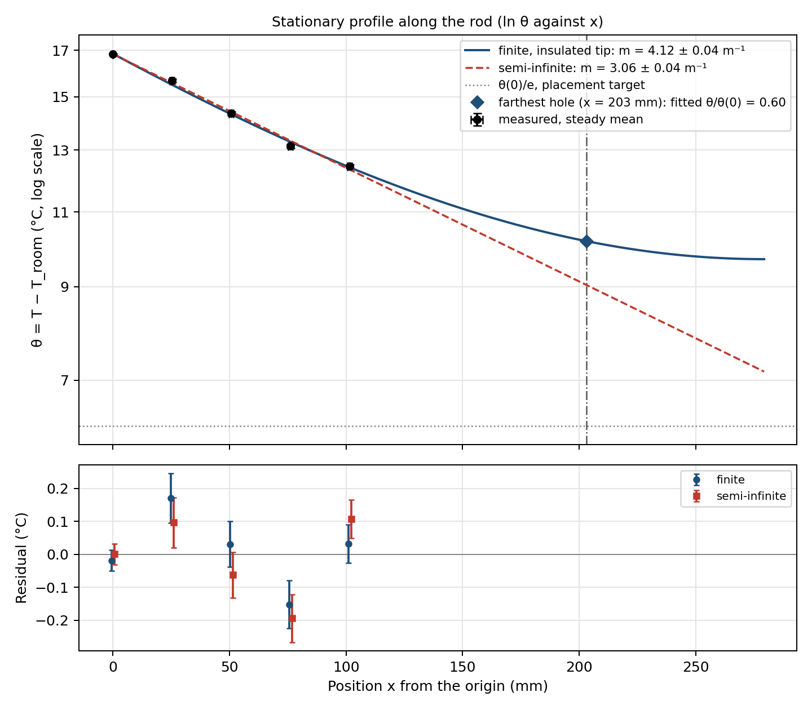

# Module 7, Part III: stationary-fin analysis (formative, evidence for C6)

Naidu / Cohen. Analysis code: [`python/analysis/stationary_fin_fit.py`](../../python/analysis/stationary_fin_fit.py).
Acquisition and calibration: [`module_08_rod_instrument.md`](module_08_rod_instrument.md).

First measured profile: run `rod_run_20261028_092033`, 28 October (section 3).
The fitting code was checked beforehand on synthetic data generated from the
same equation (m = 8.00 and 9.00 m⁻¹ put in, recovered within 0.05 m⁻¹ by the
finite fit); no synthetic data are stored in the repository.

---

## 1. Governing equation and assumptions

With θ(x, t) = T(x, t) − T_room, a uniform rod of cross-section A, perimeter
P, density ρ, specific heat c, conductivity k and side coefficient h obeys

```
ρ c A ∂θ/∂t = k A ∂²θ/∂x² − h P θ            (every term in W/m)
```

At steady state

```
d²θ/dx² = m² θ,      m² = hP/(kA)            (m in 1/m)
```

Assumptions: one temperature per cross-section (small transverse Biot
number), uniform k and h along the rod, a constant room temperature, a
measured boundary temperature (rod thermistor R1 in the first rod hole, x = 0,
as the course defines it; not the TEC thermistor and not the setpoint), and an
insulated tip for the finite model.

Profiles fitted:

```
finite, insulated tip:  θ(x) = θ0 cosh(m(L − x)) / cosh(mL)
semi-infinite:          θ(x) = θ0 e^(−mx)
```

## 2. Procedure (Part 3)

1. Hold the base at a constant safe temperature with PI. State the steady
   criterion in advance, for example every channel drifting by less than
   0.01 °C/min over the last 5 minutes. The script prints each channel's
   drift over the averaging window so the criterion can be checked.
2. Average each sensor over the final window (default 300 s).
3. Run

   ```bash
   python3 python/analysis/stationary_fin_fit.py data/module_08/rod_run_<...>.csv \
       --length-mm <L> --troom <T_room> --radius-mm <R> \
       --offsets data/module_08/calibration_<run>.csv
   ```

   Outputs: `docs/figures/module_08/fin_<run>.png` (θ against x with error
   bars, both fits, both residual sets), `data/module_08/fin_<run>.txt`, and
   `data/module_08/fin_profile_<run>.csv`.

Point uncertainties combine the standard error of each mean (allowing for
correlated readings), the calibration uncertainty, and the position
uncertainty propagated through the local slope (δθ ≈ m θ δx).

## 3. Results, run rod_run_20261028_092033 (28 October)

```bash
python3 python/analysis/stationary_fin_fit.py data/module_08/rod_run_20261028_092033.csv \
    --length-mm 279.4 --troom 21.03 --radius-mm 6.35 --t0 4346 --t1 4646 \
    --offsets data/module_08/calibration_rod_run_20261026_112627.csv \
    --mark-mm 203.2 --mark-label "farthest hole"
```

Output: [`fin_rod_run_20261028_092033.txt`](../../data/module_08/fin_rod_run_20261028_092033.txt),
[`fin_profile_rod_run_20261028_092033.csv`](../../data/module_08/fin_profile_rod_run_20261028_092033.csv),


**Conditions.**

- Base (TEC thermistor) held at 45 °C by PI (Kp 12, Ki 0.2) after the
  20 → 45 °C step at t = 2556 s.
- Steady window: 4346 to 4646 s, the last 300 s before control was switched
  off (4646.8 s), 30 to 35 min after the step. Drift of every channel over
  the window: between −0.004 and +0.005 °C/min, which meets the criterion stated in
  section 2 (under 0.01 °C/min).
- T_room = 21.03 °C: the mean of the five rod thermistors at the start of
  the same run (13 to 87 s, 09:20, control off, before any heating), sd
  0.02 °C after offsets; the base thermistor read 20.98 °C. Measured with
  the same thermistors as θ, so a common calibration error cancels in θ.
  Not re-measured at the end. A ±0.5 °C change in T_room moves m
  between 4.03 and 4.21 m⁻¹, which is larger than the fit uncertainty
  below, so the room temperature is the dominant uncertainty in m.
- L = 279.4 mm (about 11 in, R1's hole to the rod top, rough).
- Positions: holes 1 in (25.4 mm) apart, measured with a tape after the
  run; ±1 mm each.

| Channel | x (mm) | θ (°C) | σ (°C) | ε_T |
|---|---|---|---|---|
| R1 | 0.0 | 16.83 | 0.03 | 0.000 |
| R2 | 25.4 | 15.66 | 0.08 | 0.021 |
| R3 | 50.8 | 14.34 | 0.07 | 0.045 |
| R4 | 76.2 | 13.13 | 0.07 | 0.074 |
| R5 | 101.6 | 12.44 | 0.06 | 0.106 |

| Quantity | Finite fit | Semi-infinite fit |
|---|---|---|
| m (1/m) | 4.12 ± 0.04 (± 0.07 scaled) | 3.06 ± 0.04 |
| 1/m (mm) | 243 ± 2 | 327 ± 5 |
| θ0 (°C) | 16.84 | 16.82 |
| χ² / dof | 10.4 / 3 (p = 0.016) | 12.9 / 3 (p = 0.005) |
| Shift in m when the end is ignored | −1.06 m⁻¹ = −29 σ of the finite fit | |
| mL | 1.15 | |

**Neither χ² is acceptable.** The residuals (largest +0.17 °C at R2 and
−0.15 °C at R4 for the finite fit) are about twice the point errors, so
there is sensor-to-sensor scatter of roughly 0.15 °C that the error budget
does not include. The calibration offsets were measured at room
temperature only, so a channel whose error changes with temperature, or a
thermistor with poorer contact to the rod, would show up exactly like this.
Scaling the finite-fit uncertainty by √(χ²/dof) = 1.86 gives
m = 4.12 ± 0.07 m⁻¹. A multipoint calibration (section 4 of the
instrument note) would test the first explanation.

The finite fit is the better of the two (Δχ² = 2.6), but the sensors only
cover x ≤ 102 mm (mx ≤ 0.42), where a cosh and an exponential look almost
the same, so most of the 1.06 m⁻¹ difference in m comes from the assumed tip
condition and L rather than from the data. With mL = 1.15 the rod is not
long compared with 1/m, and the finite model is the one to use; the far
sensors (ε_T up to 0.11 at R5) are where ignoring the end matters most.

**Placement check (course Part 2).** θ5/θ1 = 12.44/16.83 = 0.74 (0.73 to
0.75 for T_room ± 0.5 °C). The target is θ5 ≤ θ1/e = 0.37: **not met**. From
the finite fit, the farthest available hole (about 8 in from R1) would give
θ/θ1 = 0.60 ± 0.01 and even the rod top only 0.58. Reaching 1/e at 8 in would
need m ≈ 6.4 m⁻¹, that is h/k about 2.4 times larger. Moving sensors cannot
meet the target on this set-up; raised with Prof. Fraden on 28 October.

**Transverse Biot number from the measured m.** Because m² = hP/(kA) =
2h/(kR) for a circular rod, the ratio h/k = m²R/2 is measured, and

```
Bi_⊥ = h R / (2k) = (m R)² / 4
```

so the steady profile alone fixes Bi_⊥ once R is known. With m = 4.12 m⁻¹
and R = 6.35 mm (nominal): Bi_⊥ = 1.7 × 10⁻⁴, far below 0.1, so
one temperature per cross-section is a very good assumption. The same m
gives h/k = m²R/2 = 0.054 m⁻¹.

## 4. What the steady profile cannot do

The fit gives m, which is the combination √(hP/(kA)): only the ratio h/k.
A rod with twice the conductivity and twice the side loss gives exactly the
same steady profile. Separating k from h needs a second, independent
measurement with a different dependence on them: the periodic (Angstrom)
experiment of Module 8, where amplitude decay and phase lag along the rod
involve the diffusivity and the loss rate differently.

## 5. Discussion points (first run)

- **Sensor positions** were measured with a tape after the run: 1 in
  apart, ±1 mm. At this precision they contribute about 0.07 °C per point.
- **Room temperature** was measured once, about 70 minutes before the
  steady window. ±0.5 °C moves m by about ±0.09 m⁻¹, more than the fit's
  own ±0.07: the largest single uncertainty in m. A room reading at the
  end of each hold would remove it.
- **Sensor-to-sensor scatter** of about 0.15 °C (χ²/dof = 3.5) beyond the
  stated errors: calibration at one temperature only, or contact.
- **Thermal contact.** A disturbance at about 10:18 (hands and a ruler near
  the rod while measuring the spacing, noted in the run) dropped R1 by
  0.4 °C and R2 by 0.2 °C within 30 s, with smaller dips farther up, while
  the base held 45.0 °C. The rod sensors respond to the air around them, so
  contact and draughts matter. The steady window starts about 15 min after
  that.
- **Tip condition.** With all sensors in the first 102 mm the data cannot
  separate the finite and semi-infinite shapes well (χ² 10.4 vs 12.9). Sensors
  spread out to the farthest hole would test it directly.
