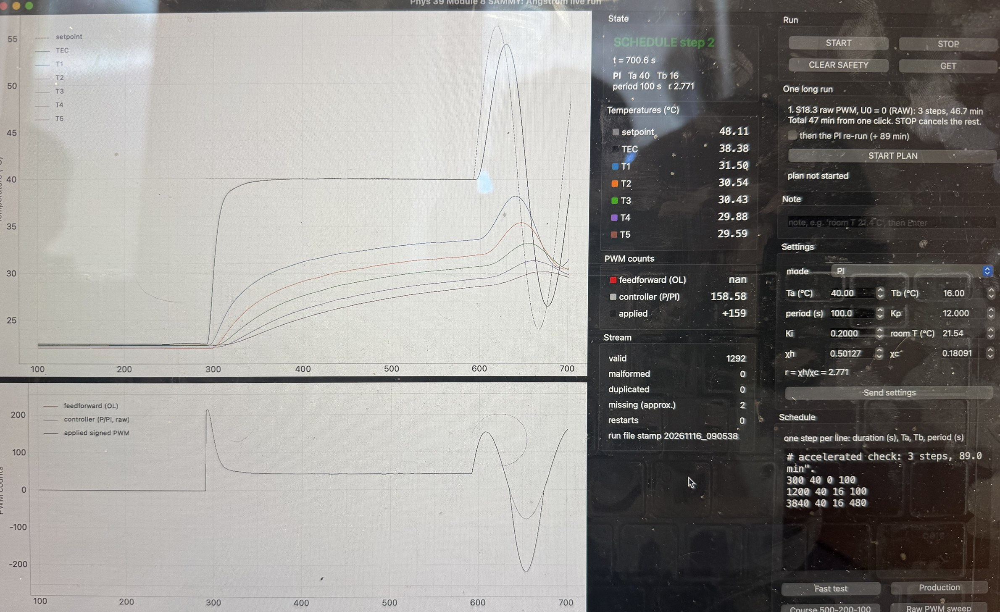
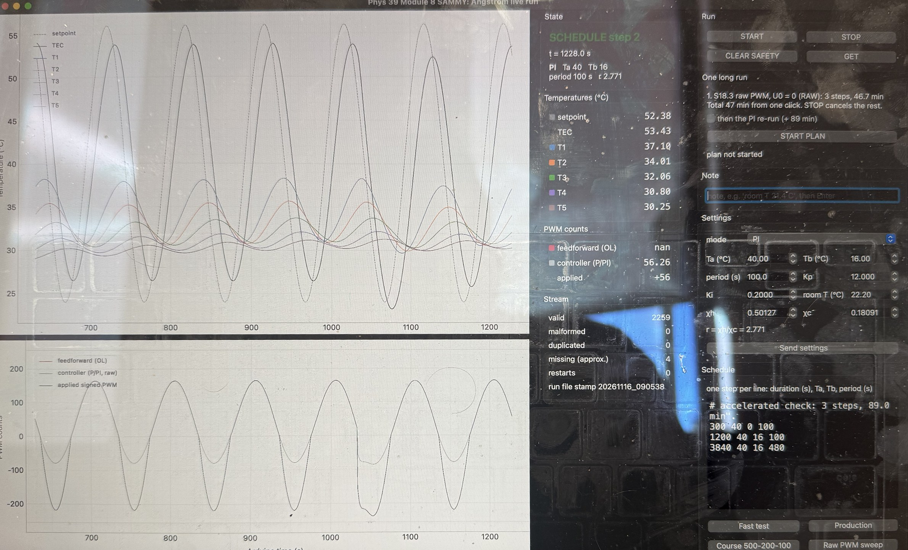
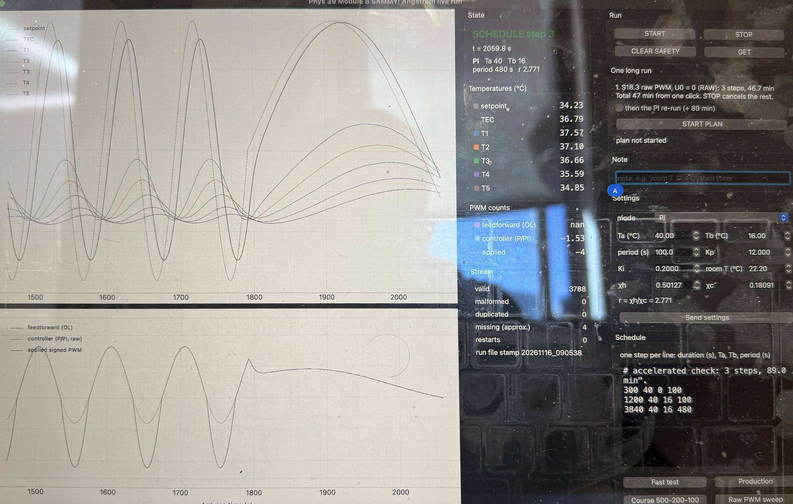
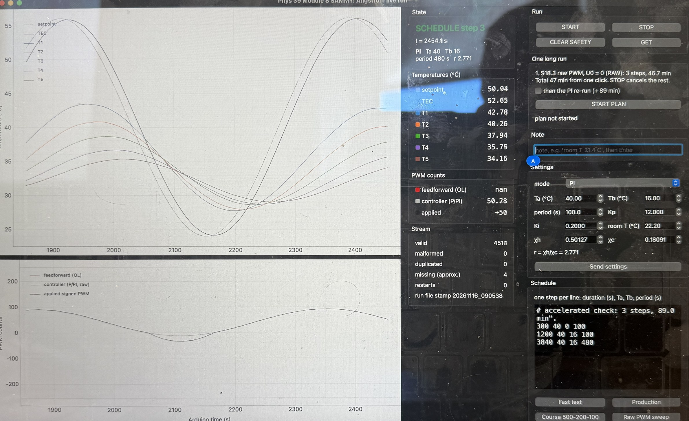

# Module 8, Part I: PI re-run of 16 November 2026 (SAMMY copy)

Summary of the 98-minute run `sammy_angstrom_live_20261116_090538.csv`, analysed with
`python/sammy_module8_angstrom_analysis.py data/module_08_sammy/sammy_angstrom_live_20261116_090538.csv --t-room 22.2`.
Figures: `docs/figures/module_08_sammy/20261116_090538_*.png`. Photos: `docs/images/module08_sammy_gui_rerun_*.jpg`.
Tables and the text report: `data/module_08_sammy/analysis_20261116_090538/`.
Kapil Naidu's acquisition code, analysis scripts and data are unchanged; everything here is an addition.

## What was run

- PI control of the TEC thermistor (Kp 12, Ki 0.2, cooling multiplier r = 2.771) with the sine setpoint
  40 ± 16 °C computed on the Arduino (`angstrom_tec_sammy`). Room T = 22.2 °C: the note at
  09:08:11 ("room T baseline 22.2 C, hands off 2 min") and the mean of T1 to T5 at
  t = 20 to 150 s (22.24 °C raw).
- Schedule: 5 min hold at 40 °C, then 12 cycles at 100 s and 8 cycles at 480 s (89.0 min). Started
  09:10:31, 100 s step at 09:15:32, 480 s step at 09:35:32, `SCHEDULE DONE` at
  10:39:30; the GUI was closed at 10:43:59.
- The file has 10869 records over 98.3 min, 0 duplicated times and 0 restarts;
  4 gaps longer than 0.75 s (at t = 164.8, 166.1, 1032.2, 1033.4 s, each 1.2 s long, when Send settings was pressed). No sample was masked. The PWM
  never reached ±255 (range -237 to 215), T1 peaked at 43.4 °C and the TEC thermistor at 55.9 °C (limits 56 and 65 °C).
- Rod: 6061-T6 aluminum, d = 12.757 mm, T1 to T5 at 0, 25.4, 50.8, 76.2 and 101.6 mm (±1 mm), tip 281.9 mm from T1.

## Photos of the run

Phone photos of the laptop screen during the run, straightened and cropped to the GUI window (metadata removed; the full-screen
originals are not in the repository). The numbers on screen are the logged values: the temperatures, the PWM and the stream's
valid-record count equal the CSV record with that number. The blue patches and dark shapes are reflections on the glass.



*IMG_2641, 9:17 AM: step 2 (100 s period), t = 700.6 s. On screen: setpoint 48.11 °C, TEC 38.38 °C, T1 31.50, T2 30.54, T3 30.43, T4 29.88, T5 29.59 °C; applied PWM +159 (record 1292); room T box 21.54. The right edge of the window is at the edge of the frame.*



*IMG_2642, 9:26 AM: step 2 (100 s period), t = 1228.0 s. On screen: setpoint 52.38 °C, TEC 53.43 °C, T1 37.10, T2 34.01, T3 32.06, T4 30.80, T5 30.25 °C; applied PWM +56 (record 2259); room T box 22.20. The step in the applied PWM near t = 1033 s in the lower plot is the settings re-send described below.*



*IMG_2643, 9:40 AM: step 3 (480 s period), t = 2059.8 s. On screen: setpoint 34.23 °C, TEC 36.79 °C, T1 37.57, T2 37.10, T3 36.66, T4 35.59, T5 34.85 °C; applied PWM -4 (record 3788); room T box 22.20. The left edge of the window is outside the frame.*



*IMG_2644, 9:46 AM: step 3 (480 s period), t = 2454.1 s. On screen: setpoint 50.94 °C, TEC 52.65 °C, T1 42.78, T2 40.26, T3 37.94, T4 35.75, T5 34.16 °C; applied PWM +50 (record 4514); room T box 22.20.*

## What disturbed the run

At 09:22:51 (t = 1032.5 s, cycle 5 of the 100 s step) Send settings was pressed during the schedule to correct
the room T box from 21.54 to 22.2 °C (note at 09:23:30). Two things follow from the sketch:

- Room T is used only in open-loop mode, so the PI control itself did not change.
- Every `SET MODE` zeroes the PI integral term (`handleSet` in `angstrom_tec_sammy.ino`). The integral term was about
  +70 counts when it was zeroed; the controller output went from +23 to -76 counts within 5 s, and the TEC thermistor
  fell to 23.2 °C in the next minute against a lowest setpoint of 24.0 °C. The step is visible in photo IMG_2642.

The per-cycle fits show the effect from cycle 5 on. The settled block counts back from the last cycle and stops at the first cycle
that disagrees (cycle 6), so it starts at cycle 7:

| 100 s cycle | TEC mean (°C) | T1 amplitude (°C) | T1 phase (rad) | In the settled block |
|---|---|---|---|---|
| 1 | 40.72 | 3.113 | -2.604 | no |
| 2 | 39.97 | 3.598 | -2.521 | no |
| 3 | 39.95 | 3.632 | -2.527 | no |
| 4 | 39.95 | 3.662 | -2.519 | no |
| 5 | 38.02 | 3.905 | -2.417 | no |
| 6 | 38.64 | 3.668 | -2.530 | no |
| 7 | 39.69 | 3.710 | -2.522 | yes |
| 8 | 39.90 | 3.706 | -2.521 | yes |
| 9 | 39.94 | 3.710 | -2.522 | yes |
| 10 | 39.94 | 3.694 | -2.523 | yes |
| 11 | 39.94 | 3.705 | -2.522 | yes |
| 12 | 39.94 | 3.710 | -2.520 | yes |

## Settling test

Counting back from the last cycle, a cycle joins the settled block while every rod sensor stays within 3 % in amplitude and
0.05 rad in phase of the block median (tolerances chosen for this analysis). The page asks for at least five settled cycles at each
of at least two usable periods.

| Period (s) | Settled block | Five or more | First rejected cycle |
|---|---|---|---|
| 100 | cycles 7 to 12 (6) | yes | cycle 6: T5 off by +4.9 % and -0.11 rad |
| 480 | cycles 2 to 8 (7) | yes | cycle 1: T5 off by -9.5 % and -0.06 rad |

## Results

| Period (s) | Settled cycles | q (1/m) | q′ (1/m) | κ (10⁻⁵ m²/s) | ν (10⁻³ 1/s) | k (W/(m K)) |
|---|---|---|---|---|---|---|
| 100 | 6 of 12 | 18.74 ± 0.24 | 18.20 ± 0.22 | 9.21 ± 0.16 | 1.82 ± 1.11 | 223 |
| 480 | 7 of 8 | 9.33 ± 0.15 | 7.99 ± 0.11 | 8.78 ± 0.18 | 2.05 ± 0.29 | 212 |

- Both periods, weighted mean: **9.02 ± 0.12 × 10⁻⁵ m²/s** (χ² = 3.0 for 1 degree of freedom);
  plain mean 8.99, spread (sd) 0.30.
- Handbook 6061-T6 (k = 167 W/(m K), ρ = 2700 kg/m³, cp = 896 J/(kg K)): κ = 6.9 × 10⁻⁵ m²/s, so the weighted mean is
  31 % above it, as in the earlier runs. ν is a small difference of two nearly equal numbers, so its relative uncertainty is large.
- Using the last five cycles instead of the settled block changes κ by +0.2 % at 100 s and -0.3 % at 480 s.

Against the earlier PI runs of the same rod (κ in 10⁻⁵ m²/s):

| Period (s) | This run | 10 Nov (SAMMY, `analysis_20261110_164057`) | Kapil (2 and 4 Nov) |
|---|---|---|---|
| 100 | 9.21 ± 0.16 | 9.29 ± 0.16 (3 cycles) | 9.76 ± 0.23 |
| 480 | 8.78 ± 0.18 | 8.80 ± 0.21 (3 cycles) | 8.94 ± 0.24 |

Differences of this run: 100 s: -0.3 σ from the 10 Nov run and -2.0 σ from Kapil; 480 s: -0.1 σ from the 10 Nov run and -0.5 σ from Kapil.

## Controller tracking (PI)

Hold step: the TEC reached 39.5 °C after 48 s with +0.03 °C overshoot, peak PWM 215.

| Period (s) | B_TEC/Tb | TEC lag (s) | B_T1/Tb | T1 lag (s) | PWM range | Samples at ±255 |
|---|---|---|---|---|---|---|
| 100 | 0.854 | 10.4 | 0.232 | 22.9 | -221 to 164 | 0 |
| 480 | 0.992 | 12.7 | 0.478 | 47.5 | -34 to 92 | 0 |

## Model-validity checks

| Period (s) | Finite-length difference (max) | Radial Biot number | m from √(q²−q′²) (1/m) | m from the mean profile (1/m) |
|---|---|---|---|---|
| 100 | 0.12 % | 2.0e-04 | 4.45 | 3.52 ± 0.10 |
| 480 | 3.64 % | 2.4e-04 | 4.83 | 3.32 ± 0.09 |

The finite-length difference is the largest at T5 for the longest period, and the radial Biot number is far below 0.1. The side-loss rate
from the mean temperature profile does not match the one from q and q′, so ν and h should be quoted with caution.

## Where this run fits

Kapil's gap analysis of 16 November (`docs/module_notes/module_08_gap_analysis.md`, commit `a1c84f5`) lists PI at 200 s, PI at 400 s
and the positive-only PWM run as what the rewritten course page still needs from the bench. This file covers none of them. It adds a
second 100 s dataset (6 settled cycles) and a third 480 s dataset (7 settled cycles), both above the five-cycle minimum, and
their κ is within 0.3 σ of the 10 Nov run and within 2.0 σ of Kapil's PI fits (table above).

## Limits of this run

- Only PI mode and only the periods 100 s and 480 s.
- Cycles 5 and 6 of the 100 s step were disturbed by the settings re-send; the 100 s fit uses cycles 7 to 12.
  The spatial lines have χ² of 8.7 (ln B) and 8.1 (phase) at 100 s, 11.8 (ln B) and 8.9 (phase) at 480 s, each for 3 degrees of freedom; the quoted errors are scaled up by √(χ²/dof) where that is above 1.
- The room T box held 21.54 °C until 09:22:51 and 22.2 °C afterwards. This does not matter in PI mode; the
  fits use 22.2 °C.
- The tolerances of the settling test were chosen for this analysis, and the semi-infinite-rod formulas carry a finite-length bias
  (table above).

## Reproduce

```bash
python3 python/sammy_module8_angstrom_analysis.py data/module_08_sammy/sammy_angstrom_live_20261116_090538.csv --t-room 22.2 --summary none
python3 python/sammy_module8_rerun_summary.py
```

## AI assistance

The analysis script changes, the photo crops, the figures and this summary were produced with GitHub Copilot assistance and
reviewed against Kapil Naidu's `angstrom_fit.py` method and the Module 8 study guide.
