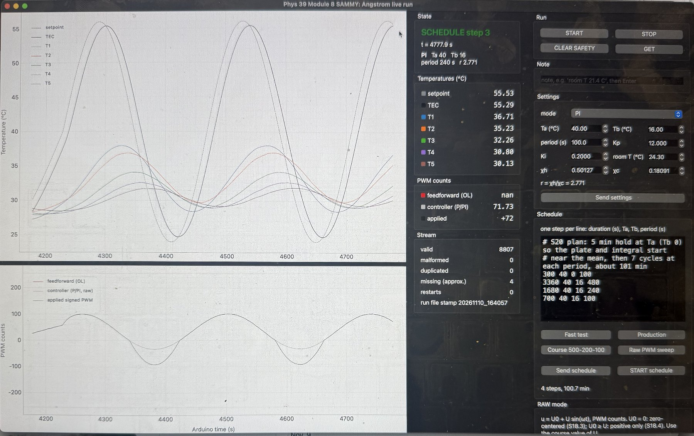
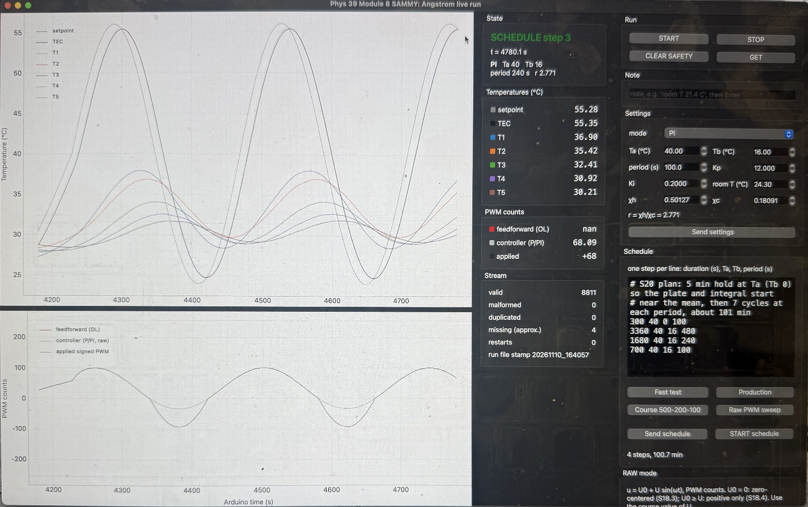
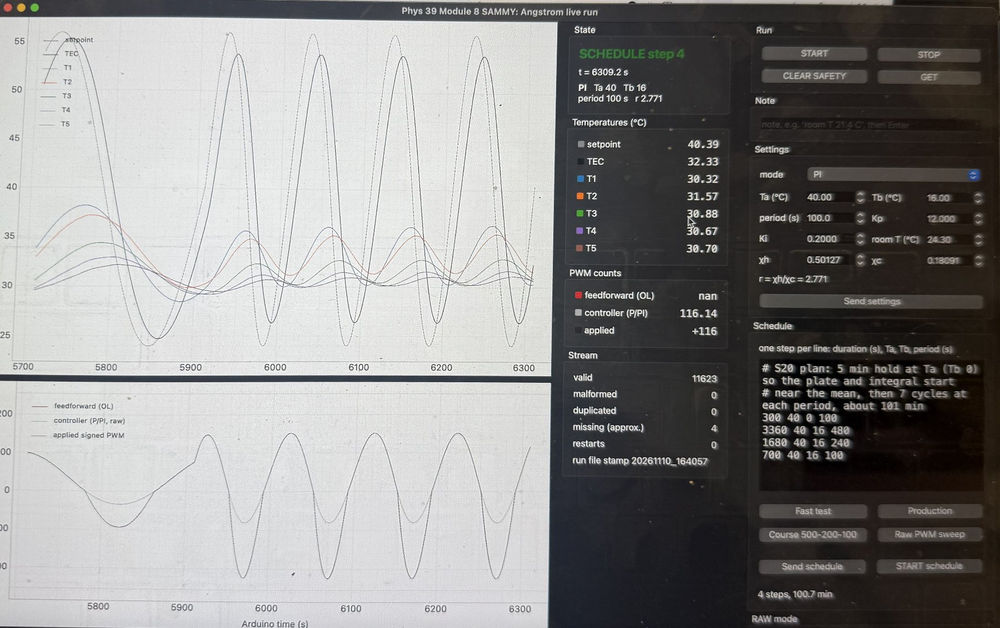

# Module 8, Part I: Angstrom run of 10 November 2026 (SAMMY copy)

Summary of the 112-minute production run `sammy_angstrom_live_20261110_164057.csv`, analysed with
`python/sammy_module8_angstrom_analysis.py`. Slides: `Phys39_Module_8_Angstrom_Slides_Sammy.pdf` in this folder.
Figures: `docs/figures/module_08_sammy/20261110_164057_*.png`. Photos: `docs/images/module08_sammy_gui_*.jpg`. Tables and the text report: `data/module_08_sammy/analysis_20261110_164057/`.
Kapil Naidu's acquisition code, analysis scripts and data are unchanged; everything here is an addition.

## What was run

- PI control of the TEC thermistor (Kp 12, Ki 0.2, cooling multiplier r = 2.771) with the sine setpoint
  40 ± 16 °C computed on the Arduino (`angstrom_tec_sammy`), room T = 24.3 °C (idle mean of T1 to T5).
- Schedule: 5 min hold at 40 °C, then 7 cycles at 480 s, 7 cycles at 240 s and 7 cycles at 100 s.
  All four steps ran to the end (5.0, 56.0, 28.0, 11.7 min), the PWM never reached ±255 (range -225 to 202), T1 peaked at
  41.9 °C and the TEC thermistor at 55.9 °C during the schedule (limits 56 and 65 °C).
  The file has 12407 records over 112.2 min with 0 duplicated times and 0 restarts;
  4 gaps longer than 0.75 s, 0 of them during the schedule.
- Rod: 6061-T6 aluminum, d = 12.757 mm, T1 to T5 at 0, 25.4, 50.8, 76.2 and 101.6 mm (±1 mm), tip 281.9 mm from T1.

## Photos of the run

Phone photos of the laptop screen during the run, straightened and cropped to the GUI window (metadata removed; the full-screen
originals are not in the repository). The numbers on screen are the logged values: the temperatures, the PWM and the stream's
valid-record count equal the CSV record with that number.



*IMG_2550, 6:00 PM: step 3 (240 s period), t = 4777.9 s. On screen: setpoint 55.53 °C, TEC 55.29 °C, T1 36.71, T2 35.23, T3 32.26, T4 30.80, T5 30.13 °C; applied PWM +72 (record 8807).*



*IMG_2551, 6:00 PM: step 3 (240 s period), t = 4780.1 s. On screen: setpoint 55.28 °C, TEC 55.35 °C, T1 36.90, T2 35.42, T3 32.41, T4 30.92, T5 30.21 °C; applied PWM +68 (record 8811).*



*IMG_2558, 6:26 PM: step 4 (100 s period), t = 6309.2 s. On screen: setpoint 40.39 °C, TEC 32.33 °C, T1 30.32, T2 31.57, T3 30.88, T4 30.67, T5 30.70 °C; applied PWM +116 (record 11623).*

## Data quality and what was masked

2462 samples were set to `nan` in the fits (never in the raw file; mask: `sammy_angstrom_live_20261110_164057_mask.csv`):

| Channel | Arduino time (s) | Why |
|---|---|---|
| T3, T4, T5 | 36 to 200 | leads being handled before the run (spikes up to 33, 117 and 102 °C) |
| T5 | 1860 to 2618 | reads 1 to 4 °C above its prediction from T3 and T4 (480 s step, cycles 3 and 4) |
| T5 | 3060 to 3141 | reads up to 3.6 °C above the prediction (480 s step, cycle 5) |

The prediction fits T5 from T3 and T4 and their slopes on the last two cycles of each step (0.012 °C RMS
in the 480 s step). Outside the masked windows the largest departure of T5 from its prediction is 0.35 °C in the 480 s step, 0.14 °C in the 240 s step, 0.15 °C in the 100 s step; inside the
masked windows it reaches 3.6 °C.

## Settling test

Counting back from the last cycle, a cycle joins the settled block while every rod sensor stays within 3 % in amplitude and
0.05 rad in phase of the block median (tolerances chosen for this analysis; the handout's tolerances were not available). The page asks for at least
five settled cycles at each of at least two usable periods.

| Period (s) | Settled block | Five or more | First rejected cycle |
|---|---|---|---|
| 480 | cycles 5 to 7 (3) | no | cycle 4: T4 off by +15.0 % and -0.03 rad |
| 240 | cycles 2 to 7 (6) | yes | cycle 1: T5 off by +1.4 % and +0.10 rad |
| 100 | cycles 5 to 7 (3) | no | cycle 4: T5 off by +0.8 % and +0.10 rad |

Under this test only the periods marked yes meet the minimum, so the others are supplementary. Why the blocks start where they do:

- 480 s: at t = 2598 s the TEC thermistor reading stepped up by 4 °C (decaying over about 10 s while the PI controller briefly
  commanded −174 PWM), and the T5 offset vanished at t = 2617 s. From then on every rod amplitude was about 10 % lower (T1 maximum
  41.6 to 41.9 °C in cycles 1 to 4, 39.6 to 39.9 °C in cycles 5 to 7) with the TEC amplitude unchanged. The ratios between sensors did
  not change (T5/T1 0.383 to 0.385 in cycles 2, 5 and 6), so the spatial slopes are not affected, but the early cycles belong to a
  different state. The cause is unknown.
- 100 s: T5's amplitude is only 0.44 °C, so 3 % is 0.013 °C, and its phase in cycle 4 is about 0.10 rad off the later cycles.

## Results

| Period (s) | Settled cycles | q (1/m) | q′ (1/m) | κ (10⁻⁵ m²/s) | ν (10⁻³ 1/s) | k (W/(m K)) |
|---|---|---|---|---|---|---|
| 480 | 3 of 7 | 9.36 ± 0.14 | 7.95 ± 0.14 | 8.80 ± 0.21 | 2.15 ± 0.31 | 213 |
| 240 | 6 of 7 | 12.42 ± 0.15 | 11.52 ± 0.12 | 9.15 ± 0.14 | 1.99 ± 0.42 | 221 |
| 100 | 3 of 7 | 18.73 ± 0.23 | 18.06 ± 0.22 | 9.29 ± 0.16 | 2.31 ± 1.07 | 225 |

- κ (10⁻⁵ m²/s) from the periods that meet the five-cycle minimum: 240 s: 9.15 ± 0.14.
- All three periods, weighted mean: **9.12 ± 0.09 × 10⁻⁵ m²/s** (χ² = 3.6 for 2 degrees
  of freedom, so the three periods are consistent with one value); plain mean 9.08 with spread (sd) 0.25.
- Handbook 6061-T6 (k = 167 W/(m K), ρ = 2700 kg/m³, cp = 896 J/(kg K)): κ = 6.9 × 10⁻⁵ m²/s, so the weighted mean is
  32 % above it, as in Kapil's data. k uses the handbook ρ and cp and inherits this offset;
  κ is the quantity the Angstrom method measures directly.
- ν = κ(q² − q′²) is a small difference of two nearly equal numbers, so its relative uncertainty is large.

Using the last five cycles of every period (Kapil's rule) instead of the settled block changes κ as follows:

| Period (s) | Last five cycles | κ, settled block (10⁻⁵ m²/s) | κ, last five cycles | Change |
|---|---|---|---|---|
| 480 | cycles 3 to 7 | 8.80 ± 0.21 | 7.78 ± 0.30 | -11.5 % |
| 240 | cycles 3 to 7 | 9.15 ± 0.14 | 9.15 ± 0.15 | 0.0 % |
| 100 | cycles 3 to 7 | 9.29 ± 0.16 | 9.41 ± 0.17 | +1.3 % |

The choice makes no difference at 240 s and 100 s within the errors. At 480 s the last five cycles straddle the disturbance at
t = 2598 s (and T5 loses cycles 3 and 4 to the mask), so that fit mixes two states and is biased low; the settled block avoids this.

Kapil's PI fits (shared branch, 2 and 4 Nov, same rod):

| Period (s) | κ (10⁻⁵ m²/s) | q (1/m) | q′ (1/m) |
|---|---|---|---|
| 100 | 9.76 ± 0.23 | 18.53 | 17.37 |
| 180 | 9.24 ± 0.20 | 14.10 | 13.39 |
| 240 | 9.40 ± 0.17 | 12.34 | 11.29 |
| 300 | 9.31 ± 0.16 | 11.06 | 10.17 |
| 480 | 8.94 ± 0.24 | 9.34 | 7.84 |

## Model-validity checks

| Period (s) | Finite-length difference (max) | Radial Biot number | m from √(q²−q′²) (1/m) | m from the mean profile (1/m) |
|---|---|---|---|---|
| 480 | 3.60 % | 2.5e-04 | 4.95 | 3.72 ± 0.14 |
| 240 | 1.21 % | 2.2e-04 | 4.66 | 4.17 ± 0.17 |
| 100 | 0.12 % | 2.5e-04 | 4.99 | 4.12 ± 0.16 |

The semi-infinite model is a good approximation for these periods (finite-length difference small, Biot number far below 0.1).
The side-loss rate from the mean temperature profile does not match the one from q and q′, so ν and h should be quoted with caution. In every mean profile T2 is warmer than T1 (by 0.41 to 0.42 °C), which conduction away from the TEC cannot produce, so the mean-profile slope is the weaker of the two estimates of m.

## Controller tracking (PI)

Hold step: TEC reached 39.5 °C after 45 s with +0.03 °C overshoot, peak PWM 202.

| Period (s) | B_TEC/Tb | TEC lag (s) | B_T1/Tb | T1 lag (s) | PWM range | Samples at ±255 |
|---|---|---|---|---|---|---|
| 480 | 0.992 | 12.0 | 0.394 | 52.9 | -47 to 83 | 0 |
| 240 | 0.957 | 11.4 | 0.301 | 36.9 | -94 to 101 | 0 |
| 100 | 0.862 | 9.9 | 0.187 | 23.6 | -225 to 152 | 0 |

## Limits of this run

- Only the PI mode was run. The page's open-loop and P comparisons, the raw sinusoidal PWM trials (S18.3 and S18.4), the gain tuning
  at 200 s and 500 s, and the P-versus-PI simulation are not covered by this file.
- Periods with fewer than five settled cycles: 480 s (3), 100 s (3). Their κ agrees with the others (χ² above), but the settled-cycle
  count is below the page's minimum.
- T5 needed masking in the 480 s step; its amplitude ratio to T1 is the same (0.383 to 0.385) in cycle 2, before the problem, and in cycles 5 and 6, after it.
- The tolerances of the settling test were chosen for this analysis, and the semi-infinite-rod formulas carry a finite-length bias of up to
  3.6 % in the amplitude ratio at T5 for the longest period.

## Reproduce

```bash
python3 python/sammy_module8_angstrom_analysis.py data/module_08_sammy/sammy_angstrom_live_20261110_164057.csv
python3 python/build_sammy_module8_slides.py data/module_08_sammy/sammy_angstrom_live_20261110_164057.csv
```

## AI assistance

The acquisition GUI changes, the analysis script, the figures, the slides and this summary were produced with GitHub Copilot
assistance and reviewed against Kapil Naidu's `angstrom_fit.py` method and the Module 8 study guide.
