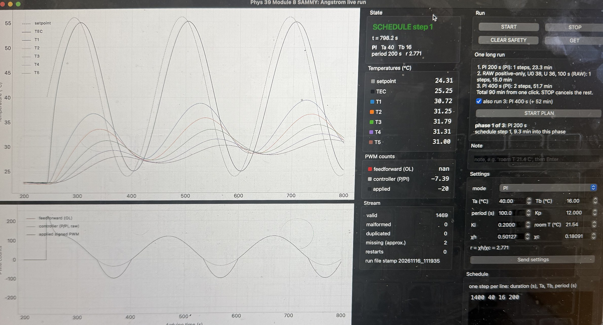
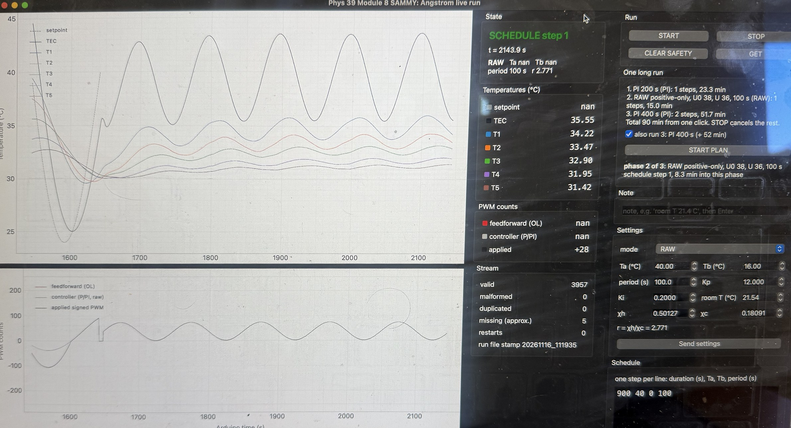
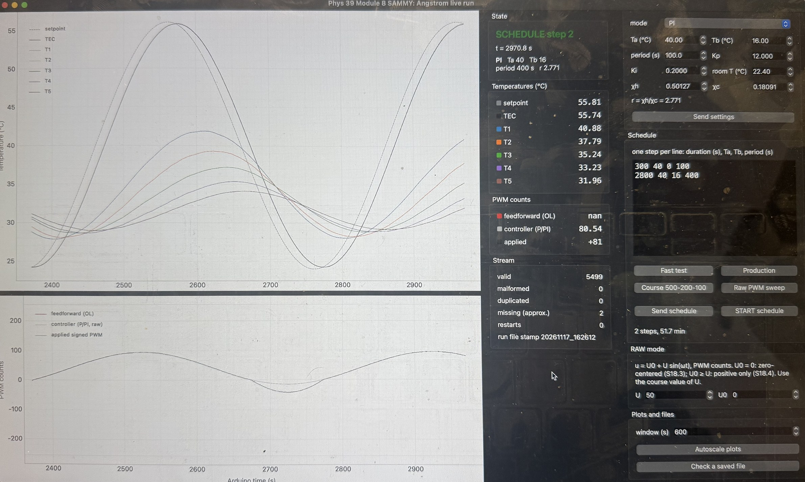
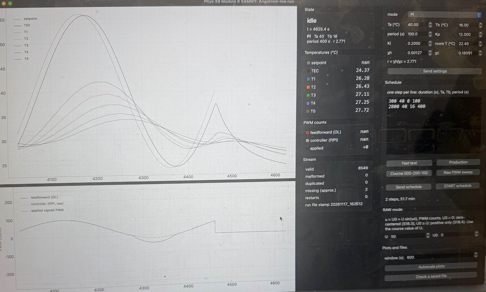
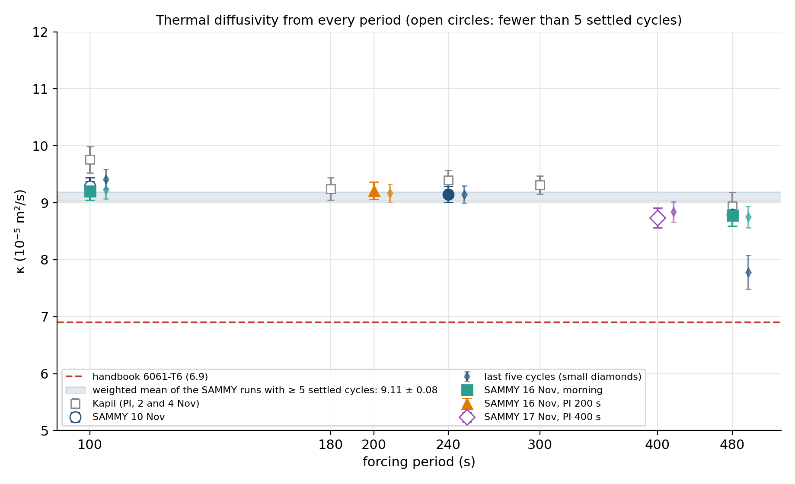
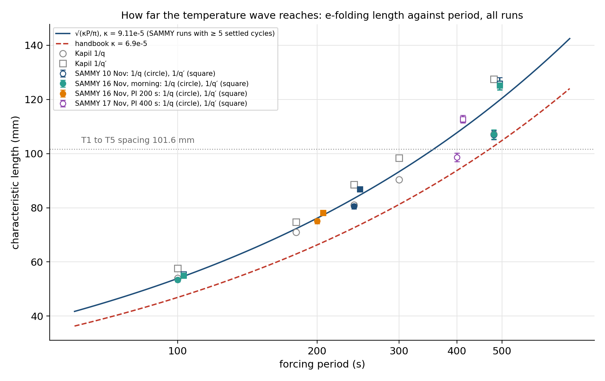

# Module 8, Part I: SAMMY runs of 16 and 17 November 2026, and all periods compiled

Summary of the 16 Nov GUI plan run (`sammy_angstrom_live_20261116_111935.csv`: PI 200 s, S18.4 positive-only PWM, interrupted PI 400 s) and of the
17 Nov PI 400 s repeat (`sammy_angstrom_live_20261117_162612.csv`), written by `python/sammy_module8_runs_summary.py`.
Tables and reports: `data/module_08_sammy/analysis_<stamp>/` (the 16 Nov run is analysed phase by phase from verbatim slices of the file),
compiled table `data/module_08_sammy/compiled_periods.csv`. Figures: `docs/figures/module_08_sammy/`. Photos: `docs/images/module08_sammy_gui_plan_*.jpg`
and `module08_sammy_gui_pi400_*.jpg`. Kapil Naidu's acquisition code, analysis scripts and data are unchanged; everything here is an addition.

## What was run

| Run | What happened |
|---|---|
| 16 Nov, plan run (GUI started 11:19:35, 8954 records, t = 3.4 to 4851.9 s) | PI 200 s from 11:23:35; RAW positive-only, U0 38, U 36, 100 s from 11:47:00; PI 400 s from 12:02:06. The first two schedules ended with `SCHEDULE DONE` at 11:46:59 and 12:02:05. The GUI process ended at 12:40:27 (last record), 1997 s into the 2800 s step of the 400 s run (4 whole cycles), with no STOP in the events file; the cause is unknown. |
| 17 Nov, PI 400 s repeat (GUI started 16:26:11, 8692 records, t = 3.4 to 4702.1 s) | Idle lead-in with supply and pump off (room T 22.4 °C, note at 16:33:08), pump on at about 16:33:31. Schedule `300 40 0 100` + `2800 40 16 400` sent at 16:47:51, START at 16:48:54 (the earlier START clicks at 16:36:18, 16:40:10, 16:42:42 were refused by the board because no schedule was loaded, with no effect on the data). Step 2 from 16:53:55, `SCHEDULE DONE` at 17:40:34, GUI closed with STOP at 17:44:35. 0 malformed, 0 duplicated, 0 restarts. |

## Photos of the runs

Phone photos of the laptop screen during the runs, straightened and cropped to the GUI window (metadata removed; the full-screen originals are
not in the repository). The numbers on screen are the logged values: the temperatures, the PWM and the stream's valid-record count equal the
CSV record with that number. The window is cropped a few pixels inside its edges.



*IMG_2645, 11:32 AM: step 1 (200 s period), t = 798.2 s. On screen: setpoint 24.31 °C, TEC 25.25 °C, T1 30.72, T2 31.25, T3 31.79, T4 31.31, T5 31.00 °C; applied PWM -20 (record 1469); room T box 21.54. Phase 1 of the plan; the plots show the first three 200 s cycles.*



*IMG_2646, 11:55 AM: step 1 (100 s period), t = 2143.9 s. On screen: setpoint nan °C, TEC 35.55 °C, T1 34.22, T2 33.47, T3 32.90, T4 31.95, T5 31.42 °C; applied PWM +28 (record 3957); room T box 21.54. Phase 2 of the plan (RAW); the blue patch at the right edge is a reflection on the glass.*



*IMG_2663, 5:15 PM: step 2 (400 s period), t = 2970.8 s. On screen: setpoint 55.81 °C, TEC 55.74 °C, T1 40.88, T2 37.79, T3 35.24, T4 33.23, T5 31.96 °C; applied PWM +81 (record 5499); room T box 22.40. The plots show the last 600 s of the 400 s run.*



*IMG_2664, 5:43 PM: idle after the schedule, t = 4625.4 s. On screen: setpoint nan °C, TEC 24.37 °C, T1 26.28, T2 26.43, T3 27.11, T4 27.25, T5 27.72 °C; applied PWM +0 (record 8549); room T box 22.40. After `SCHEDULE DONE` at t = 4461.5 s the output is 0 (the TEC thermistor read 36.89 °C at the last scheduled record), so it decays afterwards.*

## 16 Nov, phase 1: PI 200 s (S18.10, Stage 5 at 200 s)

Slice `sammy_angstrom_live_20261116_111935_phase1_pi200s.csv`, analysed with `python3 python/sammy_module8_angstrom_analysis.py ... --t-room 22.7 --summary none`
(room T from the calibrated idle sensors before the plan). PI settings Kp 12, Ki 0.2, r 2.771; no sample masked.

| Period (s) | Settled cycles (strict test) | q (1/m) | q′ (1/m) | κ (10⁻⁵ m²/s) | ν (10⁻³ 1/s) | κ, last five cycles |
|---|---|---|---|---|---|---|
| 200 | 6 of 7 | 13.32 ± 0.16 | 12.80 ± 0.15 | 9.21 ± 0.15 | 1.26 ± 0.53 | 9.17 ± 0.16 |

Tracking: B_TEC/Tb = 0.939, TEC lag 11.7 s, B_T1/Tb = 0.332, T1 lag 32.1 s,
PWM -106 to 120 in the settled block (whole slice -106 to 227, never at ±255). The TEC peaked at 55.1 °C and T1 at 40.3 °C
(limits 65 and 56 °C). Figures: `20261116_111935_phase1_pi200s_*.png`.

## 16 Nov, phase 2: S18.4 positive-only PWM

Slice `sammy_angstrom_live_20261116_111935_phase2_raw100s.csv`, analysed with the new `python/sammy_module8_s184_analysis.py` (settled cycles chosen from the TEC
because the rod amplitudes are only 0.15 to 1 °C); the prediction is the one of `Sammy_Module_8_S18_4_Positive_Only_PWM_Walkthrough.md`. Report
`data/module_08_sammy/analysis_20261116_111935_phase2_raw100s/report.txt`:

```text
S18.4 positive-only PWM: data/module_08_sammy/sammy_angstrom_live_20261116_111935_phase2_raw100s.csv
python3 python/sammy_module8_s184_analysis.py data/module_08_sammy/sammy_angstrom_live_20261116_111935_phase2_raw100s.csv --t-amb 23.05 --t-room 22.7

Schedule: 100 s period, 9 whole cycles (899.7 s), TEC at the start 35.26 °C
Applied PWM: 2 to 74 counts, never negative: yes; fitted U0 = 38.00, U = 36.02; highest T1 35.97 °C
Settled block (counting back from the last cycle while the TEC mean is within 0.2 °C, its amplitude within 3 % and its lag within 0.05 rad of the block median): cycles 2 to 9 (8 cycles); first rejected cycle 1

TEC thermistor over the settled block (3 harmonics + drift):
  mean 39.38 °C (-0.62 from the 40 °C target); highest 43.48, lowest 35.11 °C (latch 65)
  A1 3.994 °C, lag 1.420 rad = 22.6 s, A2/A1 0.002, A3/A1 0.001
  highest peak above the mean 4.10, lowest below 4.27; steepest rise 0.251, steepest fall -0.252 °C/s

Prediction made before the run (S18.3 one-lump fit chi_h 0.417, tau 64.3 s, T_amb 23.05 °C, this run's U0 and U):
  mean 38.91  A1 3.613  lag 1.328 rad = 21.1 s  highest 42.5  lowest 35.3 °C
  measured minus predicted: mean +0.46 °C, A1 +0.381 °C (+10.5 %), lag +0.091 rad (+1.5 s)
  whole run, model integrated with the recorded PWM from the first record: RMS of TEC - model over the settled block 0.58 °C

One-lump check with this run's own numbers (mean = T_amb + chi U0, A1 = chi U N, N = 1 / sqrt(1 + (w tau)^2), lag = arctan(w tau)):
  chi from the mean 0.430 °C/count (S18.3 fit chi_h 0.417);  tau from the amplitude 59.6 s, tau from the lag 104.5 s (S18.3 fit 64.3 s); one lump would give the same tau twice

Shape of the TEC cycle, S18.4 (u >= 0) against S18.3 at 100 s (u = 50 sin wt):
                                       S18.4         S18.3
  A2/A1                                0.002         0.102
  peak above / below mean (°C)   4.10/4.27     4.12/3.74  
  steepest rise / fall (°C/s)   0.251/-0.252  0.284/-0.208
  lag behind the PWM (rad)             1.420         1.442

Rod, settled block, same fits as the PI runs: q 17.97 +/- 0.39 1/m, q' 18.06 +/- 0.27 1/m, kappa 9.682e-05 +/- 2.6e-06 m^2/s; T1 amplitude 1.066 °C, T5 0.165 °C
  mean-profile loss rate m 3.56 1/m (T_room 22.7 °C) against sqrt(q^2 - q'^2): undefined here (q' is above q)
```

Figures: `20261116_111935_phase2_raw100s_s184_overview.png` (measured against the prediction) and `20261116_111935_phase2_raw100s_s184_shape.png` (the cycle shape against S18.3).

## 17 Nov: PI 400 s (Stage 5 at 400 s)

Analysed with `python3 python/sammy_module8_angstrom_analysis.py data/module_08_sammy/sammy_angstrom_live_20261117_162612.csv --t-room 22.4 --summary none`
(room T from the idle sensors before the pump was switched on). Hold step: the TEC reached 39.5 °C after 48 s with +0.03 °C
overshoot, peak PWM 216. The PWM then ran -43 to 95 (never at ±255); the TEC peaked at 55.8 °C and T1 at
42.2 °C. No sample was masked.

| Period (s) | Settled cycles (strict test) | q (1/m) | q′ (1/m) | κ (10⁻⁵ m²/s) | ν (10⁻³ 1/s) | κ, last five cycles |
|---|---|---|---|---|---|---|
| 400 | 2 of 7 | 10.14 ± 0.16 | 8.87 ± 0.11 | 8.73 ± 0.17 | 2.10 ± 0.33 | 8.84 ± 0.18 |

Tracking: B_TEC/Tb = 0.985, TEC lag 12.6 s, B_T1/Tb = 0.436, T1 lag 44.5 s.

**The settling test is the limit of this run.** Counting back from the last cycle, a cycle joins the settled block while every rod sensor stays within 3 % in
amplitude and 0.05 rad in phase of the block median (tolerances chosen for this analysis). Cycle 5 fails it: its T3 amplitude is +3.6 % from
the median of cycles 6 to 7, so the block is those 2 cycles and the five-cycle minimum is not met by the strict count. The cycles are otherwise consistent:
after the start-up cycle 1, cycles 2 to 7 agree within -2.0 to +2.5 % in amplitude (each sensor against its own mean over those cycles) and 0.019 rad in phase,
and the amplitude follows the slow warming of the rod (the T5 mean rises from 31.23 to 31.60 °C between cycles 2 and 5). Fitting other sets of cycles with the same
code (`analyse_block`):

| Cycles fitted | q (1/m) | q′ (1/m) | κ (10⁻⁵ m²/s) |
|---|---|---|---|
| strict block (cycles 6 to 7) | 10.14 ± 0.16 | 8.87 ± 0.11 | 8.73 ± 0.17 |
| all cycles after the start-up cycle (2 to 7) | 10.08 ± 0.16 | 8.82 ± 0.10 | 8.83 ± 0.17 |
| last five cycles (3 to 7) | 10.07 ± 0.16 | 8.82 ± 0.10 | 8.84 ± 0.18 |

The three κ agree within 1.2 %. Per cycle (amplitude B of the fundamental, calibrated sensors):

| Cycle | TEC mean (°C) | T1 B (°C) | T3 B (°C) | T3 B against the mean of cycles 2 to 7 (%) | T5 B (°C) | T5 mean (°C) | In the strict block |
|---|---|---|---|---|---|---|---|
| 1 | 40.05 | 6.240 | 3.633 | -13.7 | 2.275 | 30.81 | no |
| 2 | 39.94 | 6.921 | 4.147 | -1.4 | 2.470 | 31.23 | no |
| 3 | 39.94 | 6.966 | 4.204 | -0.1 | 2.502 | 31.46 | no |
| 4 | 39.94 | 7.002 | 4.257 | +1.2 | 2.525 | 31.53 | no |
| 5 | 39.94 | 7.096 | 4.313 | +2.5 | 2.522 | 31.60 | no |
| 6 | 39.94 | 6.931 | 4.142 | -1.6 | 2.445 | 31.56 | yes |
| 7 | 39.94 | 6.953 | 4.184 | -0.6 | 2.482 | 31.58 | yes |

Model-validity checks: finite-length difference 2.75 %, radial Biot number 2.4e-04; the side-loss rate from the
mean temperature profile (3.19 ± 0.09 1/m) does not match the one from q and q′ (4.90 1/m), as in the earlier runs, so ν and h
should be quoted with caution. Figures: `20261117_162612_*.png` (settling test: `20261117_162612_settling.png`).

## All periods compiled

Every SAMMY analysis and Kapil's PI fits, one row per period and run (`compiled_periods.csv`). The strict test is the settling test above; the last-five
column is Kapil's rule.

| Period (s) | Source | Settled cycles (strict) | ≥ 5 | q (1/m) | q′ (1/m) | κ (10⁻⁵ m²/s) | κ, last five cycles |
|---|---|---|---|---|---|---|---|
| 100 | SAMMY 10 Nov | 3 of 7 | no | 18.73 | 18.06 | 9.29 ± 0.16 | 9.41 ± 0.17 |
| 100 | SAMMY 16 Nov, morning | 6 of 12 | yes | 18.74 | 18.20 | 9.21 ± 0.16 | 9.23 ± 0.16 |
| 100 | Kapil (PI, 2 and 4 Nov) | last five cycles |  | 18.53 | 17.37 | 9.76 ± 0.23 |  |
| 180 | Kapil (PI, 2 and 4 Nov) | last five cycles |  | 14.10 | 13.39 | 9.24 ± 0.20 |  |
| 200 | SAMMY 16 Nov, PI 200 s | 6 of 7 | yes | 13.32 | 12.80 | 9.21 ± 0.15 | 9.17 ± 0.16 |
| 240 | SAMMY 10 Nov | 6 of 7 | yes | 12.42 | 11.52 | 9.15 ± 0.14 | 9.15 ± 0.15 |
| 240 | Kapil (PI, 2 and 4 Nov) | last five cycles |  | 12.34 | 11.29 | 9.40 ± 0.17 |  |
| 300 | Kapil (PI, 2 and 4 Nov) | last five cycles |  | 11.06 | 10.17 | 9.31 ± 0.16 |  |
| 400 | SAMMY 17 Nov, PI 400 s | 2 of 7 | no | 10.14 | 8.87 | 8.73 ± 0.17 | 8.84 ± 0.18 |
| 480 | SAMMY 10 Nov | 3 of 7 | no | 9.36 | 7.95 | 8.80 ± 0.21 | 7.78 ± 0.30 |
| 480 | SAMMY 16 Nov, morning | 7 of 8 | yes | 9.33 | 7.99 | 8.78 ± 0.18 | 8.75 ± 0.19 |
| 480 | Kapil (PI, 2 and 4 Nov) | last five cycles |  | 9.34 | 7.84 | 8.94 ± 0.24 |  |

The SAMMY runs with at least five settled cycles give a weighted mean κ = **9.11 ± 0.08 × 10⁻⁵ m²/s**. All 12 period fits (SAMMY and Kapil) lie between
8.73 and 9.76; their mean is 33 % above the handbook value for 6061-T6 (6.9), as in each earlier run. The mean κ is
9.32 at 100 to 300 s and 8.81 at 400 and 480 s. In every row q is larger than q′, the signature of the side loss.





## The five production periods of the course page

Kapil's gap analysis of 16 November (commit `a1c84f5`) lists Stage 5 at 100, 200, 300, 400 and 500 s, at least five settled cycles each:

| Period | Covered by | κ (10⁻⁵ m²/s) | Status |
|---|---|---|---|
| 100 s | SAMMY 16 Nov morning (6 settled cycles), SAMMY 10 Nov (3), Kapil | 9.21 ± 0.16 | covered |
| 200 s | SAMMY 16 Nov, phase 1 of the GUI plan (6 settled cycles) | 9.21 ± 0.15 | covered |
| 300 s | Kapil, 4 Nov (SAMMY did not repeat it) | 9.31 ± 0.16 | covered (Kapil) |
| 400 s | SAMMY 17 Nov (7 cycles recorded, 2 settled by the strict test) | 8.73 ± 0.17 (last five cycles 8.84 ± 0.18) | recorded; the strict count is below five (see the 17 Nov section) |
| 500 s | the 480 s runs: SAMMY 16 Nov morning (7 settled cycles), SAMMY 10 Nov (3), Kapil | 8.78 ± 0.18 | covered with 480 s for 500 s, as in the gap analysis |

Not covered by this page: the S18 evidence table, the course-simulator runs, the S18.5 and S18.6 open-loop trial (2 Nov, done the earlier way) and A5.

## Limits

- The 400 s run has one start-up cycle and then six cycles whose amplitudes differ by a few percent with the rod's slow warming; the strict test keeps two of them. The
  strict result, the last-five result and the all-cycles result are all given, and they agree within the stated errors.
- The room temperature is a measured idle value (22.4 °C on 17 Nov, 22.7 °C on 16 Nov), used only for the mean-profile check, not for q, q′ or κ.
- The 16 Nov plan run lost its third phase when the GUI process ended; the 17 Nov file holds the complete 400 s dataset.
