# Module 8, S18.3: raw sinusoidal PWM with U0 = 0, step by step (SAMMY copy)

A walkthrough of the run `sammy_angstrom_live_20261111_122227.csv` (11 November 2026, one click, 46.7 minutes of schedule), written so that every
step can be followed from the first idea to the last number. All numbers below are produced from that file by
`python/sammy_module8_s183_analysis.py`; none is typed in by hand.
Figures: `docs/figures/module_08_sammy/20261111_122227_s183_*.png`. Photos: `docs/images/module08_sammy_gui_s183_*.jpg`.
Tables: `data/module_08_sammy/s183_analysis_20261111_122227/`. Kapil Naidu's acquisition code, analysis scripts and data are unchanged;
everything here is an addition.

Some numbers disappeared from the pasted assignment text, among them the PWM amplitude U (the page says to keep it fixed). This document uses
U = 50 counts (the sketch default; the applied PWM measures 50.0). Because the susceptibility of the page's equal-susceptibility check may also have been lost, that check is given
for three values, 0.23, 0.345 (the mean of the Module 6 defaults) and 0.46 °C/count; the course value can be read off or recomputed from R = χ U N (section 4.4).

## 0. The result in one table and six sentences

| Period | Settled cycles used | Mean TEC temperature (°C) | Mean above the idle baseline (°C) | Amplitude A1 (°C) | Lag behind the PWM | Highest / lowest (°C) |
| --- | --- | --- | --- | --- | --- | --- |
| 100 s | 3 of 5 | 28.58 | +4.13 | 3.81 | 1.442 rad = 23.0 s | 32.70 / 24.84 |
| 200 s | 3 of 4 | 28.76 | +4.31 | 6.60 | 1.120 rad = 35.6 s | 36.00 / 22.64 |
| 500 s | 2 of 3 | 28.73 | +4.28 | 10.88 | 0.690 rad = 54.9 s | 41.01 / 19.18 |

The PWM was u = 50 sin(2π t / P) counts in every step (zero average, U0 = 0). The idle baseline is the TEC thermistor with nothing switched on:
24.45 °C (room temperature from the rod sensors: 24.21 °C).

1. **The average moves.** The plate does not swing around room temperature. It swings around a mean 4.13, 4.31 and 4.28 °C above the idle baseline,
   the same at all three periods within 0.18 °C. Heating is stronger than cooling, and the average of the one-lump model is exactly
   (χh − χc) U / π = 4.27 °C for the fitted χ (section 4.5), whatever the period.
2. **The amplitude is not constant.** With U fixed, the fundamental amplitude is 3.81, 6.60 and 10.88 °C: it grows by a factor 2.85 between the
   shortest and the longest period. The plate acts as a low-pass filter (section 4.3).
3. **The delay shows up two ways.** As an angle the lag falls from 1.44 to 0.69 rad as the period grows; as a time it rises from 23.0 s to 54.9 s.
4. **The waveform is lopsided.** The peaks above the mean are 1.10, 1.18 and 1.29 times the dips below it; the steepest rise is
   1.37, 1.27 and 1.13 times the steepest fall; the second harmonic is 10.2 %, 11.0 % and 13.8 % of the fundamental.
5. **One lump with two susceptibilities explains it.** Fitting the Module 6 model to the whole record gives χh = 0.417, χc = 0.149 °C/count and τ = 64.3 s
   (RMS misfit 0.24 °C). The ratio χh/χc = 2.79 matches the Module 4 value r = 2.771.
6. **A constant PWM amplitude does not give a constant temperature amplitude.** Holding a 5 °C amplitude at the three periods would take about
   73, 40 and 23 counts (fitted model, section 4.6).

## 1. Words and symbols

| Symbol | In plain words | Units |
| --- | --- | --- |
| u | the knob: the signed PWM command. Positive heats, negative cools, 255 is the maximum | counts |
| U | how far the knob swings each way (the amplitude of u); here 50 | counts |
| P | how long one full swing of the knob takes (the period) | s |
| ω = 2π/P | how fast the swing goes, as an angle per second (one full swing is 2π radians) | rad/s |
| T | temperature of the TEC plate, what the TEC thermistor reads | °C |
| T_amb | room temperature (the idle baseline of this run) | °C |
| θ = T − T_amb | how much hotter than the room the plate is | °C |
| χ (chi) | how many °C hotter the plate ends up per count of PWM if the knob is held still for a long time; χh when heating, χc when cooling | °C/count |
| τ (tau) | the plate's sluggishness: after a sudden change it covers 63 % of the way to its new temperature in τ seconds | s |
| N | the shrink factor 1/√(1 + (ωτ)²): how much of the push survives as a temperature swing | none |
| φ (phi) | how late the temperature swing is behind the knob swing, as an angle; the delay in seconds is φ/ω | rad |
| A1, A2, A3 | sizes of the temperature wiggle at the PWM frequency (1st), at twice it (2nd) and at three times it (3rd) | °C |

## 2. What was run, as a series of steps

The Arduino sketch `arduino/module_08_sammy/angstrom_tec_sammy` was in RAW mode: u = U0 + U sin(phase), no feedback, clamped to ±255. The TEC thermistor
is on A0 and the rod sensors T1 to T5 on A1 to A5; a record is sent every 0.5 s. A safety latch sets the output to 0 if T1 > 56 °C, the TEC thermistor > 65 °C
or five TEC readings in a row are bad. The GUI's one-click plan (`START PLAN`) set mode RAW, U = 50, U0 = 0, sent the three-line schedule and started it;
`STOP` cancels the rest.

| Step | What the PWM does | Why | Arduino time (s) |
| --- | --- | --- | --- |
| idle | u = 0 | measure room temperature and sensor noise (244 samples at 0.5 s) | 40 to 171 |
| test START | PI mode, u = 191 to 228 | a quick check that the TEC responds; TEC 24.4 to 29.7 °C; not part of S18.3, outside every fit | 174 to 178 |
| sweep 1 | u = 50 sin(2π t / 100 s) | 5 cycles of 100 s | 262 to 762 |
| sweep 2 | u = 50 sin(2π t / 200 s) | 4 cycles of 200 s | 762 to 1562 |
| sweep 3 | u = 50 sin(2π t / 500 s) | 3 cycles of 500 s | 1562 to 3062 |
| end | u = 0 (plan finished) | the plate drifts back toward room temperature | from 3062 |

Each sweep starts at phase zero, so u begins at 0 and goes positive (heating) first. The TEC was 25.5 °C when sweep 1 began,
1.0 °C above the idle baseline: close to the "start near room temperature" the page asks for. The run has 5987 records; the schedule part has 5239.

### Photos of the run

Phone photos of the laptop screen during the run, straightened and cropped to the GUI window (metadata removed; the full-screen
originals are not in the repository). The numbers on screen are the logged values: the temperatures, the PWM and the stream's valid-record count
equal the CSV record with that number. Left: temperature and PWM traces; middle: live values and stream counters; right: the run controls,
the "One long run" plan box, the settings and the schedule text.

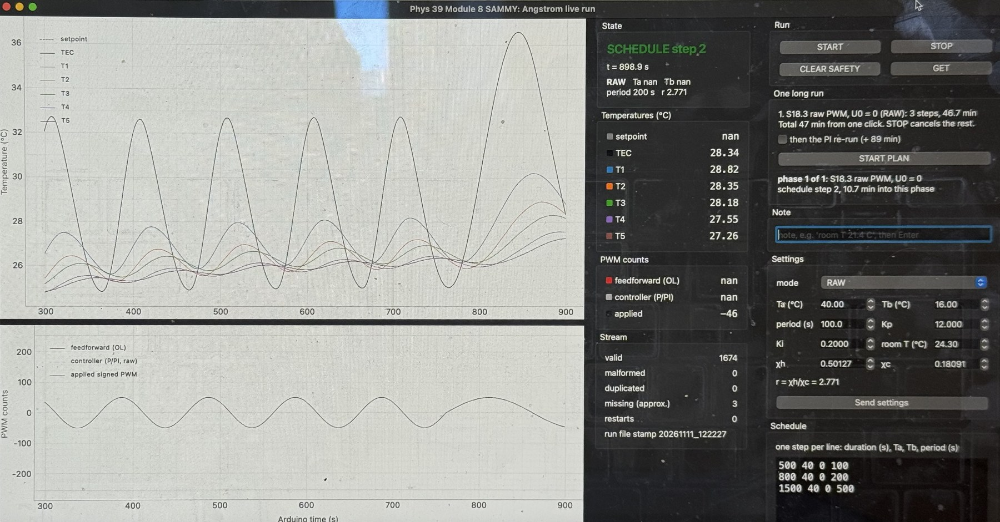

*IMG_2564, 12:37 PM: sweep 2 (200 s period), t = 898.9 s. On screen: TEC 28.34 °C, T1 28.82, T2 28.35, T3 28.18, T4 27.55, T5 27.26 °C; applied PWM -46 (record 1674).*

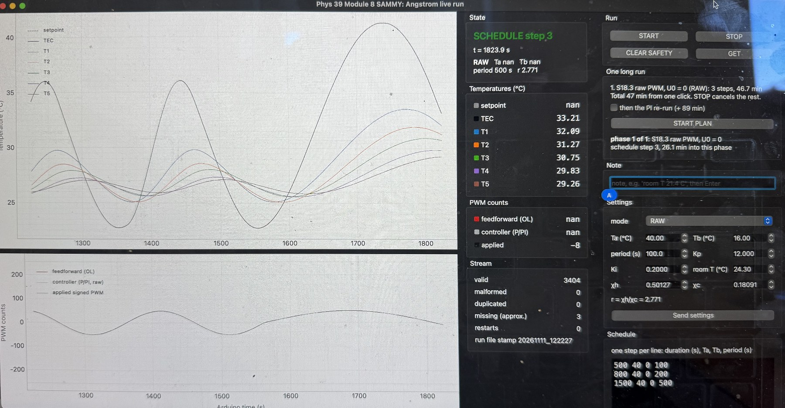

*IMG_2565, 12:52 PM: sweep 3 (500 s period), t = 1823.9 s. On screen: TEC 33.21 °C, T1 32.09, T2 31.27, T3 30.75, T4 29.83, T5 29.26 °C; applied PWM -8 (record 3404).*

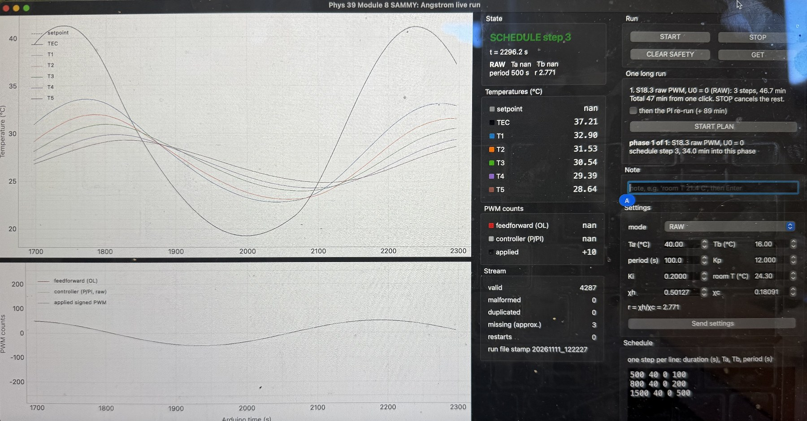

*IMG_2566, 1:00 PM: sweep 3 (500 s period), t = 2296.2 s. On screen: TEC 37.21 °C, T1 32.90, T2 31.53, T3 30.54, T4 29.39, T5 28.64 °C; applied PWM +10 (record 4287).*

Notes in the run's notes file (typed in the GUI, plus the automatic plan notes):

- 12:26 (t = 256 s): PLAN phase 1 of 1 start: S18.3 raw PWM, U0 = 0 (RAW)
- 12:27 (t = 283 s): sign check: +PWM heats
- 12:30 (t = 506 s): room T baseline 24.2 C (mean of T1-T5, hands off)
- 13:13 (t = 3062 s): PLAN finished

## 3. The idea in a picture

Think of a bathtub. A warm tap pours in when u is positive and a cold tap when u is negative; the tap is turned up and down like a swing. The bathtub also
slowly drains and leaks heat to the room, and it holds a lot of water, so its temperature cannot change quickly. If the tap swings slowly the water
temperature follows it closely. If the tap swings quickly the temperature cannot keep up: it moves less, and it is late. The TEC plate with the aluminum
rod behaves like that bathtub, with one more twist: the warm tap is stronger than the cold tap (χh > χc).

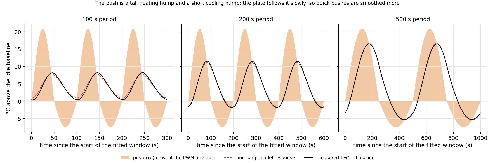

*The shaded humps are the push the PWM asks for, χ(u)·u with the fitted χ (a tall heating hump, a short cooling hump). The dashed curve is the one-lump model, the black
curve is the measured TEC temperature above the idle baseline. The plate smooths the humps; the quicker the swing, the more it smooths.*

## 4. The math, one step at a time

### 4.1 The rule the plate follows (Module 6 one-lump model)

```text
τ · dT/dt = −(T − T_amb) + χ(u) · u            χ(u) = χh when u > 0 (heating),  χc when u < 0 (cooling)
```

- `dT/dt` is how fast the plate temperature changes, in °C per second.
- `−(T − T_amb)` is the leak. The hotter the plate is than the room, the faster it loses heat; it always pulls T back toward the room temperature.
- `χ(u)·u` is the push from the TEC. Held forever, u counts would lift the plate to T_amb + χ u (put dT/dt = 0 to see it).
- `τ` turns "push minus leak" into a speed: a large τ means a slow plate.

The Module 6 simulation defaults are T_amb = 22 °C, χh = 0.46, χc = 0.23 °C/count and τ = 80 s. This run's own values are in sections 4.5 and 6.

### 4.2 Step zero: measure from the room

Let θ = T − T_amb, how much hotter than the room. T_amb does not change, so dθ/dt = dT/dt and the rule becomes

```text
τ · dθ/dt + θ = χ(u) · u                          (S18.3.1 when χ(u) is one number χ)
```

With the knob swinging as u = U sin(ωt), ω = 2π/P, and the same χ for both signs of u, the right-hand side is χ U sin(ωt).

### 4.3 The page's first case: equal heating and cooling (χh = χc = χ)

**Step A, guess.** The plate is pushed by a sine, so after a while it must wiggle at the same frequency, with a different size and timing. A sine and a cosine with
two unknown sizes a and b can make any size and timing:

```text
θp(t) = a · sin(ωt) + b · cos(ωt)
```

**Step B, differentiate.**

```text
dθp/dt = a ω · cos(ωt) − b ω · sin(ωt)
```

**Step C, put both into the equation.**

```text
τ (a ω cos ωt − b ω sin ωt) + a sin ωt + b cos ωt = χ U sin ωt
```

**Step D, collect the sines and the cosines.**

```text
(a − ωτ b) · sin ωt + (ωτ a + b) · cos ωt = χ U · sin ωt + 0 · cos ωt
```

**Step E, match.** The equation must hold at every instant, so the sine parts must agree and the cosine parts must agree:

```text
sine:    a − ωτ b = χ U
cosine:  ωτ a + b = 0
```

**Step F, solve.** The cosine line gives b = −ωτ a. Put that into the sine line: a + (ωτ)² a = χ U, so

```text
a =  χ U / (1 + (ωτ)²)
b = −ωτ · χ U / (1 + (ωτ)²)
```

**Step G, one sine instead of two.** Write the answer as R sin(ωt − φ). Expanding, R sin(ωt − φ) = R cos φ · sin ωt − R sin φ · cos ωt, so a = R cos φ and b = −R sin φ.
Squaring and adding gives R² = a² + b²; dividing gives tan φ = −b/a:

```text
R² = a² + b² = (χ U)² (1 + (ωτ)²) / (1 + (ωτ)²)² = (χ U)² / (1 + (ωτ)²)
R = χ U / √(1 + (ωτ)²) = χ U · N          tan φ = ωτ,   φ = arctan(ωτ)
```

**Step H, add the start-up.** A pure leak, with no push, would die away as e^(−t/τ), and adding C·e^(−t/τ) to a solution does not break the equation
(it satisfies τ dθ/dt + θ = 0 by itself). So the general solution is θ(t) = R sin(ωt − φ) + C e^(−t/τ).

**Step I, start from room temperature.** θ(0) = 0 gives 0 = R sin(−φ) + C, so C = R sin φ and

```text
θ(t) = R · [ sin(ωt − φ) + sin φ · e^(−t/τ) ]
```

**Step J, read it.** After a few τ the exponential is gone and the plate swings at the PWM's own frequency with size R = χ U N, which is smaller than the push χ U by the
shrink factor N < 1, and with a delay φ = arctan(ωτ) behind the PWM, a time delay Δt = φ/ω.

- Slow swing (ωτ much less than 1): N → 1 and φ → 0. The plate follows the knob.
- ωτ = 1: N = 0.71 and φ = π/4 (an eighth of a period late).
- Fast swing (ωτ much more than 1): N ≈ 1/(ωτ) and φ → π/2 (a quarter period late). The plate hardly moves.

### 4.4 Check the answer

**Does it satisfy the equation?** Differentiate θ = R[sin(ωt − φ) + sin φ · e^(−t/τ)]:

```text
τ dθ/dt = R · [ ωτ cos(ωt − φ) − sin φ · e^(−t/τ) ]
τ dθ/dt + θ = R · [ ωτ cos(ωt − φ) + sin(ωt − φ) ] + R sin φ · e^(−t/τ) · (−1 + 1)
             = R · [ sin(ωt − φ) + ωτ cos(ωt − φ) ]
```

The exponential terms cancel. Now use ωτ = tan φ = sin φ / cos φ:

```text
sin(ωt − φ) + (sin φ / cos φ) cos(ωt − φ) = [ sin(ωt − φ) cos φ + cos(ωt − φ) sin φ ] / cos φ = sin(ωt) / cos φ
```

and cos φ = 1/√(1 + tan²φ) = 1/√(1 + (ωτ)²) = N, so R / cos φ = χ U N / N = χ U. Hence τ dθ/dt + θ = χ U sin ωt, which is the equation. The start:
θ(0) = R [sin(−φ) + sin φ] = 0, as required.

**Worked numbers for P = 200 s** (τ = 80 s):

```text
ω  = 2π / 200 s                  = 0.031416 rad/s
ωτ = 0.031416 × 80               = 2.5133
N  = 1 / √(1 + 2.5133²)          = 0.3697
φ  = arctan(2.5133)              = 1.1921 rad = 68.3°
Δt = φ / ω = 1.1921 / 0.031416   = 37.95 s
R  = χ U N = 0.345 × 50 × 0.3697 = 6.379 °C   (for χ = 0.345)
```

**All three periods** (τ = 80 s, the Module 6 value; N, φ and Δt do not depend on χ):

| P (s) | ω (rad/s) | ωτ | N | φ (rad) | Δt (s) | R, χ = 0.23 | R, χ = 0.345 | R, χ = 0.46 |
| --- | --- | --- | --- | --- | --- | --- | --- | --- |
| 100 | 0.06283 | 5.027 | 0.1951 | 1.3744 | 21.87 | 2.24 | 3.37 | 4.49 |
| 200 | 0.03142 | 2.513 | 0.3697 | 1.1921 | 37.95 | 4.25 | 6.38 | 8.51 |
| 500 | 0.01257 | 1.005 | 0.7052 | 0.7880 | 62.71 | 8.11 | 12.17 | 16.22 |

R is in °C for U = 50 counts; for another χ or U, multiply N by χ U.

**Numerical check.** The equation was also integrated numerically (fourth-order Runge-Kutta, 0.02 s steps) from θ = 0 for each period and compared with the formula at every step;
the largest difference is 6.6e-14 °C, which is rounding error.

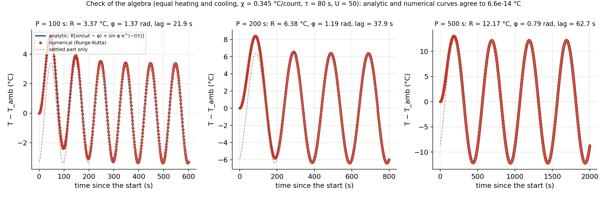

*Blue: the formula, including the start-up transient. Red dots: the numerical integration. Gray dashed: the settled part alone.*

### 4.5 When heating and cooling differ (χh ≠ χc)

The page warns that one sinusoidal guess does not solve this case, because the push is a sine only while u keeps one sign. Two facts still hold and give most of the answer.

**Fact 1: the average temperature rise, exactly.** In the settled state the temperature repeats every cycle, so the average of dθ/dt over one cycle is zero. Average the equation:

```text
avg(θ) = avg(χ(u) u) = (1/2π) ∫ χ(U sin x) · U sin x dx
                       = (U/2π) · [ χh ∫(0..π) sin x dx + χc ∫(π..2π) sin x dx ]
                       = (U/2π) · [ 2 χh − 2 χc ]  =  (χh − χc) U / π
```

This holds for any τ and any period. With the fitted values it is (0.4175 − 0.1494) × 50.0 / π = 4.27 °C; the Module 6 defaults give 3.66 °C and the
Module 4 curve (0.50127, 0.18091) gives 5.10 °C. The measured shifts are 4.13, 4.31 and 4.28 °C.

**Fact 2: the waveform, split into two pieces.** Let χavg = (χh + χc)/2 and Δχ = (χh − χc)/2, so χh = χavg + Δχ and χc = χavg − Δχ. With x = ωt the push is

```text
f = χ(u) u = χavg U sin x + Δχ U |sin x|
```

Check: where sin x > 0 this is (χavg + Δχ) U sin x = χh U sin x; where sin x < 0, |sin x| = −sin x and it is (χavg − Δχ) U sin x = χc U sin x. The plate treats each piece
separately (the equation is linear for a given f), and the pieces add up:

- **Piece 1, χavg U sin x,** is exactly the equal-susceptibility problem of section 4.3 with χ = χavg. It gives a swing of size χavg U N and lag arctan(ωτ).
- **Piece 2, Δχ U |sin x|,** is a train of bumps. Its standard Fourier series is a constant plus even harmonics only:

```text
|sin x| = 2/π − (4/π) · [ cos 2x / (1·3) + cos 4x / (3·5) + cos 6x / (5·7) + ... ]
```

Each harmonic of frequency nω goes through the same filter as before: its size is multiplied by Nn = 1/√(1 + (nωτ)²) and it is delayed by arctan(nωτ). Adding all of it:

```text
θ(t) = 2ΔχU/π                                 the mean: (χh − χc) U / π
     + χavg U N1 · sin(x − φ1)                the swing at the PWM frequency
     − (4ΔχU / 3π) N2 · cos(2x − φ2)          second harmonic, sets the lopsidedness
     − (4ΔχU / 15π) N4 · cos(4x − φ4) − ...   fourth, sixth, ... harmonics (small; no third, fifth, ... harmonic)
```

What this says about the experiment:

- the swing at the PWM frequency has the equal-susceptibility size and lag with χ replaced by the average χavg. The asymmetry does not change it;
- the asymmetry shows up as a raised average and as even harmonics. The lowest even harmonic is the 2nd, A2 = (4ΔχU / 3π) N2. The 3rd harmonic should be zero;
- the quicker the swing, the more the filter flattens the even harmonics (N2 < N1), so the lopsidedness fades at short periods. In the slow limit θ ≈ f and the peaks would be
  χh U = 20.9 °C up and χc U = 7.5 °C down.

The series was compared with numerical integration of the piecewise equation for the Module 6 defaults, the Module 4 curve and the fitted values:
the largest difference in mean, A1 and A2 is 7.1e-06 °C (the lag differs by 1.6e-03 rad, the half-sample hold of the numerical scheme).

| Period | Quantity | Measured | Equal χ (0.345, τ = 80 s) | Unequal, Module 6 defaults (0.46, 0.23, 80 s) | Unequal, fitted (0.417, 0.149, 64.3 s) |
| --- | --- | --- | --- | --- | --- |
| 100 s | mean above idle (°C) | 4.13 | 0 | 3.66 | 4.27 |
|  | A1 (°C) | 3.81 | 3.37 | 3.37 | 3.41 |
|  | lag (rad) | 1.442 | 1.374 | 1.374 | 1.328 |
|  | A2 (°C) | 0.39 | 0 | 0.24 | 0.35 |
| 200 s | mean above idle (°C) | 4.31 | 0 | 3.66 | 4.27 |
|  | A1 (°C) | 6.60 | 6.38 | 6.38 | 6.29 |
|  | lag (rad) | 1.120 | 1.192 | 1.192 | 1.111 |
|  | A2 (°C) | 0.73 | 0 | 0.48 | 0.68 |
| 500 s | mean above idle (°C) | 4.28 | 0 | 3.66 | 4.27 |
|  | A1 (°C) | 10.88 | 12.17 | 12.17 | 11.03 |
|  | lag (rad) | 0.690 | 0.788 | 0.788 | 0.680 |
|  | A2 (°C) | 1.50 | 0 | 1.09 | 1.50 |

### 4.6 Why a constant PWM amplitude cannot give a constant temperature amplitude

The swing at the PWM frequency is χavg U N(ω) with N = 1/√(1 + (ωτ)²), and N falls as ω rises. To hold the temperature amplitude at A* the PWM amplitude must grow as the period shortens:

```text
U(P) = A* / (χavg N) = (A* / χavg) · √(1 + (ωτ)²)
```

For A* = 5 °C, χavg = 0.2834 °C/count and τ = 64.3 s this is 73.4, 39.8 and 22.7 counts at 100, 200 and 500 s. This is what the later
feedforward and PI stages have to supply.

## 5. How the numbers were pulled out of the data

1. **Offsets.** The calibration offsets of `data/module_08/calibration_rod_run_20261026_112627.csv` are applied to the TEC thermistor and T1 to T5 (corrected = logged − offset). The raw CSV is not changed.
2. **Idle baseline (u = 0).** The mean and scatter of every channel over t = 40 to 171 s, before anything was switched on. The TEC mean is T_amb for the model fit and the
   reference for "mean above idle".
3. **Whole cycles only.** Each sweep is cut into whole cycles that start at phase zero (the PWM goes through zero upward). The first cycles are start-up, because the plate begins each sweep at
   the end state of the previous one. Enough start-up cycles are skipped to cover 2.5 τ with τ = 80 s: 2 cycles at 100 s, 1 cycle at 200 s, 1 cycle at 500 s. The remaining cycles are fitted together.
4. **The fit.** For the settled cycles of one sweep the TEC temperature is fitted, by linear least squares, with

```text
T(t) = a + Σ(k=1..3) [ b_k cos(kω s) + c_k sin(kω s) ] + d · s          s = t − t_mid,   ω = 2π/P
```

   `a` is the average over the cycles, `d` a slow drift in °C/s (so that a drifting baseline does not leak into the harmonics), and b_k, c_k the cosine and sine content of the k-th harmonic.
   "Least squares" means: the computer picks the numbers that make the sum of the squared misses smallest; because the unknowns enter linearly this is one matrix solution, with no guessing.
   The size of the k-th harmonic is A_k = √(b_k² + c_k²) and its phase θ_k = atan2(b_k, c_k), so the term reads A_k sin(kω s + θ_k).
5. **Lag.** The applied PWM is fitted in the same way. The lag of the temperature behind the PWM is θ_u1 − θ_T1 in radians, and Δt = lag/ω in seconds.
6. **Distortion.** THD = √(A2² + A3²)/A1. The page's "sinusoidal-fit residual" is also given: the same fit with a mean, one sinusoid and the drift only.
7. **Error bars.** The fundamental is also fitted to each whole cycle separately; the tables give the standard error of the mean over the used cycles and the half-range. With only two or three
   cycles these are lower bounds on the true uncertainty: they do not include a leftover start-up transient or the model error.
8. **Model fit to the whole record.** For a trial τ, the two unit responses h and c are computed from the recorded PWM (exact between records, u held for 0.5 s):
   τ dh/dt + h = max(u, 0) and τ dc/dt + c = min(u, 0). Then T − T_amb − (T(0) − T_amb) e^(−t/τ) = χh h + χc c is fitted for χh and χc by linear least squares, and τ is found by a one-dimensional search for the
   smallest RMS misfit. The record used is every schedule sample (the start-up cycles included).

The uncertainty of the rod positions and the rod fits are not part of the S18.3 question; the rod sensors are used once, as a cross-check, in section 8.

## 6. Results

### 6.1 Idle data (u = 0)

| Channel | Mean (°C) | Scatter, sd (°C) | Samples |
| --- | --- | --- | --- |
| TEC | 24.454 | 0.011 | 244 |
| T1 | 24.291 | 0.008 | 244 |
| T2 | 24.194 | 0.006 | 244 |
| T3 | 24.204 | 0.002 | 244 |
| T4 | 24.157 | 0.005 | 244 |
| T5 | 24.215 | 0.003 | 244 |

The rod sensors average 24.21 °C; the TEC thermistor reads 0.24 °C higher. The scatter of a channel is a few thousandths to about a hundredth of a °C, so the
amplitudes below are far above the noise.

### 6.2 Sign check

In the first half of sweep 1 the PWM averaged +37.9 counts and the TEC went from 25.51 to 32.45 °C (+6.94 °C): **positive PWM heats**.
In the second half it averaged −38.1 counts and the TEC went from 32.45 to 24.79 °C (−7.66 °C): **negative PWM cools**. This is the signed-PWM convention the page asks to verify.

### 6.3 The whole record

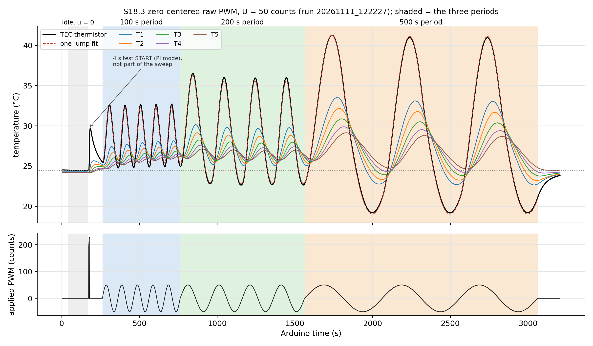

*Top: TEC thermistor (black), the one-lump fit (red dashed) and the five rod sensors. Bottom: the applied PWM. Shaded: idle, then the three sweeps. The spike near 175 s is the test START in PI mode.*

### 6.4 Settled cycles, and how sinusoidal they are

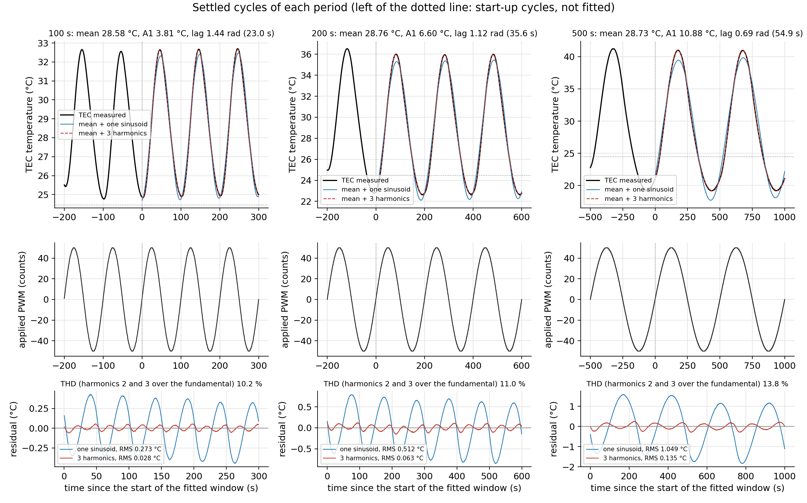

*Top: measured TEC temperature (black), the mean-plus-one-sinusoid fit (blue) and the mean-plus-three-harmonics fit (red dashed). Middle: the applied PWM. Bottom: what is left over by each fit.*

| Period | Cycles (skipped, used) | A1 (°C) | A1 sem / half-range (°C) | Lag (rad) | Lag sem / half-range (rad) | A2/A1 | A3/A1 | THD | Residual, 3 harmonics (°C) | Residual, one sinusoid (°C) | One-sinusoid residual / (A1/√2) |
| --- | --- | --- | --- | --- | --- | --- | --- | --- | --- | --- | --- |
| 100 s | 2, 3 | 3.812 | 0.003 / 0.005 | 1.4422 | 0.0003 / 0.0005 | 10.2 % | 0.10 % | 10.2 % | 0.028 | 0.273 | 10.1 % |
| 200 s | 1, 3 | 6.601 | 0.010 / 0.017 | 1.1197 | 0.0019 / 0.0032 | 11.0 % | 0.16 % | 11.0 % | 0.063 | 0.512 | 11.0 % |
| 500 s | 1, 2 | 10.878 | 0.012 / 0.012 | 0.6898 | 0.0007 / 0.0007 | 13.8 % | 0.11 % | 13.8 % | 0.135 | 1.049 | 13.6 % |

The third harmonic is the quietest, as the series of section 4.5 says it should be. What the three-harmonic fit leaves is mostly the fourth and sixth harmonics, which the model predicts:

| Period | Residual of the three-harmonic fit (°C RMS) | RMS of the model's 4th, 6th, 8th, ... harmonics (°C) | Model's 4th harmonic amplitude (°C) |
| --- | --- | --- | --- |
| 100 s | 0.028 | 0.026 | 0.035 |
| 200 s | 0.063 | 0.052 | 0.070 |
| 500 s | 0.135 | 0.125 | 0.168 |

Cycle by cycle (fundamental fit to each whole cycle), which shows the start-up:

| Period | Cycle | Used in the fits | Mean (°C) | A1 (°C) | Lag (rad) |
| --- | --- | --- | --- | --- | --- |
| 100 s | 1 | no (start-up) | 28.625 | 3.741 | 1.3893 |
| 100 s | 2 | no (start-up) | 28.470 | 3.807 | 1.4494 |
| 100 s | 3 | yes | 28.549 | 3.817 | 1.4451 |
| 100 s | 4 | yes | 28.584 | 3.808 | 1.4445 |
| 100 s | 5 | yes | 28.612 | 3.807 | 1.4455 |
| 200 s | 1 | no (start-up) | 29.396 | 6.591 | 1.0351 |
| 200 s | 2 | yes | 28.780 | 6.617 | 1.1168 |
| 200 s | 3 | yes | 28.745 | 6.583 | 1.1233 |
| 200 s | 4 | yes | 28.759 | 6.607 | 1.1185 |
| 500 s | 1 | no (start-up) | 29.093 | 10.972 | 0.6562 |
| 500 s | 2 | yes | 28.741 | 10.888 | 0.6909 |
| 500 s | 3 | yes | 28.719 | 10.863 | 0.6894 |

### 6.5 Excursions and slopes

| Period | Highest T (°C) | Lowest T (°C) | Highest − mean (°C) | Mean − lowest (°C) | Ratio | Steepest rise (°C/s) | Steepest fall (°C/s) | Ratio |
| --- | --- | --- | --- | --- | --- | --- | --- | --- |
| 100 s | 32.70 | 24.84 | 4.12 | 3.74 | 1.10 | +0.284 | −0.208 | 1.37 |
| 200 s | 36.00 | 22.64 | 7.24 | 6.12 | 1.18 | +0.245 | −0.192 | 1.27 |
| 500 s | 41.01 | 19.18 | 12.28 | 9.55 | 1.29 | +0.161 | −0.143 | 1.13 |

The slopes are those of the three-harmonic fit (differentiating the raw 0.5 s data would mostly give noise). The highest temperature reached by the TEC in the settled
cycles is 41.01 °C, below the safety limits (TEC 65 °C, T1 56 °C).

### 6.6 Temperature against the PWM

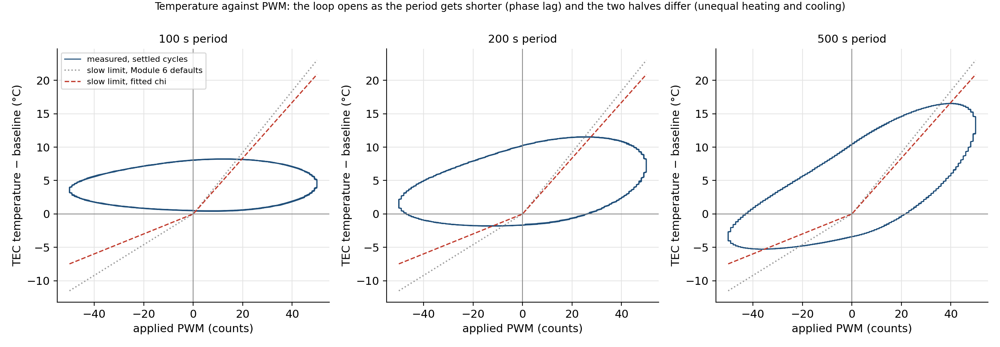

*Each loop is the settled cycles. If the plate answered instantly, the points would lie on the bent line T − baseline = χ(u) u (steeper for u > 0). The loop opens as the period gets shorter (phase lag) and the whole loop sits above the
center (the raised average). The dotted line uses the Module 6 defaults, the dashed line the fitted χ.*

### 6.7 Trends with the period, and the fitted model

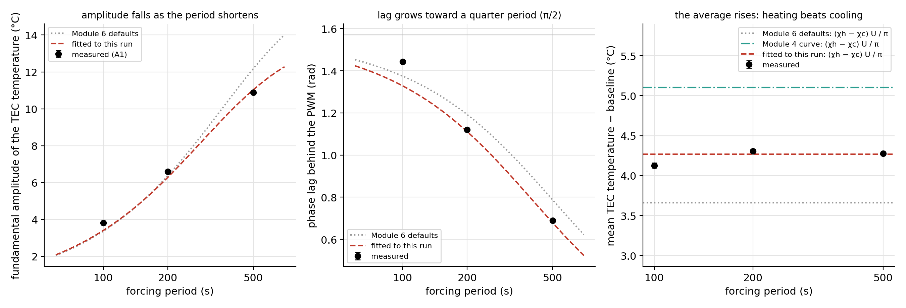

*Left: fundamental amplitude. Middle: lag. Right: mean above the idle baseline. Black dots: measured (bars: half-range of the cycles). Dotted: Module 6 defaults. Dashed: fitted values. Dash-dot (right): Module 4 curve.*

| Parameter set | χh (°C/count) | χc (°C/count) | χh/χc | τ (s) | T_amb (°C) | Mean shift (χh − χc) U/π (°C) |
| --- | --- | --- | --- | --- | --- | --- |
| fitted to this run | 0.4175 | 0.1494 | 2.79 | 64.3 | 24.45 | 4.27 |
| Module 6 simulation defaults | 0.46 | 0.23 | 2.00 | 80 | 22 | 3.66 |
| Module 4 curve (GUI and sketch defaults) | 0.50127 | 0.18091 | 2.771 | (not part of the curve) |  | 5.10 |

The fit's RMS misfit over the 5239 schedule samples is 0.241 °C. Only the ratio χh/χc agrees closely with Module 4; the absolute values are 9 % (χh) and 35 % (χc)
below the Module 6 defaults and τ is 64.3 s instead of 80 s. The defaults are simulation values; this run has the rod attached and a different room temperature (24.5 °C instead of 22 °C).

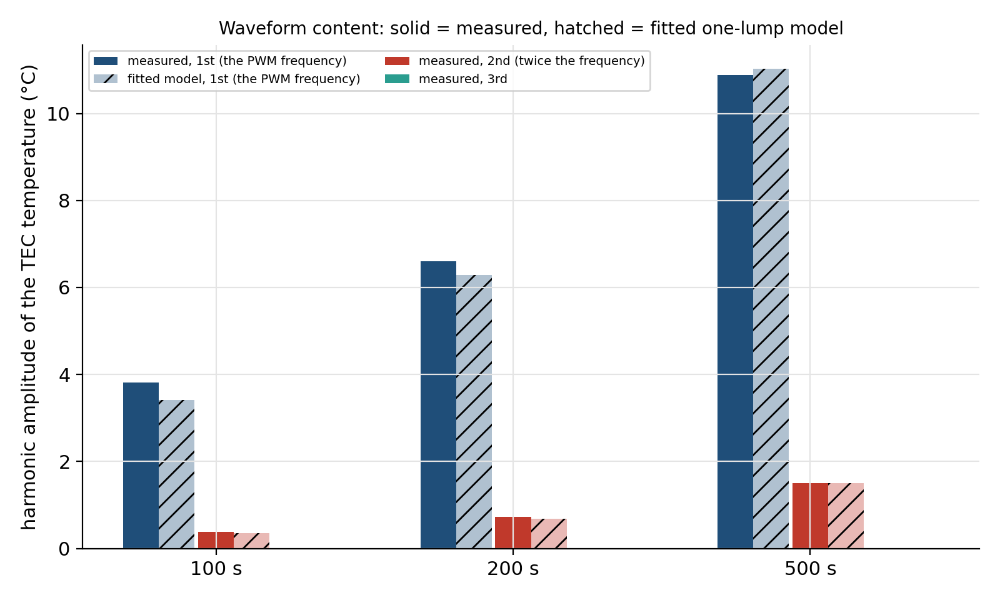

*Harmonic content of the TEC temperature: solid, measured; hatched, fitted model.*

Where the single-τ model falls short: inverting the equal-susceptibility formulas on each measured amplitude (with χavg from the fit) and on each lag gives the time constant each measurement implies:

| Period | Measured A1 / model A1 | Measured lag − model lag (rad) | τ implied by the amplitude (s) | τ implied by the lag (s) |
| --- | --- | --- | --- | --- |
| 100 s | 1.119 | +0.114 | 57.0 | 123.1 |
| 200 s | 1.049 | +0.009 | 60.5 | 65.7 |
| 500 s | 0.986 | +0.010 | 66.5 | 65.7 |

The amplitudes imply τ between 57 and 66 s, rising with the period, and the lags at 200 and 500 s imply 66 s and 66 s. At the shortest period the lag is
0.11 rad (1.8 s) longer than the single-τ model gives, and the lag is a very insensitive way to find τ there (ωτ is about 4.0).
A plate-plus-rod system with more than one time constant would do this (the quick swing sees the fast part, the slow swing the whole system); a short extra delay, such as heat reaching the thermistor, would too.
These are explanations that fit, not ones tested in this run.

## 7. Answers to the questions on the page

**How do you expect the temperature to respond?** A temperature swing at the PWM's own frequency, smaller and later than the push, increasingly so as the period shortens:
amplitude χavg U N and lag arctan(ωτ). With the Module 6 defaults and equal susceptibility (0.345 °C/count) that predicts A1 = 3.37, 6.38, 12.17 °C and lags of
21.9, 37.9, 62.7 s at 100, 200 and 500 s, swinging around room temperature. Because heating is stronger than cooling, the average should also rise and the up-swings should exceed the down-swings.

**How do the amplitude and the phase lag change with the period?** The ratio of the sluggishness to the swing time, ωτ, grows as the period shortens
(with the fitted τ it is 4.0, 2.0 and 0.8 at 100, 200 and 500 s). That has two effects. The shrink factor N falls, so the amplitude falls:
10.88, 6.60 and 3.81 °C from the longest to the shortest period. The lag angle φ = arctan(ωτ) rises toward a quarter cycle (π/2 = 1.57 rad):
0.69, 1.12 and 1.44 rad. In seconds the delay φ/ω does the opposite: it tends to a quarter of the period for a very quick swing (P/4 = 25 s at 100 s; measured 23.0 s)
and to τ for a very slow one (τ = 64 s; measured 54.9 s at 500 s).

**Does it meet the expectation?** The shape of the answer does; the details need the unequal susceptibilities.
- The amplitude is 3.81, 6.60 and 10.88 °C against 3.37, 6.38 and 12.17 °C from the equal-susceptibility formula with the default τ: +13 %, +3 % and −11 %. The trend (growing with the period) is as predicted.
- The lag is 23.0, 35.6 and 54.9 s against 21.9, 37.9 and 62.7 s: the same pattern, in seconds growing with the period and in radians shrinking.
- The average is +4.13 to +4.31 °C above the idle baseline, not zero. The equal-susceptibility solution cannot produce that; the unequal-susceptibility result of section 4.5 does (+4.27 °C with the fitted values).
- After fitting χh, χc and τ to the record, the model reproduces the measured mean, A1 and A2 to within 6 % at 200 and 500 s and to within 12 % at 100 s (section 6.7).

**Unequal excursions, slopes, phase lag and distortion** (sections 6.4 to 6.6):
- excursions: the temperature goes 4.12, 7.24 and 12.28 °C above its mean and 3.74, 6.12 and 9.55 °C below it, a ratio of 1.10, 1.18 and 1.29.
  The ratio grows with the period toward the slow-limit value χh/χc = 2.79, because a slow plate follows the push more faithfully;
- slopes: the steepest rise is 1.37, 1.27 and 1.13 times the steepest fall;
- phase lag: 1.44, 1.12 and 0.69 rad, i.e. 23.0, 35.6 and 54.9 s;
- distortion: THD 10.2 %, 11.0 % and 13.8 %, almost all of it the second harmonic.

**Which departures from the equal-susceptibility prediction come from unequal heating and cooling?** The raised average, the lopsided peaks and slopes, and the second harmonic. The size of the swing at the PWM frequency and its lag do not:
section 4.5 shows they depend only on the average χavg and on τ. A likely physical reason for χh > χc is Joule heating in the thermoelectric module: the current heats the module in either direction, so it adds to the Peltier effect when the plate is being
heated and works against it when the plate is being cooled. That reason was not tested here.

**How well does open-loop, uncompensated sinusoidal PWM give a sinusoidal temperature with a constant amplitude, independent of frequency?** Two separate properties are involved.
- *How nearly sinusoidal.* Reasonably, not exactly. A single sinusoid leaves a residual of 0.27, 0.51 and 1.05 °C RMS (10 %, 11 % and 14 % of the swing's RMS),
  almost entirely the second harmonic. This is a shape error caused by χh ≠ χc, and it gets worse, in relative terms, at longer periods.
- *How constant the amplitude is.* Not at all: A1 changes by a factor 2.85 between 100 and 500 s although U is fixed. This is a size error caused by the thermal lag, and it would remain even with equal susceptibilities.

**Is a constant PWM amplitude sufficient for a constant temperature amplitude? No.** The plate is a first-order low-pass filter with shrink factor N = 1/√(1 + (ωτ)²), which depends on frequency. The PWM amplitude has to be raised as the period shortens, as U(P) in section 4.6,
and the asymmetry would still need compensating. That is the job of the feedforward and feedback stages that follow.

## 8. A cross-check from the rod (bonus)

The raw-PWM wave also travels down the aluminum rod. Treating the fundamental at each of T1 to T5 like the Angstrom method does (ln amplitude and unwrapped phase against position, the same fits as in the production-run analysis):

| Period | q (1/m) | q′ (1/m) | κ = ω / (2 q q′) (10⁻⁵ m²/s) | T1 amplitude (°C) | T5 amplitude (°C) |
| --- | --- | --- | --- | --- | --- |
| 100 s | 18.98 | 17.82 | 9.29 | 1.004 | 0.148 |
| 200 s | 13.65 | 12.72 | 9.05 | 2.319 | 0.585 |
| 500 s | 9.29 | 8.04 | 8.41 | 5.161 | 2.022 |

These are of the size of the production-run Angstrom result, 9.12 ± 0.09 × 10⁻⁵ m²/s (`Sammy_Module_8_Production_Run_Summary.md`), and agree with each other within 10 %. They rest on two or three cycles and on a TEC boundary that is neither zero-mean nor purely
sinusoidal, so they are a consistency check, not a second measurement of κ.

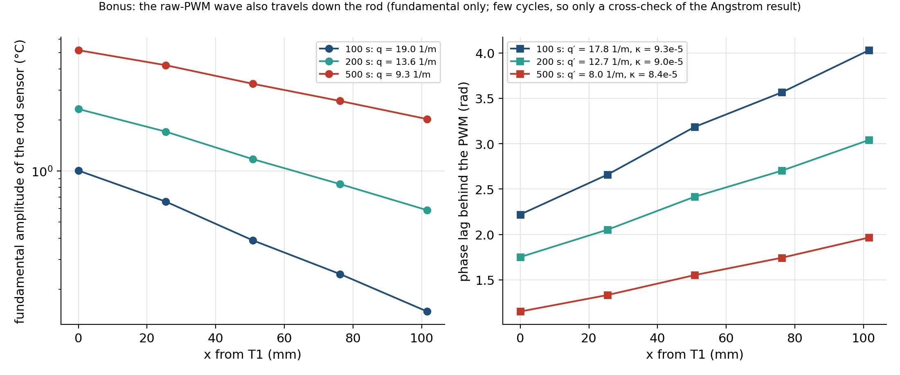

## 9. Limits of this run

- U = 50 counts is assumed (the number was lost from the pasted page; it is the sketch default and the PWM measures 50.0). The equal-susceptibility value of the page is also lost; section 4.4 gives the results for three values.
- Settled cycles per period: 3, 3 and 2. The sweep was sized to fit the available time (46.7 min). The error bars in the tables are cycle-to-cycle scatter of two or three cycles and are lower bounds.
- The start-up cycles are skipped by a rule (2.5 τ with the default τ). With the fitted τ = 64.3 s the skipped time is 3.1 to 7.8 τ, so a small remainder of the start-up can be left (e^(−3.1) is 4 %); the drift term of the fit absorbs the slow part of it.
- The one-lump model is an approximation. With one τ it misses the amplitude by up to about 12 % at 100 s and the lag by about 0.11 rad there (section 6.7). The fitted χ and τ are those of this plate, rod and room, not universal values.
- T_amb in the fit is the idle TEC reading (24.45 °C), not the Module 6 default (22 °C); the rod sensors read 0.24 °C lower at idle.
- One run on one rod. S18.4 (positive-only PWM) is not covered here, it has its own page, and the page's remaining open-loop, P and PI comparisons are separate runs.
- The photos are of the GUI display and are not data; the data are the CSV records they quote.

## 10. The series of PWM runs, and what comes next

| Run | PWM command | What it shows | Status |
| --- | --- | --- | --- |
| idle | u = 0 | room temperature and sensor noise | done (this file, section 6.1) |
| S18.3 | u = 50 sin(2π t/P), U0 = 0, P = 100, 200 and 500 s | uncompensated response; effect of unequal heating and cooling | done (this file) |
| S18.4 | u = U0 + U sin(2π t/P) with U0 = U, so u ≥ 0 | the response when the current never reverses; separates the polarity asymmetry from other imperfections | not yet run; has its own page (link below) |
| S18.5 to S18.8 | feedforward, P and PI control of a requested sine | tracking at 100, 200 and 500 s | the PI part was run on 10 November (production run) |

S18.4 has its own page, [Sammy_Module_8_S18_4_Positive_Only_PWM_Walkthrough.md](Sammy_Module_8_S18_4_Positive_Only_PWM_Walkthrough.md): the math, the series of steps for the run and the predictions
made from this run.

## 11. Files and how to reproduce

- Run: `data/module_08_sammy/sammy_angstrom_live_20261111_122227.csv` (with `_events.txt`, `_meta.json`, `_notes.csv`).
- Tables: `data/module_08_sammy/s183_analysis_20261111_122227/`: `s183_by_period.csv`, `s183_cycle_fits.csv`, `s183_model_fit.csv`, `s183_predictions.csv`, `s183_equal_chi.csv`, `s183_idle_baseline.csv`, `s183_rod_by_period.csv`, `s183_summary.json`.
- Figures: `docs/figures/module_08_sammy/20261111_122227_s183_*.png` (overview, periods, push_vs_response, pwm_vs_temperature, trends, harmonics, theory_check, rods).

```bash
python3 python/sammy_module8_s183_analysis.py data/module_08_sammy/sammy_angstrom_live_20261111_122227.csv
```

The script needs numpy and matplotlib. It reads the calibration offsets and the sensor map from the repository and rewrites the tables, the figures and this document.

## AI assistance

The acquisition GUI changes, the analysis script, the figures and this walkthrough were produced with GitHub Copilot assistance and checked against the Module 8 page, the Module 6 model
and the recorded run. The derivations in section 4 were also verified numerically (sections 4.4 and 4.5).
