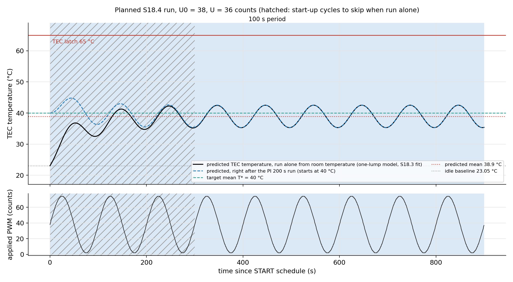
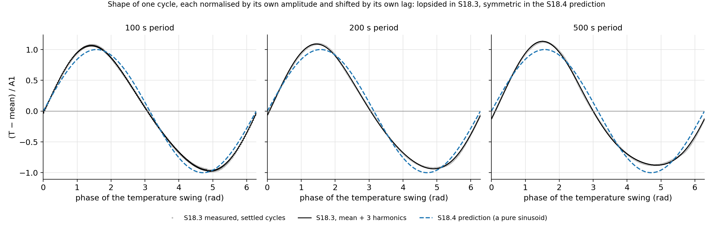

# Module 8, S18.4: positive-only sinusoidal PWM, step by step (SAMMY copy)

A page prepared before the S18.4 run. **No S18.4 data have been recorded yet**, so every number below is a prediction. It is made from the S18.3 run
`sammy_angstrom_live_20261111_122227.csv` (the Module 6 one-lump model fitted to it) and from the PI hold of 10 November (`sammy_angstrom_live_20261110_164057.csv`). Once the S18.4 file exists,
these predictions are what it is compared with. Companion page: [Sammy_Module_8_S18_3_Raw_PWM_Walkthrough.md](Sammy_Module_8_S18_3_Raw_PWM_Walkthrough.md).
Figures: `docs/figures/module_08_sammy/s184_*.png`. Kapil Naidu's acquisition code, analysis scripts and data are unchanged; everything here is an addition.

Run specification, from Kapil Naidu's gap analysis of 16 November (commit `a1c84f5`): positive-only PWM at 100 s, mean TEC temperature near 40 °C, U0 = 38 and U = 36 counts,
schedule `900 40 0 100`. The first version of this page (11 November) assumed U0 = U = 36 and three periods; this version (16 November, written before run 2 of the plan started) follows the specification. T* = 40 °C is also the mean of the sketch's default
setpoint (Ta = 40 °C); section 4 gives the formula and a table for other targets.

## 0. The question, and the short answer

S18.3 swung the PWM around zero, u = U sin(ωt), so the current reversed twice per cycle. S18.4 swings it around an offset U0 that is at least U:

```text
u(t) = U0 + U sin(ωt)         U0 − U ≤ u ≤ U0 + U, never negative because U0 ≥ U
```

The TEC now only heats. The page asks to adjust the PWM until the mean TEC temperature is about T*, to keep the swing safe, and to compare with S18.3, so as to decide
which of the S18.3 asymmetries come from reversing the TEC current and which are still there when the current keeps one direction.

**Predictions for U0 = 38, U = 36 counts** (u from 2 to 74), room temperature 23.05 °C. Only the 100 s period is planned; the other two rows are the same model at the S18.3 periods:

| Period | Shrink factor N | Amplitude A1 (°C) | Lag behind the PWM | Highest TEC (°C) | Lowest TEC (°C) | Highest T1 (°C, estimate) |
| --- | --- | --- | --- | --- | --- | --- |
| 100 s | 0.240 | 3.61 | 1.328 rad = 21.1 s | 42.5 | 35.3 | 35.5 |
| 200 s | 0.444 | 6.67 | 1.111 rad = 35.4 s | 45.6 | 32.2 | 36.9 |
| 500 s | 0.778 | 11.69 | 0.680 rad = 54.1 s | 50.6 | 27.2 | 40.1 |

1. **The mean is set by χh and U0, not by an asymmetry.** It is T_amb + χh U0 = 38.9 °C with the S18.3 fit (χh = 0.417 °C/count), at every period.
   The 10 November PI hold gives 40.0 °C for the same U0. Both are within 1.1 °C of the target.
2. **The amplitude is χh U N,** 3.6, 6.7 and 11.7 °C, and **the lag is the same arctan(ωτ) as in S18.3.** The amplitude grows with the period for the same
   reason as before (the plate is a low-pass filter).
3. **The waveform should be a clean sinusoid.** In the model, the second harmonic, the unequal peaks and the unequal slopes of S18.3 come from using two different
   susceptibilities (χh for u > 0, χc for u < 0). With one sign of u there is one susceptibility and they vanish. The S18.4 run tests this.
4. **It is safe by a wide margin.** The highest TEC temperature is about 43 °C at the planned 100 s period (latch 65 °C); T1 stays near 35 °C (latch 56 °C).
5. **Run 900 s at 100 s** (15.0 min, 9 cycles): the model skips the first 3 start-up cycles when it starts from room temperature and the first 2 when it follows the PI 200 s run of the plan (section 5).

## 1. Words and symbols

The symbols u, U, P, ω, T, T_amb, θ = T − T_amb, χh, τ, N, φ and A1 to A3 are explained in the S18.3 page. The new ones:

| Symbol | In plain words |
| --- | --- |
| U0 | the offset: the level the knob swings around. Here U0 = 38 and U = 36, so the knob swings between 2 and 74 and never goes below zero |
| T* | the mean TEC temperature we want (here 40 °C) |
| mean rise | χh U0: how much hotter than the room the plate sits on average |
| N = cos φ | the shrink factor 1/√(1 + (ωτ)²). It equals cos φ, because φ = arctan(ωτ), so a measured lag gives N directly |

The bathtub of the S18.3 page again. In S18.3 the tap swung from hot to cold, and the hot tap was stronger. Now only the hot tap is used: it swings between
"off" and "full", so the water level moves up and down around a high average level. The tub is always being warmed; only the amount changes.

## 2. The series of steps for the run

Everything needed is already in the sketch (`SET U`, `SET U0`, mode RAW) and in the GUI.

**One click.** START PLAN in the "One long run" box runs this as run 2 of 3 (PI 200 s, this run, PI 400 s): it sets mode RAW, U = 36 and U0 = 38,
sends `900 40 0 100` and starts it when run 1 reports `SCHEDULE DONE`. **By hand** (this run alone):

1. **Baseline.** Start the GUI (`python3 python/sammy_module8_angstrom_gui.py`) and leave the rig untouched for 2 minutes with nothing started (u = 0). Read the mean of
   T1 to T5 and type it into the note box with the real number, for example `room T baseline 24.3 C (mean of T1-T5, hands off)`.
2. **Settings.** Set mode to RAW. In the RAW mode box set U = 36 and U0 = 38. Click Send settings, then GET, and check that the `# SETTINGS` line shows
   `mode=RAW`, `U=36.0` and `U0=38.0`.
3. **Schedule.** Type this line in the schedule box (Ta and Tb are ignored in RAW but must be typed). The label under the box should say 1 steps, 15.0 min.
   Click Send schedule and check the listed steps.

```text
900 40 0 100
```

4. **Start.** Type the note `S18.4 start, U0 = 38, U = 36` and click START schedule. The applied PWM plot should swing between 2 and 74 counts and never go below 0.
5. **Watch the run.** The TEC should climb to about 38.9 °C within 3 cycles and then swing between about 35 and 43 °C.
   If the mean of the last three cycles is more than about 2 °C from 40 °C, the new offset is U0 = U0_old × (T* − T_amb) / (T_mean − T_amb). The run can be finished anyway, because
   the data are still good for the comparison (section 7), and repeated with the new U0 (and U scaled with it) if the target mean is required.
6. **Safety.** Press STOP if the TEC passes 56 °C or T1 passes 50 °C; the board latches at 65 and 56 °C and sets the output to 0 on its own.
7. **End.** After the last step the output goes to 0 (`SCHEDULE DONE`). Type the note `S18.4 finished`, close the GUI, and check the file with Check a saved file.

## 3. The math, one step at a time

### 3.1 The push now has one sign

```text
u(t) = U0 + U sin ωt,   U0 − U ≤ u ≤ U0 + U,   so χ(u) = χh at every moment
τ · dθ/dt + θ = χh (U0 + U sin ωt)                              (S18.4.1)
```

Compare with S18.3: the push gained a constant, and the two susceptibilities χh and χc have become one, χh. The equation is linear again, with no |sin| and no case split.

### 3.2 Split the push in two

The push is χh U0 (a constant) plus χh U sin ωt (a swing). The equation is linear, so the plate's answer to a sum of pushes is the sum of its answers to each push alone.

### 3.3 The constant push

Try a constant θc. Then dθc/dt = 0 and the equation says θc = χh U0. In words: hold the knob at U0 forever and the plate ends up χh U0 hotter than the room.

### 3.4 The swinging push (the S18.3 steps, with χ = χh)

```text
guess      θs = a sin ωt + b cos ωt                       dθs/dt = a ω cos ωt − b ω sin ωt
put in     (a − ωτ b) sin ωt + (ωτ a + b) cos ωt = χh U sin ωt
match      sine: a − ωτ b = χh U        cosine: ωτ a + b = 0
solve      b = −ωτ a,   a = χh U / (1 + (ωτ)²)
one sine   θs = R sin(ωt − φ),   R = √(a² + b²) = χh U / √(1 + (ωτ)²) = χh U N,   tan φ = ωτ
```

### 3.5 The start-up piece, and the whole answer

A pure leak dies away as e^(−t/τ), and adding C e^(−t/τ) to a solution does not break the equation. So θ(t) = χh U0 + R sin(ωt − φ) + C e^(−t/τ). The plate starts at the idle
baseline, θ(0) = 0 (a plate that starts warm, θ(0) > 0, only changes C):

```text
0 = χh U0 + R sin(−φ) + C   →   C = −χh (U0 − U N sin φ)
θ(t) = χh · [ U0 + U N sin(ωt − φ) − (U0 − U N sin φ) e^(−t/τ) ]
```

### 3.6 Check the answer

```text
constant piece:   τ · 0 + χh U0 = χh U0                                    satisfies the equation
swinging piece:   verified in the S18.3 page (section 4.4)
start-up piece:   τ d/dt(C e^(−t/τ)) + C e^(−t/τ) = −C e^(−t/τ) + C e^(−t/τ) = 0
start:            θ(0) = χh (U0 − U N sin φ) − χh (U0 − U N sin φ) = 0
```

The equation was also integrated numerically (fourth-order Runge-Kutta, 0.05 s steps) from θ = 0 for the three periods with U0 = 38 and U = 36 and compared with the formula at every step;
the largest difference is 1.6e-13 °C, which is rounding error.

### 3.7 Read the settled solution

```text
mean            T_amb + χh U0                 the constant piece, the same at every period
amplitude       R = χh U N = (χh U) cos φ     a fraction N of the swing χh U
lag             φ = arctan(ωτ), delay φ/ω     the same as in S18.3: it comes from τ, not from χ
highest/lowest  T_amb + χh (U0 ± U N)         symmetric about the mean
shape           a pure sinusoid in this model
```

A slow swing (N near 1) uses the whole range of the knob, from T_amb + χh (U0 − U) to T_amb + χh (U0 + U); a quick swing (N small) hardly leaves the mean. At 100 s,
N = 0.24, so the plate is predicted to swing 35 to 43 °C around a mean of 38.9 °C; at 500 s (N = 0.78) it would swing 27 to 51 °C. This is why "a safe amplitude" matters here: with U close to U0 the swing is tied to the mean.

## 4. Choosing U0 and U

The mean is T_amb + χh U0 whatever the period, so the offset that gives a mean T* is:

```text
U0 = (T* − T_amb) / χh
```

Three estimates of the offset that holds a mean of 40 °C when the room is at 23.05 °C:

| Source | What it says | U0 (counts) |
| --- | --- | --- |
| Module 4 steady-state curve (the GUI default) | χh = 0.50127 °C/count | 33.8 |
| S18.3 fit (this rig, rod attached) | χh = 0.4175 °C/count | 40.6 |
| 10 November PI hold | the controller held the TEC at 40.05 °C with 36.9 counts on average (sd 0.3; last 100 s of the 5 minute hold, drift 0.004 °C/min) when the TEC idled at 23.58 °C, so χh = 0.447 °C/count | 37.9 |

The Module 4 curve asks for fewer counts because it overestimates this rig's χh. The other two agree within 7 %. **Kapil's U0 = 38** gives 38.9 °C with the S18.3 fit and 40.0 °C with the PI hold.
The swing U = 36 sets the amplitude (χh U N), not the mean, and U ≤ U0 keeps u ≥ 0.
An error of 10 % in χh moves the mean by 1.6 °C. The room temperature moves it one for one: on 10 November the idle TEC reading drifted by 0.4 °C in three minutes.

For another target mean the same recipe gives (U0 is the mean of the S18.3-fit and the PI-hold estimates, rounded; U = U0 − 2 as in the plan):

| T* (°C) | U0 (counts) | U (counts) | A1 at 100 s (°C) | A1 at 200 s (°C) | A1 at 500 s (°C) | Highest TEC at 500 s (°C) | Safety |
| --- | --- | --- | --- | --- | --- | --- | --- |
| 30 | 16 | 14 | 1.4 | 2.6 | 4.5 | 34 | ok |
| 35 | 28 | 26 | 2.6 | 4.8 | 8.4 | 43 | ok |
| 40 | 39 | 37 | 3.7 | 6.9 | 12.0 | 51 | ok |
| 45 | 51 | 49 | 4.9 | 9.1 | 15.9 | 60 | above 56 °C, not advised |
| 50 | 62 | 60 | 6.0 | 11.1 | 19.5 | 68 | above the TEC latch |

## 5. What to expect



*The model response to the planned schedule. Black: run alone from room temperature (hatched: the start-up cycles skipped in that case). Blue dashed: right after the PI 200 s run, starting at 40 °C. Green dashed: the target mean. Red dotted: the predicted mean. Red solid: the TEC latch.*

**Start-up.** Run alone, the plate starts at the room temperature and has to climb 16 °C to the mean; the leftover of that climb at the start of a cycle is
C e^(−t/τ) with |C| = 12.4 °C. Right after the PI 200 s run of the plan the TEC starts near 40 °C (an assumption: run 1 ends at its 40 °C setpoint) and |C| = 4.6 °C.
Counting a cycle as settled once the model's start-up error is below 0.2 °C gives:

| Way of running | Cycles | Start-up error at the start of cycle 1, 2, 3, 4 (°C) | Cycles to skip | Settled cycles |
| --- | --- | --- | --- | --- |
| alone, from room temperature | 9 | 12.36, 2.61, 0.56, 0.12 | 3 | 6 |
| after the PI 200 s run, from 40 °C | 9 | 4.59, 0.96, 0.20, 0.04 | 2 | 7 |

S18.3 had 3, 3 and 2 settled cycles; this run should give 6 (alone) or 7 (in the plan), at least the five the course page asks for.

**Safety.** The highest values in the table of section 0 are the model's; the T1 estimate scales the S18.3 rod response (T1 amplitude over TEC amplitude 0.26, 0.35, 0.47; mean rise of T1 over mean rise of the TEC up to 0.73) and is good to a degree or two.

## 6. S18.3 against S18.4

|  | S18.3 (U0 = 0, U = 50) | S18.4 (U0 = 38, U = 36) |
| --- | --- | --- |
| PWM range | −50 to +50 counts | 2 to 74 counts |
| susceptibility that acts | χh when u > 0, χc when u < 0 | χh all the time |
| mean above the room | (χh − χc) U / π, from the asymmetry | χh U0, the plain heating |
| amplitude of the swing | χavg U N, with χavg = (χh + χc) / 2 | χh U N |
| lag | arctan(ωτ) | arctan(ωτ) |
| second harmonic | (4 Δχ U / 3π) N2, Δχ = (χh − χc) / 2 | 0 |
| peaks above / dips below the mean | more than 1 | 1 |

With the numbers (S18.3 measured; S18.4 predicted for U0 = 38, U = 36):

|  | S18.3 100 s | S18.3 200 s | S18.3 500 s | S18.4 100 s (planned) | S18.4 200 s (model) | S18.4 500 s (model) |
| --- | --- | --- | --- | --- | --- | --- |
| mean above the room (°C) | 5.53 | 5.71 | 5.68 | 15.86 | 15.86 | 15.86 |
| amplitude A1 (°C) | 3.81 | 6.60 | 10.88 | 3.61 | 6.67 | 11.69 |
| lag (s) | 23.0 | 35.6 | 54.9 | 21.1 | 35.4 | 54.1 |
| A2 / A1 | 10.2 % | 11.0 % | 13.8 % | 0 % | 0 % | 0 % |
| peaks above / dips below | 1.10 | 1.18 | 1.29 | 1.00 | 1.00 | 1.00 |
| steepest rise / steepest fall | 1.37 | 1.27 | 1.13 | 1.00 | 1.00 | 1.00 |



*One cycle of the settled S18.3 data (gray dots, black fit), each normalised by its own amplitude and shifted by its own lag, against the pure sinusoid predicted for S18.4 (blue dashed). The taller, earlier peak and the shallower, flatter trough of the S18.3 curves are the second harmonic.*

**How to read the result when it exists.** The S18.3 distortions are the reference; what S18.4 still shows is not caused by reversing the current.

| Feature | S18.3 measured | S18.4 if reversing the current were the only cause | If S18.4 still shows it |
| --- | --- | --- | --- |
| second harmonic A2/A1 | 10 %, 11 %, 14 % | about 0 % | the heating response itself is not linear in u (for example Joule heating grows as u²) |
| peaks above / dips below | 1.10, 1.18, 1.29 | 1.00 | the same cause: the heating response is not linear in u |
| mean rise against χh U0 | not applicable (two χ) | T_amb + χh U0 = 38.9 °C | χh depends on u (the PWM now reaches 74 counts), or the room temperature changed |
| amplitude against the single-τ prediction | +12 %, +5 %, −1 % | no change expected from polarity | the same deviations mean the plate and rod are not one lump |
| lag against arctan(ωτ) | +0.11 rad, +0.01 rad, +0.01 rad | no change expected from polarity | the same, a property of the thermal system |

## 7. After the run: what to compute

Fit the settled whole cycles of each step exactly as in S18.3 (mean, three harmonics, drift; the lag against the PWM). Then, with the measured mean, A1 and lag φ at each period:

```text
χh from the mean        χh = (T_mean − T_amb) / U0
χh from the swing       χh = A1 / (U cos φ)             (N = cos φ, so the measured lag removes τ)
τ from the lag          τ = tan φ / ω
distortion              A2/A1, peaks above / below the mean, steepest rise / fall
```

If the one-lump model with one heating susceptibility holds, the two χh agree with each other and with the S18.3 fit (0.417 °C/count) and τ is near 64 s. The measured mean should be within a
degree or two of the target. The tables, figures and comparison with the S18.3 page are produced from the S18.4 file by an analysis script that is still to be written;
it needs only the heating-only version of the S18.3 fits, because there is no cooling branch to fit.

## 8. Limits of these predictions

- No S18.4 run exists. T* = 40 °C and the room temperature of 23.05 °C (the idle TEC reading before the 16 November plan started) are assumptions; use the numbers of the day.
- χh is taken constant. S18.3 covered u from 0 to 50 counts, S18.4 goes to 74; the 10 November hold at 37 counts supports the value, but the response between 50 and 74 counts has not been measured.
- The one-lump model missed the S18.3 amplitude by +12 %, +5 % and −1 % and the lag by +0.11 rad at 100 s, so the amplitudes and lags above are good to about 10 %.
- The T1 numbers scale the S18.3 rod response and are estimates.
- In the plan the run starts right after the PI 200 s run, so the plate and the rod start warm. The model treats the plate only (one lump, starting at 40 °C); the warm rod is not in it, so the start-up estimate for that case is rougher.

## 9. Files and how to reproduce

```bash
python3 python/sammy_module8_s184_page.py --target 40 --u0 38 --u 36 --t-amb 23.05
```

It fits the S18.3 run `sammy_angstrom_live_20261111_122227.csv`, reads the PI hold of `sammy_angstrom_live_20261110_164057.csv`, and rewrites this page and the two figures.

## AI assistance

This page, its script and its figures were produced with GitHub Copilot assistance and checked against the Module 8 page, the Module 6 model, the sketch and the GUI code,
the S18.3 run and the 10 November hold. The derivation in section 3 was also verified numerically (section 3.6).
